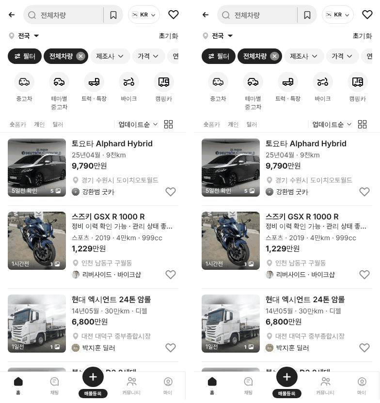
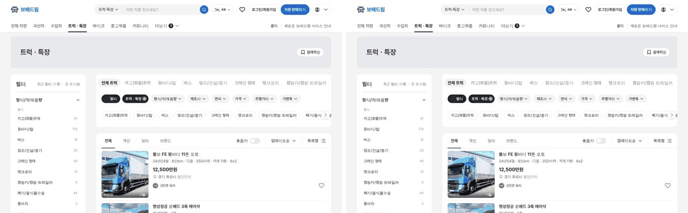
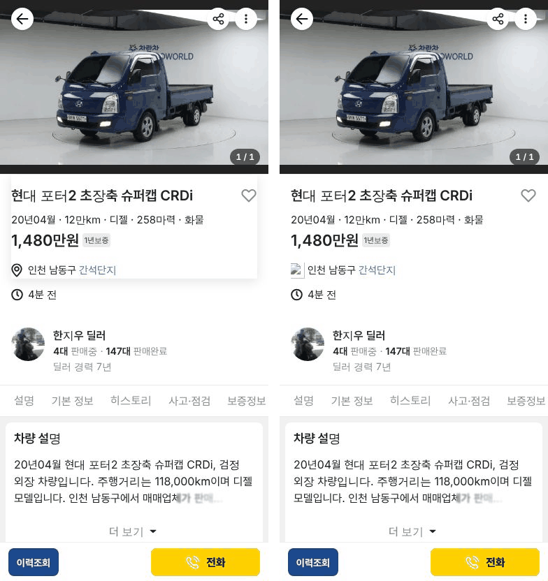

# PR #1063 보고서 — 중고차 목록 · 상세 · 판매자페이지 넉스트 판

## ① 한 줄 요약
중고차 목록 · 매물 상세 · 판매자페이지를 넉스트(Nuxt 3)로 옮겨 `/bobaedream/nuxt/`에 배포했고, 리액트 판과 화면 글자 · 모양이 같습니다.

## ② 과제 · 브랜치 · 커밋 · 상태
- 과제 ID: 없음(사용자 지시 「우리 중고차 리스트 등 모두 넉스트로」)
- 브랜치: `feat/nuxt-site-1028`
- 병합 커밋: `abf8886` (PR https://github.com/bobaekimboae/bobaedream/pull/1063)
- 상태: 병합 · 배포 완료, 배포 v값 `dffb7de`
- 같이 main에 들어간 것: 보고서 PR #1058 · #1060 · #1062

## ③ 한 일
- `nuxt-site/` 폴더에 넉스트 앱을 만들었습니다(Nuxt 3.21 · Vue 3.5).
- 데이터 · 계산 함수 · CSS는 복사하지 않고 리액트 파일을 그대로 불러옵니다. 리액트 쪽을 고치면 넉스트에도 자동으로 들어갑니다.
- 화면 부품 약 250개를 Vue로 옮겼습니다. 큰 화면(목록 · 판매자페이지 · 숏폼 제작기)은 리액트와 줄 단위로 대조할 수 있는 방식으로 옮겼습니다.
- 리액트 판(`/bobaedream/`)은 그대로 둡니다. 옮기는 동안 둘 다 볼 수 있습니다.
- 배포 설정은 바꾸지 않았습니다. 넉스트 결과물을 `public/nuxt/`에 넣어 기존 배포에 같이 올라갑니다.

## ④ 원본과 비교
| 화면 | 보이는 글자 | 화면 차이(픽셀) |
|---|---|---|
| 모바일 목록 `?qf=guazi` | 같음 | 0.00% |
| PC 목록 `&pc=1` | 같음 | 0.00% |
| 수입차 · 바이크 · 트럭 PC | 같음 | 0.00% |
| 피드 보기 `&view=feed` | 같음 | 0.00% |
| 매물 상세 | 같음 | 0.00% |
| 판매자페이지 · 명함 | 같음 | 0.00% |

배포본에서도 리액트 · 넉스트 글자를 다시 맞춰 봤고 3개 화면 모두 같았습니다.

왼쪽 리액트 | 오른쪽 넉스트:

## ⑤ 검증
- `npm run verify:qf` 통과, 넉스트 자체 타입 오류 0, `nuxt generate` 성공
- 누르는 흐름(제조사 → 전체 필터 → 정렬 → 매물 → 상세 → 뒤로) 모바일 · PC 같음
- 배포본 콘솔 오류: 모바일 목록 · PC 목록 · 판매자페이지 · 상세 모두 0, 깨진 파일(404) 0
- 퀵필터 규격(레일 96 · 카드 80×72 · 이미지 56×28 · 트림 칩 32 · 선택지 303개 · 시트 마감 6 · 광고기간 「전체」)은 리액트 CSS를 그대로 쓰므로 리액트와 같습니다.

## ⑥ 원본과 다르게 남긴 것
- 아이콘 클래스 이름 끝 빈칸 하나(리액트 `"bb-icon "` / 넉스트 `"bb-icon"`). 화면 차이는 없습니다.

## ⑦ 못 한 것 · 다음에 할 것
- 아직 리액트에만 있는 화면: 메인 홈, 매물 등록, 커뮤니티. 다음에 같은 방식으로 옮깁니다.
- 리액트 화면 부품을 고치면 짝이 되는 넉스트 부품도 같이 고쳐야 합니다(규칙: `nuxt-site/CONVENTIONS.md`).

## ⑧ 확인 링크
- 넉스트 모바일: https://bobaekimboae.github.io/bobaedream/nuxt/?qf=guazi&v=dffb7de
- 넉스트 PC: https://bobaekimboae.github.io/bobaedream/nuxt/?qf=guazi&v=dffb7de&pc=1
- 리액트 비교: https://bobaekimboae.github.io/bobaedream/?qf=guazi&v=dffb7de
