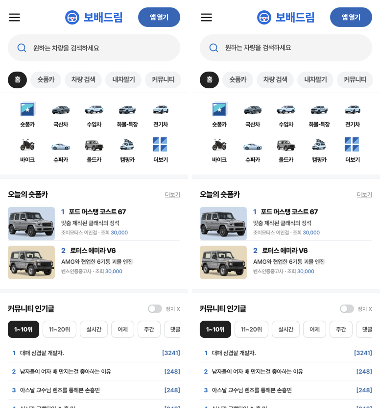
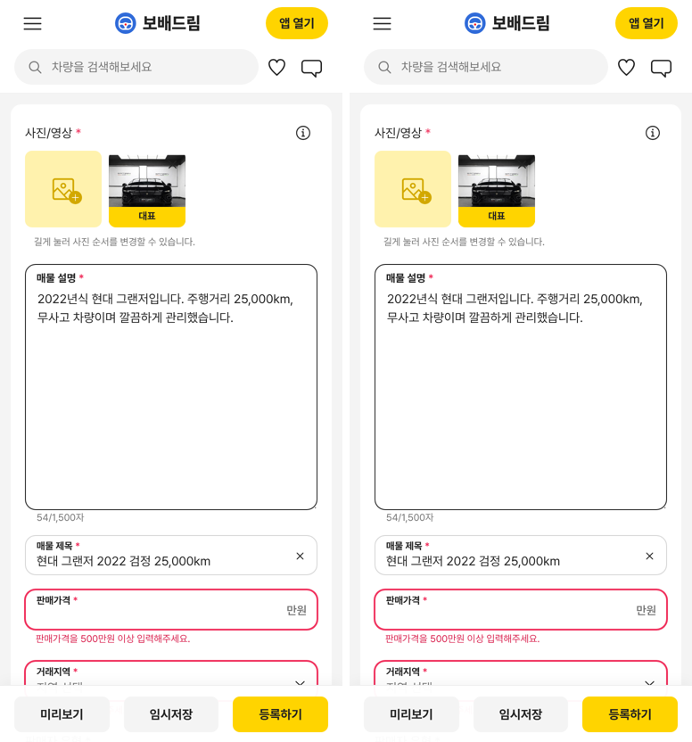

# PR #1065 보고서 — 넉스트 사이트 2차(메인 · 등록 · 촬영 · 커뮤니티)

## ① 한 줄 요약
메인 홈 · 중고차/바이크 매물 등록 · 58 촬영 · 간편 촬영 · 커뮤니티 차량 후기 · 연비 화면을 넉스트 사이트(`/nuxt/`)로 옮겼다.

## ② 과제 · 브랜치 · 커밋 · 상태
- 과제 ID: 없음(사용자 지시 「다음 화면도 옮겨」)
- 브랜치: `feat/nuxt-site-2-1028` · PR: https://github.com/bobaekimboae/bobaedream/pull/1065
- 병합 커밋: `9345722` · 배포 v=9345722
- 이번 병합으로 main에 함께 들어간 과제: PR #1069(임시저장, 바로 앞 병합)

## ③ 한 일
- 메인 홈, 중고차 등록(`?register`), 바이크 등록(`=bike`), 58 촬영(`=shoot`, 숏폼 스튜디오 포함), 간편 촬영(`=shootsimple`), 커뮤니티 차량 후기 · 연비를 넉스트로 옮겼다.
- 주소 고르는 순서는 리액트 `src/Prototype.tsx`와 같다. `?register=shootkit`은 넉스트 촬영 키트(`/nuxt-shootkit/`)로 넘긴다.
- 데이터 · 계산 · CSS는 리액트 파일을 그대로 불러오고(`@proto`), 화면 부품만 Vue로 옮겼다.
- 병합 전 main과 기준 문서 한 줄이 겹쳐 두 줄 모두 남기고 합쳤다.

## ④ 원본과 비교
| 화면 | 글자 · 요소 | 화면 차이 |
|---|---|---|
| 22개 주소(모바일 · PC) | 리액트와 같음 | 0.00%(간편 촬영 0.02%, 공백 한 칸) |

## ⑤ 검증
- `npm run verify:qf` 통과.
- 배포본: 메인 · 목록 · 등록 · 바이크 등록 · 간편 촬영 · 연비 6개 주소 모두 콘솔 오류 0, `?register=shootkit` → `/nuxt-shootkit/` 이동 확인.

## ⑥ 원본과 다르게 남긴 것과 이유
- 리액트 판 PC 성능점검 기록부 창의 선택 표시가 바뀌지 않는 문제를 넉스트도 같게 둠(두 판 동작 일치).

## ⑦ 못 한 것 · 다음에 할 것
- `/bike/` · `/truck/` · `/shoot/` 독립 진입점은 아직 리액트.
- 58 촬영 영상 단계는 리액트에서도 닿지 않는 화면이라 비교하지 못함.

## ⑧ 확인 링크
- 넉스트 메인: https://bobaekimboae.github.io/bobaedream/nuxt/?v=9345722
- 넉스트 목록 모바일: https://bobaekimboae.github.io/bobaedream/nuxt/?qf=guazi&v=9345722
- 넉스트 목록 PC: https://bobaekimboae.github.io/bobaedream/nuxt/?qf=guazi&v=9345722&pc=1
- 넉스트 등록: https://bobaekimboae.github.io/bobaedream/nuxt/?register&v=9345722
