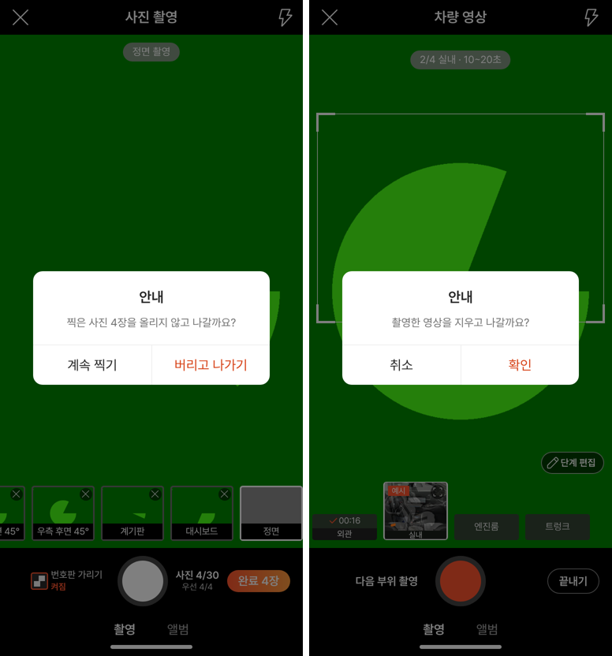
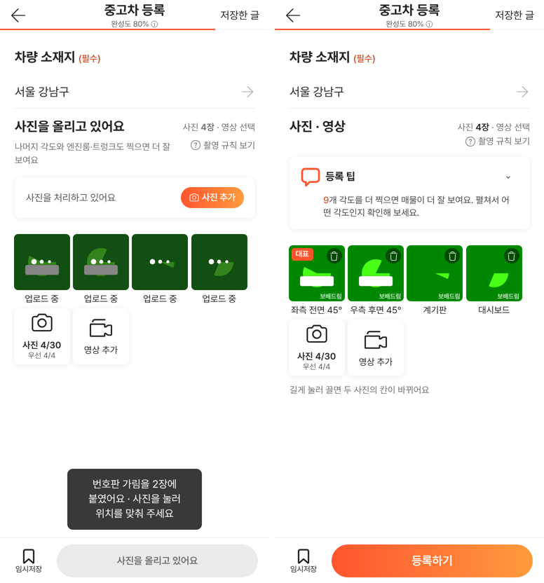
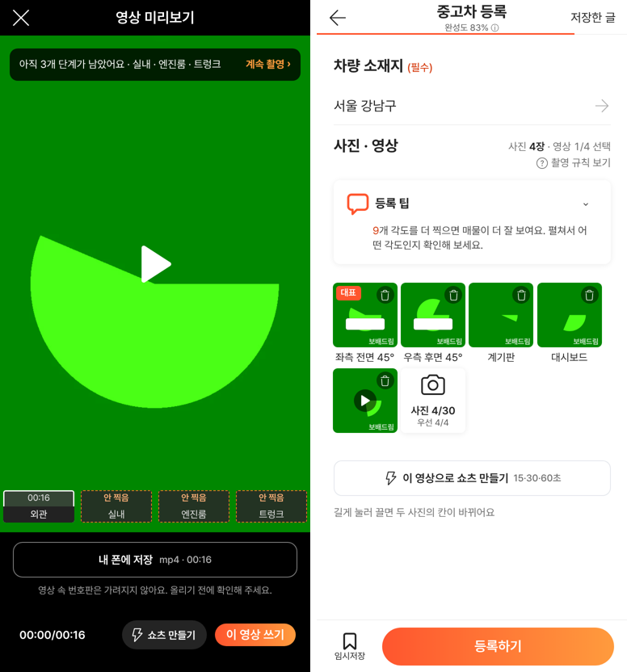
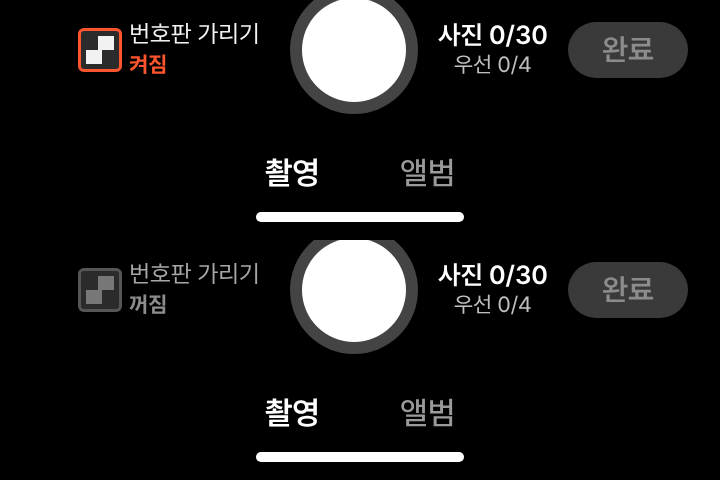

# PR #1067 보고서 — 촬영 쇼츠 키트 넉스트 단일화 · 컨설팅 4건 종합 반영

## ① 한 줄 요약
넉스트 촬영 쇼츠 키트에 컨설팅 4건(+자체 컨설팅)을 판단해 반영했고, 앞으로 촬영 키트는 넉스트 판만 고친다.

## ② 과제 · 브랜치 · 커밋 · 상태
- 과제 ID: 없음(사용자 지시 「니가 판단하고 고쳐라」 · 「넉스트 하나만 가자」)
- 브랜치: `fix/shootkit-consult-1029`
- PR: https://github.com/bobaekimboae/bobaedream/pull/1067
- 병합 커밋: `97197fa` · 상태: 병합 · 배포 완료(v=97197fa)
- 이번 병합으로 main에 함께 들어간 과제: 없음(PR #1065 넉스트 사이트 2차는 아직 병합 전)

## ③ 한 일
- 휴대폰 뒤로가기로 찍은 사진·영상이 사라지던 것을 막았다. 촬영 중이면 「찍은 사진 N장을 올리지 않고 나갈까요?」, 등록 화면에 내용이 있으면 「나갈까요?」, 내용이 없으면 그대로 나간다.
- 넉스트 기본 처리가 뒤로가기마다 주소를 두 겹(`/nuxt-shootkit/bobaedream/nuxt-shootkit/`)으로 만들던 문제를 머리 스크립트로 먼저 받아 막았다.
- 영상 번호판 안내, 좌우 칸 「확인」 딱지, 첫 화면 미리 받기 끄기(첫 화면 JS 약 327KB), 탭 제목, 홈 화면 설치 정보와 서비스 워커.
- 등록 화면 「이 영상으로 쇼츠 만들기」, 계정 직접 연결(흉내)은 `?debug=1`만, 번호판 가리기 켜짐/꺼짐, 완료 막힘 회색.
- 미리보기 저장 버튼 겹침, 외관 볼 때 실내 칩, 「bb」 자리 글자, 알림 위치, 임시저장 아이콘, VP9 문구.

## ④ 원본과 비교(동작 점검표)
| 항목 | 작업 전 | 작업 후 |
|---|---|---|
| 촬영 중 뒤로가기 | 사진 4장 사라짐 | 확인창 「찍은 사진 4장을 올리지 않고 나갈까요?」 |
| 등록 화면 뒤로가기(내용 있음) | 바로 나감 | 「나갈까요?」 |
| 뒤로가기 뒤 주소 | — | 두 겹 없음 |
| 첫 화면 미리 받기 | 조각 5개 미리 받음 | 0개 · 첫 화면 JS 327KB |
| 영상 번호판 안내 | 없음 | 저장 버튼 아래 · 저장 창 |
| 미리보기 위 저장 버튼 | 아래 큰 버튼과 중복 | 부위 여럿일 때만 「부위별」 |

## ⑤ 검증
- `npm run verify:qf` 통과, `npx vue-tsc --noEmit` 통과.
- 배포본 자동 시험(가짜 카메라 384×832): 위 점검표 모두 통과, 같은 사이트에서 왔으면 뒤로가기로 실제로 나감, 58 재현(`&vstage=58`)은 뒤로가기 막이 없음, 규칙 화면 360×640에서 마지막 항목 안 가림.
- 콘솔 오류: 모바일 0. 이 작업은 퀵필터를 바꾸지 않아 measure:qf 해당 없음.

## ⑥ 원본과 다르게 남긴 것과 이유
- 「기본 화면 필수 문구」·「차량 인증 버튼」 지적은 58 재현 화면에만 있는 것이라 그대로 둠.
- 외관 15~30초는 어느 코스든 외관 단계 값이라 그대로 둠.
- 쇼츠를 H.264로 대신 만들기는 서버가 없어 불가능 → 경고 문구로 안내.
- 리액트 판(`?register=shootkit`)은 고치지 않음(넉스트 단일화).

## ⑦ 못 한 것 · 다음에 할 것
- 임시저장을 실제로 보관했다가 다시 여는 기능(지금은 안내만).
- 실제 아이폰·안드로이드에서 뒤로가기 · 홈 화면 설치 확인.
- 탭 닫기는 브라우저 기본 경고만(촬영 창 안 사진은 보호 안 됨).

## ⑧ 확인 링크
- 촬영 쇼츠 키트(넉스트): https://bobaekimboae.github.io/bobaedream/nuxt-shootkit/?v=97197fa
- 58 재현: https://bobaekimboae.github.io/bobaedream/nuxt-shootkit/?vstage=58&v=97197fa
- 모바일: https://bobaekimboae.github.io/bobaedream/?qf=guazi&v=97197fa
- PC: https://bobaekimboae.github.io/bobaedream/?qf=guazi&v=97197fa&pc=1
