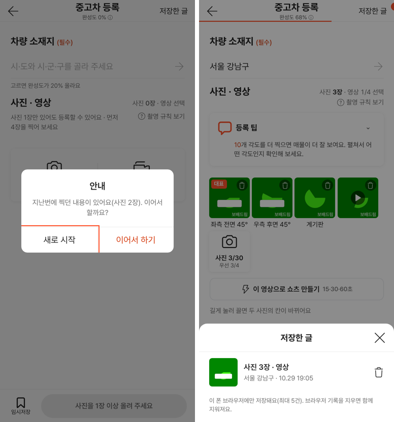

# PR #1069 보고서 — 촬영 쇼츠 키트 임시저장 실제 보관

## ① 한 줄 요약
넉스트 촬영 쇼츠 키트에서 임시저장이 실제로 폰에 보관되고, 「저장한 글」에서 다시 열며, 지난번 작업을 이어서 할 수 있다.

## ② 과제 · 브랜치 · 커밋 · 상태
- 과제 ID: 없음(사용자 지시 「수정하고 병합해라」)
- 브랜치: `fix/shootkit-drafts-1029` · PR: https://github.com/bobaekimboae/bobaedream/pull/1069
- 병합 커밋: `427def6` · 배포 v=9345722(PR #1065와 같은 배포)
- 이번 병합으로 main에 함께 들어간 과제: PR #1065 넉스트 사이트 2차(바로 뒤 병합)

## ③ 한 일
- 「임시저장」·「저장하고 나가기」가 사진·영상·소재지를 이 폰 브라우저(IndexedDB)에 최대 5건 담는다. 서버로는 보내지 않는다.
- 머리 오른쪽 「저장한 글」을 누르면 목록 시트가 뜨고, 골라서 열거나 지울 수 있다. 하던 작업이 있으면 먼저 저장한 글에 담는다.
- 작업이 바뀌면 자동으로 보관해, 탭을 닫거나 폰이 꺼져도 다음에 열 때 「이어서 할까요?」를 묻는다(아이폰 대비).
- 「저장 안 함」으로 나가면 자동 보관도 지워 다시 묻지 않는다.

## ④ 원본과 비교(동작 점검표)
| 항목 | 작업 전 | 작업 후 |
|---|---|---|
| 임시저장 | 안내만 | 실제 보관(최대 5건) |
| 저장한 글 | 「시안에서 열지 않아요」 | 목록 · 열기 · 지우기 |
| 탭 닫기 · 새로고침 뒤 | 모두 사라짐 | 「이어서 할까요?」 → 사진 · 영상(재생됨) · 소재지 복원 |

## ⑤ 검증
- `npm run verify:qf` 통과, `vue-tsc` 통과.
- 배포본 자동 시험(가짜 카메라 384×832): 사진 3장 + 영상 16초 임시저장 → 새로고침 → 이어서 하기 → 사진 3장 · 영상(16초 재생) · 서울 강남구 복원, 저장한 글 열기 · 지우기, 「저장 안 함」 뒤 다시 묻지 않음, 뒤로가기 회귀 통과, 콘솔 오류 0.
- 퀵필터 변경 없음(measure:qf 해당 없음).

## ⑥ 원본과 다르게 남긴 것과 이유
- 저장 위치는 이 폰 브라우저뿐(서버 없음). 다른 폰·PC에서는 보이지 않는다.
- 58 재현(`&vstage=58`)은 그대로.

## ⑦ 못 한 것 · 다음에 할 것
- 실제 폰에서 큰 영상(1분 이상) 저장 용량 확인.
- 서버 저장(로그인 계정에 보관)은 개발 단계 과제.

## ⑧ 확인 링크
- 촬영 쇼츠 키트: https://bobaekimboae.github.io/bobaedream/nuxt-shootkit/?v=9345722
- 모바일: https://bobaekimboae.github.io/bobaedream/?qf=guazi&v=9345722
- PC: https://bobaekimboae.github.io/bobaedream/?qf=guazi&v=9345722&pc=1
