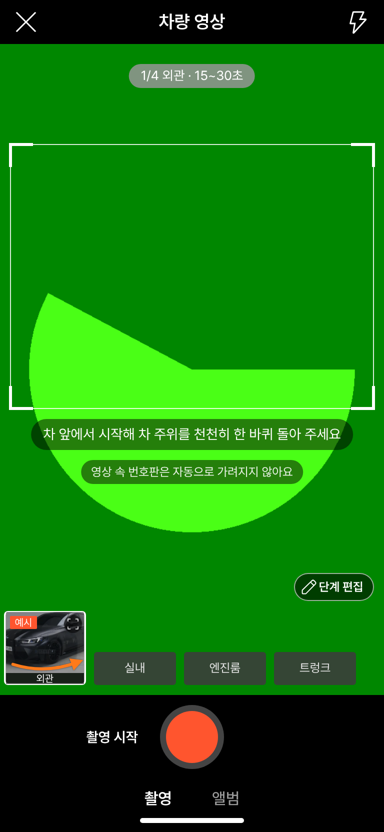
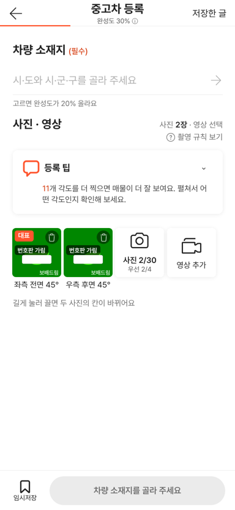
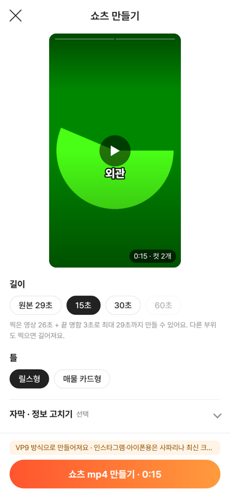

# PR #1071 — 촬영 쇼츠 키트 컨설팅 P0 (글꼴 · 번호판 · 흠집 문구)

## ① 한 줄 요약
처음 열 때 받는 글꼴을 3.1MB에서 약 226KB로 줄였습니다. 영상 번호판 안내, 사진 칸 「번호판 가림」 표시, 흠집 문구 정리를 넣었습니다.

## ② 과제 · 브랜치 · 커밋 · 상태
- 과제: 2026-10-29 노션 「촬영 기트 의견」 컨설팅 P0 (과제 ID 없음)
- 브랜치: `nuxt-shootkit-p0-font-plate` · 커밋 `1b7fb613`
- PR: https://github.com/bobaekimboae/bobaedream/pull/1071
- 상태: 병합 · 배포 완료 (v=ec0d6e0, 번들 assets/main-CmxMF7EF.js)

## ③ 한 일
1. 글꼴: jsdelivr Pretendard 굵기별 전체본 4개 대신 사이트 공용 Pretendard Variable 조각본을 붙였습니다. 화면에 쓰는 글자의 조각만 받습니다.
2. 쇼츠 그림판(캔버스)은 그리기 전에 자막 글자를 먼저 받아, 다른 글꼴로 그려지지 않게 했습니다.
3. 외관 · 흠집 표시 · 타이어 · 휠 단계 녹화 전에 「영상 속 번호판은 자동으로 가려지지 않아요」를 보여 줍니다.
4. 번호판 가림이 붙은 사진 칸 왼쪽 위에 「번호판 가림」 표시를 남깁니다.
5. 「흠집 공개」를 「흠집 표시」로, 코스 안내는 「판매자가 표시한 흠집 N곳」으로 바꿨습니다(법무 확인 전 임시안).

## ④ 원본과 비교
| 항목 | 전 | 후 |
| --- | --- | --- |
| 첫 화면 글꼴 | 4개 · 약 3.1MB | 9조각 · 약 226KB |
| 영상 화면 번호판 안내 | 없음 | 바깥 단계 녹화 전 한 줄 |
| 사진 칸 번호판 가림 표시 | 흰 판만 | 「번호판 가림」 표시 |
| 흠집 문구 | 흠집 공개 N곳 | 흠집 표시 N곳 / 판매자가 표시한 흠집 N곳 |

  

## ⑤ 검증
- `npm run verify:qf` 통과
- 로컬 384px 가짜 카메라: 404 0, 콘솔 오류 0, 뒤로가기 · 임시저장 회귀 통과
- 쇼츠 미리보기 한글이 Pretendard로 그려짐
- 퀵필터 규격 측정은 해당 없음(촬영 키트만 변경)

## ⑥ 원본과 다르게 남긴 것
- 녹화 중에는 번호판 안내를 숨깁니다. 안내 글자가 화면을 가리지 않게 하려는 것입니다.

## ⑦ 못 한 것 · 다음
- 영상 번호판 자동 가림, H.264 서버 변환(서버 필요)
- 실제 폰 2대 시험
- 흠집 문구 법무 확인

## ⑧ 확인 링크
- 배포본: https://bobaekimboae.github.io/bobaedream/nuxt-shootkit/?v=ec0d6e0 (배포본에서 글꼴 226KB · 표시 2개 · 안내 문구 · 오류 0 재확인)
