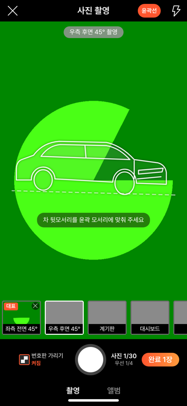
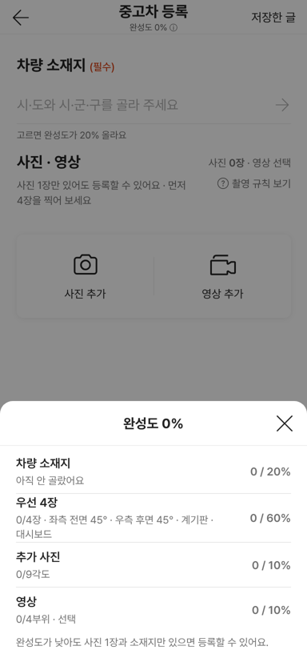

# PR #1073 — 촬영 쇼츠 키트 컨설팅 8건 크로스체크 P0

## ① 한 줄 요약
윤곽선 안내를 기본으로 켜고, 수평계를 떼어 아이폰 권한을 붙였습니다. 녹화 글자·촬영 탭·완성도 ⓘ의 누르는 곳을 44px로 넓히고, 완성도는 항목별 점수 시트로 바꿨습니다.

## ② 과제 · 브랜치 · 커밋 · 상태
- 과제: 노션 「촬영 기트 의견」 컨설팅 8건 크로스체크 P0 (과제 ID 없음)
- 브랜치: `nuxt-shootkit-p0-guide-touch` · 커밋 `a220da4b`
- PR: https://github.com/bobaekimboae/bobaedream/pull/1073
- 상태: 푸시 완료, 병합 승인 대기

## ③ 한 일
1. 사진 촬영 윤곽선 안내를 처음부터 켭니다(머리줄 「윤곽선」으로 끄고 켬, `?guide=off`면 끔).
2. 수평계를 윤곽선에서 떼어 따로 보입니다. 아이폰은 화면을 처음 누를 때 기울기 권한을 묻습니다.
3. 녹화 버튼 옆 글자(「촬영 시작」 등)를 눌러도 녹화가 시작됩니다.
4. 촬영·앨범 탭의 누르는 곳을 44×44로 넓혔습니다.
5. 완성도 ⓘ: 누르는 곳 높이 44, 누르면 항목별 점수 시트가 열립니다.

## ④ 원본과 비교
| 항목 | 전 | 후 |
| --- | --- | --- |
| 윤곽선 | `?guide=on`일 때만 | 기본 켜짐 |
| 수평계 | 윤곽선 안(같이 꺼짐), 아이폰 안 나옴 | 따로, 아이폰 권한 요청 |
| 녹화 버튼 옆 글자 | 눌러도 반응 없음 | 버튼과 같이 동작 |
| 촬영·앨범 탭 | 28×40 | 44×44 |
| 완성도 ⓘ | 60×13 + 알림 한 줄 | 누르는 곳 높이 44 + 점수 시트 |

 

## ⑤ 검증
- `npm run verify:qf` 통과
- 로컬 384px 가짜 카메라에서 위 5가지를 확인했고 콘솔 오류는 0건입니다.
- `&vstage=58`은 윤곽선 0 · 탭 40으로 그대로입니다.
- 뒤로가기 · 임시저장 회귀 통과
- 퀵필터 규격 측정은 해당 없음(촬영 키트만 변경)

## ⑥ 원본과 다르게 남긴 것
- 58 재현의 탭 높이 40과 윤곽선 꺼짐은 원본 재현이라 그대로 두었습니다.

## ⑦ 못 한 것 · 다음
- 수평계·아이폰 권한은 실제 폰에서 확인이 필요합니다(가짜 카메라에는 기울기 센서가 없음).
- 번호판 기본값(딜러 노출 / 개인 가림)은 사용자 결정 대기입니다.
- 다음: 품질 검사, 역할 설정, 딜러 빠른 경로, 경고 문구 정리, 45° 윤곽 다시 그리기.

## ⑧ 확인 링크
- 배포 후: https://bobaekimboae.github.io/bobaedream/nuxt-shootkit/?v=<커밋>
