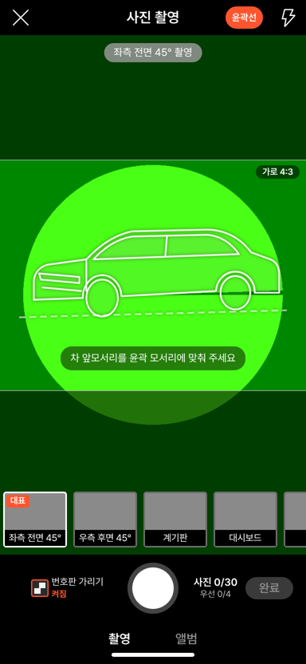
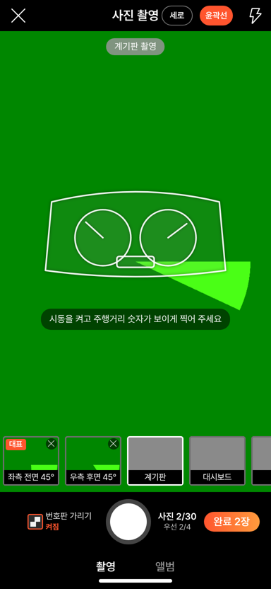
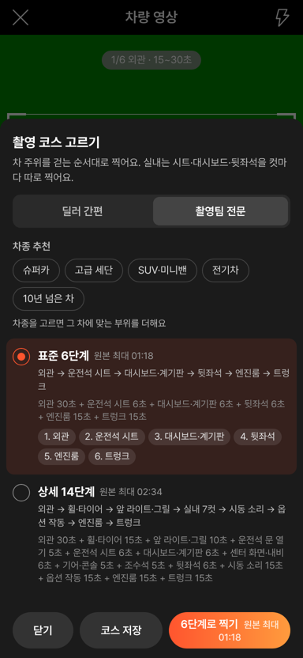
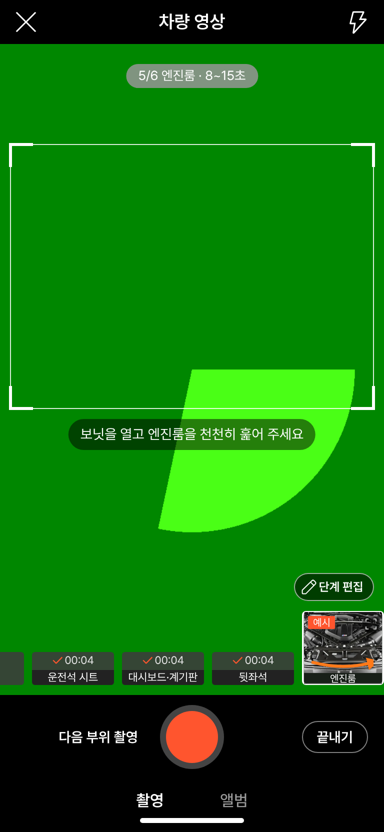
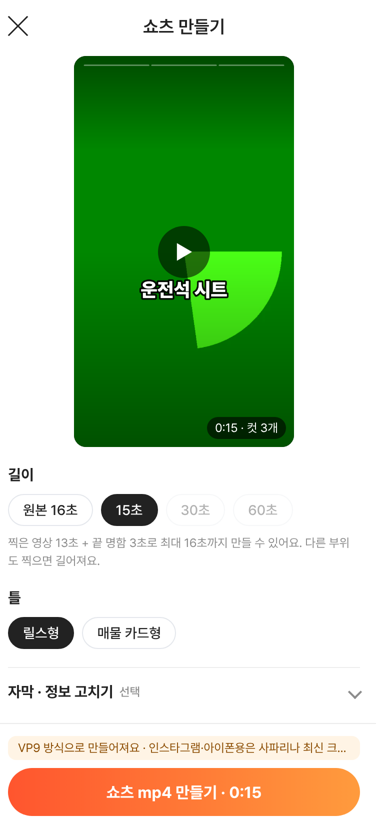

# PR #1074 — 촬영 키트 3차: 부위 컷 마스터 · 사진 가로 기본 · 실내 독립 컷 · 역할 값

## ① 한 줄 요약
3차 컨설팅 판단대로 촬영 항목 JSON을 「부위 컷 마스터」 한 파일로 묶고, 외관·엔진룸·트렁크 사진을 가로 4:3 틀로 보이는 대로 저장하며, 실내 영상을 컷마다 따로 녹화하는 독립 컷으로 바꾸고, `?role=dealer|crew` 역할 값으로 딜러·촬영팀 기본값을 나눴다.

## ② 과제 · 브랜치 · 커밋 · PR · 상태
- 과제: 3차 컨설팅 후속 PR ①(노션 「3차 촬영 의견 키트」 클로드코드 판단 1번)
- 브랜치 `nuxt-shootkit-cut-master` · 커밋 71b106a1(+ 보고서 커밋)
- PR https://github.com/bobaekimboae/bobaedream/pull/1074 · 푸시(병합 대기)

## ③ 한 일
- `nuxt-shootkit/data/shoot-items-kit.json` v2: 역할(`roles`), 그룹 사진 방향(`orientation`), 실내 독립 컷 9개(`video.cuts`, 같은 부위 사진 칸과 `item`으로 연결), 역할별 코스(`video.courses`), 추가 부위 정리(시트 → 컷, 휠·브레이크 + 타이어 → 「휠·타이어」, 「앞 라이트·그릴」 · 「뒤 라이트·배기」 · 「미러·도어 핸들」 추가), 쇼츠 `hookDefault` 삭제.
- 사진 촬영: 외관·엔진룸·트렁크 칸은 화면 가운데 가로 4:3 틀(틀 밖 55% 어둡게, 「가로 4:3」 표시, 윤곽선은 틀 안). 저장 사진 = 틀 안(그 밖의 칸은 보이는 영역) — 보이는 구도와 저장 구도가 같아졌다. 촬영팀만 머리줄 「가로/세로」로 지금 칸의 방향을 바꾼다.
- 영상 촬영: 딜러 기본 「표준 6단계」(외관 → 운전석 시트 → 대시보드·계기판 → 뒷좌석 → 엔진룸 → 트렁크). 컷마다 녹화 → 자동 멈춤 → 다음 컷. 코스 창은 딜러 2개(빠른·표준), 촬영팀 3개(표준·상세 14단계·직접 고르기).
- 역할 값: `?role=dealer|crew`가 코스 창의 「딜러 간편 / 촬영팀 전문」을 맞추고 이 브라우저에 기억한다(등록 화면 `data-role`).
- 완성도의 영상 점수는 그룹 기준으로(실내 컷 3개 = 실내 1/4).
- 58 재현(`&vstage=58`)은 그대로.

## ④ 원본과 비교
촬영 키트는 58 원본 비교 대상이 아니라(키트 전용 화면) 영역별 차이 비율은 없음. 58 재현 화면(`&vstage=58`)은 변경 0(틀 없음 · 전체 프레임 1600×900 · 4단계 · 역할 없음 확인).

| 동작 | 전 | 후 |
| --- | --- | --- |
| 외관 사진 | 세로 전체 프레임 저장 | 가로 4:3 틀 안 저장(가짜 카메라 637×478, 실제 폰 세로 1080×1920 → 1080×810) |
| 계기판 사진 | 세로 전체 프레임 | 세로, 보이는 영역 |
| 촬영팀 방향 전환 | 없음 | 머리줄 「가로/세로」 |
| 영상 기본 | 4단계(실내 한 파일) | 6단계(실내 3컷 따로) |
| 코스 창 | 3코스 공통 | 딜러 2 · 촬영팀 3 |

    

## ⑤ 검증
- `npm run verify:qf` 통과, `nuxt typecheck` 통과.
- 폭 384 가짜 카메라(헤드리스): 딜러 — 외관 칸 틀 384×288, 전환 버튼 없음, 저장 4:3; 촬영팀(`?role=crew`) — 전환 버튼 「가로」→「세로」 동작; 영상 기본 6단계, 실내 3컷 녹화(각 4초) → 끝내기 → 미리보기 → 표지 → 등록 화면 「영상 1/4」 → 쇼츠 컷 3개(0:15); 58 재현 그대로; 뒤로가기·임시저장 회귀 통과; 콘솔 오류 0.
- 퀵필터 규격(레일 96 · 카드 80×72 · 이미지 56×28 · 트림 칩 32)은 이 PR과 무관(촬영 키트만 변경).

## ⑥ 원본과 다르게 남긴 것과 이유
- 사진 가로는 폰을 세로로 든 채 틀 안을 자르는 방식(폰을 눕히는 가로 화면은 아직 없음). 세로 스트림이라 긴 변 1080이지만 매물 목록·상세 썸네일에는 충분. 폰을 눕히는 방식은 다음에.
- 쇼츠용 세로 사본 파일은 따로 만들지 않고 그리기에서 자르기·이동으로 처리(`Photo.orient`만 남김).
- 외관 영상은 한 바퀴 한 컷 그대로(실내만 독립 컷). 외관 4컷 분할은 다음에.

## ⑦ 못 한 것 · 다음에 할 것
- 실제 아이폰·안드로이드에서 가로 틀 저장 크기 · 수평계 확인.
- 2차 후속 ②~⑥: 컷별 음성·글 메모, 사진 쇼츠 3종, 촬영 화면 그룹 탭, 중복 정리.
- 결정 대기: 번호판 기본값 · 뒤 대각 30° · 가상 배경 · 딜러 음성 공개 · 음악.

## ⑧ 확인 링크(병합·배포 후 `&v=<커밋>`)
- 촬영 키트: https://bobaekimboae.github.io/bobaedream/nuxt-shootkit/?v=<커밋>
- 촬영팀: `&role=crew` · 58 재현: `&vstage=58`
- 모바일 `?qf=guazi&v=<커밋>` · PC `?qf=guazi&v=<커밋>&pc=1`(변경 없음)
