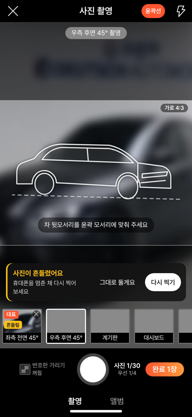
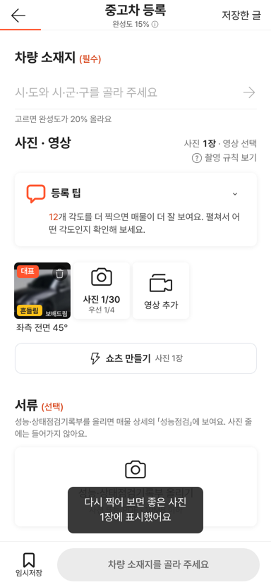

# PR #1088 촬영 키트 촬영 후 품질 검사

① 한 줄 요약: 찍은 사진이 흔들리거나 어둡거나 빛이 날아가면 바로 알려 다시 찍게 한다(사진은 고치지 않음).

② 과제 ID 없음 · 브랜치 `shootkit-photo-qc` · PR https://github.com/bobaekimboae/bobaedream/pull/1088 · 상태: 병합 · 배포(v값은 채팅 보고)

③ 한 일
- `nuxt-shootkit/lib/quality.ts`: 사진을 320px로 줄여 평균 밝기 · 아주 어두운 점 · 하얗게 날아간 점 · 가장자리 세기(라플라시안 분산)를 잰다. 폰 안에서만, 서버 전송 없음.
- 사진 촬영 화면: 문제가 있으면 칸 줄 위에 알림 카드(`그대로 둘게요` / `다시 찍기`). 다시 찍기는 그 칸으로 돌아간다. 칸에 노랑 딱지(흔들림 · 어두움 · 빛 번짐).
- 등록 화면: 사진 칸에 같은 딱지, 「다시 찍어 보면 좋은 사진 N장에 표시했어요」 한 번. 앨범 사진도 검사(딱지만).
- 해외 촬영앱(Spyne · CarCutter) 비교 분석 1순위 과제.

④ 원본과 비교: 해당 없음(새 기능). 58 재현(`&vstage=58`)은 변경 없음.

⑤ 검증
- 실매물 사진 60장: 원본 잘못 표시 0/60, 강하게 흐린 사본 54/60, 어둡게 한 사본 57/60, 밝게 날린 사본 47/60.
- 가짜 카메라(흐린 사진 · 선명한 사진)로 384px 실제 촬영: 흐린 사진만 카드 · 딱지 · 알림, 선명한 사진은 없음. 콘솔 오류 0.
- `nuxt generate` 성공.

 

⑥ 다르게 남긴 것: 차가 틀 밖으로 잘렸는지는 재지 않는다(차 위치 인식 필요).

⑦ 다음: 약한 손떨림은 거의 못 잡는다(1/60) → 실제 폰 사진으로 기준 다시 맞추기. 번호판 자동 인식 가림(2순위).

⑦-2 배포: 첫 병합에 빌드 결과(public/nuxt-shootkit) 복사가 빠져 후속 PR로 올렸다.

⑧ 확인 링크: https://bobaekimboae.github.io/bobaedream/nuxt-shootkit/
