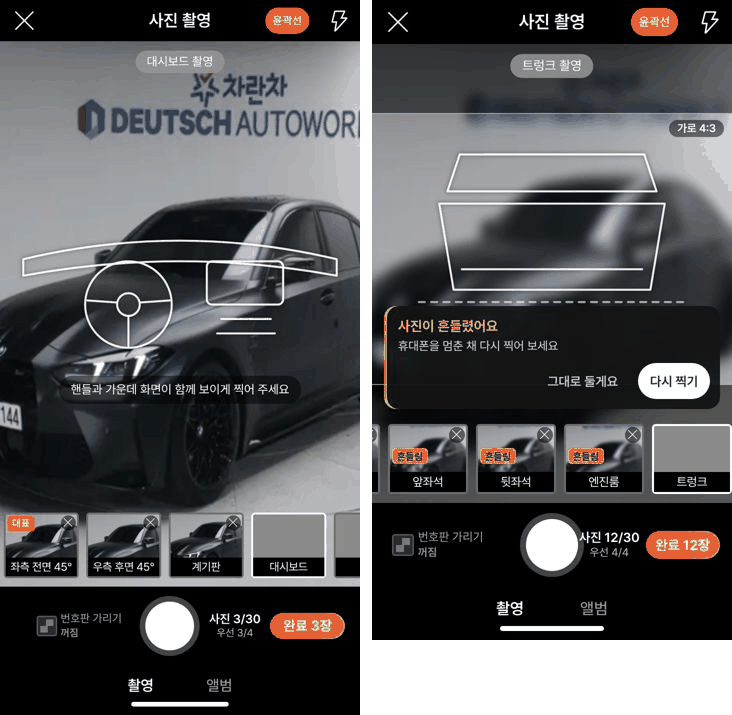
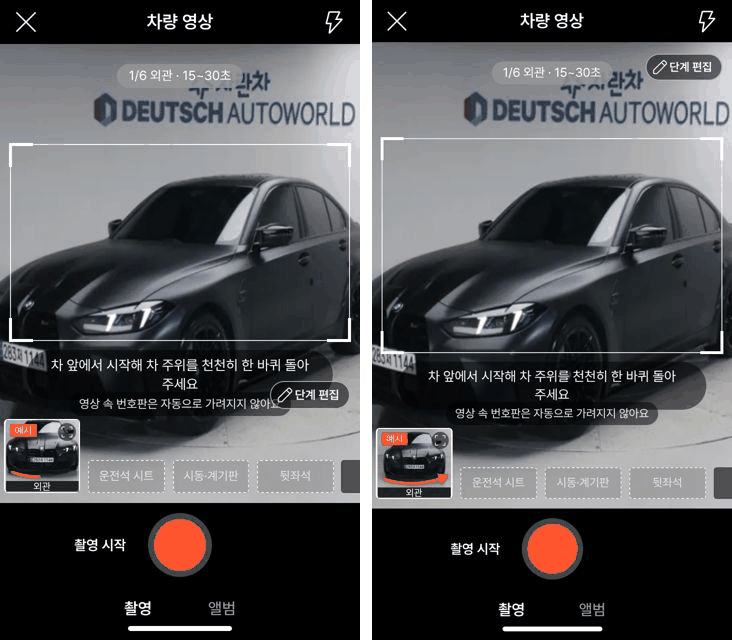

# PR #1091 촬영 키트 50배 크로스체크

① 한 줄 요약: 촬영 키트를 50배 강한 기준으로 다시 써 보고 코드를 따로 검수했습니다. 임시저장이 통째로 실패하던 것을 포함해 실제로 깨지던 16가지를 고쳤습니다.

② 과제 · 브랜치 · 커밋 · PR · 상태
- 과제: 「50배 강화된 기준으로 촬영 키트 크로스체크 및 기능 점검」(과제 번호 없음)
- 브랜치: `shootkit-audit-50x` · 커밋 `29316361`
- PR: https://github.com/bobaekimboae/bobaedream/pull/1091
- 상태: 병합 · 배포 v=1ad4a66 (번들 `_nuxt/D5TUkCUi.js`)
- 함께 들어간 과제: 없음

③ 한 일
- **가장 큰 문제 — 임시저장 실패:** 품질 검사 결과가 붙은 사진이 있으면 자동 보관과 임시저장이 `DataCloneError`로 실패했습니다. 화면 상태 배열을 그대로 저장소에 넣은 탓입니다. 이제 넣기 전에 일반 배열로 바꿉니다.
- **사진 미리보기:**
  - 「완료」를 누르면 품질 딱지, 가로 사진 표시, 「번호판 가림」 표시가 사라지던 것을 고쳤습니다.
  - 올리는 중인 사진이 「업로드 중」으로 계속 남던 것을 고쳤습니다.
  - 사진을 바꾸거나 편집하면 품질 검사를 다시 잽니다.
- **저장한 글:**
  - 올리는 중에 다른 글을 열면 하던 작업이 덮어써지던 것을 고쳤습니다.
  - 5건이 차 있을 때 손대지 않은 글이 지워지던 것을 고쳤습니다.
  - 소재지와 점검기록부만 쓴 작업이 사라지던 것을 고쳤습니다.
- **카메라 권한 화면:** 닫기·Esc·뒤로가기를 누르면 고른 사진과 찍은 영상이 확인 없이 버려졌습니다. 이제 버리기 전에 묻습니다.
- **화면 배치:**
  - 셔터가 「완료 N장」 버튼에 밀려 가운데에서 8~11px 벗어나던 것을 고쳤습니다.
  - 아이폰 SE와 360×640 화면에서 「단계 편집」 버튼이 안내 글자를 가리던 것을 고쳤습니다.
- **영상 저장:** 아이폰에서 「내 폰에 저장」이 공유창을 열지 못해 사진첩에 넣을 수 없었습니다. 이제 영상을 다 만든 뒤 「저장하기」를 한 번 더 누르면 공유창이 열립니다.
- **쇼츠:**
  - 영상 편집에서 연 쇼츠에 흠집 수가 빠지던 것을 고쳤습니다.
  - 고친 자막이 갑자기 지워지던 것을 고쳤습니다.
  - 자동 쇼츠가 로고와 시동 소리가 준비되기 전에 만들어지던 것을 고쳤습니다.
  - 쇼츠를 열 때마다 메모리가 쌓이던 것을 고쳤습니다.
- **그 밖:** 촬영 중 단계 편집, 녹화 전 카메라 끊김, 음성 메모가 들어가는 부위, 부위 나누기 닫기 확인, 접근성 이름.

④ 원본(작업 전)과 비교

| 항목 | 작업 전 | 작업 후 |
|---|---|---|
| 자동 보관(품질 검사 결과가 있는 사진) | 실패(DataCloneError) | 저장 후 복원: 사진 12장, 딱지 12개 그대로 |
| 셔터 가운데 어긋남(360, 「완료 12장」) | 8~11px | 0px |
| 375×667에서 「단계 편집」과 안내 글자 | 겹침 | 겹치지 않음(버튼을 위 오른쪽으로 옮김) |
| 미리보기 완료 뒤 품질 딱지 | 사라짐 | 유지 |
| 올리는 중 미리보기 완료 뒤 「업로드 중」 | 계속 남음 | 사라짐 |

⑤ 검증
- `nuxt typecheck`와 `nuxt generate` 빌드를 통과했습니다.
- 퀵필터 화면은 바꾸지 않았으므로 verify:qf와 measure:qf는 대상이 아닙니다.
- 실제 화면 시험: Playwright로 가짜 카메라에 선명한 영상과 흔들린 영상을 넣어 돌렸습니다.
  - 화면 폭: 360·375·384·412
  - 시험한 화면: 등록, 사진 촬영, 미리보기, 저장한 글, 이어서 하기, 지역 시트, 완성도, 촬영 규칙, 영상 촬영, 녹화, 부위 나누기
  - 대화창 4개: 포커스가 창 안에 머물고 Esc로 닫히는 것을 확인했습니다.
  - 콘솔 오류: 0
- 58 재현(`&vstage=58`): 품질 검사가 나오지 않고 셔터도 가운데 그대로입니다.

⑥ 원본과 다르게 남긴 것: 키트의 「번호판 가리기」 왼쪽 여백을 26에서 8로 줄였습니다. 셔터를 가운데에 두면서 오른쪽 칸 폭을 확보하려는 것입니다. 58 재현은 그대로입니다.

⑦ 못 한 것 · 다음
- 녹화 영상과 Blob 캐시를 메모리에서 정리하는 일
- mp4를 만들다 오류가 났을 때 정리하는 일
- 앨범에서 고른 사진을 빼도 품질 알림 카드가 남는 것
- 카메라 권한 거절 화면은 시험 브라우저가 권한을 자동으로 허용해 직접 띄우지 못했습니다. 코드로만 확인했습니다.

⑧ 확인 링크: https://bobaekimboae.github.io/bobaedream/nuxt-shootkit/ (58 재현은 `?vstage=58`)
