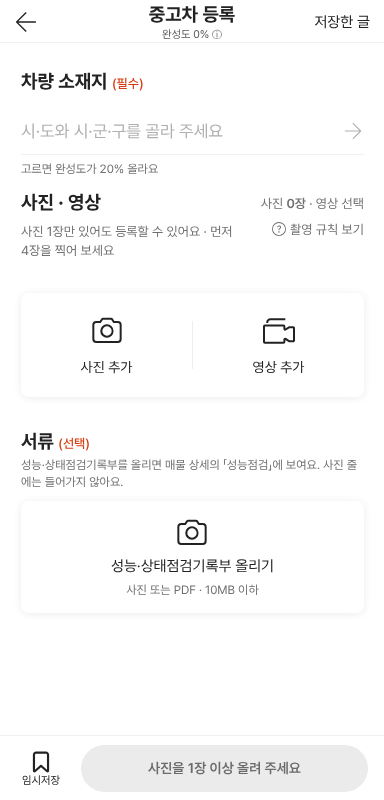
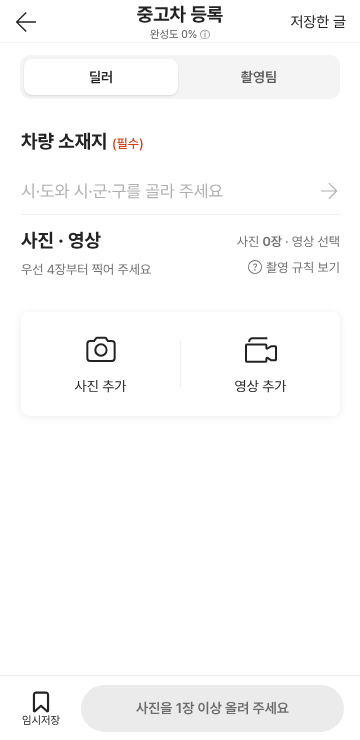
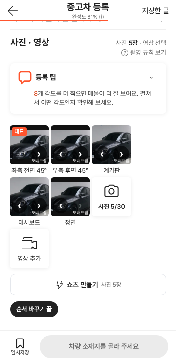

# PR #1093 촬영 키트 상용화 컨설팅 P1 반영

① 한 줄 요약: 클로드코드와 Codex Master의 상용화 컨설팅에서 공통으로 나온 P1 중, 서버 없이 바로 할 수 있는 화면 정리를 반영했습니다.

② 과제 · 브랜치 · 커밋 · PR · 상태
- 과제: 「수정하고 배포해라」(촬영 키트 상용화 컨설팅 P1, 과제 번호 없음)
- 브랜치: `shootkit-p1-polish`
- PR: https://github.com/bobaekimboae/bobaedream/pull/1093
- 상태: 병합 · 배포(v값은 병합 뒤 main 커밋 7자리)
- 함께 들어간 과제: 없음

③ 한 일
- 첫 화면 맨 위에 「딜러 / 촬영팀」 고르기를 두었습니다. 영상 코스 창의 「딜러 간편 / 촬영팀 전문」과 같은 값을 씁니다.
- 딜러의 기본 영상 코스를 표준 6단계에서 빠른 3단계(외관 → 시동·계기판 → 트렁크)로 바꿨습니다.
- 서류(성능·상태점검기록부) 칸은 촬영팀 화면에서만 보입니다.
- 안내를 줄였습니다: 「고르면 완성도가 20% 올라요」를 지우고, 사진 안내를 「우선 4장부터 찍어 주세요」로 줄이고, 영상 번호판 안내는 이 폰에서 첫 녹화 전까지만 보입니다.
- 사진 카운터를 하나로 정리했습니다: 우선 4장 전에는 「우선 n/4」, 다 채우면 「사진 n/30」.
- 「순서 바꾸기」를 누르면 사진마다 앞·뒤 버튼이 생깁니다(길게 눌러 끌기도 그대로).

④ 원본과 비교

| 항목 | 작업 전 | 작업 후 |
|---|---|---|
| 딜러 / 촬영팀 고르기 | 영상 코스 창 안 | 첫 화면 맨 위 |
| 딜러 기본 영상 코스 | 6단계 | 3단계 |
| 딜러 첫 화면 서류 칸 | 보임 | 숨김(촬영팀만) |
| 사진 카운터 | 「사진 0/30」 + 「우선 0/4」 | 「우선 0/4」 주인공 → 다 채우면 「사진 n/30」 |
| 사진 순서 바꾸기 | 길게 눌러 끌기만 | + 앞·뒤 버튼 |

작업 전 첫 화면 · 작업 후 첫 화면 · 순서 바꾸기

⑤ 검증
- `nuxt typecheck`와 `nuxt generate` 빌드를 통과했습니다.
- 실제 화면 시험(Playwright, 폭 360, 가짜 카메라):
  - 딜러 화면에 서류 칸 없음, 촬영팀으로 바꾸면 보임
  - 딜러 영상 1/3 외관
  - 카운터: 0장일 때 「우선 0/4 · 전체 0/30」, 5장일 때 「사진 5/30」
  - 순서 바꾸기 버튼으로 두 사진이 맞바뀌고 칸 이름은 그대로
  - 콘솔 오류 0
- 58 재현(`?vstage=58`): 역할 고르기 없음, 차량 인증 그대로
- 퀵필터 화면은 바꾸지 않았으므로 verify:qf와 measure:qf는 대상이 아닙니다.

⑥ 원본과 다르게 남긴 것: 영상 저장 시트와 미리보기의 번호판 안내는 그대로 둡니다. 저장하는 순간에는 매번 알려야 하기 때문입니다.

⑦ 못 한 것 · 다음
- P1 나머지: 품질 판정 3단계(통과 / 다시 찍기 권장 / 사용 불가)와 차 잘림 검사, 차종별 윤곽선, Nuxt 4 이전
- P0(서버 · 정책): 차량번호 → DB 사실 연결, 번호판 처리 방침, 업로드·렌더 복구, 실제 폰 검증, 차량 인증 위치

⑧ 확인 링크: https://bobaekimboae.github.io/bobaedream/nuxt-shootkit/ (58 재현은 `?vstage=58`)
