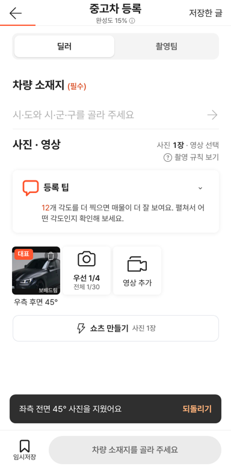
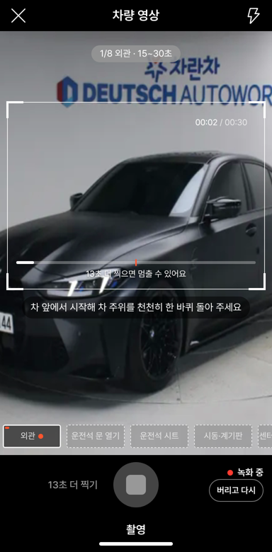
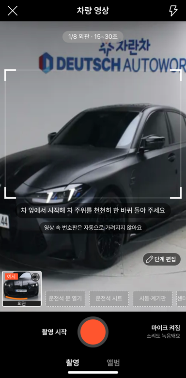
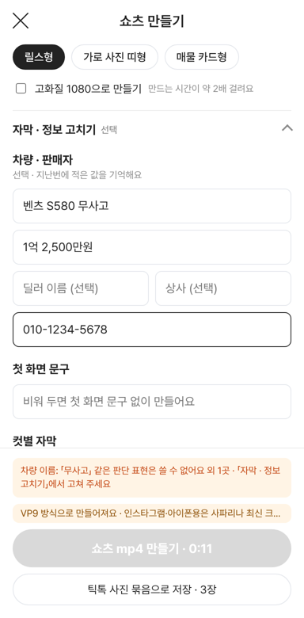

# PR #1094 촬영 키트 컨설팅 전체 대조 P1 반영

① 노션 컨설팅 의견 11개를 대조해 정책 결정 없이 바로 고칠 수 있는 것만 넉스트 촬영 키트에 반영했다.

② 과제 ID 없음 · 브랜치 `shootkit-p1-fixes` · 커밋 e5a8e25 · PR https://github.com/bobaekimboae/bobaedream/pull/1094 · 상태: 병합 · 배포 v=303ba38 (번들 `_nuxt/DVn58xpM.js`) · 함께 들어가는 과제 없음

③ 한 일
- 쇼츠 글자 안전장치: 「무사고」·「신차급」 같은 판단 표현과 휴대폰 번호(010 등)가 들어가면 만들기 버튼을 막고 어느 칸인지 알려 준다.
- 사진 쇼츠 자막 초안에서 「45°」를 빼고 「기타」 칸은 빈 자막으로. 가격은 숫자만 적으면 「1억 2,500만원」으로 맞추고, 공유 글에 제조사·모델 해시태그를 더한다.
- 사진 수로 못 채우는 쇼츠 길이(30·60초)는 막는다.
- 사진 지우기 버튼의 누르는 곳을 44px로 넓히고, 지우면 5초 동안 「되돌리기」를 보여 준다.
- 영상 녹화 중 「버리고 다시」, 녹화 전 「마이크 켜짐/꺼짐」 표시.
- `?fakecam=1`은 실제 카메라를 켜지 않는다. 임시저장 5건이 넘어 오래된 글이 지워지면 알린다. 촬영팀 카운터는 두 줄 유지. 추가 촬영 부위 「차 키」.

④ 원본과 비교: 해당 없음(자체 기능 수정). 동작 점검표

| 점검 | 결과 |
|---|---|
| 사진 지우기 → 되돌리기 | 2장 → 1장 → 2장 |
| 촬영팀 카운터 | 「우선 2/4 · 전체 2/30」 |
| 녹화 전 마이크 표시 | 「마이크 켜짐 · 소리도 녹음돼요」 |
| 녹화 중 버리고 다시 | 단계 그대로, 「외관 녹화를 버렸어요」 |
| `?fakecam=1` | 「시험용 가짜 카메라」, 권한 화면 없음 |
| 쇼츠 글자 막기 | 「무사고」·010 입력 시 버튼 비활성, 고치면 풀림 |
| 가격 형식 | 12500 → 1억 2,500만원 |
| 사진 2장 쇼츠 길이 | 30·60초 막힘 |

   

⑤ 검증: `npx nuxi typecheck` 통과, Playwright 384px(가짜 카메라) 점검 위 표, 콘솔 오류 0. 퀵필터 화면은 바꾸지 않아 verify:qf·measure:qf 대상 아님.

⑥ 원본과 다르게 남긴 것: 「차 키」 예시 사진은 실사가 없어 편의 장비 사진을 임시로 쓴다.

⑦ 못 한 것: 품질 3단계 + 차 잘림 검사(실제 폰 사진으로 기준을 잡아야 함), 차종별 윤곽선(매물 정보 연결 뒤), Nuxt 4 이전, 정책 결정 항목(매물 고정 · SNS 번호판 가림 · 업로드 · 서버 렌더 · AI 표시).

⑧ 확인 링크: https://bobaekimboae.github.io/bobaedream/nuxt-shootkit/?v=303ba38
