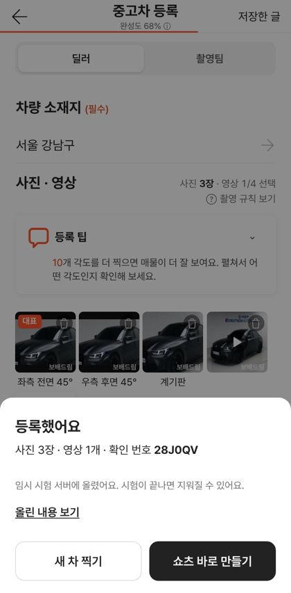
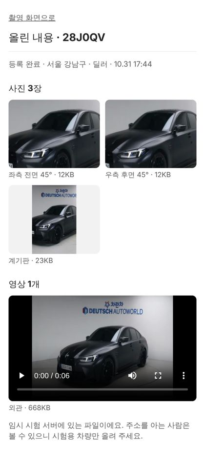

# PR #1095 촬영 키트 — 등록하기 실제 업로드

① **한 줄 요약**: 「등록하기」가 사진·영상을 실제 서버에 올리고 다시 불러오도록 Laravel 12 업로드 서버와 화면 연결을 만들었다. 서버 배포만 남았다.

② 과제 ID 없음(사용자 지시 「실제 동작 가능하게」 · 「임시 무료 서버」 · 「깃허브로 하자」) · 브랜치 `shootkit-upload-server` · 커밋 `b0d1d048` · PR https://github.com/bobaekimboae/bobaedream/pull/1095 · 상태: 푸시(병합 대기, 서버 배포 대기) · 함께 들어간 과제 없음

③ **한 일**
- `shootkit-api/`(Laravel 12): 촬영 만들기 · 업로드 허가표 · 등록 확인 · 보기 API 5개.
- 파일은 폰 → Vercel Blob으로 바로 간다(무료 서버는 요청당 4.5MB까지라 서버를 거치지 않음). 서버는 1시간짜리 허가표만 준다(경로·형식·크기 제한).
- 임시 서버는 DB 없이 기록을 Blob에 JSON으로 둔다. 운영용 PostgreSQL 표 설계(마이그레이션)도 넣었다.
- 화면: 올리는 중 진행률 → 실패하면 남은 것만 「다시 올리기」 → 「등록했어요 · 확인 번호」 → 「올린 내용 보기」(`?shoot=번호`), 쇼츠 바로 만들기·새 차 찍기.
- 서버 주소(`DEFAULT_API`)가 비어 있으면 지금 배포본처럼 시안 안내만 한다. 58 재현은 그대로.

④ **원본과 비교**: 해당 없음(새 기능).

⑤ **검증**
- 내 컴퓨터 끝까지 시험: 사진 3장 + 영상 1개(668KB) 업로드 → 등록 확인 → 보기 화면에서 사진·영상 다시 불러오기 성공, 콘솔 오류 0. 가짜 저장소는 진짜 Vercel Blob처럼 허가표 서명을 검사한다.
- 서버 거절 확인: 잘못된 파일 이름 · 허락 안 된 형식(exe) · 없는 촬영 · 이미 등록한 촬영 · 다른 사이트에서 온 요청.
- 허가표 모양을 `@vercel/blob` 1.1.1 원본 코드와 대조(서명 일치).
- `nuxi typecheck` 통과. verify:qf · measure:qf는 퀵필터 변경이 없어 돌리지 않음.

 

⑥ **원본과 다르게 남긴 것**: 없음.

⑦ **못 한 것 · 다음**
- 연결된 Vercel 계정이 프로젝트를 만들 권한이 없어(403) 서버를 직접 띄우지 못했다 → GitHub로 로그인해 누르는 배포 버튼 주소를 드림. 배포되면 주소를 `DEFAULT_API`에 넣고 다시 배포.
- 실제 폰 시험(큰 영상 · 끊긴 인터넷), 오래된 시험 파일 자동 삭제, 운영 DB 연결.

⑧ **확인 링크**: 배포 전이라 실제 업로드는 아직 꺼져 있음. 촬영 키트 https://bobaekimboae.github.io/bobaedream/nuxt-shootkit/
