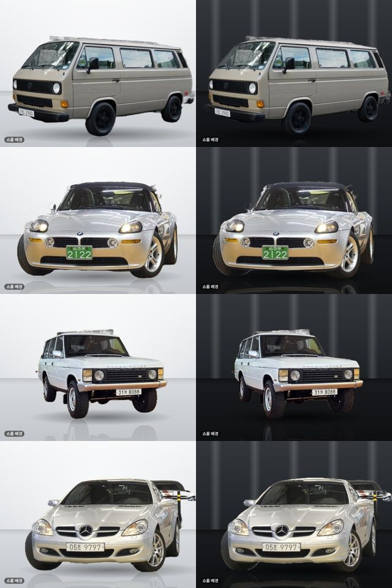
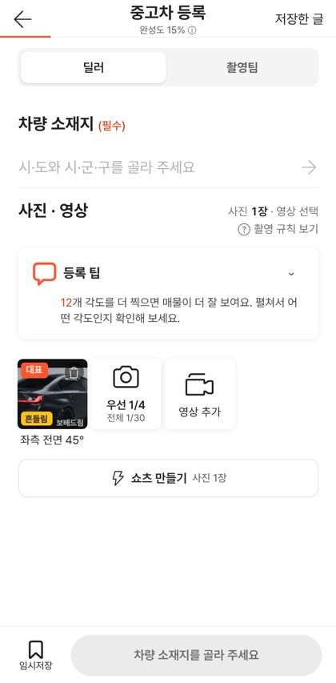

# PR #1097 촬영 키트 — 쇼룸 배경

① **한 줄 요약**: 외관 사진의 배경만 쇼룸으로 바꾼 사진을 한 장 더 만드는 「쇼룸」을 넣었다. 원본은 그대로이고 차는 고치지 않으며 무료다.

② 과제 ID 없음(사용자 결정 「쇼룸만 변경하고 과금 방식은 우린 무료다」) · 브랜치 `shootkit-showroom` · 커밋 `f47d5766` · PR https://github.com/bobaekimboae/bobaedream/pull/1097 · 상태: 푸시(병합 대기) · PR #1096 커밋 포함

③ **한 일**
- 사진 미리보기 도구 줄 「쇼룸」(외관 7칸만) → 원본/쇼룸 끌어서 비교, 배경 3종(화이트 스튜디오 · 다크 쇼룸 · 그레이 콘크리트, 보배드림이 캔버스로 직접 그림).
- 원본은 두고 쇼룸 사진을 한 장 더. 사진 왼쪽 아래에 「쇼룸 배경」을 구워 넣는다. 광택 · 먼지 · 반사 지우기는 하지 않는다.
- 차 찾기는 폰 안에서(U-2-Netp, Apache-2.0, 4.6MB, 처음 한 번 내려받음). 과금 없음.
- 번호판 가림을 옮기거나 회전 · 자르기를 하면 쇼룸 사진은 지운다. 등록 화면 칸에 「+쇼룸」, 업로드 때 따로 올린다(서버 사진 한도 60).

④ **원본과 비교**: 해당 없음(AutoStudio AI의 쇼룸 기능을 참고했지만 배경 그림 · 흐름은 새로 만듦).

⑤ **검증**: 실매물 4장 × 2종 생성(첫 장 약 5.7초, 이후 약 2초) · 촬영→미리보기→쇼룸→등록 화면 표시까지 콘솔 오류 0 · `nuxi typecheck` 통과.

 

⑥ **원본과 다르게 남긴 것**: 사진에 「쇼룸 배경」 표시를 구워 넣음(참고 앱에는 없음 — 허위 매물 오해 방지).

⑦ **못 한 것 · 다음**: 가벼운 모델이라 가장자리가 거칠고 차 뒤에 붙은 다른 차가 남을 수 있음 → 운영 전 더 정확한 모델(서버 처리 포함) 검토. 바퀴 기준선 · 앞뒤 기울기 · 줌 · 첫 촬영 안내 카드 · 360° 돌려 보기는 다음 작업.

⑧ **확인 링크**: 병합 · 배포 뒤 https://bobaekimboae.github.io/bobaedream/nuxt-shootkit/
