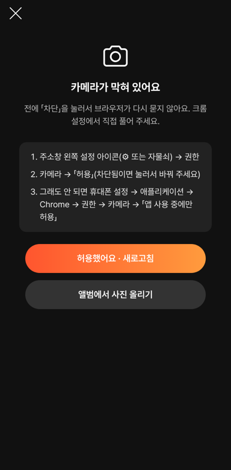

# PR #1098 촬영 키트 — 카메라 권한 막힘 안내

① **한 줄 요약**: 「카메라 권한 허용」을 눌러도 아무 일 없던 문제를 고쳤다. 이미 차단된 권한은 브라우저가 다시 묻지 않아서, 설정에서 푸는 순서와 새로고침 버튼을 보인다.

② 과제 ID 없음(사용자 제보 「카메라 권한 허용 버튼 자체가 안먹어」) · 브랜치 `shootkit-camperm` · 커밋 `3530dac2` · PR https://github.com/bobaekimboae/bobaedream/pull/1098 · 상태: 푸시(병합 대기)

③ **한 일**
- 원인: 한 번 「차단」하면 브라우저는 다시 묻지 않고 바로 거절한다. 버튼은 다시 묻기만 해서 화면이 그대로였다.
- 권한 상태가 이미 「거부」이거나 눌러도 막히면 「카메라가 막혀 있어요」로 바꾸고, 지금 브라우저(크롬 · 삼성 인터넷 · 아이폰 사파리 · 홈 화면 앱)에 맞는 설정 순서와 「허용했어요 · 새로고침」을 보인다.
- 카카오톡 · 네이버 등 앱 안 브라우저는 「다른 브라우저로 열기」 순서를 보인다.
- 설정에서 허용하고 돌아오면 카메라를 저절로 다시 연다. 다시 묻는 동안 「확인 중…」.

④ 원본과 비교: 해당 없음.

⑤ **검증**: 거부 상태를 흉내 내 처음부터 설정 순서가 보이는 것 확인 · 허용 상태 촬영 → 쇼룸 흐름 그대로 · 콘솔 오류 0 · typecheck 통과. 실제 폰 확인은 아직(폰 연결이 끊김).

⑥ 원본과 다르게 남긴 것: 없음.

⑦ **못 한 것 · 다음**: 실제 폰(샤오미 크롬)에서 차단 → 설정 허용 → 돌아오기 확인.

⑧ 확인 링크: 병합 · 배포 뒤 https://bobaekimboae.github.io/bobaedream/nuxt-shootkit/
