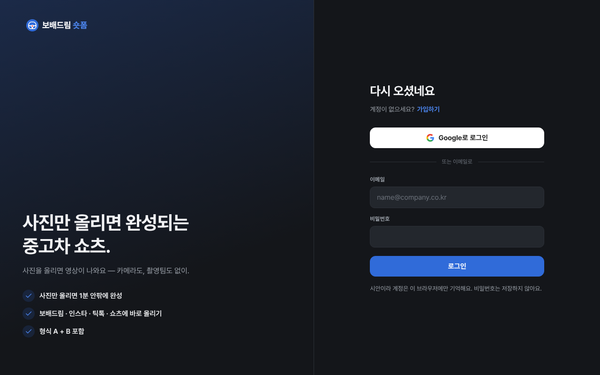
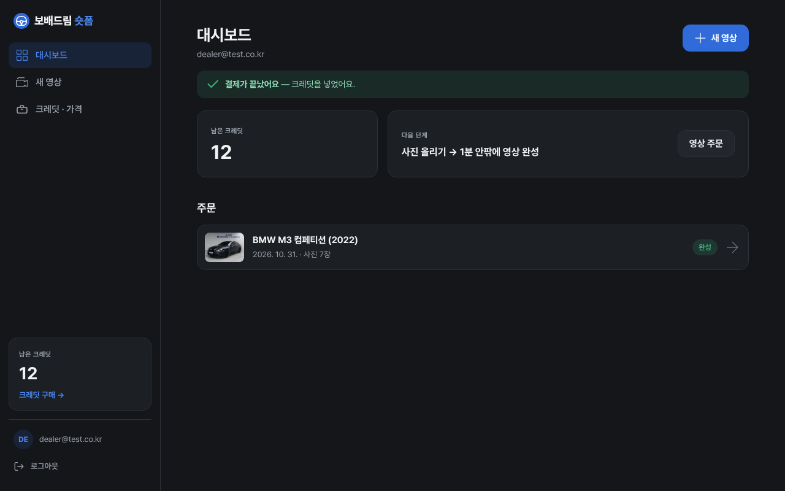
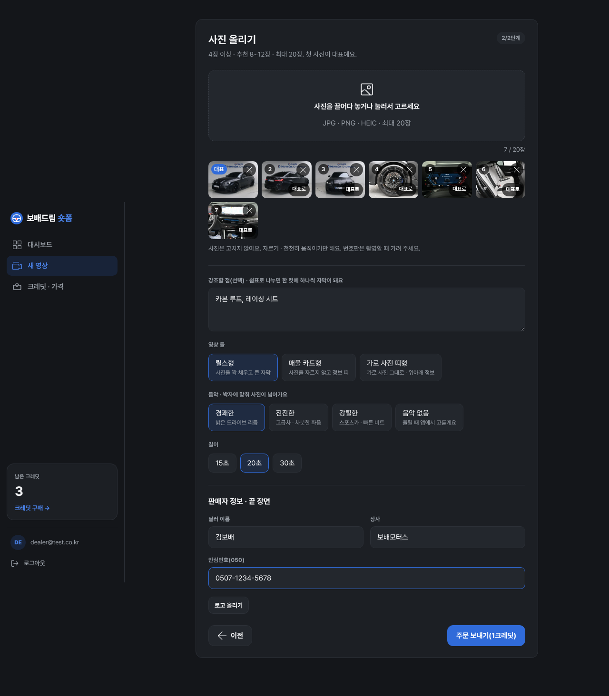
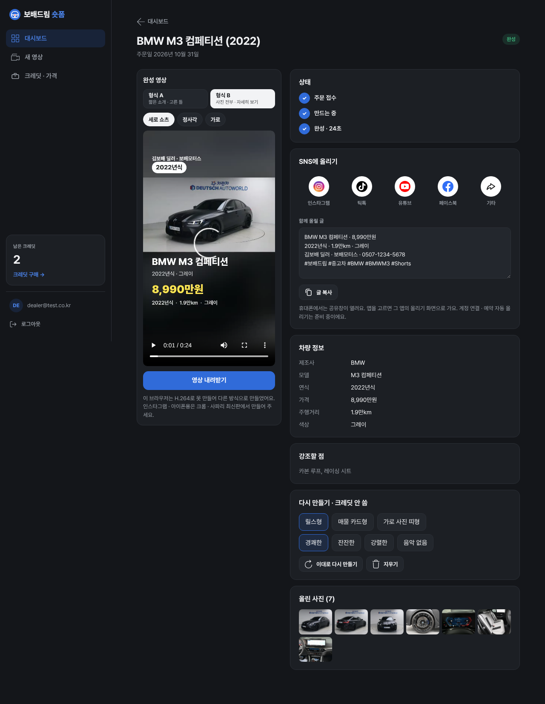
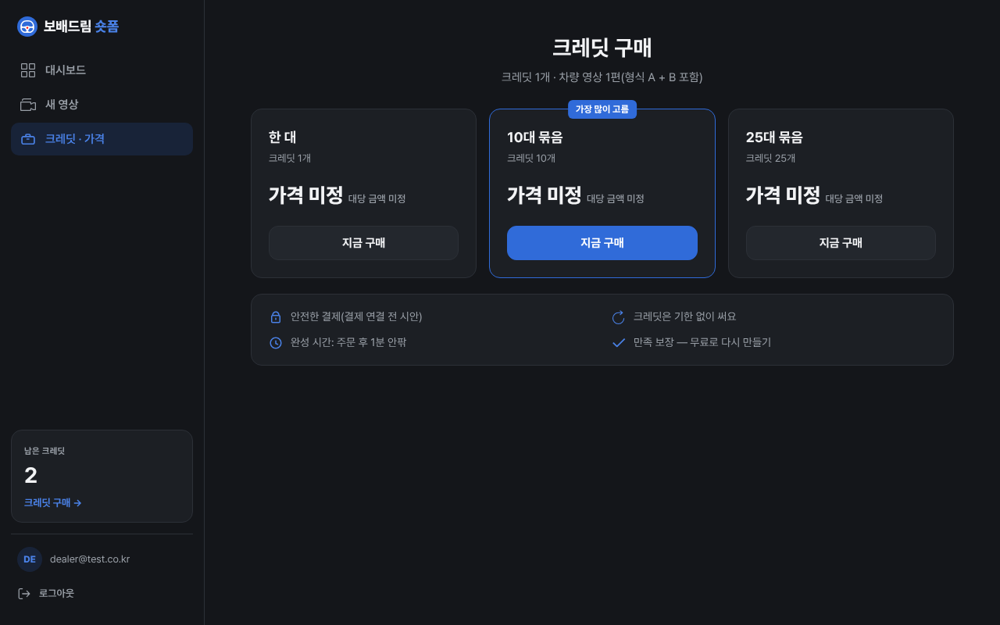
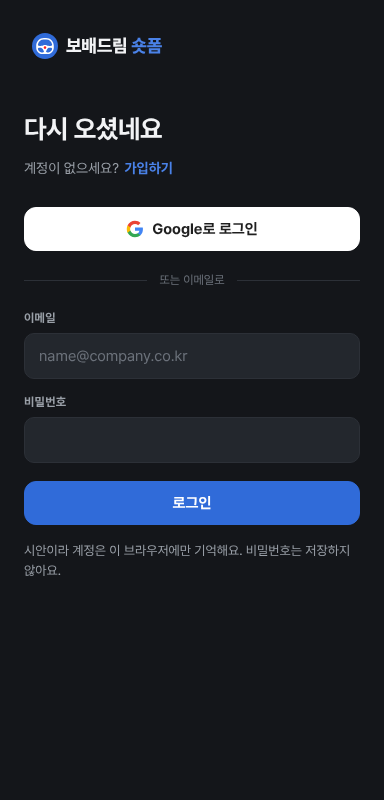
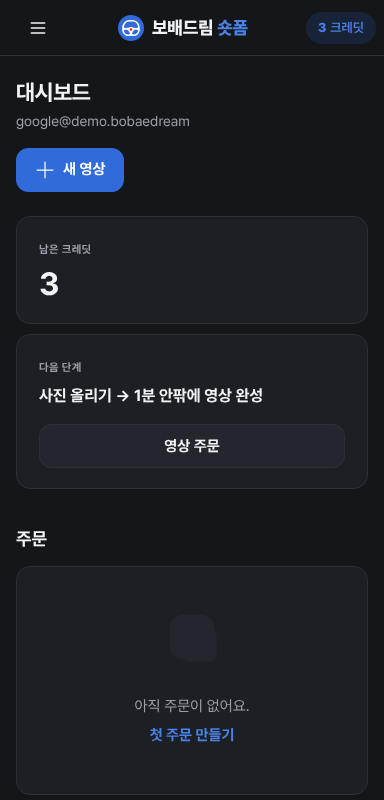
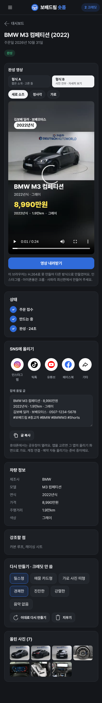

# PR #1099 숏폼 자동 제작 키트 시안

## ① 한 줄 요약
중고차 딜러가 사진만 올리면 약 12초 만에 세로 쇼츠 mp4가 나오는 키트 시안을 만들었다. 화면 구조는 autohaus-video.de를 그대로 따랐다.

## ② 기본 정보
- 과제 ID: 없음(사용자 지시)
- 브랜치: `shortform-kit`
- PR: https://github.com/bobaekimboae/bobaedream/pull/1099
- 상태: 푸시 완료, 병합 대기
- 커밋: 60559abc(첫 시안) · ed52c4da(아이콘 고침) · 이번 커밋(「기능 동일하게」)

## ③ 한 일
- 새 앱 `nuxt-shortform/`을 리뉴얼 스택(Nuxt 4.6.2 · Vue 3.5.33 · TS 6.0.3 · pnpm)으로 만들었다.
- autohaus-video 대시보드 화면을 그대로 옮겼다. 왼쪽 메뉴, 남은 크레딧, 다음 단계, 만든 영상 목록이 들어 있다.
- 새 영상은 2단계다. 차량 정보 → 사진 4~20장. 첫 사진이 대표 사진이 된다.
- 영상은 사람이 아니라 브라우저가 바로 만든다. 촬영 키트의 영상 엔진을 함께 쓴다.
- 고를 수 있는 것은 틀 3가지, 음악 4가지, 길이 15 · 20 · 30초다. 음악은 코드로 만든 박자라 저작권 문제가 없고, 컷이 박자에 맞춰 넘어간다.
- 끝 장면에 딜러 명함, 판매자 로고, 매물 주소 QR이 들어간다.
- 영상 화면에서 할 수 있는 것:
  - 세로 · 정사각 · 가로 영상 만들기(크레딧 안 씀)
  - 내려받기
  - SNS 올리기(글 복사 + 공유창)
  - 다시 만들기

### 2차: 「기능 동일하게 만들어」
autohaus-video의 화면 코드를 읽어 기능을 하나씩 맞췄다.
- 로그인 화면: 왼쪽 소개, 오른쪽 양식. Google 로그인, 이메일 로그인과 가입(비밀번호 8자 이상)이 있다. 가입하면 「확인 메일을 보냈어요」 화면이 나온다. 로그인하지 않으면 다른 화면이 열리지 않는다.
- 계정마다 크레딧과 주문을 따로 둔다. 왼쪽 메뉴 아래에 이메일과 `로그아웃`, 모바일 위 막대에 크레딧 알약을 두었다.
- 대시보드:
  - 이메일 표시
  - `새 영상` 버튼과 첫 주문 링크는 크레딧이 있을 때만 보인다.
  - 크레딧이 0이면 「크레딧을 사고 영상 주문하기」와 `지금 구매`가 나온다.
  - 결제 뒤에는 「결제가 끝났어요」 알림이 뜬다.
  - 불러오는 동안 자리 표시를 보여 준다.
  - 상태 글자는 주문 접수 · 만드는 중 · 완성 · 실패다.
- 크레딧 구매: `지금 구매` → 확인 → 크레딧이 들어가고 대시보드로 돌아가 결제 알림이 뜬다. 결제는 시안이라 실제 돈은 나가지 않는다. 가격은 미정이다.
- 새 영상:
  - 크레딧이 0이면 「크레딧이 없어요」 화면이 나온다.
  - 제조사와 모델을 적기 전에는 `다음` 버튼이 막힌다.
  - 사진이 4장보다 적으면 `주문 보내기(1크레딧)` 버튼이 막히고 안내 문구가 나온다.
  - 사진 칸에 「N / 20장」을 표시한다.
- 주문 화면:
  - 크레딧 1개로 **형식 A**(짧은 소개, 고른 틀)와 **형식 B**(사진 전부를 컷마다 오래 보여 주는 매물 카드형)를 함께 만든다.
  - 상태는 ✓와 번호가 붙은 3단계로 보여 준다.
  - 차량 정보는 빈 칸을 「–」로 표시한다. 매물 주소와 강조할 점은 따로 칸을 두었다.
  - 파일 이름은 `bobae_shortform_{id}_{A|B}_{9x16}.mp4`이다.

## ④ 원본과 비교
| 영역 | autohaus-video | 보배드림 키트 |
|---|---|---|
| 제작 시간 | 24시간(사람이 만듦) | 약 12초(브라우저가 만듦) |
| 입력 | 차량 정보 7칸 + 사진 4~20장 + 메모 | 같음 + 강조할 점 · 틀 · 음악 · 길이 |
| 형식 · 비율 | 형식 A + B · 9:16 | 형식 A + B · 9:16 · 1:1 · 16:9 |
| 로그인 | Google · 이메일 · 확인 메일 | 같음(시안: 이 브라우저에만 기억, 비밀번호 저장 안 함) |
| 결제 | Stripe | 확인창 시안 → 크레딧 + 결제 알림 |
| 올리기 | 내려받기 | 내려받기 + 인스타 · 틱톡 · 유튜브 · 페이스북 공유 |
| 가격 | 1 · 10 · 25 크레딧 €49 · €399 · €899 | 같은 묶음, 가격 미정 시안 |

## ⑤ 검증
- `pnpm run typecheck`: 통과
- 브라우저로 끝까지 시험(사진 7장, 크로미움, 2차):
  - PC 1280: 가입 → 확인 → 주문. 10.1초 만에 형식 A(720×1280, 17.0초)가 나오고, 이어서 형식 B(24.0초)와 형식 B 정사각(720×720)이 나왔다.
  - 모바일 384: Google 로그인 → 주문. 10.6초 만에 형식 A가 나오고, 이어서 형식 B가 나왔다.
  - 막힌 상태 확인: 가입 안 한 이메일 오류, 짧은 비밀번호 오류, 빈 칸에서 `다음` 막힘, 사진 2장에서 주문 막힘
  - 결제 확인: 크레딧 2 → 12, 주소에 `payment=success`
  - 계정 확인: 로그아웃한 뒤 다시 로그인하면 주문 1건과 크레딧 12가 그대로 있다. 다른 계정에서는 주문이 0건이다.
- 2차에서 고친 것: 빈 목록 아이콘이 안 보이던 문제, 주문 화면을 불러오는 순간 「주문을 찾지 못했어요」가 잠깐 뜨던 문제
- 콘솔 오류: PC 0, 모바일 0
- 시험에서 찾아 고친 것: SNS `기타` 아이콘이 흰 칸으로 보이던 문제(CSS 선택자 겹침)
- verify:qf와 measure:qf: 퀵필터 화면을 바꾸지 않아 해당 없음

| 로그인 | 결제 뒤 대시보드 | 사진 올리기 | 완성(형식 B) | 크레딧 |
|---|---|---|---|---|
|  |  |  |  |  |

| 모바일 로그인 | 모바일 대시보드 | 모바일 완성 |
|---|---|---|
|  |  |  |

## ⑥ 원본과 다르게 남긴 것과 이유
- 24시간 사람 제작 대신 즉시 자동 제작으로 바꿨다. 이 키트의 목표가 「사진만으로 자동」이기 때문이다.
- 어두운 화면과 오렌지 강조는 보배드림 파랑 `#306BD9`으로 바꿨다. 글꼴은 Pretendard를 쓴다.
- 가격은 정해지지 않아 `가격 미정`으로 두었다. 결제는 확인창으로 흉내만 낸다.
- 로그인과 결제는 서버 없이 이 브라우저에서 흉내만 낸다. Google 로그인을 누르면 시험 계정으로 들어가고, 확인 메일은 보내지 않는다(`확인 완료하고 시작` 버튼으로 이어 간다).
- 형식 B는 원본에서 가로 · 다른 구성의 영상이다. 우리는 사진을 전부(최대 12장) 컷마다 6박씩 보여 주는 매물 카드형으로 정했다.

## ⑦ 못 한 것 · 다음에 할 것
- 실제 로그인(Laravel 12 인증 + 메일 확인), 실제 결제, 서버 저장, 공식 API 자동 게시, 매물 ID 연동, 판매 완료 시 자동 내림
- 시험한 크로미움에는 H.264가 없어 VP9로 만들어졌다. 실제 크롬 · 사파리에서 H.264로 만들어지는지 확인이 필요하다.

## ⑧ 확인 링크
- 배포 전이라 로컬에서만 확인할 수 있다. 병합해서 배포하면 `https://bobaekimboae.github.io/bobaedream/nuxt-shortform/` 에서 열린다.
- 최종 아이디어(노션): https://app.notion.com/p/40aee9c4b606818a92f4d8e1eea95e16
