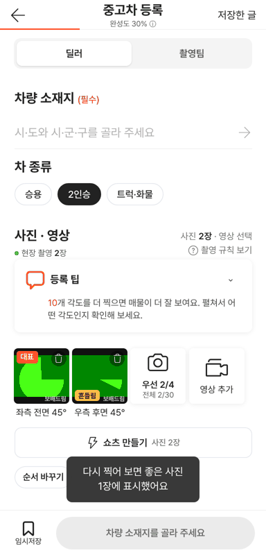
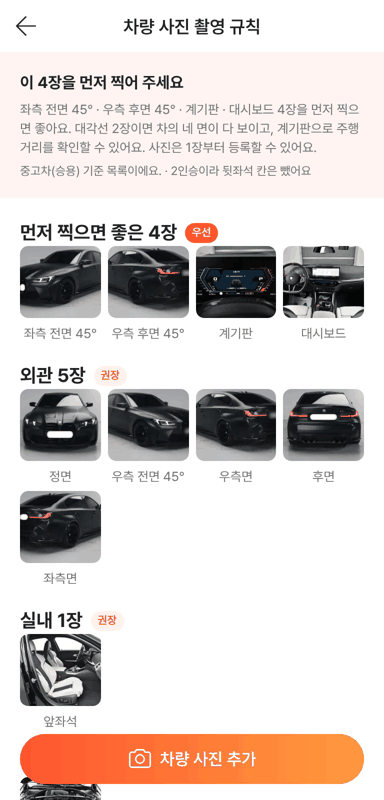
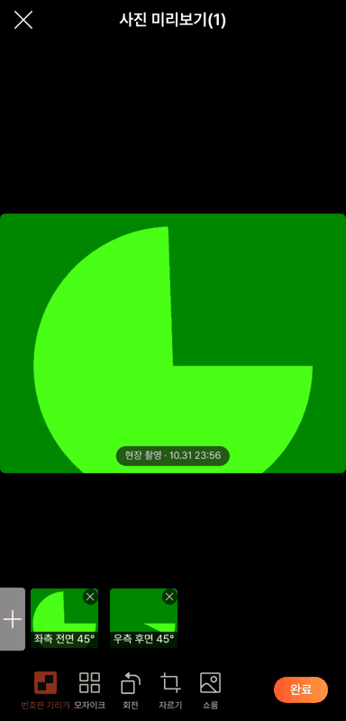
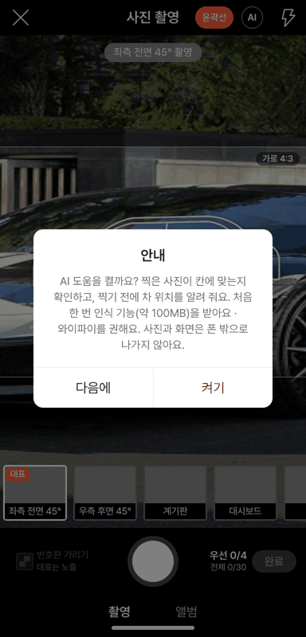
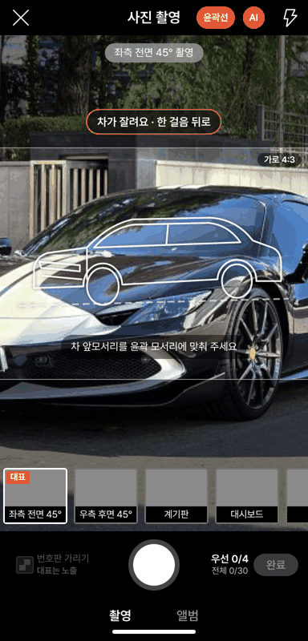
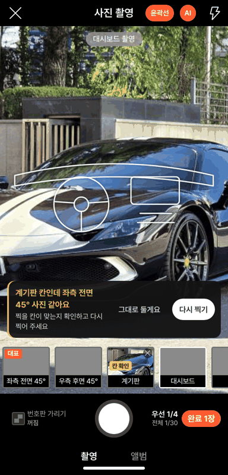

# PR #1102 — 촬영 키트: 칸 확인 · 촬영 출처 · 차 종류 · 찍기 전 위치 안내

## ① 한 줄 요약
해외 촬영 앱 대조에서 나온 수정 4가지(칸이 맞는지 확인, 현장 촬영/앨범 구분, 차 종류별 사진 칸, 찍기 전 위치 안내)를 넉스트 촬영 키트에 넣었다.

## ② 정보
- 과제: 촬영 키트 수정 1~4 (2026-10-31 「진행해라」)
- 브랜치: `shootkit-capture-checks`
- 커밋: PR 페이지 참고
- PR: https://github.com/bobaekimboae/bobaedream/pull/1102
- 상태: 푸시 완료, 병합 승인 대기(배포 전)
- 이번 병합으로 main에 함께 들어갈 과제: 없음

## ③ 한 일
1. **칸 확인**: 사진을 찍으면 그 칸 부위가 맞는지 폰 안에서 본다(부위 나누기와 같은 인식기). 외관/실내/엔진룸/트렁크 묶음이 다를 때만 「계기판 칸인데 좌측 전면 45° 사진 같아요」라고 알리고 칸에 「칸 확인」 표시를 붙인다.
2. **촬영 출처**: 현장에서 찍은 사진은 찍은 시각을 남기고, 앨범 사진과 나눠 `현장 촬영 N장 · 앨범 M장`으로 보여 준다. 미리보기 사진 아래에도 `현장 촬영 · 10.31 23:55`.
3. **차 종류**: 등록 화면에 `승용 · 2인승 · 트럭·화물` 알약. 2인승은 뒷좌석, 트럭·화물은 뒷좌석·트렁크 칸을 뺀다(규칙 화면·완성도도 같이).
4. **찍기 전 위치 안내**: 외관 칸에서 카메라 화면 속 차를 찾아 「차가 잘려요 · 한 걸음 뒤로」 · 「휴대폰을 왼쪽/오른쪽으로」 · 「조금 앞으로」 · 「위치 좋아요」를 한 줄로 알려 준다.
5. 1·4는 머리줄 `AI` 버튼으로 켜고, 처음 한 번 「약 100MB를 받아요, 사진은 폰 밖으로 안 나가요」 동의를 받는다.
6. 같이 고친 것: 미리보기 도구 판의 `쇼룸`이 `번호판 가리기` 위에 겹치던 것.

## ④ 원본과 비교
비교 원본이 없는 새 기능이라 동작 점검표로 대신한다(폭 384, 시험용 가짜 카메라).

| 점검 | 결과 |
|---|---|
| 차 종류 `2인승` → 규칙·사진 칸에서 뒷좌석 빠짐 | 통과 |
| 등록 화면 `현장 촬영 2장` | 통과 |
| 미리보기 `현장 촬영 · 10.31 23:55` (사진 아래 가운데) | 통과 |
| AI 동의 창 | 통과 |
| 위치 안내 (차 양옆이 틀 밖) → 「차가 잘려요 · 한 걸음 뒤로」 | 통과 (모델 받는 데 약 21초) |
| 계기판 칸에 외관 사진 → 「계기판 칸인데 좌측 전면 45° 사진 같아요」 | 통과 |
| `?vstage=58` 에 새 기능 없음 | 통과 |

위치 안내 판정 정확도(실매물 사진 변형): 원본 12/17 좋아요 · 가까이 15/17 뒤로 · 옆으로 옮김 20/20 · 멀리 10/17.

| 화면 | |
|---|---|
| 등록 화면(차 종류 · 현장 촬영) |  |
| 2인승 규칙 |  |
| 미리보기 출처 · 도구 판 |  |
| AI 동의 |  |
| 위치 안내 |  |
| 칸 확인 |  |

## ⑤ 검증
- `nuxt-shootkit` 타입 검사 통과, 정적 내보내기 성공
- 콘솔 오류: 모바일 384 0건 (PC 미점검 — 촬영 키트는 폰 화면)
- verify:qf · measure:qf: 퀵필터를 건드리지 않아 돌리지 않음

## ⑥ 원본과 다르게 남긴 것과 이유
- 칸 확인은 좌우(좌측면/우측면)를 구분하지 않는다. 인식기가 좌우를 못 가린다.
- 위치 안내는 화면에 보이는 4:3 틀 기준이라, 세로로 들고 가로 틀 밖으로 차가 나가면 「잘려요」가 먼저 나온다.

## ⑦ 못 한 것 · 다음에 할 것
- 실제 폰에서 위치 안내 반응 속도(노드 기준 640px 한 장 약 4.8초 → 320px로 줄여 씀)와 정확도 확인
- 멀리 찍은 사진 판정(10/17) 기준 다듬기

## ⑧ 확인 링크
- 병합 전 미리보기 없음. 배포 후: https://bobaekimboae.github.io/bobaedream/nuxt-shootkit/
- 58 재현: https://bobaekimboae.github.io/bobaedream/nuxt-shootkit/?vstage=58
