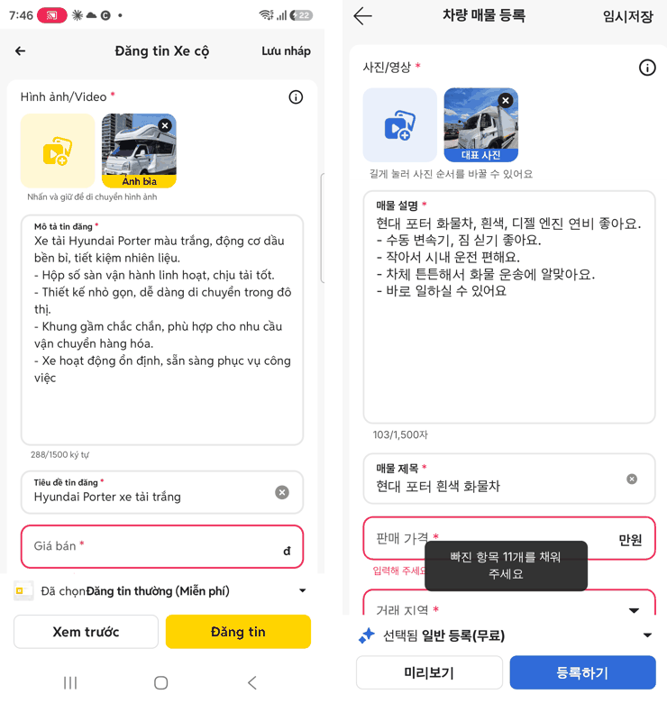
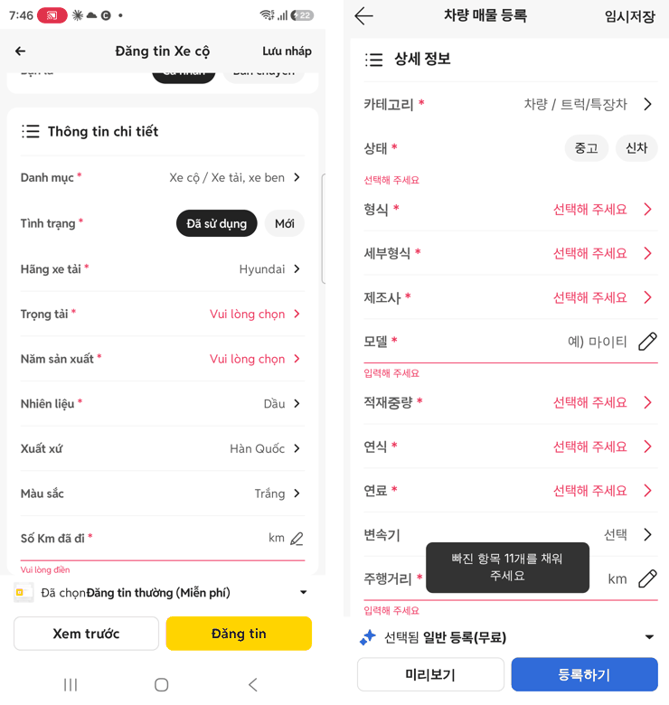
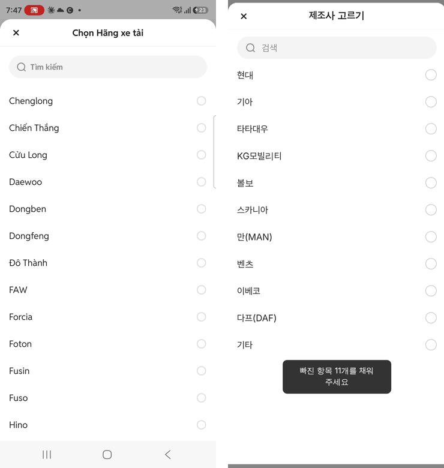
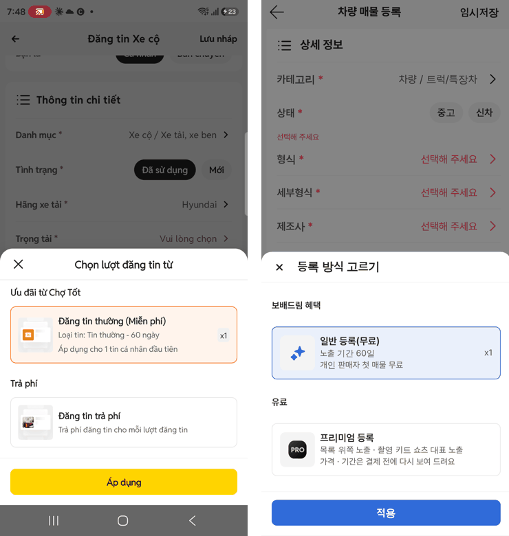
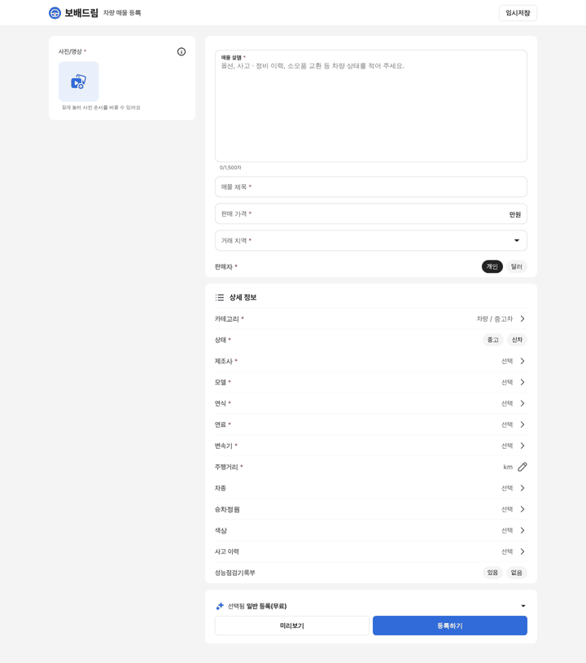
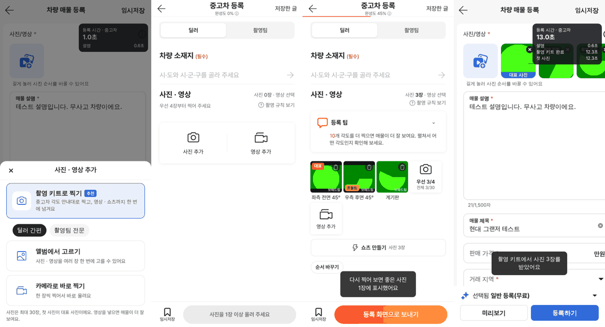

# PR #1103 매물 등록 초톳 네이티브 앱 동일화 v1 + 촬영 키트 연결

① 연결된 폰의 초톳 네이티브 앱 등록 화면을 직접 실측했습니다. 같은 순서 · 치수로 보배드림 매물 등록 화면(앱 · PC)을 만들고 촬영 키트를 연결했습니다.

② 과제 ID 없음 · 브랜치 `register-chotot-app` · 커밋 cf630fc9 외 · [PR #1103](https://github.com/bobaekimboae/bobaedream/pull/1103) · 상태: 푸시(병합 대기, 배포 전) · 함께 들어간 과제 없음

③ 한 일
- 폰(SM-S938N)을 adb로 연결해 초톳 앱 `Đăng tin Xe cộ`를 실측했습니다. 화면 3장, 선택 시트 7종(카테고리 · 제조사 · 적재 · 연식 · 연료 · 색상 · 등록 방식), 사진 규칙 화면을 찍고 화면 구조 파일(uiautomator)에서 위치 · 크기를 쟀습니다.
- `nuxt-register/`(Nuxt 4.6.2 · Vue 3.5.33 · TS 6.0.3 · pnpm)를 새로 만들었습니다. 화면 순서는 머리 → 사진/영상 · 설명 · 제목 · 가격 · 지역 · 판매자 → 상세 정보 → 하단 고정(등록 방식 · 미리보기 · 등록하기)입니다.
- 노랑은 파랑 `#306BD9`(글자 흰색)으로 바꾸고, 나머지 색 · 테두리 · 구분선은 원본 값을 그대로 썼습니다. 아이콘은 초톳 등록 원본과 레딧 원본만 씁니다.
- 7개 카테고리마다 상세 정보 칸이 다릅니다. 제조사 · 모델은 사이트 차량 기준표에서, 트럭 형식은 엔카 13 · 89 원장에서 가져옵니다.
- 사진 추가 칸 → `촬영 키트로 찍기`(딜러 간편 / 촬영팀 전문) → 촬영 키트의 `등록 화면으로 보내기` → 사진 · 영상과 입력값이 그대로 돌아옵니다.
- 등록 시간 측정: 단계별 시각(첫 사진 · 설명 · 가격 · 상세 정보 · 촬영 키트 완료 · 등록 완료)을 완료 화면과 `&debug=1`에 보여 줍니다.

④ 원본과 비교(왼쪽 초톳 앱 실측 / 오른쪽 보배드림)

| 영역 | 판정 |
| --- | --- |
| 머리 52 · 카드 모서리 12 · 사진 칸 88 · 입력칸 2px 테두리 · 오류 빨강 | 일치(색만 파랑으로 바꿈) |
| 상세 정보 줄 52 · 셰브론 · 빈 필수 빨강 · 숫자 칸 연필 | 일치 |
| 선택 시트(X · 가운데 제목 · 검색 · 라디오) | 일치(선택 = 파랑) |
| 등록 방식 시트 | 구조 일치. 보배드림 상품(일반 무료 / 프리미엄 유료 시안)으로 바꿈 |
| 사진 추가 | 의도된 차이: 초톳은 자체 앨범, 보배드림은 촬영 키트 · 앨범 · 카메라 선택 |

⑤ 검증
- `pnpm typecheck`(nuxt-register) · `npm run typecheck`(nuxt-shootkit) 통과, 두 앱 내보내기 성공
- 콘솔 오류: 모바일 384 · PC 1440 모두 0
- e2e: 설명 · 제목 입력 → 촬영 키트 3장 촬영 → `등록 화면으로 보내기` → 사진 3장 · 입력값 유지 · 측정 지점 기록 확인
- `verify:qf`와 `measure:qf`는 퀵필터를 바꾸지 않아 돌리지 않았습니다.

⑥ 원본과 다르게 남긴 것
- 사진 추가 시트(촬영 키트 연결 때문), 오른쪽 아래 측정 창(`&debug=1`일 때만)
- 이어 쓰기 질문은 아직 브라우저 기본 확인 창입니다.

⑦ 못 한 것 · 다음에 할 것
- 초톳 승용차(Ô tô) 폼은 폰에 있던 트럭 임시글을 지우지 않으려고 따로 열지 않았습니다. 초톳 PC 등록 화면은 로그인 뒤에만 보여 실측하지 못했습니다.
- 실제 딜러 · 촬영팀 등록 시간은 사람이 직접 써 봐야 잴 수 있습니다(측정 기능만 준비).
- 서버 업로드, 프리미엄 결제, SNS 동시 업로드는 다음 단계입니다.
- 섹션 위치 조정은 최종 단계에서 합니다.

⑧ 확인 링크(병합 · 배포 뒤): 모바일 `https://bobaekimboae.github.io/bobaedream/nuxt-register/?cat=car&debug=1&v=<커밋>`, PC는 같은 주소를 넓은 창에서
