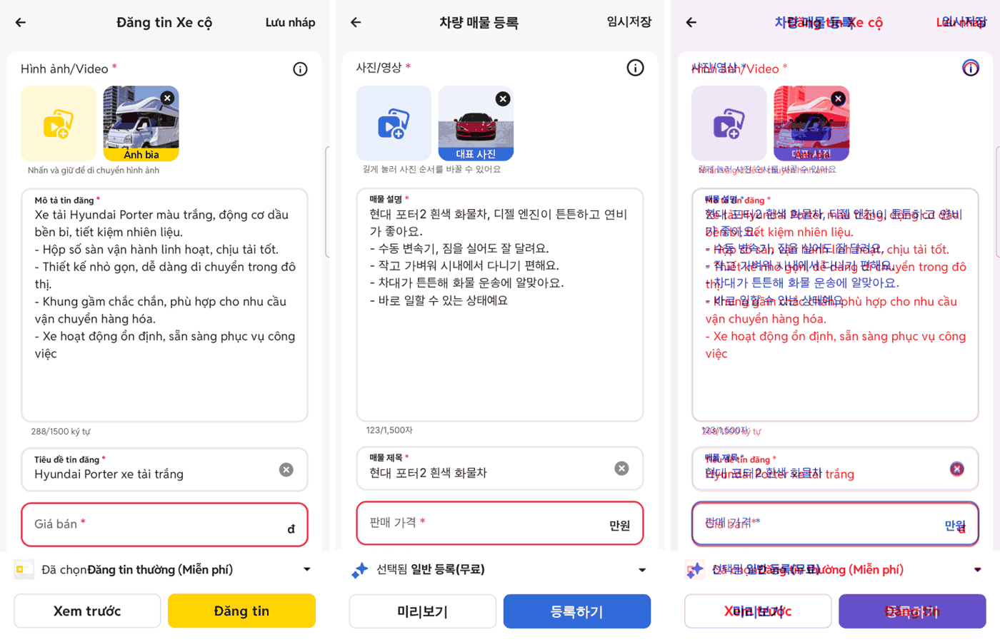
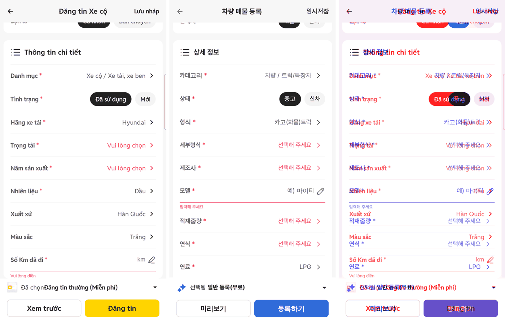
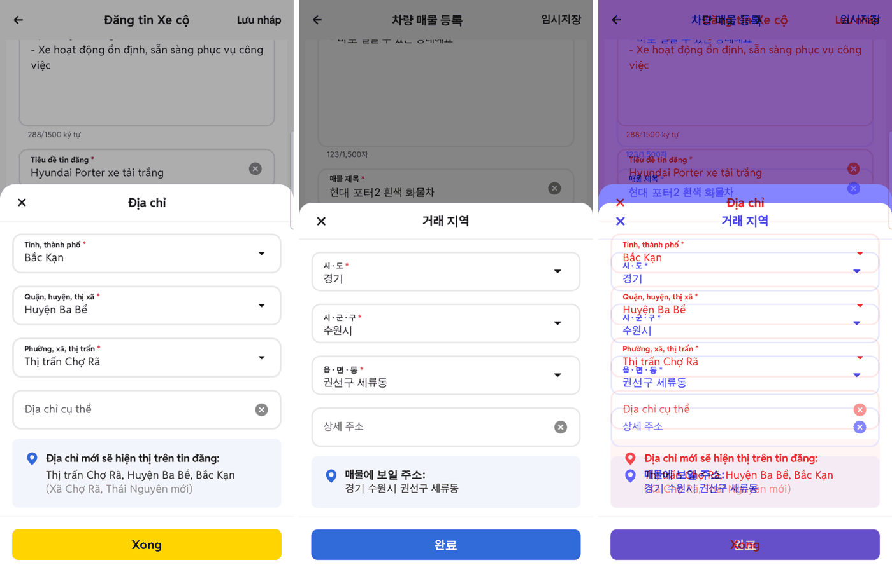
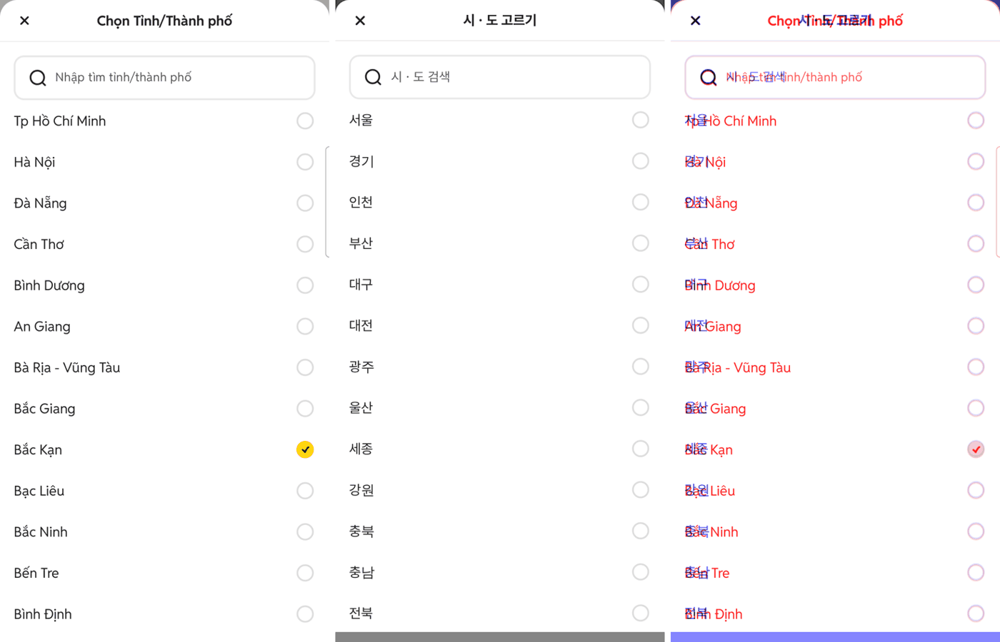
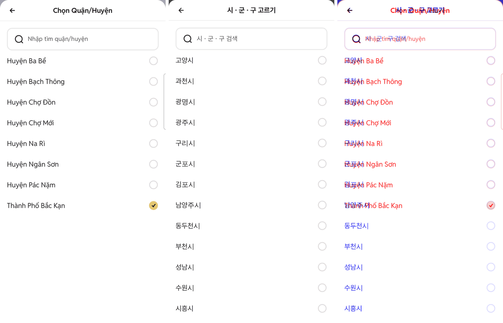
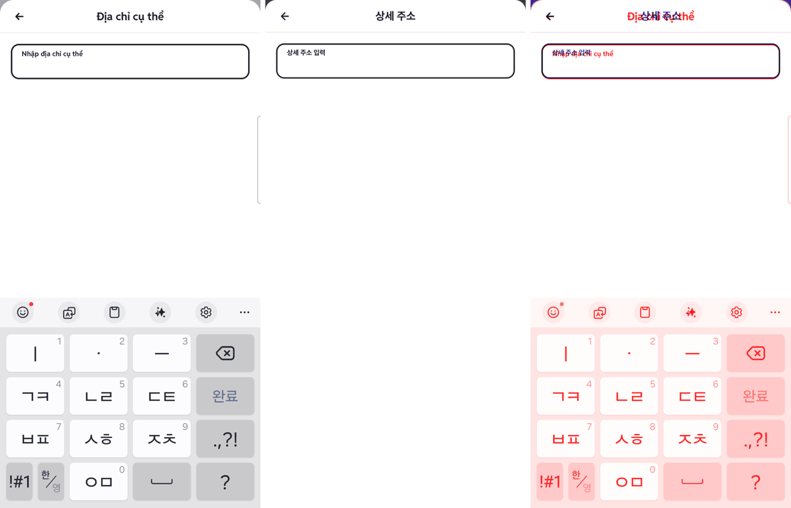
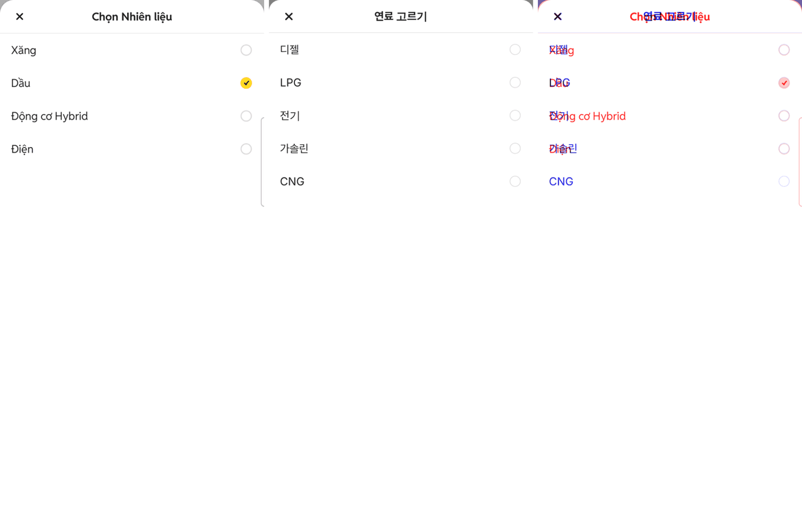
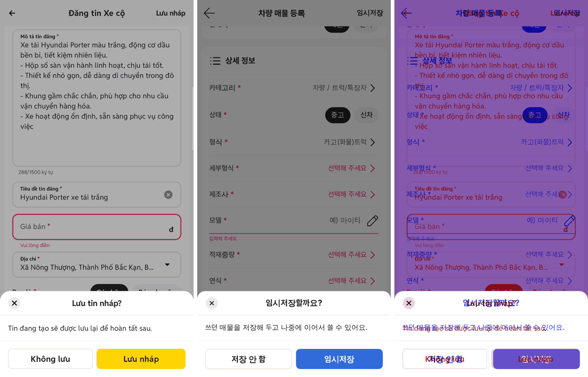

# PR #1107 매물 등록 초톳 앱 크로스체크

## ① 한 줄 요약
초톳 네이티브 앱(폰 adb 실측)과 캡처·영상으로 나란히 대조해, 등록 화면의 글자 크기·간격·거래 지역 3단계·상세 주소·나가기 시트·사진 크게 보기·시트 움직임을 맞췄다.

## ② 과제 · 브랜치 · 커밋 · 상태
- 과제 ID: 없음(사용자 지시 「크로스체크 · 거래 지역 뎁스별 · 100% 동일」)
- 브랜치 `register-chotot-crosscheck` · 커밋 `25410114` · PR https://github.com/bobaekimboae/bobaedream/pull/1107
- 상태: 병합 · 배포 완료 v=`6b87088` (배포본 다시 빌드 PR #1108 함께). main에 함께 들어간 과제: PR #1108(배포 결과물 · 글꼴 404 수정).

## ③ 한 일
- 글자 크기를 초톳 실측으로: 본문·입력·알약 14/18, 제목·버튼·고르기 줄 16/20.6, 칸 이름·안내·글자 수·오류 10/12.8, 설명칸 14(줄 20.2, 높이 250).
- 간격: 머리 52 → 카드 60, 칸 52·사이 12, 오류 뒤 6, 상세 줄 53(구분선 `#F6F6F6`), 아래 막대 48+4+40+16. 주요 위치는 초톳과 0.6px 안.
- 거래 지역을 초톳 「Địa chỉ」처럼 바텀시트 + 시·도 → 시·군·구 → 읍·면·동 3단계(뒤로 화살표, 고르면 바로 다음 단계) + 상세 주소 전체 화면 입력 + 「매물에 보일 주소」 상자. 읍·면·동은 법정동 5,026개(`public/data/regions-kr-dong-v1.json`, Apache-2.0 공개 코드 재정리).
- 뒤로(머리 · 휴대폰 뒤로가기) 시 쓰던 내용이 있으면 「임시저장할까요?」 시트(저장 안 함 / 임시저장).
- 올린 사진을 누르면 검은 전체 화면으로 크게 보기(옆으로 넘기기·점·닫기).
- 시트 여닫기 움직임: 열림 0.25초 감속, 닫힘 0.15초, 바탕 어둡게 서서히(초톳 60fps 녹화 기준). 움직임 줄이기 설정이면 끔.
- 등록하기 때 「빠진 항목 N개」 알림은 초톳에 없어 빼고 첫 빈 칸으로만 이동.

## ④ 원본과 비교(초톳 | 보배드림 | 겹침)
| 영역 | 작업 전 → 후 |
| --- | --- |
| 첫 화면 위 | 글자 16 → 14, 칸 위치 4~9px 어긋남 → 0.6px 안 |
| 상세 정보 | 줄 52(선 없음) → 53 + 선, 셰브론·연필 크기 맞춤 |
| 거래 지역 | 시·도/구 2칸 고르기 → 초톳 같은 3단계 + 상세 주소 |
| 고르기 시트 | 머리선·라디오 크기, 주소용 테두리 검색칸 52 |
| 나가기 · 사진 보기 | 없음 → 추가 |

비교 영상(초톳 왼쪽 · 우리 오른쪽, 5구간: 거래 지역 3단계 · 상세 주소 · 고르기 여닫기 · 뒤로 → 임시저장 · 사진 크게 보기)은 채팅으로 보냄.

## ⑤ 검증
- `pnpm build` 통과 · `vue-tsc` 오류 0. verify:qf 대상 아님(퀵필터 미변경).
- 384×750 화면에서 가로 넘침 0, 콘솔 오류 0.
- 퀵필터 규격 측정 대상 아님.

## ⑥ 원본과 다르게 남긴 것
- 초톳 주소 상자의 「(옛 행정구역명)」 줄: 우리에게 해당 자료 없음.
- 한글 글꼴은 같은 크기에서 라틴 대문자보다 높아 글자 잉크 높이는 1px 안팎 차이.
- 노랑 → 보배드림 파랑 `#306BD9`.
- 사진 추가 칸은 촬영 키트 선택 시트(의도된 차이, 그대로).

## ⑦ 못 한 것 · 다음
- 초톳 PC 등록 화면 실측(로그인 필요).
- 시험 중 초톳 앱 임시 글의 적재 중량(Trọng tải)이 잘못 눌려 「4 tấn」으로 바뀜 — 사용자 확인 필요.

## ⑧ 확인 링크
- 모바일 https://bobaekimboae.github.io/bobaedream/nuxt-register/?cat=truck&v=6b87088
- PC 같은 주소를 1024 이상 폭에서
- 배포본 확인: 거래 지역 칸 → 「거래 지역」 시트 열림, 콘솔 404 0(글꼴 주소 겹침 수정)
