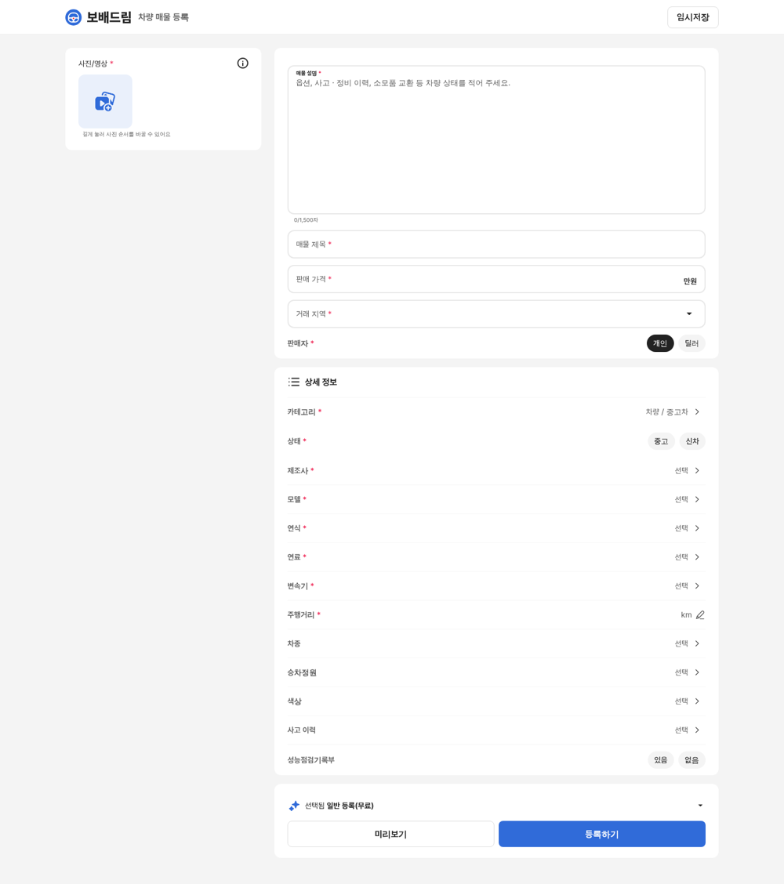
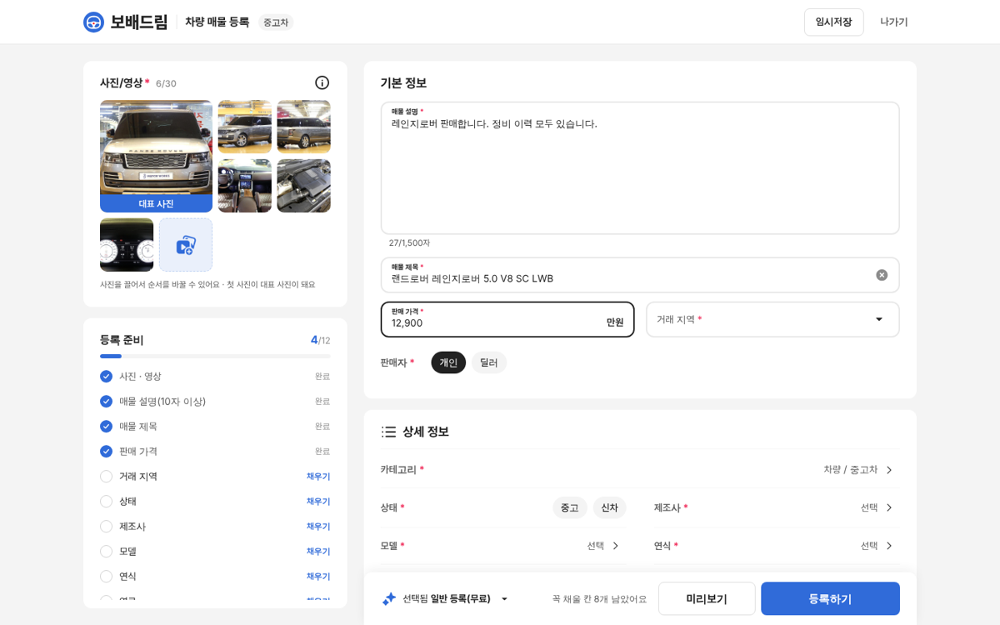
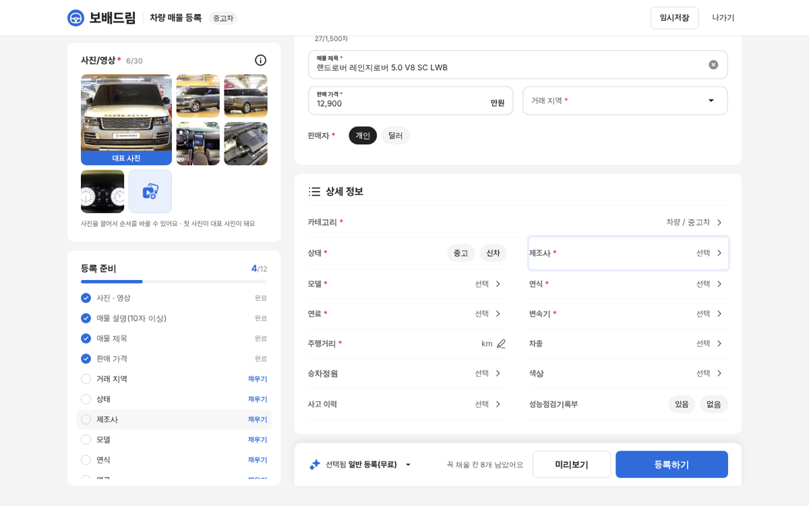
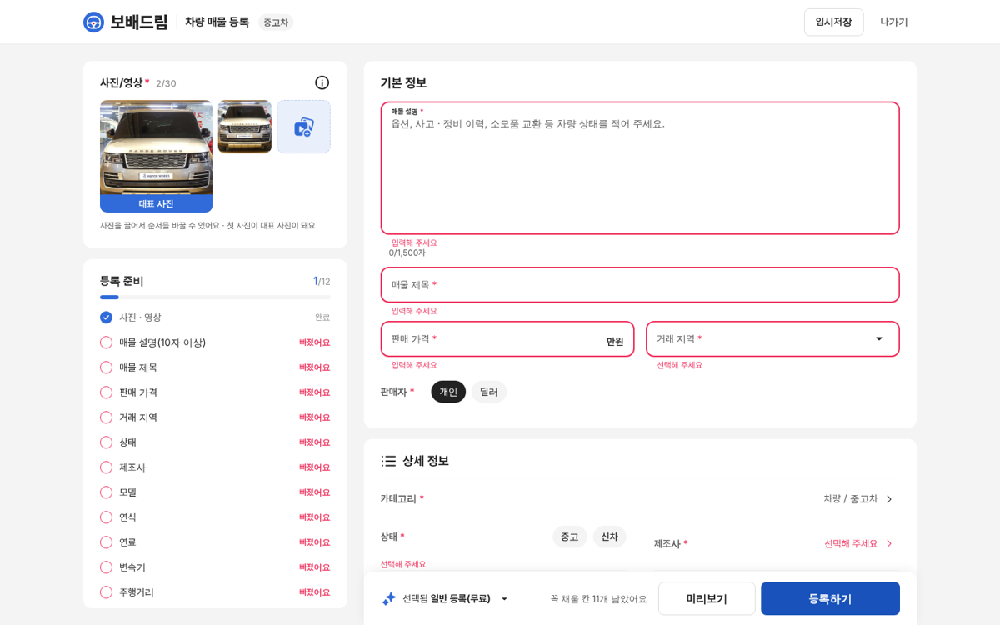
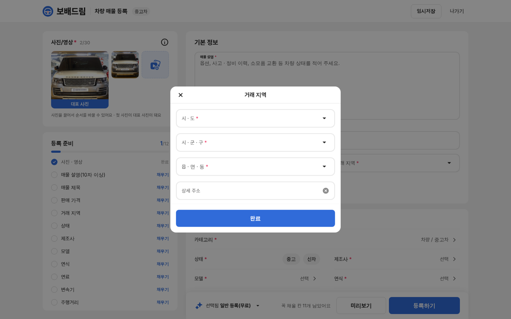

# PR #1109 매물 등록 PC 버전

## ① 한 줄 요약
앱 화면을 늘려 놓았던 PC 매물 등록 화면을, 사진 끌어다 놓기 · 등록 준비 목록 · 2열 상세 정보를 갖춘 PC 전용 배치로 새로 만들었습니다.

## ② 과제 · 브랜치 · 커밋 · 상태
- 과제 ID: 없음(사용자 지시 「피씨버전도 만들어라」)
- 브랜치: `register-pc` · 커밋 `b74cb4a9`
- PR: https://github.com/bobaekimboae/bobaedream/pull/1109
- 상태: 병합(108508b) · 배포 완료 v=`d711af4`(다른 작업창 커밋 d711af4 배포에 함께 실림, 108508b 단독 배포는 취소됨)
- 번들: `nuxt-register/_nuxt/Bzfb9v8z.js`

## ③ 한 일
- 초톳 PC 등록 화면은 로그인해야 열려 실측하지 못했습니다. 글자 · 색 · 칸 모양은 앱 실측값을 그대로 쓰고 PC 배치만 새로 짰습니다.
- 왼쪽 칸(스크롤해도 따라옴): 사진이 없으면 큰 점선 칸에 파일을 끌어다 놓으면 바로 올라갑니다. 사진이 있으면 4열 격자이고 대표 사진은 2×2로 크게 보입니다.
- 왼쪽 「등록 준비」: 꼭 채울 칸의 진행 막대와 목록입니다. 누르면 그 칸으로 이동해 잠깐 표시하고 커서를 둡니다. 등록하기 뒤 빠진 칸은 빨갛게 「빠졌어요」로 표시됩니다.
- 오른쪽: 기본 정보(가격 · 지역을 한 줄 2칸) → 상세 정보 2열 → 아래에 붙어 따라오는 등록 줄(남은 칸 수 · 미리보기 · 등록하기).
- 머리에 카테고리 알약 · 나가기 버튼을 더했고, 1024~1279 폭은 왼쪽 칸을 줄이고 상세 정보를 1열로 바꿉니다.
- 모바일(1023 이하)은 바뀌지 않았습니다.

## ④ 원본과 비교
초톳 PC 원본은 로그인이 필요해 비교하지 못했습니다(차이 비율 없음). 작업 전후 화면:

| 작업 전(1440) | 작업 후(1440) |
|---|---|
|  |  |

| 등록 준비 → 제조사 이동 | 1024 폭 | 빠진 칸 표시 | 거래 지역 창 |
|---|---|---|---|
|  |  |  |  |

동작 점검표

| 항목 | 결과 |
|---|---|
| 파일 끌어다 놓기(사진 2장) | 통과 |
| 등록 준비 누르면 그 칸으로 이동 · 표시 | 통과 |
| 등록하기 → 빠진 칸 빨강 | 통과 |
| 거래 지역 가운데 창 · Esc 닫기 | 통과 |
| 모바일 384에서 PC 전용 요소 0개 | 통과 |

## ⑤ 검증
- `pnpm export`(nuxt generate) 통과, 결과물 `public/nuxt-register` 함께 커밋(번들 `_nuxt/` 새 파일).
- 콘솔 오류 · 404: PC 1440 · 1024, 모바일 384 모두 0.
- 가로 넘침: 1440 · 1024 모두 0.
- verify:qf · measure:qf: 퀵필터 화면을 건드리지 않아 해당 없음.

## ⑥ 원본과 다르게 남긴 것과 이유
- PC 배치 전체: 초톳 PC 원본을 볼 수 없어 직접 설계했습니다.
- 「등록 준비」 목록 · 끌어다 놓기: 앱에는 없는 PC 전용 기능입니다(화면이 길어 빠진 칸 찾기가 어렵기 때문).

## ⑦ 못 한 것 · 다음에 할 것
- 초톳 PC 등록 화면 실측: 사용자 크롬에서 초톳에 로그인해 두시면 그 화면으로 크로스체크하겠습니다.

## ⑧ 확인 링크
- PC: https://bobaekimboae.github.io/bobaedream/nuxt-register/?cat=car&v=d711af4 (창 폭 1024 이상)
- 모바일: https://bobaekimboae.github.io/bobaedream/nuxt-register/?cat=car&v=d711af4
- 배포본 확인: PC 1440 콘솔 오류 · 404 0, 끌어다 놓기 칸 · 등록 준비 표시 / 모바일 384 PC 전용 요소 0
