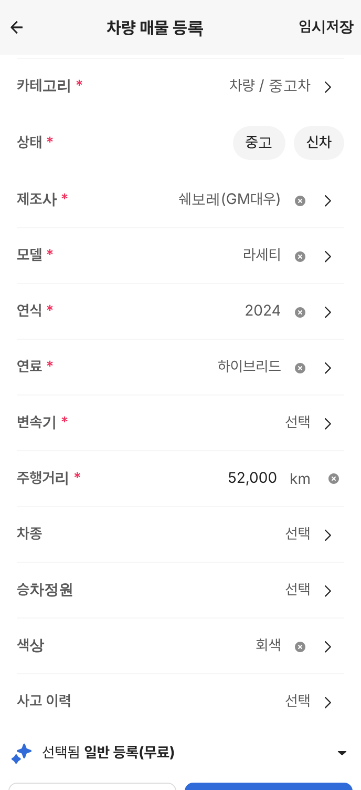
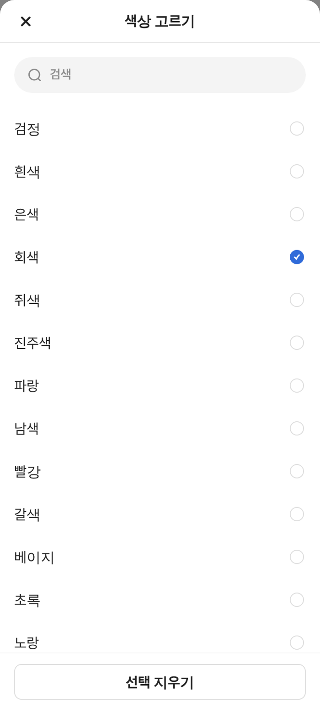

# PR #1112 매물 등록 고른 값 지우기 + 전체 크로스체크

## ① 한 줄 요약
매물 등록 화면에서 한 번 고른 값을 지울 방법이 없던 곳 다섯 군데에 지우기 동작을 넣고, 7개 카테고리 전체를 모바일·PC에서 자동 조작으로 다시 점검했습니다.

## ② 과제 · 브랜치 · 커밋 · 상태
- 과제 ID: 없음(사용자 지시 「선택된 항목 삭제하는 액션 없어」 · 「10배 강화된 기능으로 다시 확인」)
- 브랜치: `register-clear`
- PR: https://github.com/bobaekimboae/bobaedream/pull/1112
- 상태: 병합 · 배포 완료 v=ccd7caa (병합 커밋 ccd7caa7, 배포 실행 성공)
- 배포본 확인: 번들 `_nuxt/H_56kViC.js`, 배포본 대상 자동 점검 312개 통과 · 콘솔 오류 0 (모바일 384 · PC 1440)
- 확인 링크: 모바일 https://bobaekimboae.github.io/bobaedream/nuxt-register/?cat=car&v=ccd7caa · PC 같은 주소를 1024px 이상 화면에서

## ③ 한 일
- 상세 정보 고르기 줄(제조사 · 모델 · 연식 · 색상 등): 값 옆에 지우기(×). 제조사를 지우면 모델도 함께 비웁니다.
- 고르기 시트: 고른 값이 있으면 아래에 「선택 지우기」. 카테고리 시트에는 없습니다(카테고리는 비울 수 없음).
- 주행거리 같은 숫자 입력 줄: 값이 있으면 연필 자리에 ×.
- 알약: 필수가 아닌 줄(성능점검기록부 등)은 고른 알약을 다시 누르면 풀립니다. 필수(판매자 · 상태)는 그대로 둡니다.
- 거래 지역 칸: 값이 있으면 ×. 지역 창의 상세 주소 ×는 값이 있을 때만 보이게 고쳤습니다.

## ④ 원본과 비교 · 동작 점검표
초톳 앱에서 이 지우기 동작은 확인하지 못해 보배드림 추가 기능으로 넣었습니다(아이콘은 초톳 입력칸 지우기 원본).

| 지우기 줄 | 시트 안 선택 지우기 |
|---|---|
|  |  |

자동 점검(7개 카테고리 × 모바일 384 · PC 1440 = 14회, 항목 312개 모두 통과)

| 단계 | 확인한 것 |
|---|---|
| 빈 채로 등록하기 | 빈 필수 칸 5곳 이상 빨강 |
| 사진 2장 → 1장 지우기 | 장수 맞음 |
| 제목 입력 → × | 비워짐 |
| 거래 지역 고르기 → × → 다시 | 표시 · 비움 · 재선택 |
| 상세 고르기 줄 전부 채우기 → 줄 × → 시트 「선택 지우기」 | 모두 채움 · 지움 · 제조사 지우면 모델 비움 |
| 카테고리 시트 | 지우기 버튼 없음 |
| 알약 다시 누르기 | 필수 유지 · 비필수 해제 |
| 숫자 줄 입력 → × | 비워짐 |
| 다시 채워 등록 | 등록 완료 · 남은 오류 0 |
| 화면 구조 | 버튼 안 버튼 0, 가로 넘침 0, 콘솔 · 네트워크 오류 0 |

## ⑤ 검증
- `pnpm export` 통과, 결과물 `public/nuxt-register` 함께 커밋.
- 위 자동 점검 312개 통과. verify:qf · measure:qf는 퀵필터를 건드리지 않아 해당 없음.

## ⑥ 원본과 다르게 남긴 것과 이유
- 지우기 동작 전체: 초톳 앱에서는 확인하지 못한 보배드림 추가 기능입니다(고른 값을 되돌릴 수 없으면 선택 항목을 비울 방법이 없어서).

## ⑦ 못 한 것 · 다음에 할 것
- 실제 폰 손가락 조작 확인(자동 점검은 화면 폭 · 터치 모드로만 함).

## ⑧ 확인 링크(병합 · 배포 뒤)
- 모바일: https://bobaekimboae.github.io/bobaedream/nuxt-register/?cat=car
- PC: 같은 주소, 창 폭 1024 이상
