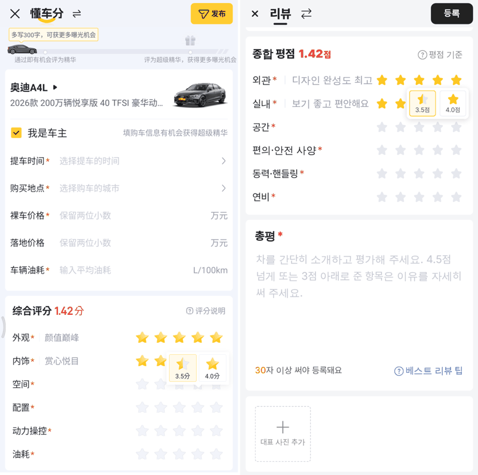
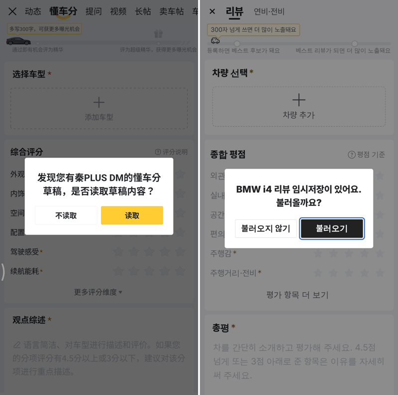
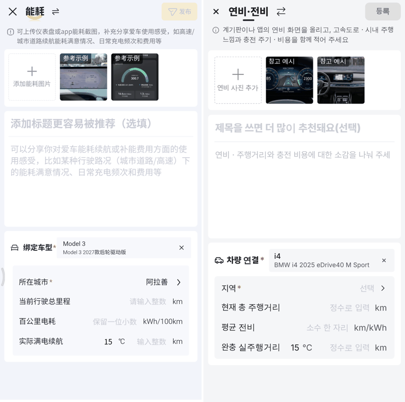
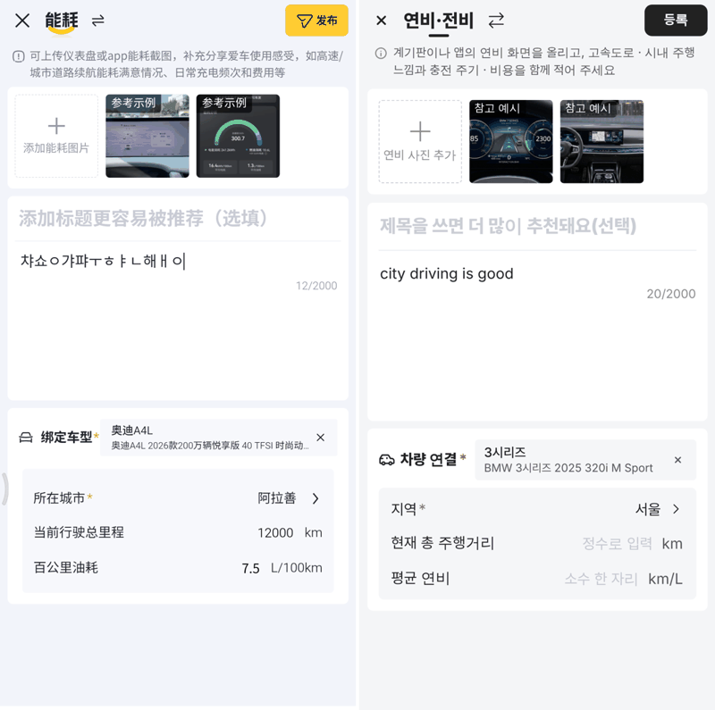
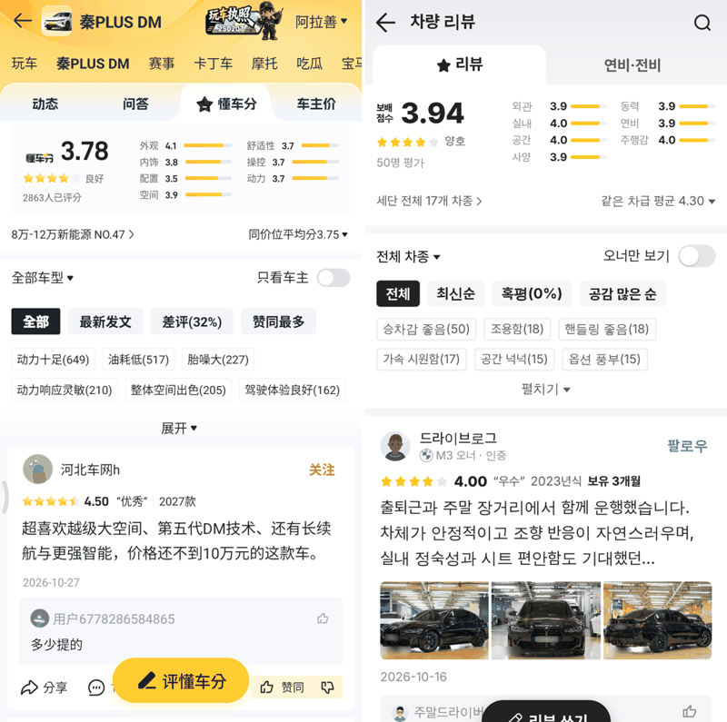
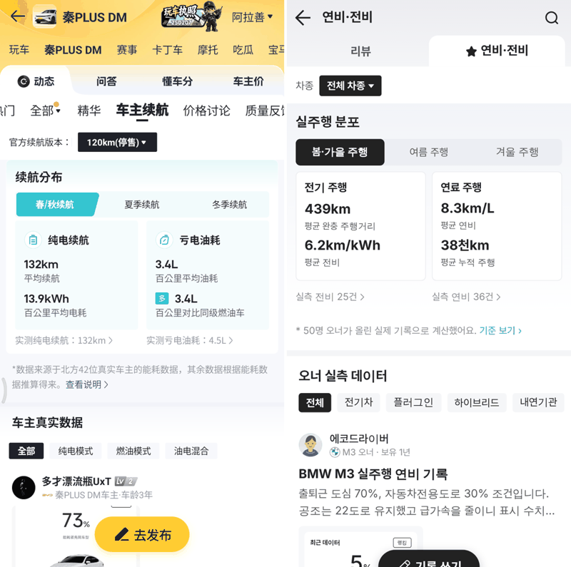
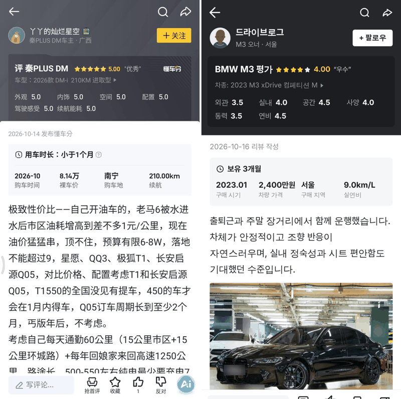
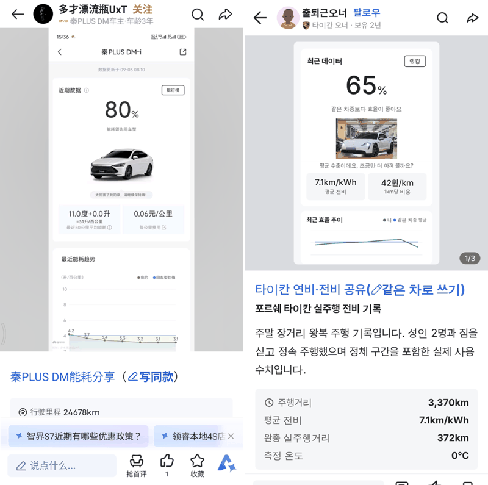

# PR #1113 커뮤니티 차량 리뷰 · 연비 게시판 넉스트 판 + Laravel 12 API 계약

## ① 한 줄 요약
동처띠 懂车分(차량 리뷰) · 能耗(연비 · 전비) 게시판의 등록폼 · 목록 · 상세를 원본 캡처와 나란히 대조해 넉스트 판으로 만들고, 게시글 · 댓글 · 권한 · 임시저장 · 등록 API 계약을 Laravel 12 · PHP 8.4로 만들었습니다.

## ② 기본 정보
- 과제 ID: 없음(사용자 지시 「동처띠 리뷰 · 연비 게시판 30배 기준 크로스체크 · 원본 그대로 구현」)
- 브랜치: `community-review-dcd`
- 커밋: b381fc5b (보고서 커밋 별도)
- PR: https://github.com/bobaekimboae/bobaedream/pull/1113
- 상태: 푸시(병합 · 배포 대기). 이번 병합으로 main에 함께 들어갈 과제 없음.

## ③ 한 일
- 새 화면 `nuxt-review/`(Nuxt 4.6.2 · Vue 3.5.33 · TypeScript 6.0.3 · pnpm). 주소 `?board=review|fuel&view=list|detail|write&id=`, 뒤로가기 · 스크롤 기억 · 나가기 확인.
- 리뷰 쓰기: 노출 띠 · 차량 고르기 · 「오너예요」(동력 방식별 칸) · 반 칸 별점 팝업 · 평균 · 차급 평균 줄 · 총평 30자 · 커버 사진.
- 연비 쓰기: 참고 예시 사진 · 제목 · 본문 n/2000 · 차량 연결 · 지역 · 주행거리 · 전비 · 연비 · 전기차 온도 줄(기본 15℃).
- 임시저장: 게시판마다 1건 자동 저장, 다시 들어오면 「불러올까요?」 창. 닫기는 원본처럼(리뷰 30자 미만이면 묻고, 그 밖엔 조용히 저장).
- 목록(오너 리뷰 · 정렬 · 태그 · 인기 댓글 · 연비 분포 카드 · 계절 탭) · 상세(점수판 · 오너 정보 · 공유 카드 · 댓글 · 아래 반응 막대).
- 서버 `community-api/`: 라우트 · 표 8개 · 받는 값 검사 4개 · 권한 2개 · 내려주는 모양 4개 · 스모크 시험. 계약 문서 `docs/community-review-api.md` · `openapi.yaml`.
- 화면은 계약 층(`lib/api/`)을 거친다. 기본은 같은 계약을 흉내 내는 mock, `?api=` 주소면 Laravel 서버.

## ④ 원본과 비교
| 영역 | 작업 전 | 작업 후 |
|---|---|---|
| 리뷰 쓰기 세로 위치(차량 · 오너 줄 · 평점 제목) | 원본보다 약 15px 아래 | 3.5px 안 |
| 별점 간격 · 마지막 별 오른쪽 끝 · 등록 버튼 | — | 같음(30 · 359 · 68×34) |
| 임시저장 창(폭 · 버튼 · 모서리) | 296 · 40 · 6 | 288 · 36 · 4(원본 288 · 35 · 4) |
| 전기차 온도 숫자 | 18px | 16px(원본과 같은 크기) |

| 원본(왼쪽) · 우리(오른쪽) | |
|---|---|
| 리뷰 쓰기 별점 |  |
| 임시저장 불러오기 |  |
| 전기차 연비 쓰기 |  |
| 연비 쓰기 지역 |  |
| 리뷰 목록 |  |
| 연비 목록 |  |
| 리뷰 상세 |  |
| 연비 상세 |  |

## ⑤ 검증
- 화면 자동 점검 108개 통과(폭 384 · 1280): 쓰기 · 반 칸 별점 · 검사 알림 · 나가기 · 임시저장 불러오기 · 거절 · 전기차 온도 · 차급 평균 · 목록 · 상세 · 댓글 · 반응 · 뒤로가기.
- 타입 검사(`nuxt typecheck`) 통과. 콘솔 오류 0, 가로 넘침 0.
- API 스모크 36개 통과(SQLite · PHP 내장 서버): 로그인 없음 401 · 남의 글 403 · 0.5 단위 · 동력 방식별 항목 · 오너 구매 정보 · 평균 계산 · 공감↔비공감 · 연비 비공감 404 · 댓글 수 · 임시저장 저장/읽기/등록 뒤 지움 · 삭제 뒤 목록 제외 · CORS.
- 이 작업은 퀵필터 화면을 바꾸지 않아 `verify:qf` · `measure:qf`는 해당 없음.

## ⑥ 원본과 다르게 남긴 것
- 노랑 버튼 → 검정 `#222`(보배드림 기준). 단위 L/100km · kWh/100km → km/L · km/kWh, 가격 만원.
- 목록 머리는 원본의 차종 동그라미 머리 대신 게시판 탭(리뷰 · 연비).
- 임시저장 창의 「불러오기」에 키보드 초점 테두리가 보이는 것은 접근성 때문(손가락으로 누를 때는 안 보임).
- 내 PHP가 8.3이라 서버 시험은 8.3에서 했다(코드는 8.4 기준, `composer.json` `php ^8.4`).

## ⑦ 못 한 것 · 다음에 할 것
- 회원 로그인(토큰 발급) 연동 — 지금 서버 모드는 읽기만.
- 글 수정 · 신고 · 사진 업로드 · 조회 수 · 팔로우 경로, 검색을 Meilisearch 패싯으로.
- 실제 PostgreSQL 15에서 마이그레이션 시험(지금은 SQLite).

## ⑧ 확인 링크(병합 · 배포 뒤)
- 리뷰 목록: https://bobaekimboae.github.io/bobaedream/nuxt-review/?board=review&view=list
- 리뷰 쓰기: https://bobaekimboae.github.io/bobaedream/nuxt-review/?board=review&view=write
- 연비 목록: https://bobaekimboae.github.io/bobaedream/nuxt-review/?board=fuel&view=list
- 연비 쓰기: https://bobaekimboae.github.io/bobaedream/nuxt-review/?board=fuel&view=write
