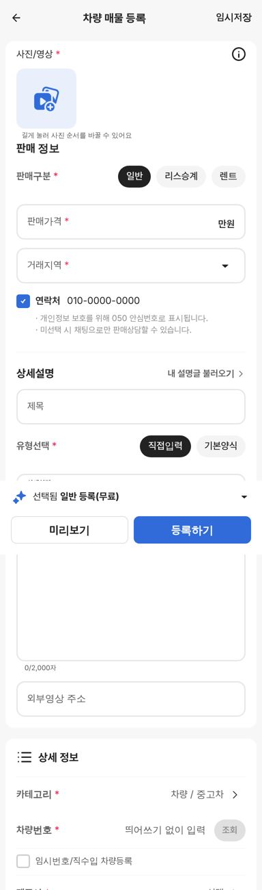
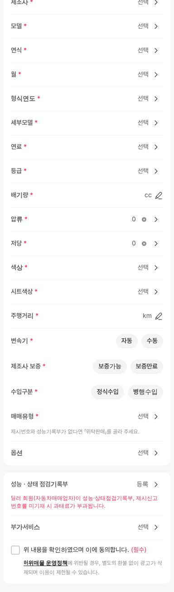

# PR #1115 매물 등록에 테스트 서버 양식 적용

① 한 줄 요약: 보배드림 테스트 서버 등록폼의 칸·순서·선택지를 초톳식 등록 화면의 중고차·전기차에 넣었습니다.

② 과제 ID 없음 · 브랜치 `register-devform` · 커밋 `927bbb5b` · PR https://github.com/bobaekimboae/bobaedream/pull/1115 · 상태: 푸시(병합 대기) · 함께 들어간 과제 없음

③ 한 일
- 테스트 서버 등록폼을 직접 열어(14러0927 조회까지만, 등록하기는 누르지 않음) 항목을 대조했습니다. 10월 7일 수집본과 같고, 첫 화면에 카테고리 고르기만 새로 생겼습니다.
- 상세 정보 칸을 테스트 서버 순서로 바꿨습니다: 차량번호(조회) · 제조사 · 모델 · 연식 · 월 · 형식연도 · 세부모델 · 연료 · 등급 · 배기량 · 압류 · 저당 · 색상 · 시트색상 · 주행거리 · 변속기 · 제조사 보증 · 수입구분 · 매매유형 · 옵션.
- 세부모델 · 연료 · 등급은 사이트 공용 차량 기준표에서 이어서 고릅니다(예: BMW 3시리즈 F30 디젤 → 디젤 등급만).
- 판매 정보(판매구분 일반·리스승계·렌트, 리스·렌트 조건), 연락처(050 안심번호), 상세설명(내 설명글 · 제목 40자 · 직접입력/기본양식 · 2,000자 · 외부영상 주소), 점검기록부(제시번호), 부가서비스, 허위매물 정책 동의를 넣었습니다.
- 모양은 초톳 카드 · 줄 · 알약 · 바텀시트 그대로입니다. 옵션은 초톳 시트 모양의 여러 개 고르기 시트로 만들었습니다.

④ 원본과 비교: 테스트 서버 항목 전부(차량 정보 20칸 · 판매 정보 4칸 · 상세설명 4칸 · 점검기록부 · 부가서비스 · 정책 동의) 있음.

 

⑤ 검증: 폰 384 · PC 1280 자동 점검 96개 통과 · 화면 오류 0 · 가로 넘침 0. 조회(14러0927) · 다른 번호 안내 · 등급 연료별 걸러짐 · 옵션 2개 · 리스 칸 · 기본양식 · 내 설명글 · 정책 원문 · 제시번호 · 잠금 풀기 · 트럭 기존 양식 유지 확인.

⑥ 원본과 다르게 남긴 것
- 순서: 테스트 서버는 매물 정보 → 사진 → 판매 정보 → 상세설명, 우리는 초톳 순서(사진 → 판매·설명 → 상세 정보)입니다.
- 사진 1장 이상 필수(초톳 규칙). 테스트 서버는 별표가 없습니다.
- 임시저장은 초톳처럼 머리 오른쪽에 있습니다(테스트 서버는 아래 버튼).
- 색상은 이름 목록으로 고릅니다(색 견본 동그라미 없음). 시트 마감(선택)과 리스 시작·만료일은 아직 없습니다.
- 차량번호 조회는 목업이라 14러0927만 채워지고, 연락처는 010-0000-0000으로 가렸습니다.

⑦ 다음에 할 것: 오토바이 · 화물·트럭 · 기타 탭의 테스트 서버 양식 확인, 색 견본 시트, 실제 조회 API 연결.

⑧ 확인 링크(병합·배포 후)
- 모바일: https://bobaekimboae.github.io/bobaedream/nuxt-register/?cat=car
- 전기차: https://bobaekimboae.github.io/bobaedream/nuxt-register/?cat=ev
