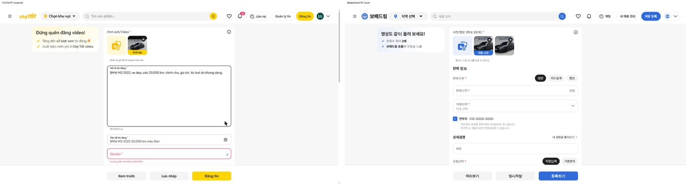
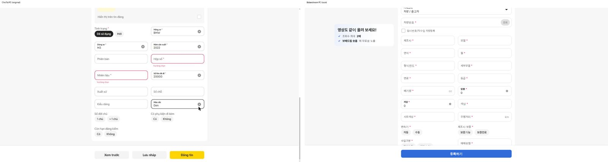
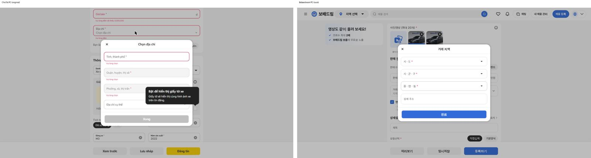
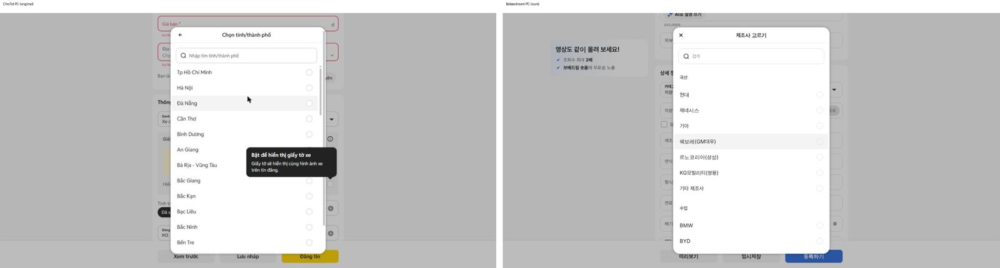
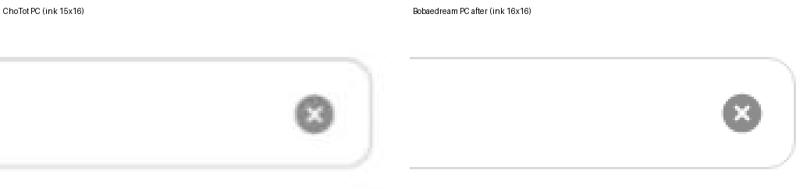
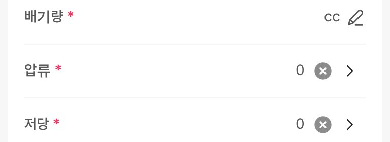

# PR #1116 매물 등록 PC를 초톳 PC 화면 그대로

① 한 줄 요약: 로그인한 초톳 PC 등록 화면을 직접 재서, 매물 등록 PC 화면을 같은 배치 · 크기 · 아이콘으로 바꿨습니다.

② 과제 ID 없음 · 브랜치 `register-pc-chotot` · 커밋 `b06c0b59` · PR https://github.com/bobaekimboae/bobaedream/pull/1116 · 상태: 푸시(병합 대기) · 함께 들어간 과제 없음

③ 한 일
- 초톳 PC 화면(`chotot.com/dang-tin?ia_version=3`)을 1536 폭에서 쟀습니다. 상세 칸은 사진과 설명을 넣어야 열려서 시험 사진 1장과 설명을 넣었습니다. 잰 뒤에는 모두 지웠고 「Đăng tin」(등록)은 누르지 않았습니다.
- 머리 66: 메뉴 · 로고 · 지역 알약 · 검색 알약 · 찜 · 알림 · 채팅 · 내 매물 관리 · 매물 등록 · 내 정보
- 본문: 가운데 592 한 칸에 사진 → 설명 → 제목 → 가격 → 지역 → 판매자를 한 카드로 이었고, 「상세 정보」는 다음 카드입니다. 왼쪽에는 300 영상 안내 카드가 화면을 따라옵니다.
- 입력칸은 48 높이(테두리 1.6 #DADADA · 모서리 12)이고 이름이 칸 안에 뜹니다. 상세 정보는 272 + 16 + 272 두 칸입니다.
- 아래 고정 줄 84: 버튼은 같은 폭으로 늘어납니다. 아무것도 안 썼으면 「등록하기」만, 쓴 내용이 생기면 「미리보기 · 등록하기」, 사진이 있으면 「미리보기 · 임시저장 · 등록하기」입니다.
- 가운데 창: 480 폭 · 모서리 20 · 머리 48입니다. X 버튼은 40 크기로 왼쪽 위 4에 있고, 그 안의 X 아이콘은 초톳 원본 24입니다.
- 설명칸 안에 「AI로 설명 쓰기」 알약을 두었습니다(초톳 「AI Viết giúp」 자리). 고른 상세 정보로 초안을 씁니다.

④ 원본과 비교(PC 1526 폭 기준, 초톳 → 우리)

| 영역 | 초톳 | 우리 |
| --- | --- | --- |
| 머리 | 높이 66 · 메뉴 24,13 40 · 오른쪽 여백 24 | 같음 |
| 가운데 카드 | x 467 · 폭 592 · 위 82 | 같음 |
| 왼쪽 안내 카드 | 146,82 · 300×113 | 같음 |
| 사진 빈 칸 | 483,122 · 560×140 · 아이콘 48 | 같음 |
| 사진 칸 | 추가 86 · 사진 86 · 사이 8 · 지우기 24 · 대표 띠 22 · 안내 495,222 | 같음 |
| 설명칸 · AI 알약 | 276 · 알약 32(칸 위에서 236) | 275(배율 반올림) · 같음 |
| 입력칸 | 48 · 사이 16 | 같음 |
| 상세 2칸 | 272 + 16 + 272 · 줄 간격 64 | 같음 |
| 아래 줄 | 84 · 버튼 40 · 아래 16 · 3개일 때 176씩 | 같음 |
| 가운데 창 | 480 · 모서리 20 · 머리 48.8 · X 버튼 40(+4,+4) · 아이콘 24 · 목록 줄 48 · 라디오 20 | 같음 |
| 아이콘 | X · 사진 지우기 · 메뉴 · 핀 · ▼ · 돋보기 · 찜 · 알림 · 채팅 | 경로가 같은 원본 |

⑤ 검증
- 폰 384 · PC 1280 자동 점검 96개 통과
- 1024 · 1280 · 1440 · 1920 × 4개 카테고리: 가로 넘침 0, 머리 겹침 0, 화면 오류 0
- 모바일 384(중고차 · 바이크 · 트럭 × 위 · 가운데 · 끝): 배포본과 화소 차이 0

⑥ 원본과 다르게 남긴 것
- 초톳 노랑(#FFD400 · #FFF8D6)은 보배드림 파랑(#306BD9 · #EAF0FB)으로 바꿨습니다.
- 목록 창의 뒤로 화살표: 초톳 PC 화살표는 노션 아이콘 DB에 없어서 기존 레딧 원본을 그대로 씁니다.
- 로고 폭은 104 대신 114입니다(보배드림 로고 비율).
- 초톳의 「Giấy tờ xe」(서류 사진) 상자는 우리 양식에 없는 항목이라 넣지 않았습니다.
- 등록 방식 고르기(일반 · 프리미엄)는 초톳 PC처럼 아래 줄에서 뺐습니다. 모바일에는 그대로 있습니다.
- 초톳 PC는 제조사 등 고르는 칸을 칸 아래 펼침 목록으로 엽니다. 우리는 모바일과 같은 가운데 창 목록을 씁니다.
- 머리의 검색 · 찜 · 알림 · 채팅 · 내 매물 관리는 시안이라 안내만 띄웁니다.

⑦ 다음에 할 것: 고르는 칸을 초톳 PC처럼 칸 아래 펼침 목록으로 바꿀지 결정, 서류 사진 칸 필요 여부.

⑧ 확인 링크(병합·배포 후, PC는 1024 이상 창으로)
- 중고차: https://bobaekimboae.github.io/bobaedream/nuxt-register/?cat=car
- 바이크: https://bobaekimboae.github.io/bobaedream/nuxt-register/?cat=bike
- 모바일: https://bobaekimboae.github.io/bobaedream/?qf=guazi · PC: https://bobaekimboae.github.io/bobaedream/?qf=guazi&pc=1

## 추가 수정 · 지우기(X) 아이콘 크기 크로스체크 (2026-11-01 「지우기 버튼 작잖아 크로스체크해라」)

- 원인: 초톳 원본 아이콘 파일은 `width 20 · height 30 · viewBox 24`라서 20×30 칸에 그려야 원 지름이 약 16이 된다. PC에서 칸을 20×20으로 줄여 그려 그림이 2/3로 줄었다(보이는 원 11×11).
- 수정: PC 입력칸(`.of__clear .ico`)과 상세 정보 줄(`.row__clear .ico` · `.row__clear--in .ico`) 아이콘 칸을 초톳과 같은 20×30으로 바꿨다.

| 위치 | 초톳 | 우리 수정 전 | 우리 수정 후 |
|---|---|---|---|
| 매물 제목 칸 X (보이는 크기) | 15×16 | 11×11 | 16×16 |
| 상세 정보 줄 X(제조사 · 압류 등) | 15×15~16 | 11×11 | 16×16 |
| 칸 오른쪽 선 → 아이콘 가운데 | 약 24 | 약 23 | 약 23 |

- 함께 고친 것: 모바일 바이크 · 트럭 화면에서 설명칸이 배포본보다 2px 위로 올라가 있었다(PC 「기본 정보」 제목을 지우면서 모바일용 위 여백 14 규칙도 같이 지워짐). 모바일에서 첫 입력칸 위 14를 되살려 배포본과 화면이 같아졌다(자동차 · 바이크 · 트럭 9장 차이 0).
- 검증: devform 96 통과, PC 1024/1280/1440/1920 · 모바일 384 가로 넘침 0.
- 캡처: 
- 모바일 상세 정보 줄 X(2026-11-01 「진행해라」): 18×18 칸이라 보이는 원이 약 10이던 것을 20×30 칸으로 바꿔 입력칸 X와 같은 16×16으로 맞췄다. 누르는 영역 40×40 · 위치는 그대로. 기본 모바일 화면 9장은 배포본과 화소 차이 0, devform 96 통과.
- 캡처: 

## 배포 (2026-11-01 「배포해라」)
- 병합: main `e4287c8`(스쿼시) · Pages 배포 run 41297767221 성공 · v = `e4287c8`
- 배포본 확인: PC 머리(초톳형) 나옴, 입력칸 · 상세 줄 X 아이콘 칸 20×30, 화면 오류 0
- 번들: 메인 `assets/main-NTdcjNS3.js` · 매물 등록 `nuxt-register/_nuxt/DOAZBoUC.js`
- 모바일 https://bobaekimboae.github.io/bobaedream/nuxt-register/?register=car&v=e4287c8 · PC 같은 주소를 1024 이상 폭으로
