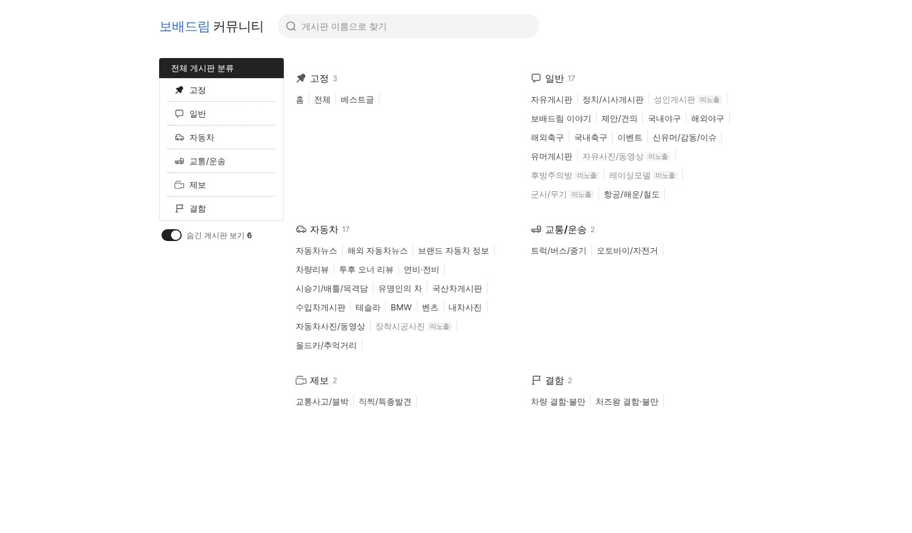
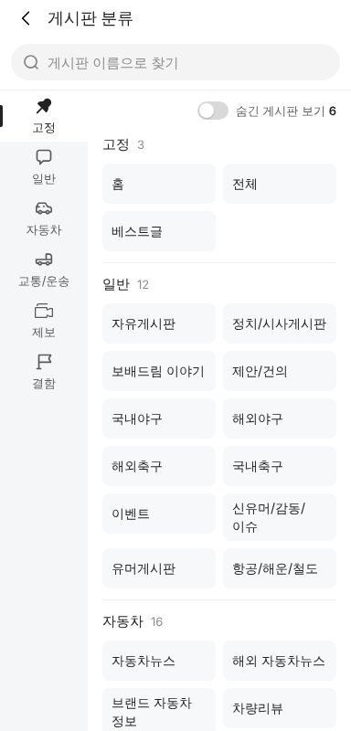
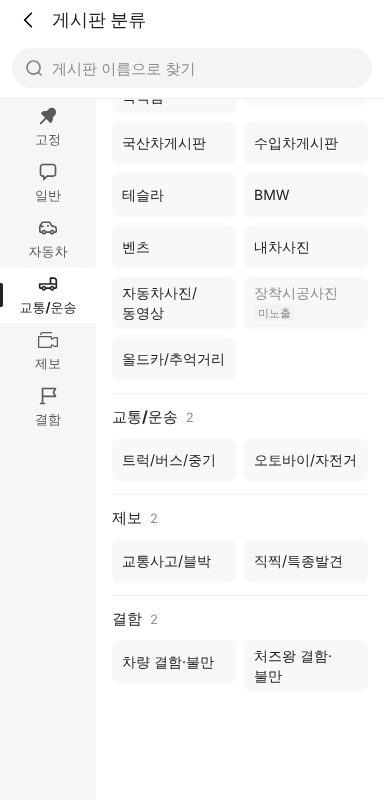
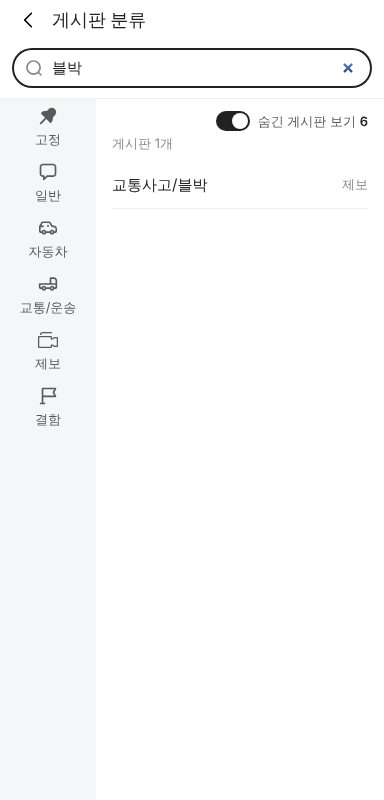

# PR #1117 커뮤니티 게시판 분류 화면 (바이두 티에바식)

## ① 한 줄 요약
커뮤니티 Nuxt 앱에 바이두 티에바 「全部贴吧分类」처럼 생긴 게시판 분류 화면을 만들고, 「차량」 묶음을 「교통/운송」으로 바꿨다.

## ② 과제 · 브랜치 · 커밋 · 상태
- 과제 ID: 없음(사용자 지시 「커뮤니티 카테고리 만들어보자 · 바이두처럼 · 차량을 교통/운송으로」)
- 브랜치 `community-category` · 커밋 `f849b1f5` · PR https://github.com/bobaekimboae/bobaedream/pull/1117
- 상태: 푸시 완료, 병합·배포 대기

## ③ 한 일
- 사용자가 준 트리(고정 · 일반 · 자동차 · 교통/운송 · 제보 · 결함, 게시판 43개)를 `nuxt-community/app/data/board-directory.ts` 한 곳에 담았다.
- 새 화면 `#/categories`: PC는 왼쪽 분류 목록 + 오른쪽 2열 글자 링크, 모바일은 왼쪽 세로 탭 + 오른쪽 2열 버튼.
- 「기본 미노출」 6개(성인게시판 · 자유사진/동영상 · 후방주의방 · 레이싱모델 · 군사/무기 · 장착시공사진)는 처음엔 숨기고 「숨긴 게시판 보기」 스위치를 켜면 회색 + `미노출` 딱지로 보인다.
- 게시판 이름 검색(띄어쓰기 무시), 결과 없으면 안내 + 검색 지우기.
- 지금 목록 화면에 있는 게시판(자유 · 정치 · 유머 · 국산차 · 수입차 · 트럭 · 바이크 · 블랙박스 · 제보 · 결함)은 누르면 그 게시판 목록으로 가고, 나머지는 「○○ 게시판은 준비 중이에요」 안내.
- 기존 목록의 「차량」 묶음 이름을 「교통/운송」으로 바꾸고, 게시판 메뉴(서랍) 머리에 `전체 분류` 버튼을 달았다.

## ④ 원본과 비교 (바이두 tieba.baidu.com/f/index/forumclass, 1523 폭 직접 측정)
| 항목 | 바이두 | 우리 |
|---|---|---|
| 왼쪽 분류 폭 | 210 | 210 |
| 왼쪽 머리 | 34 · 14px · 파랑 그림 바탕 | 34 · 14px · `#222` 바탕(파랑은 로고·주 버튼 전용 규칙) |
| 분류 줄 | 40 · 14px · 점선 `#B1B4B6` · 아이콘 16 | 40 · 14px · 점선 `#B1B4B6` · 아이콘 16 |
| 왼쪽 → 오른쪽 사이 | 10 | 10 |
| 오른쪽 열 | 2열 × 394 | 2열 × 394 |
| 묶음 제목 | 16/22 400 진한 파랑 | 16/22 700 `#222` + 아이콘 + 개수 |
| 게시판 링크 | 12px `#444` · 세로선 `#E3E3E3` · 줄 사이 12 | 14px `#444`(한글 가독성) · 세로선 `#E3E3E3` · 줄 사이 12 |
| 모바일 | (웹 없음, 티에바 앱 왼쪽 세로 탭 구조) | 왼쪽 탭 96 · 오른쪽 2열 버튼 44 |

   

## ⑤ 검증
- `pnpm typecheck` 통과, `pnpm test` 3개 통과, `pnpm generate` 성공
- PC 1536 · 모바일 384 가로 넘침 0, 콘솔 오류 0
- 모바일 왼쪽 「교통/운송」 누름 → 해당 묶음으로 이동 · 탭 강조, 검색 「블박」 → 교통사고/블박 → 블랙박스 게시판 목록으로 이동
- verify:qf · measure:qf는 퀵필터 변경이 없어 돌리지 않았다

## ⑥ 원본과 다르게 남긴 것과 이유
- 파란 머리·제목 대신 검정: 파랑은 로고·검색·주 버튼에만 쓰는 우리 규칙.
- 링크 글자 12 → 14: 한글 12px은 너무 작다(이전 지시 「14 너무 작아 보여」 기준과 같은 방향).
- 바이두의 마우스 올림 펼침 창 대신, 왼쪽 분류를 누르면 오른쪽 해당 묶음으로 이동한다(묶음이 6개라 한 화면에 다 보여 펼침 창이 필요 없음).

## ⑦ 못 한 것 · 다음
- 목록에 없는 게시판(보배드림 이야기 · 국내야구 · 자동차뉴스 등 30여 개)은 아직 「준비 중」. 목록 화면 데이터에 게시판을 늘리면 `boardId`만 이어 주면 된다.
- 「투후 오너 리뷰」는 받은 이름 그대로 넣었다(오타인지 확인 필요).
- 미노출 게시판의 실제 노출 조건(성인 인증 등)은 서버 권한 과제.

## ⑧ 확인 링크 (배포 후)
- 모바일 · PC: https://bobaekimboae.github.io/bobaedream/nuxt-community/#/categories
