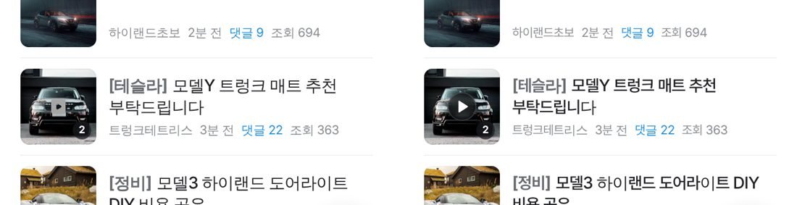
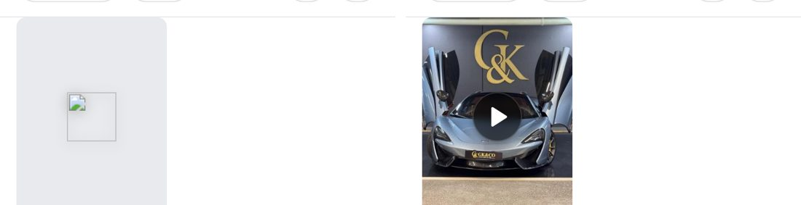
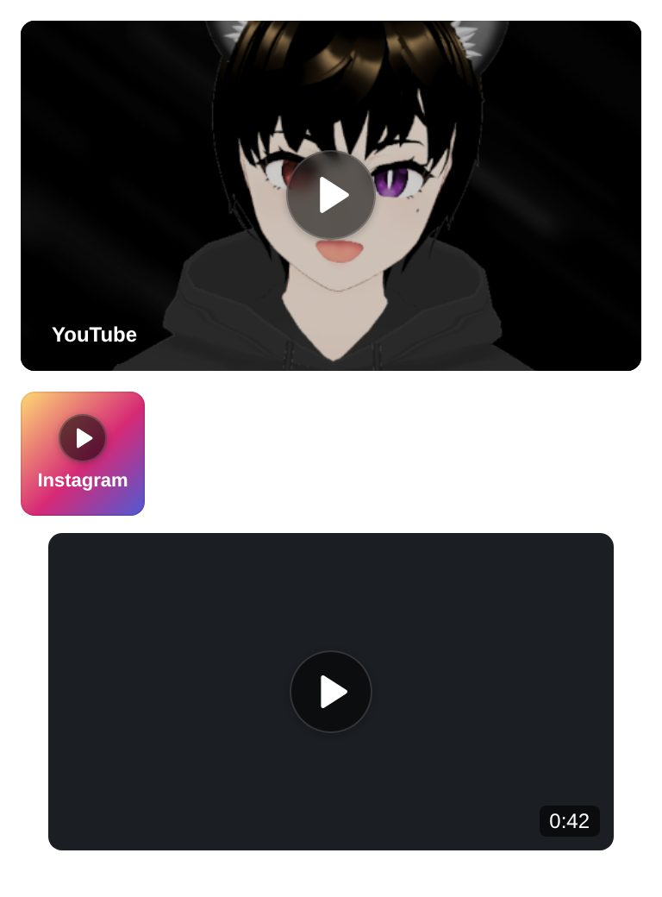

# PR #1118 커뮤니티 영상 썸네일 재생 아이콘 레딧 원본으로 교체

① 한 줄 요약: 커뮤니티 게시판의 영상 썸네일 재생 표시(▶)를 레딧 공식 원본 아이콘 + 반투명 검정 원으로 통일했다.

② 과제 ID: 없음(사용자 지시 「영상 플레이 버튼들 레딧 또는 치지직으로」) · 브랜치 `community-video-icons` · 커밋 34f85097 · PR https://github.com/bobaekimboae/bobaedream/pull/1118 · 상태: 병합 · 배포 완료(v=b9a0b2c, 번들 main-D9sbXrio.js, Deploy GitHub Pages 성공) · main 충돌(chotot-feed.css·hupu 캐시 번호) 해결 후 병합 · 함께 들어간 과제: 없음

③ 한 일
- 레딧 공식 아이콘 원본(reddit/devvit-docs 커밋 `b0a55e7`)에서 재생·영상 관련 8개를 `public/community/assets/reddit-video/`에 그대로 받았다(출처 `SOURCE.md`).
- 재생 표시 6곳을 같은 모양으로 바꿨다. 반투명 검정 원(56%) + 얇은 흰 테두리 + 흰 `play-fill` 아이콘이며, 원본 SVG는 고치지 않고 CSS mask로 흰색만 칠한다.
- 크기: 작은 썸네일(네이버 카페 좌측 · 토론 썸네일 · 목록) 원 28 / 아이콘 12, 큰 사진(카페 피드 · 초톳 피드 · 결함 영상 탭) 48 / 20, 링크 임베드 52 / 22.
- 예전 표시는 네이버 카페 「보기 방식」 아이콘(회색 네모)을 재생 버튼으로 잘못 쓰거나, CSS 삼각형을 그린 것이었다.
- 바뀐 CSS·JS 캐시 번호를 `20261102redditplay1`로 올렸다.

④ 원본과 비교(작업 전 → 후, 384px)
| 화면 | 전 | 후 |
|---|---|---|
| 카페 피드(`view=feed-cafe`) | 회색 네모 44 | 검정 원 48 + 레딧 ▶ |
| 카페 좌측 썸네일(`view=feed-cafe-left`) | 회색 네모 28 | 검정 원 28 + 레딧 ▶ |
| 초톳 피드(`view=feed-chotot`) | 초톳 흰 원 48 | 검정 원 48 + 레딧 ▶ |
| 토론 썸네일 · 결함 영상 탭 · 링크 임베드 | CSS 삼각형 | 검정 원 + 레딧 ▶ |

⑤ 검증: 수정한 JS 문법 검사 통과. 5개 보기 방식에서 페이지 오류 0건. 크기·배경색은 실측했다(48×48 · 28×28 · rgba(0,0,0,.56)). 퀵필터·매물 화면은 건드리지 않아 verify:qf·measure:qf 대상이 아니다.

⑥ 원본과 다르게 남긴 것: (판단) 초톳 비교 보기도 레딧 방식으로 통일 — 흰 차·흰 벽 사진에서 흰 원이 묻히기 때문. 치지직(네이버) 원본은 공개 아이콘 저장소가 없어 쓰지 않고 레딧 원본으로 통일했다. 초톳 비교 보기의 초톳 재생 아이콘도 통일을 위해 바꿨다. 목록형(`view=list`)과 컴팩트형은 원래 재생 표시를 숨기고 있어 그대로 둔다(컴팩트형은 레딧 원본 `video` 배지 유지).

⑦ 못 한 것 · 다음: 영상 길이 표시(0:42), 상세 화면 영상 플레이어(일시정지 · 소리) 아이콘 교체. 받아 둔 pause · volume 원본으로 할 수 있다.

⑧ 확인 링크(배포본, 실측 48·28·48 · 오류 0): https://bobaekimboae.github.io/bobaedream/community/naver-cafe-list.html?view=feed-cafe&v=b9a0b2c · `?view=feed-cafe-left` · `?view=feed-chotot`
