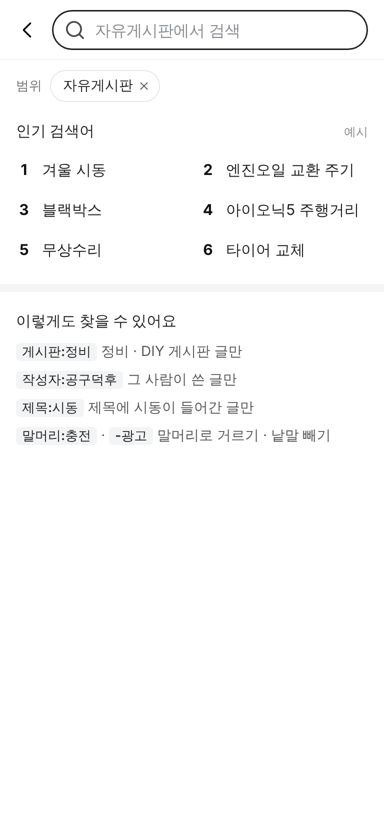
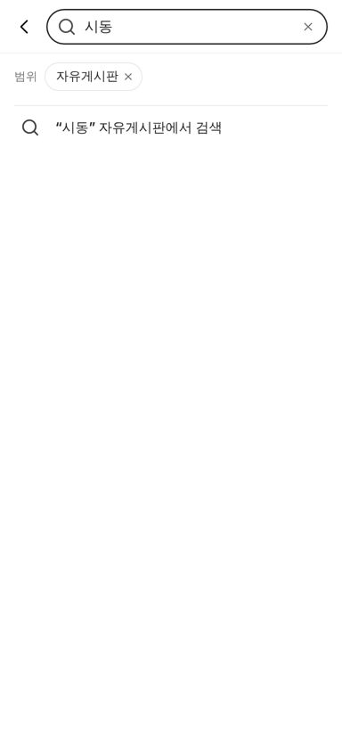
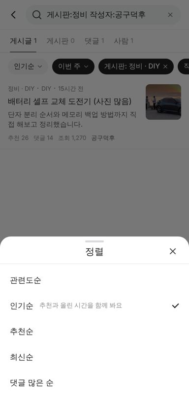

# PR #1119 커뮤니티 검색 화면 시안 (레딧식)

① 한 줄 요약: 커뮤니티에 레딧처럼 범위·탭·정렬·기간·검색어 문법이 있는 검색 화면(`/search`)을 만들었다.

② 과제 ID: 없음(사용자 지시 「레딧처럼 검색 기능」 → 「바로 진행해」 → 「어설프면 배포하지 말고」) · 브랜치 `community-search` · 커밋 `59f5ae70` → 보완 커밋(아래 ③ 보완) · PR https://github.com/bobaekimboae/bobaedream/pull/1119 · 상태: 푸시(병합·배포 대기) · 함께 들어간 과제: 없음

③ 한 일
- 목록 머리의 검색칸(눌러도 반응 없던 버튼)을 `○○게시판에서 검색` 링크로 바꿨다. 들어가면 그 게시판이 범위 알약으로 걸리고 ×로 전체에서 찾는다.
- 입력 전에는 최근 검색(이 브라우저에만 저장) · 인기 검색어(예시) · 검색어 문법 안내, 입력 중에는 0.15초 멈추면 게시판 · 사람 · 게시글 추천이 뜬다.
- 결과는 `게시글 · 게시판 · 댓글 · 사람` 탭, 정렬 5가지(관련도 · 인기 · 추천 · 최신 · 댓글 많은 순), 기간 6가지, 게시판별 대수 알약으로 좁힌다.
- 검색어 문법 `게시판:정비` `작성자:공구덕후` `제목:시동` `말머리:충전` `-광고` `"교환 주기"`를 지원하고, 건 조건은 검정 알약으로 보여 ×로 뺀다.
- "그랜저IG"와 "그랜저 IG"처럼 띄어쓰기가 달라도 찾고, 찾은 글자는 굵게 표시한다(HTML을 끼워 넣지 않고 글자 조각으로 그림).
- 인기순은 레딧 공개 코드(reddit-archive/reddit, CPAL 1.0)의 hot 식을 새로 작성했다: 추천 10배 = 12.5시간 늦게 올린 글과 같은 순위.
- 상태는 모두 주소(`q · type · sort · t · board`)에 둬서 결과를 공유·새로고침해도 그대로다. 서버 계약(Laravel Scout + Meilisearch 색인 · 정렬 · 거르기 칸 · 인기 검색어 Redis)은 `COMMUNITY_API_CONTRACT.md`에 적었다.

**보완(「어설프면 배포하지 말고」 뒤 자체 점검)**
- 목록에서 들어오면 지금 게시판으로 범위가 걸려 예시 글이 적은 게시판에선 첫 검색이 0건이었다. 기본을 「커뮤니티 전체」로 바꾸고 `커뮤니티 전체 | ○○게시판에서만` 두 알약으로 고르게 했다(주소 `from`). 머리 검색칸 문구도 「커뮤니티 검색」.
- 댓글 결과를 눌러도 상세에 그 댓글이 없었다. 상세가 예시 댓글을 보여 주고, 고른 댓글로 스크롤해 왼쪽 3px 검정 띠 + 연회색 바탕으로 표시한다(`?comment=`).

④ 원본과 비교
레딧 화면 캡처 대조는 하지 않았다(구성만 옮김). 우리 화면 캡처:

| 입력 전 | 입력 중 | 게시글 결과 |
| --- | --- | --- |
|  |  |  |

| 댓글 결과 | 검색어 문법 | 정렬 시트 |
| --- | --- | --- |
|  |  |  |

동작 점검(384 폭): 목록 → 검색 진입 시 `board=free` 범위 · Enter로 결과 · 범위 × → 전체 · 탭 바꾸기 · `게시판:정비 작성자:공구덕후` + 인기순 + 이번 주 → 1건 · 정렬 시트 열면 선택 항목에 포커스, Esc로 닫으면 알약으로 포커스 복귀 · `그랜저IG` → "그랜저 IG" 굵게 · 범위 안 0건이면 `전체 게시판에서 1개 보기`.

⑤ 검증
- `pnpm test` 12개 통과(새 검색 테스트 8개) · `pnpm typecheck` 통과 · `pnpm generate` 성공
- 콘솔 오류 0(모바일 384), 가로 넘침 없음(scrollWidth 384)
- `verify:qf` · `measure:qf`는 퀵필터 화면을 바꾸지 않아 돌리지 않았다.

⑥ 원본과 다르게 남긴 것
- 찾은 글자는 레딧처럼 굵게만 하고 노랑 배경은 쓰지 않았다.
- 인기 검색어는 서버가 없어 예시 6개를 고정으로 둔다(「예시」 표시).
- 게시판 결과를 누르면 그 게시판 목록으로 간다(레딧의 커뮤니티 미리보기 화면은 없음).
- 검색용 예시 글 12개(p6~p17)와 예시 댓글 12개를 더했다. 비어 있던 게시판 목록에도 이 글이 보인다.

⑦ 못 한 것 · 다음
- 서버 연결(Laravel Scout + Meilisearch 색인, `/v1/community/search`)과 인기 검색어 Redis 집계.
- 오타 허용과 의미 검색(하이브리드)은 서버 단계에서 Meilisearch로 붙인다.
- PC 폭 전용 배치(왼쪽 결과 · 오른쪽 게시판 추천)는 아직 없다(모바일 화면이 720 가운데).

⑧ 확인 링크
- 로컬 빌드 기준. 병합·배포 후: https://bobaekimboae.github.io/bobaedream/nuxt-community/#/search?q=겨울
- 목록에서 진입: https://bobaekimboae.github.io/bobaedream/nuxt-community/#/
