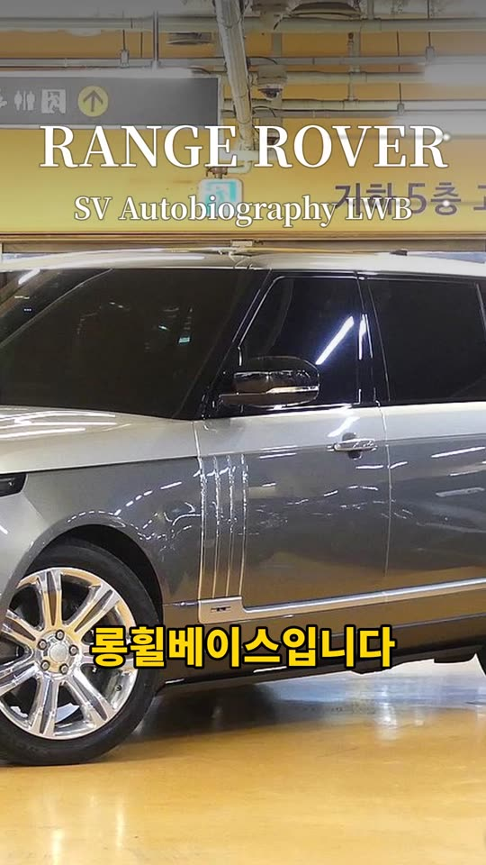
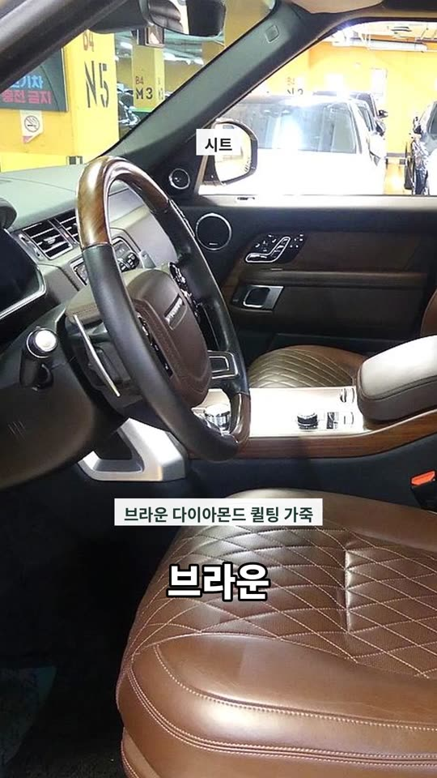
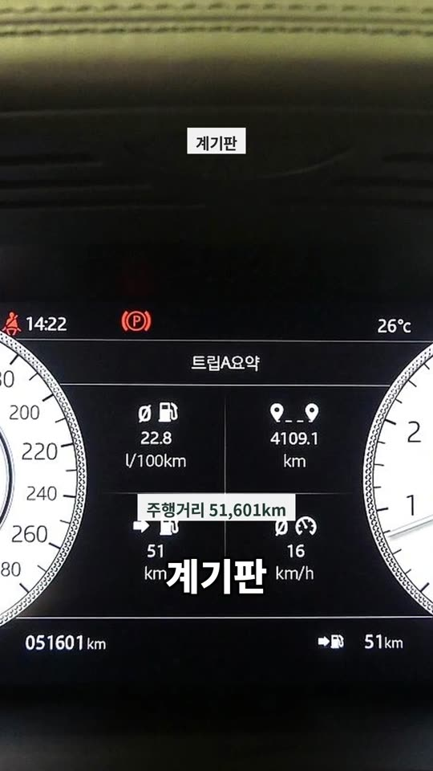

# PR #1120 딜러 내레이션형 숏폼 샘플 v01

① 한 줄 요약: 매물 사진 17장과 매물 정보만으로, 딜러가 매장에서 차를 한 바퀴 돌며 설명하듯 자동 편집한 63초 세로 숏폼 샘플을 만들어 배포했다.

② 과제 ID: 없음(사용자 지시) · 브랜치 `shortform-dealer-narration-sample` · PR https://github.com/bobaekimboae/bobaedream/pull/1120 · 상태: 병합·배포 · 이번 병합으로 main에 함께 들어간 과제: 없음

③ 한 일
- 서울오토갤러리 선우혁 딜러 릴스 3개를 분석했다(약 20컷, 한 컷 평균 3초, 한 낱말씩 뜨는 자막, 8단계 대본).
- 서울오토갤러리 레인지로버 SV 오토바이오그래피 매물로 대본을 썼다. 매장 설명 순서: 앞 → 옆 → 휠 → 뒤 → 엔진룸 → 운전석 → 시트 → 핸들 → 계기판 → HUD → 센터 → 카메라 → 기어 → 트렁크 → 정리.
- 문장 하나에 그 부위 사진 하나를 맞췄다(17컷). 사진은 천천히 확대·옆 이동.
- 남성 AI 음성의 낱말 시각으로 자막을 한 낱말씩 표시(숫자·핵심어 노랑). 위쪽 부위 이름, 흰 사양 알약, 7초 타이틀, 끝 딜러 명함.
- 확인 페이지에서 영상 옆 대본 줄을 누르면 그 장면으로 이동한다.

④ 원본과 비교
| 항목 | 선우혁 딜러 릴스 | 샘플 v01 |
|---|---|---|
| 길이 | 60~67초 | 63초 |
| 컷 | 약 20컷 · 평균 3초 | 17컷 · 문장 단위 |
| 자막 | 한 낱말씩, 흰 글씨 + 검은 테두리, 노랑 강조 | 같음 |
| 타이틀 | 6~9초, 브랜드 + 모델 + 빛 줄기 | 7~13초, RANGE ROVER / SV Autobiography LWB |
| 사양 알약 | 색상·트림·옵션가 | 롱휠베이스·엔진·시트·주행거리·HUD 등 |
| 음성 | 딜러 본인 | 남성 AI 음성 |
| 음악 | 로파이·하우스 | 없음 |

⑤ 검증
- 받아쓰기(faster-whisper)로 음성을 다시 들어 문장이 끊기지 않음을 확인.
- 2.5초 간격 장면 묶음으로 자막·부위·사양 알약 위치 확인.
- 정적 파일만 추가(앱 코드 변경 없음). 퀵필터 규격 측정 대상 아님.

⑥ 원본과 다르게 남긴 것
- 영상이 아닌 사진으로 만들어 움직임이 단조롭다(촬영키트 영상을 넣으면 해결).
- 사고 이력·가격은 매물 정보에 없어 말하지 않았다. 주행거리는 계기판 51,601km를 읽었다.
- 배경음악·표지(썸네일)는 없음.

⑦ 다음에 할 것
- 촬영키트 부위별 영상으로 교체, 상업용 무료 배경음악, 표지 그림.
- 숏폼 자동 제작 키트(nuxt-shortform)에 「딜러 내레이션형」 템플릿으로 붙이기(대본 생성·시각 맞추기는 Laravel 큐 + 받아쓰기 작업 서버).

⑧ 확인 링크
- https://bobaekimboae.github.io/bobaedream/shortform-samples/dealer-narration-v01/

캡처:   
