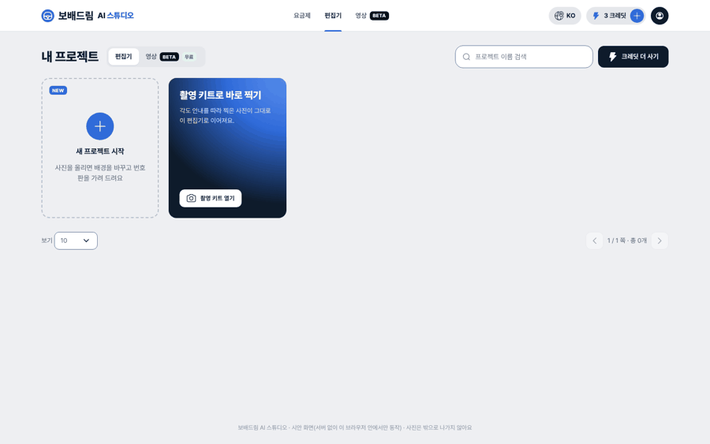
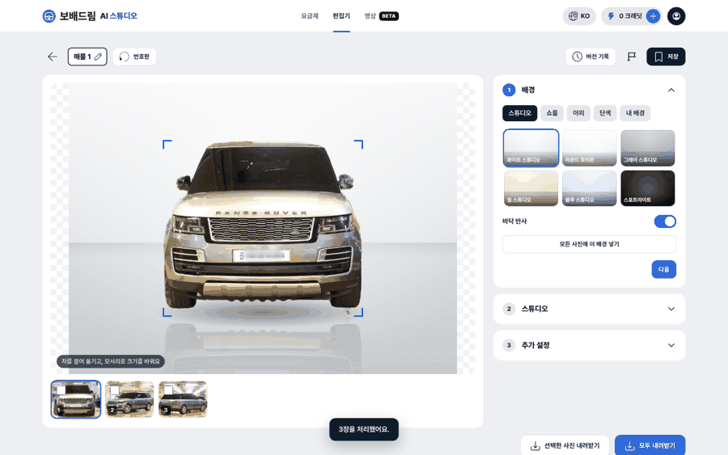
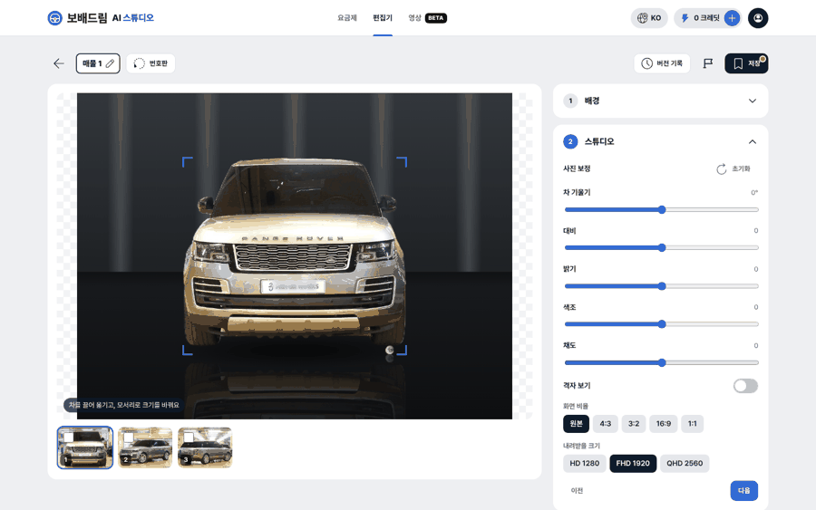
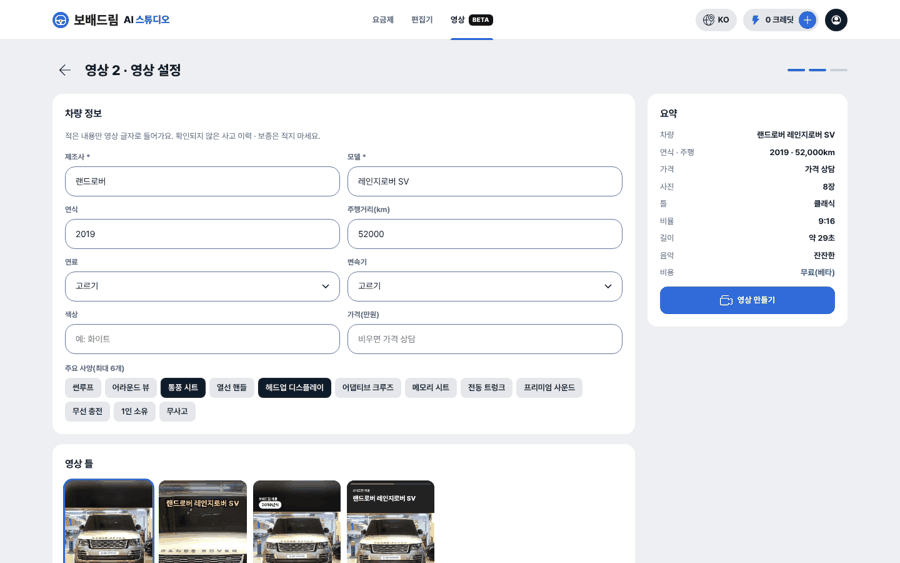
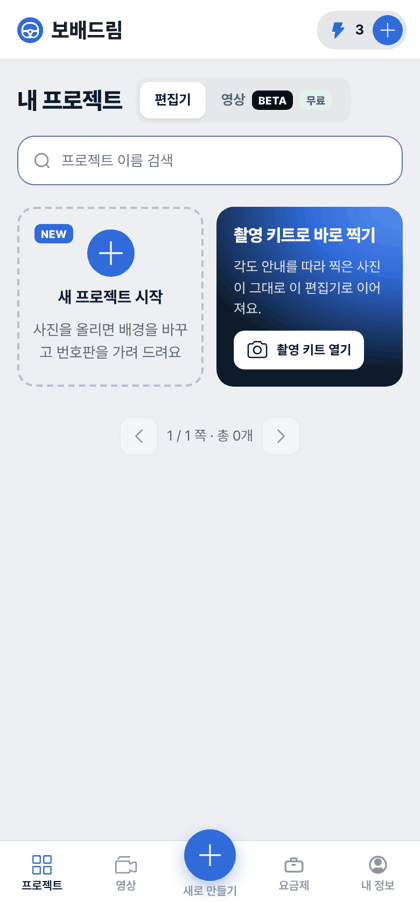
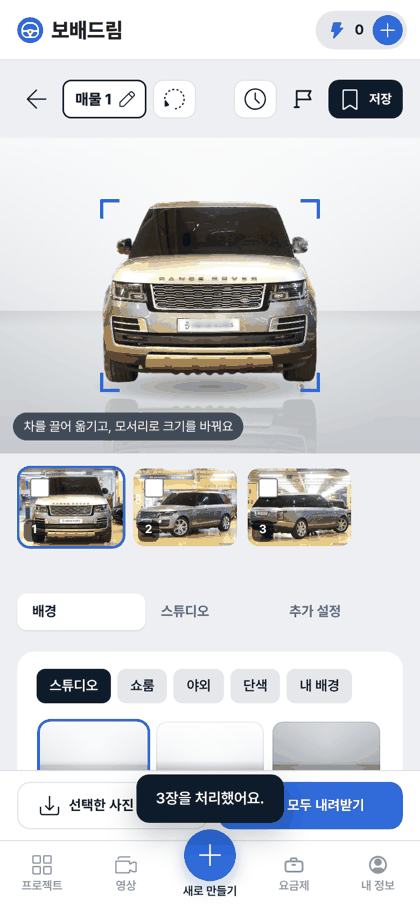
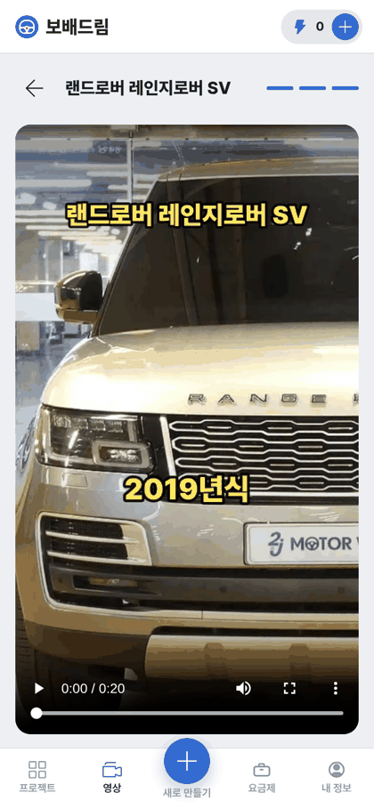
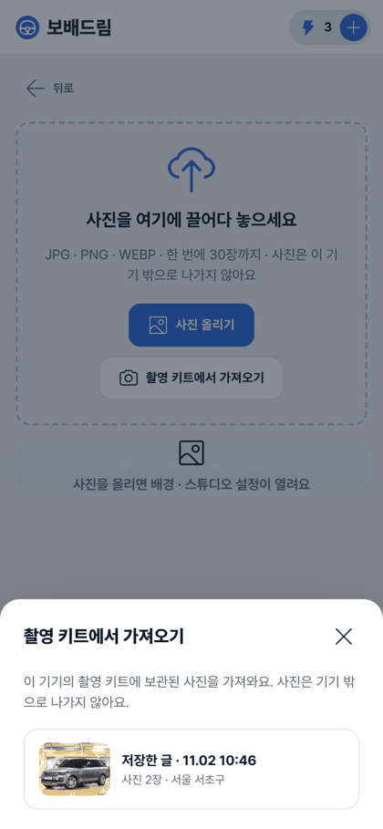

# PR #1121 보배드림 AI 스튜디오 — Car Studio AI 재현 시안 (PC 웹 + 모바일 앱)

## ① 한 줄 요약
Car Studio AI 편집기(사진 배경 바꾸기 · 번호판 · 영상)를 보배드림 기술 스택(Nuxt 4)으로 다시 만들고, PC 웹과 모바일 앱(홈 화면 설치형) 두 판으로 나눴으며 촬영 키트 사진을 바로 가져오게 연결했다.

## ② 과제 정보
- 과제 ID: 미지정(사용자 지시 「app.carstudio.ai 완벽하게 UI·UX·동작·인터랙션까지」 · 「PC 웹과 모바일 앱 2가지」)
- 브랜치: `carstudio-replica`
- 커밋: PR 참고
- PR: https://github.com/bobaekimboae/bobaedream/pull/1121
- 상태: 푸시 · 병합 대기(병합·배포는 승인 후)
- 함께 들어간 과제: 없음

## ③ 한 일
- Car Studio의 화면 순서를 그대로 옮겼다: 프로젝트 목록 → 사진 올리기 → 번호판 선택 → 편집기(배경 · 스튜디오 조정 · 추가 설정) → 내려받기, 그리고 영상 BETA · 요금제 · 내 정보.
- 차 오려내기는 서버 없이 기기 안에서 AI(U-2-Netp)로 한다. 촬영 키트 쇼룸과 같은 함수(`cutCar()`)를 나눠 쓴다.
- 배경 22종(스튜디오 · 쇼룸 · 야외 · 단색 · 내 배경)은 코드로 직접 그렸다. 차를 끌어 옮기고, 모서리로 크기를 바꾸고, 회전 · 밝기 · 대비 · 색감 · 반사 · 그림자 · 비율 · 해상도 · 로고를 고를 수 있다.
- 영상은 클래식 · 릴스 · 매물 카드 · 사진 띠 4가지 틀로 720×1280 mp4를 브라우저 안에서 만든다.
- 모바일 앱 판: 아래 탭 막대(프로젝트 · 영상 · 새로 만들기 · 요금제 · 내 정보), 창은 아래에서 올라오는 시트, 홈 화면에 설치 가능.
- 촬영 키트 연동: 같은 사이트의 촬영 키트 임시저장 사진을 「촬영 키트에서 가져오기」로 바로 불러온다.

## ④ 원본과 비교

| 영역 | Car Studio | 우리 |
|---|---|---|
| 프로젝트 목록 | 편집기/영상 구분 · 검색 · 카드 | 같음 + 촬영 키트 안내 카드 |
| 업로드 | 끌어다 놓기 · 30장 | 같음 + 촬영 키트에서 가져오기 |
| 번호판 | 자동 인식 · 흐림/흰 판/내 번호판 | 위치 상자 직접 맞춤 · 흐림/흰 판/내 번호판 |
| 배경 | 자체 배경 사진 | 코드로 그린 22종 |
| 스튜디오 | 회전 · 대비 · 밝기 · 색감 · 채도 · 격자 · 비율 · 해상도 | 같음 |
| 영상 | 템플릿 · 음악 · AI 음성 | 템플릿 4 · 음악 · AI 음성은 준비 중 |
| 색 | 주황 | 보배드림 파랑 `#306BD9` |

## ⑤ 검증
- `nuxi typecheck` · `nuxt generate` 통과.
- PC(1280) · 모바일(384) 전 흐름 자동 조작: 목록 → 업로드 3장 → AI 오려내기 → 배경 변경 → 번호판 → 스튜디오 → 압축 내려받기, 콘솔 오류 0.
- 영상: 클래식(PC, 29.4초) · 릴스(모바일, 20.6초) mp4 생성 확인.
- 촬영 키트 가져오기: 임시저장 사진 2장 불러옴, 설치 정보(manifest) 200.
- 퀵필터 화면(verify:qf · measure:qf)은 건드리지 않아 해당 없음.

## ⑥ 원본과 다르게 남긴 것과 이유
- Car Studio 배경 · 그림 · 로고 · 이름은 쓰지 않았다(저작권 · 사칭 방지).
- 번호판 자동 인식 대신 위치 상자: 번호판 사진·글자를 서버로 보내지 않기 위해.
- 결제는 시안(크레딧만 늘어남, 가격 미정). 데이터는 이 브라우저에만 저장.
- AI 음성은 준비 중 표시.

## ⑦ 못 한 것 · 다음에 할 것
- Car Studio 폰 앱이 휴대폰에 설치돼 있지 않아 앱 원본과는 대조하지 못했다(설치되면 휴대폰 연결로 대조).
- 다른 나라 상용 숏폼·사진 키트 재현(후보는 노션 의견 참고).
- 촬영 키트 → 스튜디오 바로 넘기기(키트 완료 화면 버튼), 서버 저장 · 결제 연결.

## ⑧ 확인 링크(병합·배포 뒤)
- PC 웹: https://bobaekimboae.github.io/bobaedream/nuxt-carstudio/
- 모바일 앱: https://bobaekimboae.github.io/bobaedream/nuxt-carstudio/?app=1
