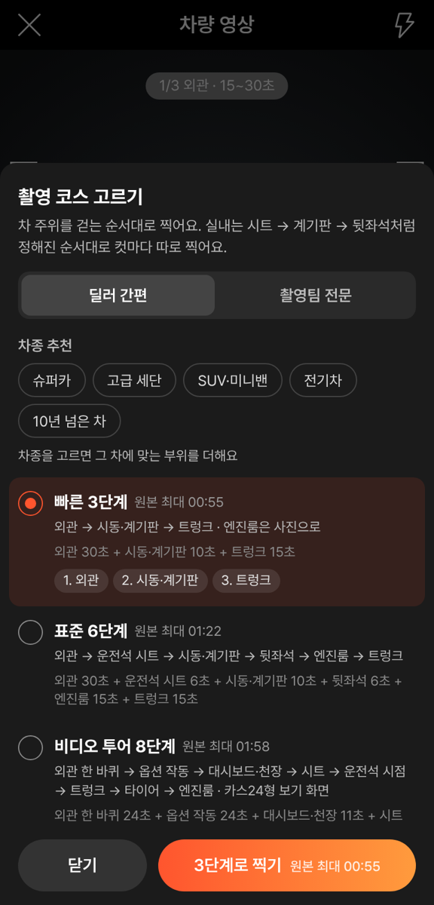
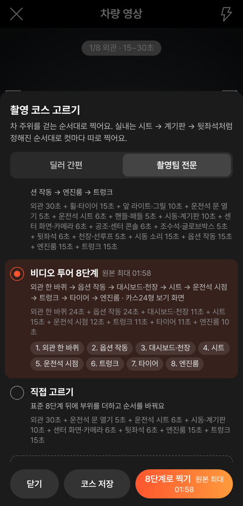
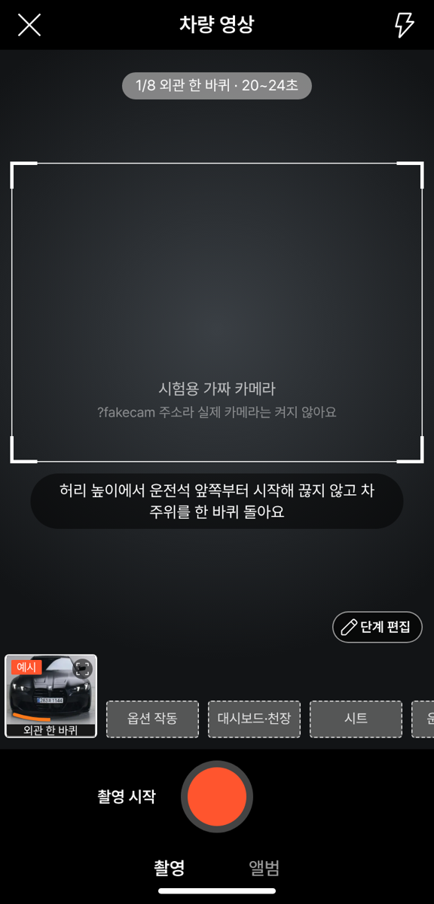
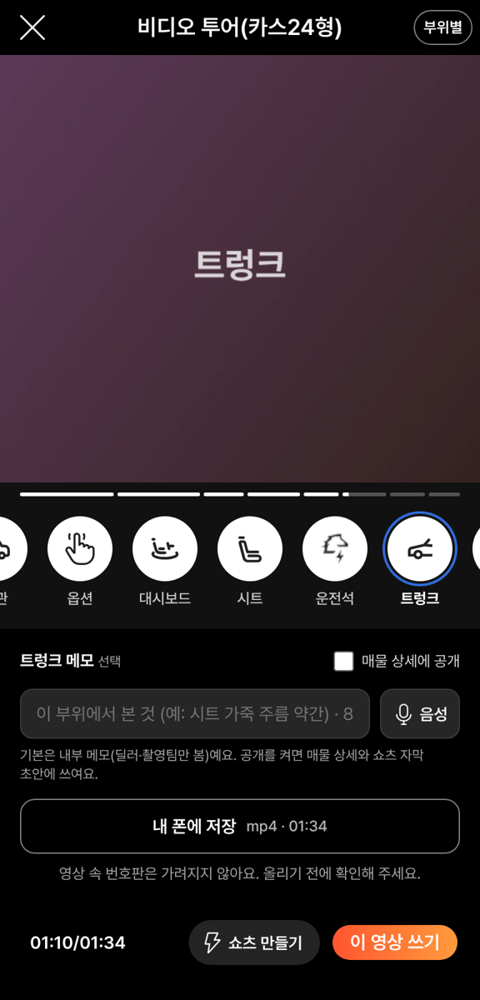

# PR #1122 촬영 쇼츠 키트 · 비디오 투어(카스24형)

## ① 한 줄 요약
촬영 쇼츠 키트 안에 `비디오 투어 8단계` 코스를 더했습니다. 이 코스로 찍은 영상은 아래 원형 부위 아이콘을 누르면 그 장면으로 바로 갑니다.

## ② 과제 · 브랜치 · 커밋 · 상태
- 과제 ID: 미지정(사용자 지시 「독립된 키트가 아닌 우리 키트 안에 명칭을 정해서 추가」)
- 브랜치: `shootkit-video-tour` · 커밋: `917dd969`(보고서 커밋 별도)
- PR: https://github.com/bobaekimboae/bobaedream/pull/1122
- 상태: 푸시만 함. 병합·배포 안 함(승인 필요). main에 함께 들어간 과제 없음.

## ③ 한 일
1. 호주 CARS24 비디오 투어 11대(웹 10 · 앱 1)의 부위 순서와 길이를 재서 8부위 코스를 정했습니다.
2. 순서와 길이(초): 외관 한 바퀴 20~24 → 옵션 작동 18~24 → 대시보드·천장 8~11 → 시트 11~15 → 운전석 시점 7~12 → 트렁크 9~11 → 타이어 7~11 → 엔진룸 6~10.
3. 부위마다 찍는 방법 안내를 우리 말로 새로 썼습니다(예: 허리 높이에서 끊지 않고 한 바퀴).
4. 딜러·촬영팀 코스 고르기 창에 이 코스가 나옵니다. 58 재현(`&vstage=58`)과 기존 코스는 그대로입니다.
5. 투어로 찍은 영상을 보는 화면 아래에 부위별 진행 막대와 원형 아이콘 줄을 넣었습니다. 아이콘을 누르면 그 장면으로 가고, 지금 부위는 파랑 고리로 표시합니다.

## ④ 원본과 비교

| 항목 | CARS24 | 우리 |
|---|---|---|
| 부위 수 · 순서 | 8부위(외관 → 옵션 → 대시보드 → 시트 → 운전석 → 트렁크 → 타이어 → 엔진룸) | 같음 |
| 전체 길이 | 평균 1:42(1:38~1:49) | 코스 최대 1:58, 최소 1:26 |
| 보는 화면 | 영상 아래 원형 아이콘 + 이름, 누르면 장면 이동 | 같음 |
| 지금 부위 표시 | 주황 고리 | 보배드림 파랑 `#306BD9` 고리 |
| 진행 표시 | 없음 | 부위별 진행 막대 3px 추가 |

동작 점검: 가짜 카메라로 8부위를 모두 녹화(합계 1:34) → 보는 화면에 아이콘 8개 → `트렁크`를 누르면 01:10으로 이동하고 파랑 고리 표시 → 정상.

## ⑤ 검증
- `nuxt typecheck` 통과 · `nuxt generate` 통과 · `public/nuxt-shootkit` 다시 복사
- 콘솔 오류: 모바일 384 폭 0건
- 딜러(`?role=dealer`) · 촬영팀(`?role=crew`) 모두 코스 보임, 58 재현(`?vstage=58`)에는 안 보임
- verify:qf · measure:qf: 퀵필터 화면을 바꾸지 않아 돌리지 않음

## ⑥ 원본과 다르게 남긴 것과 이유
- 고리 색은 주황 대신 보배드림 파랑입니다.
- CARS24 아이콘 · 문구 · 화면은 복사하지 않았습니다. 아이콘은 저장소의 원본(AS24 · 헤이카 상세 아이콘, 레딧 `tap-outline`)을 씁니다.
- 노션 아이콘 DB에 타이어 · 트렁크 전용 원본이 없었습니다. 그래서 타이어는 도로(주행거리) 아이콘, 트렁크는 차체(바디타입) 아이콘으로 대신했습니다.
- 예시 그림은 기존 단계(외관 · 옵션 · 대시보드 · 시트 · 계기판 · 트렁크 · 타이어 · 엔진룸) 그림을 빌려 씁니다.

## ⑦ 못 한 것 · 다음에 할 것
- 타이어 · 트렁크 원본 아이콘 받기
- 매물 상세 화면(사는 사람 화면)에 같은 아이콘 줄 연결: 지금은 키트 미리보기 · 편집 화면에만 있습니다.
- 투어 부위 칸이 촬영 화면에서 「추가 단계」처럼 점선으로 보입니다. 따로 구분할지 정해야 합니다.

## ⑧ 확인 링크(병합 · 배포 후)
- 키트: `https://bobaekimboae.github.io/bobaedream/nuxt-shootkit/?role=crew` → 영상 추가 → 단계 편집 → `비디오 투어 8단계`
- 카메라 없는 PC 시험: 주소 끝에 `&fakecam=1`
