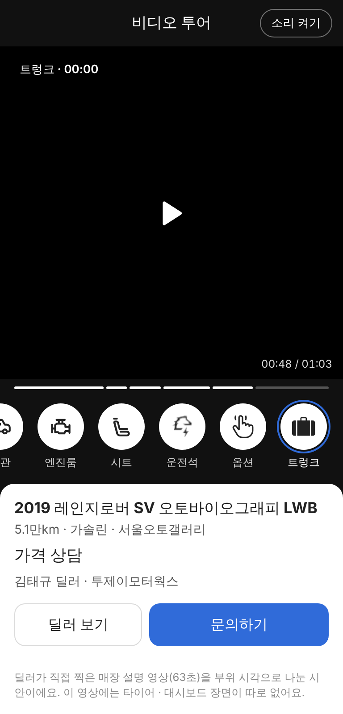
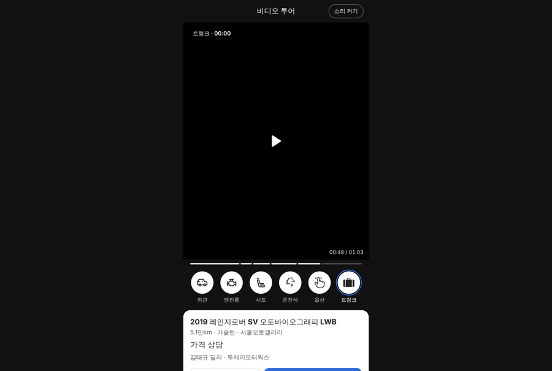
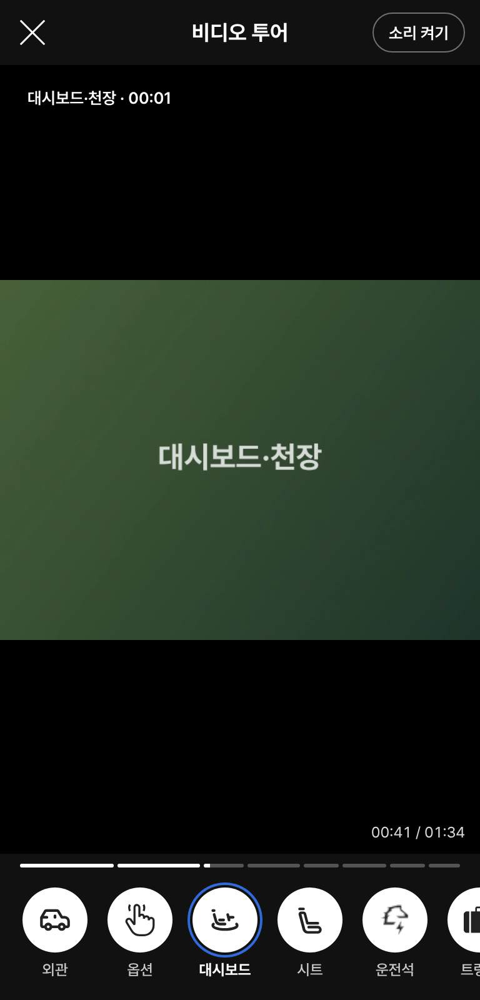

# PR #1123 촬영 쇼츠 키트 · 비디오 투어 보는 화면(카스24형)

## ① 한 줄 요약
사는 사람이 보는 비디오 투어 화면을 만들었습니다. 영상 아래 부위 아이콘을 누르면 그 장면으로 바로 갑니다.

## ② 과제 · 브랜치 · 커밋 · 상태
- 과제 ID: 미지정(사용자 지시 「카스 24 비디오 투어 화면 보기도 제작하자」 · 「아이콘은 노션에 있다」)
- 브랜치: `shootkit-tour-viewer` · 커밋: `2b1d7df3`(보고서 커밋 별도)
- PR: https://github.com/bobaekimboae/bobaedream/pull/1123
- 상태: 푸시만 함. 병합·배포 안 함(승인 필요).

## ③ 한 일
1. CARS24 비디오 투어처럼 세로 영상 하나와 부위별 시작·끝 시각으로 움직이는 보는 화면(`TourPlayer`)을 만들었습니다.
2. 화면 구성: 위 `비디오 투어` · `소리 켜기`, 가운데 영상(지금 부위 이름 · 시간), 아래 부위 진행 막대와 원형 아이콘 줄, 맨 아래 매물 카드(차명 · 사양 · 가격 · 딜러, `딜러 보기` · `문의하기`).
3. 아이콘을 누르면 그 부위로 가고, 부위가 끝나면 다음 부위로 저절로 넘어갑니다. 키보드 ← → 로도 부위를 옮깁니다.
4. 시안 주소 `?tour=demo`: 김태규 딜러의 레인지로버 매장 설명 영상(63초)을 부위 6개로 나눠 보여 줍니다.
5. 키트에서 투어 코스로 찍은 영상은 미리보기의 `사는 사람 화면으로 보기`를 누르면 같은 화면으로 볼 수 있습니다.
6. 타이어 · 트렁크 아이콘을 노션 「독일_오토24 › 차량 아이콘 › 부품/액세서리」 원본으로 바꿨습니다.

## ④ 원본과 비교

| 항목 | CARS24 | 우리 |
|---|---|---|
| 영상 | 세로 영상 하나 + 부위 시작·끝 시각 | 같음(부위별 파일도 이어서 틂) |
| 부위 이동 | 아래 원형 아이콘 누르기 | 같음 + ← → 키 |
| 지금 부위 | 주황 고리 | 보배드림 파랑 고리 |
| 진행 표시 | 없음 | 부위별 진행 막대 |
| 매물 정보 | 페이지 아래 차량 정보 | 흰 매물 카드 + 딜러 보기 · 문의하기 |

동작 점검(모바일 384 · PC 1280): 예시 영상에서 `트렁크` 누름 → 48.0초, ← 키 → `옵션` 39.5초. 키트 녹화본에서 `대시보드` 누름 → 00:41. Esc는 보는 화면만 닫고 미리보기는 남음. 콘솔 오류 0.

## ⑤ 검증
- `nuxt typecheck` · `nuxt generate` 통과, `public/nuxt-shootkit` 다시 복사
- 콘솔 오류: 모바일 · PC 0건
- 시험용 브라우저는 H.264 영상을 못 틀어서 예시 영상 캡처는 검은 화면입니다. 실제 크롬 · 사파리에서는 나옵니다(시각 이동은 확인).

## ⑥ 원본과 다르게 남긴 것과 이유
- 고리 색은 파랑, 진행 막대를 더했습니다.
- 소리는 브라우저의 자동 재생 제한 때문에 꺼진 채 시작하고 `소리 켜기`로 켭니다.
- 예시 영상은 CARS24 순서대로 찍은 영상이 아니라 매장 설명 영상이라 순서가 다르고, 타이어 · 대시보드 장면이 따로 없습니다.

## ⑦ 못 한 것 · 다음에 할 것
- 실제 매물 상세(중고차 상세 화면)의 `비디오 투어` 버튼과 연결
- 투어 코스로 실제 차를 찍은 예시 영상으로 교체
- `문의하기`는 지금 딜러 명함 화면으로 연결(채팅 연결은 서버 필요)

## ⑧ 확인 링크(병합 · 배포 후)
- 보는 화면 시안: `https://bobaekimboae.github.io/bobaedream/nuxt-shootkit/?tour=demo`
- 키트에서: `nuxt-shootkit/?role=crew` → 영상 추가 → 단계 편집 → 비디오 투어 8단계 → 찍은 뒤 `사는 사람 화면으로 보기`
