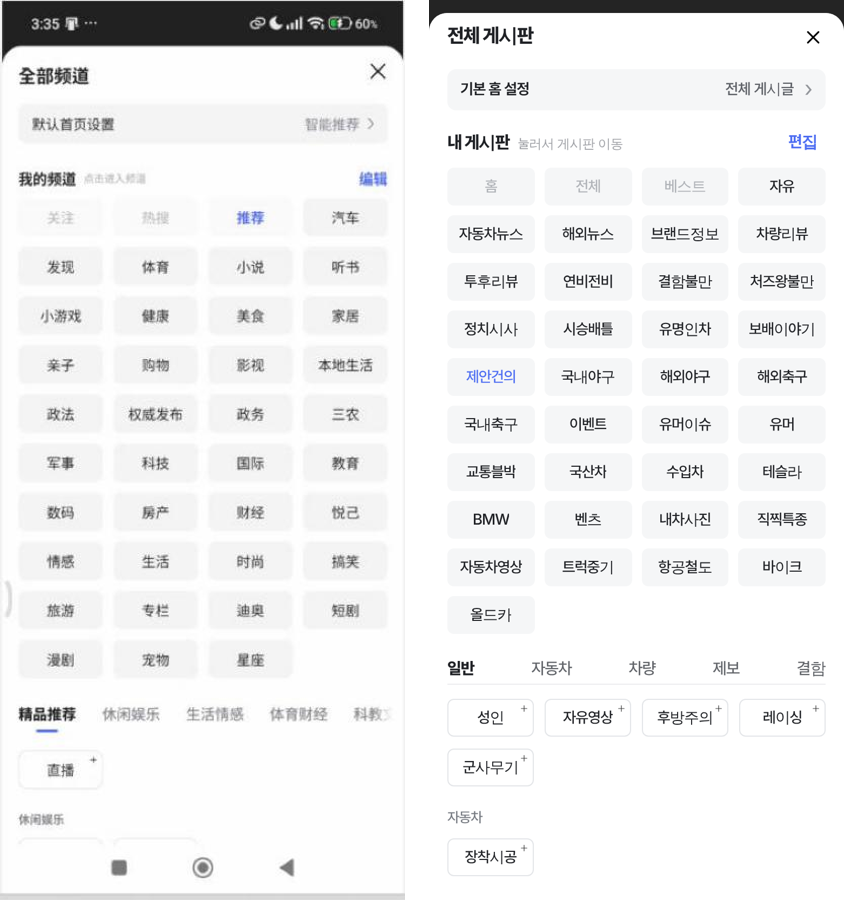
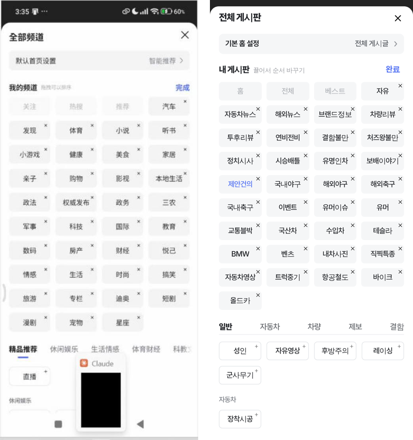
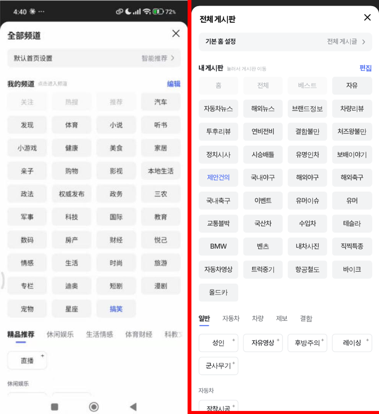

# 커뮤니티 게시판 바로가기 = 바이두 내 채널 관리

① 한 줄 요약: 커뮤니티 목록의 「전체 게시판」(게시판 바로가기) 창을 바이두 앱 「我的频道管理」와 같은 크기·동작으로 맞췄습니다.

② 과제 ID 미지정 · 브랜치 `community-board-shortcut` · 커밋 61aa9a6 · [PR #1124](https://github.com/bobaekimboae/bobaedream/pull/1124) · 상태: 푸시(병합·배포 전)

③ 한 일
- 폰의 바이두 앱 채널 관리 화면을 「휴대폰과 연결」로 직접 보고 눌러 보며 크기와 동작을 쟀습니다.
- 칸 크기·간격을 바이두에 맞췄습니다(좌우 17 · 칸 80×35 · 간격 10/11 · 반경 6).
- 아래 추천 칸에는 아직 넣지 않은 게시판만 4열로 보이고, 다 넣은 분류는 「모두 ‘내 게시판’에 추가했어요」만 보입니다.
- + 를 누르면 편집 모드가 아니어도 바로 내 게시판 끝으로 날아가 붙고, 그 게시판이 지금 게시판이 됩니다.
- 편집 중에는 칸 어디를 눌러도 빠지고, 빠진 칸은 원래 분류 자리로 날아갑니다.
- 평소에 칸을 길게 누르면 편집 모드가 되고, 편집 중 끌면 칸이 떠서 손가락을 따라오며 다른 칸들이 비켜납니다.
- 분류 탭은 아래로 굴리면 지금 보이는 분류로 따라 바뀝니다.

④ 원본과 비교 (왼쪽 바이두 · 오른쪽 우리)

| 항목 | 바이두(384 환산) | 작업 전 | 작업 후 |
|---|---|---|---|
| 좌우 여백 | 17~18 | 14 | 17 |
| 칸 / 피치 | 80×35 / 90·46 | 82×35 / 91·44 | 80×35 / 90·46 |
| 추천 칸 | 안 넣은 것만 4열, 흰 칸 + | 전부 2열, 넣은 것 파랑 점 | 안 넣은 것만 4열, 흰 칸 + |
| + 누르기 | 바로 추가·현재 채널 | 추가 + 알림 | 바로 추가·현재 게시판 |
| 편집 중 칸 누르기 | 빠짐 | × 만 | 칸 어디든 빠짐 |
| 끌기 | 칸이 떠서 따라옴 | 자리만 바뀜 | 떠서 따라옴 + 비켜남 |

⑤ 검증(2차 확인 추가): 폭 320 · 360 · 384 · 430에서 칸 크기·간격·글자 잘림·가로 넘침 점검 — 384에서 칸 80×35 · 간격 10/11 정확, 320에서는 글자 13px로 줄여 잘림 0, 가로 넘침 0, 콘솔 오류 0. PC 1280 마우스 끌기 · Esc 닫기 통과. 확인 중 찾아 고친 것: ① 예전 규칙이 간격을 9로 덮어써 10/11이 안 먹던 것 ② PC 마우스 끌기 중 화면이 멈추던 것(손가락 끌기 전용 설정이 마우스 끌기에도 걸림).

1차 검증: 384×832 터치 헤드리스로 추가 · 빼기 · 길게 눌러 편집 · 끌기(칸 중심과 손가락 차이 2px 안) · 짧게 끌고 놓아도 안 빠짐 · 키보드 화살표 이동 · 분류 탭 따라가기 모두 통과, 콘솔 오류 0. 정적 시안 파일이라 verify:qf 대상 아님.

### 3차 대조(10배 기준, 2026-11-02 16:10)
바이두 캡처와 우리 화면을 **같은 해상도로 줄여 같은 방법으로** 글자 잉크(실제 칠해진 부분) 높이·위치를 재서 맞췄습니다(창 윗변 기준, 384 환산).

| 항목 | 바이두 | 고치기 전 | 고친 후 |
|---|---|---|---|
| 제목 글자 높이 / 세로 위치 | 16.1 / 19.5~35.6 | 17.7 / 12.6~30.3 | 16.1 / 19.5~35.6 |
| 기본 홈 줄 높이 / 글자 높이 | 약 40 / 12.3 | 38 / 13.1 | 40 / 약 12.3 |
| 「내 게시판」 글자 높이 / 위치 | 13.8 / 118.8~132.6 | 16.1 / 111.8~128.0 | 13.8 / 118.8~132.6 |
| 칸 높이 / 세로 피치 | 약 37 / 46.4 | 35 / 46 | 37 / 46.4 |
| 칸 가로 간격 | 9.2 | 10 | 9 |
| × 위치(칸 안쪽 오른쪽·위) | 약 6.6 · 8 | 3.5 · 3.5 | 6 · 7 |
| 안내 글자 | 7.7(잉크) | 12px | 10px(한글 최소 가독 크기라 바이두보다 큼) |
| 칸 글자 높이 | 12.5 | 12.5 | 12.5(그대로) |

시험 다시 통과: 추가 · 빼기 · 길게 눌러 편집 · 손가락 끌기 · 짧은 끌기 · 키보드 · 분류 탭 · 폭 320~430 · PC 마우스 끌기 · Esc, 콘솔 오류 0. 폰 화면 연결은 폰 쪽 허용 대기로 실시간 재확인은 못 했습니다.

### 4차 실폰 대조(폰 연결 후, 2026-11-02 16:20)
- 분류 탭: 바이두는 왼쪽 정렬·글자 사이 26·밑줄 18.6×2.3 가운데·탭 아래 선 없음 → 맞춤(전: 양쪽 벌림·글자 폭 밑줄·회색 선).
- 탭이 굴리면 창 제목 아래에 붙고, 탭을 누르면 그 분류 제목이 바로 아래로 옴(마지막 분류도 위까지 올라옴) → 맞춤(전: 탭이 같이 올라가 사라짐).
- 분류 제목 12.5px, 제목→「모두 추가했어요」 20, 다음 분류까지 약 48 → 맞춤.
- 편집 중 + 로 넣은 게시판은 지금 게시판이 되지 않음(바이두 확인) → 우리도 같음.
- 「휴대폰과 연결」 마우스로는 길게 누르기·끌기가 폰에 전달되지 않아(화면만 굴러감) 바이두 끌기 동작은 직접 재지 못함.
- 시험 중 바이두 앱에서 「搞笑」 채널이 빠져 다시 넣었는데, 원래 자리(时尚 다음)가 아니라 맨 끝에 있습니다. 폰에서 길게 눌러 옮겨 주세요.

⑥ 원본과 다르게 남긴 것: 글자는 한국어 14px(바이두 중국어 15px), 고정 칸은 홈 · 전체 · 베스트 3개, 강조색은 기존 파랑 `#4E6EF2`.

⑦ 못 한 것: 바이두에서 길게 눌러 그대로 끌기로 이어지는지는 폰 마우스 조작으로 확인하지 못해 편집 모드 전환까지만 넣었습니다. 시험 중 바이두 앱에서 「娱乐」를 넣었다가 뺐고, 채널 관리 창은 편집 모드로 열려 있습니다.

⑧ 확인 링크: 병합 전 미리보기 없음 — 배포 후 `community/naver-cafe-list.html?board=suggestion&v=<커밋>` 에서 게시판 줄 오른쪽 버튼.

## 5차 대조 (2026-11-02 16:40, 와이파이 정상화 뒤 처음부터 다시)

이전 캡처는 폰 화면 가장자리를 3px 넓게 잘라 배율이 0.8% 틀려 있었다. 폰 화면 실제 가장자리(캡처 x 13~507)를 다시 재서 384로 환산했고, 우리 화면도 같은 배율(494/384)로 찍어 글자·칸의 잉크 위치를 비교했다.

| 항목 | 바이두 | 고치기 전 | 고친 뒤 |
|---|---|---|---|
| 좌우 여백(칸 왼쪽 끝) | 14.8 | 17.1 | 14.8 |
| 칸 폭 · 가로 간격 | 81.5 · 9.6 | 80.8 · 9.4 | 81.6 · 9.6 |
| 칸 줄 피치 | 47.0 | 46.5 | 46.9 |
| 둘째 줄 위 · 마지막 줄 위 | 191.2 · 567.4 | 190.4 · 562.8 | 191.2 · 567.4 |
| 기본 홈 줄 위 · 높이 | 54.4 · 38.1 | 51.3 · 39.6 | 54.4 · 37.3 |
| × 잉크 | 353.7~366.9 × 16.3~29.5 | 349.8~361.5 × 21.8~32.6 | 353.7~366.9 × 16.3~29.6 |
| 분류 탭 글자 위 · 밑줄 위 | 632.0 · 653.0 | 626.5 · 648.3 | 632.0 · 652.2 |
| 칸 바탕 · 고정 칸 바탕 | #F2F2F2 · #FAFAFA | #F5F6F7 · 같음 | #F2F3F4 · #FAFAFA |
| 칸 글자색 · 안내 글자색 | #333 · #B2B2B2 | #202226 · #A3A3A3 | #333 · #AEB1B5 |

동작 다시 확인(헤드리스 384): 추가·빼기·길게 눌러 편집·끌기·키보드·탭 따라가기·PC 마우스 끌기 통과, 폭 320~430 잘림·가로 넘침 없음, 콘솔 오류 0.
편집 모드 화면은 대조 도중 폰 연결이 다시 끊겨(PC 와이파이는 그대로, 폰 쪽 끊김) 이번에 다시 재지 못했다.

## 6차 대조 (2026-11-02 16:55, 배포본 afa36b7 기준 · 더 엄격하게)

- 배포본(`v=afa36b7`)을 같은 배율로 찍어 5차 값이 그대로 올라간 것을 먼저 확인했다(칸·줄·×·탭·색 모두 로컬과 같음).
- 아래쪽 「추천」 영역까지 넓혀 재고 고친 것: 탭 밑줄 → 첫 추가 칸 15.6 → 16.3(바이두 16.3), 추가 칸 아래 → 다음 분류 제목 23.3 → 20.2(바이두 20.9), 추가 칸 테두리 `#E3E5E8` → `#EBEDF0`(바이두가 더 옅음), 추가 칸 글자 `#202226` → `#333`, 칸 글자 굵기 500 → 400(바이두 보통 굵기), 4글자 이름(후방주의 · 군사무기)과 + 가 붙던 것을 띄움(최소 3.5).

동작 다시 확인(헤드리스): 추가·빼기·길게 누르기·끌기·키보드·탭 따라가기·PC 끌기 통과, 폭 320~430 이상 없음, 콘솔 오류 0. 편집 모드 실폰 대조는 폰 화면 공유가 다시 끊겨 못 했다.
