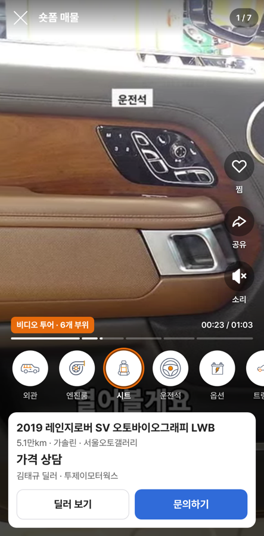
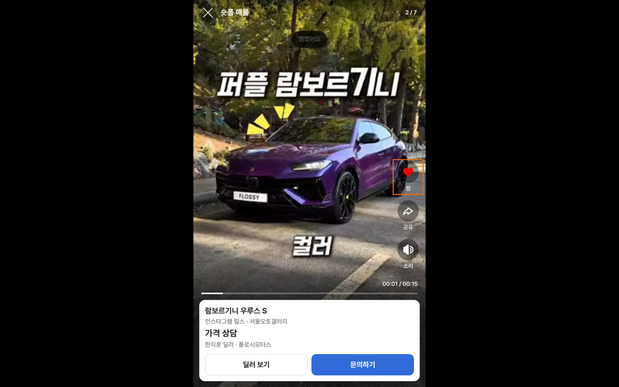

# PR #1141 촬영 키트 카스24형 숏폼 보기 화면

① 한 줄 요약: 카스24 비디오 투어처럼 부위 아이콘으로 장면을 옮겨 다니는 세로 숏폼 보기 화면을 만들고, 부위 아이콘을 노션의 호주 카스24 원본으로 바꿨다.

② 과제 ID 없음 · 브랜치 `shootkit-shorts-cars24` · PR https://github.com/bobaekimboae/bobaedream/pull/1141 · 상태: 병합·배포 완료(main 630d5a9, v=630d5a9, 번들 main-D4Vm_sei.js)

③ 한 일
- `nuxt-shootkit/?shorts=demo` 새 화면: 세로 영상을 위아래로 한 장씩 넘긴다. 보이는 영상만 재생한다.
- 부위 자료가 있는 영상은 아래에 부위 아이콘 줄이 나온다. 누르면 그 장면으로 가고, 지금 부위는 카스24와 같은 주황 고리다.
- 오른쪽에 찜(두 번 눌러도 찜) · 공유 · 소리, 아래에 매물 카드(딜러 보기 · 문의하기).
- 키보드: ↑↓ 영상, ←→ 부위, 스페이스 재생·멈춤, M 소리, Esc 닫기.
- 부위 아이콘 9개를 노션 「호주_카스 24 › 검사보고서」 원본 SVG로 바꿨다(그림 수정 없음). 기존 비디오 투어 화면에도 같이 적용된다.

④ 원본과 비교
| 항목 | 카스24 | 우리 |
|---|---|---|
| 세로 영상 + 부위 아이콘 줄 | 있음 | 있음 |
| 아이콘 눌러 장면 이동 | 있음 | 있음(측정 23.2초 시트 장면으로 이동) |
| 지금 부위 표시 | 주황 고리 | 주황 고리 #EF6E0B |
| 소리 꺼진 채 시작 | 있음 | 있음 |
| 찜 · 공유 | 있음 | 있음(아이콘은 초톳 원본) |

 

⑤ 검증: typecheck 통과. 모바일 384 · PC 1280에서 아이콘 6개 모두 불러옴, 부위 이동, ↓ 넘기기(2/7), 2번째 영상만 재생, 찜 켜짐, M 소리 켜짐, 가로 넘침 없음, 콘솔 오류 0. 시험용 브라우저가 mp4를 못 틀어서 같은 영상을 webm으로 바꿔 시험했다.

⑥ 원본과 다르게 남긴 것: 노션 카스24 DB에 찜 · 공유 · 소리 아이콘이 없어 초톳 · 레딧 원본을 썼다. 인테리어와 시트 아이콘이 비슷하게 생겼다. 릴스는 부위 시각 자료가 없어 진행 막대만 보인다(시각을 지어내지 않음). 가격은 정보가 없어 「가격 상담」.

⑦ 다음: 실제 폰에서 넘기기 감 확인, 릴스 부위 시각 입력 방법.

⑧ 확인 링크: https://bobaekimboae.github.io/bobaedream/nuxt-shootkit/?shorts=demo
