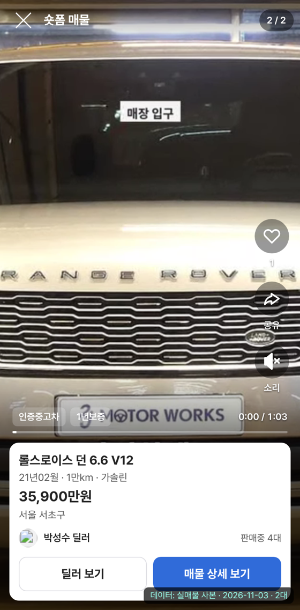
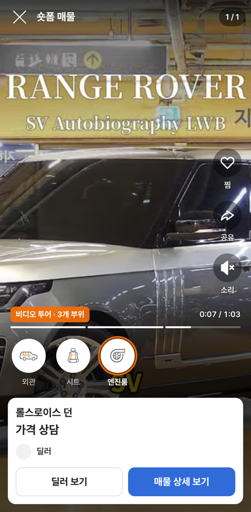
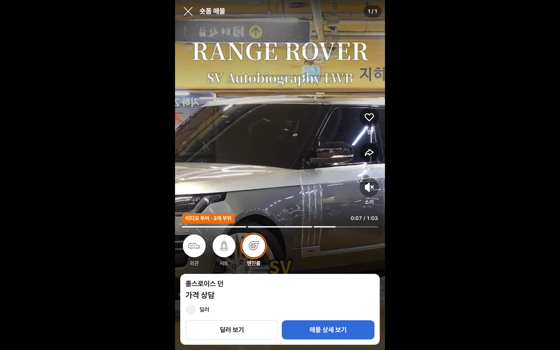
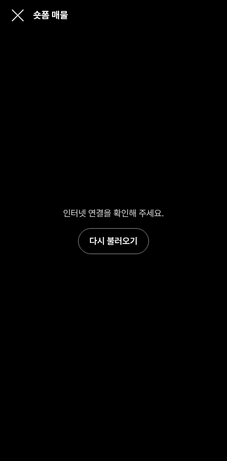

# PR #1143 숏폼 보기 상용 판

① 한 줄 요약: 숏폼 보기 화면을 시안이 아닌 상용 구조(리뉴얼 스택 Nuxt 4.6.2 화면 + Laravel 12 API + 보배드림 실매물)로 다시 만들었다.

② 과제 ID 없음 · 브랜치 `shorts-commercial` · 커밋 16b97e80 · PR https://github.com/bobaekimboae/bobaedream/pull/1143 · 상태: 푸시(병합·배포 전) · 함께 들어간 과제 없음

③ 한 일
- 화면을 촬영 키트(Nuxt 3) 안 시안에서 떼어 `nuxt-shorts/`로 새로 만들었다. 리뉴얼 스택: Nuxt 4.6.2 · Vue 3.5.33 · TypeScript 6.0.3 · pnpm 10.33.0, 색·크기는 CSS 사용자 속성(SCSS 안 씀).
- `shorts-api/`(Laravel 12)를 만들었다. 보배드림 리뉴얼 백엔드의 실매물 숏폼 API(`/v2/cars/shorts`, 한 번에 한 매물씩 줌)를 따라가며 여러 장을 모아 주고, 원본에 없는 비디오 투어 부위 시각·시청 기록만 PostgreSQL에 둔다. 찜은 로그인 토큰을 원본에 그대로 넘긴다.
- 실매물: 원본에서 판매중 숏폼 매물을 그대로 받는다. GitHub Pages는 원본 서버가 다른 주소를 막아(CORS) 받아 둔 실매물 사본을 보여 준다(안심번호 뺌).
- 유튜브 쇼츠 주소 매물도 튼다(쿠키 없는 유튜브 퍼가기).
- 상용 처리: 불러오는 중·실패·매물 없음·영상 실패 화면, 끝 가까이에서 다음 매물 이어 받기, 공유 주소(`?id=`), 찜(로그인 = 계정 / 아니면 이 기기), 다른 앱으로 가면 멈춤, 키보드·화면 낭독기·움직임 줄이기.
- 계약 문서 `docs/shorts-api.md` · `shorts-api/openapi.yaml`.

④ 원본과 비교: 원본(촬영 키트 안 `?shorts=demo`)과 화면 구성(세로 피드 · 오른쪽 찜·공유·소리 · 부위 아이콘 · 매물 카드)은 같고, 데이터가 가짜 → 실매물로 바뀌었다.

| 항목 | 전(시안) | 후(상용) |
|---|---|---|
| 스택 | Nuxt 3.21 · npm | Nuxt 4.6.2 · TS 6.0.3 · pnpm |
| 데이터 | 영상 7개(데모 · 릴스, 가격 상담) | 보배드림 실매물(오늘 2대: 유튜브 1 · mp4 1) |
| 서버 | 없음 | Laravel 12 API(피드 · 한 매물 · 찜 · 시청 · 부위) |
| 이어 받기 | 없음(고정 7개) | 끝 두 장 전에 다음 매물 |
| 실패 화면 | 없음 | 불러오기 실패 · 영상 실패 · 없음 |
| 찜 | 이 기기만 | 로그인 = 계정, 아니면 이 기기 |
| 문의 | 가상 명함 | 안심번호 전화 · 매물 상세 · 딜러 페이지(리뉴얼 사이트) |

   

⑤ 검증
- `pnpm typecheck` 통과, `pnpm export` 빌드 통과(첫 화면 JS 약 184KB).
- `bash shorts-api/tests/smoke.sh` 30개 통과(피드 · 영상 없는 매물 건너뜀 · 다음 장 · 끝 · 잘못된 값 422 · 없음 404 · 찜 401/성공 · 시청 2초 · 30분 중복 · 부위 권한 · 겹침 422 · CORS).
- 실제 원본(staging)에 붙여 피드 2대 확인.
- 자동 브라우저 시험 모바일 384 · PC 1280: 콘솔 오류 0, 가로 넘침 없음, ↓ 키로 2/2 · 주소 `?id=` 바뀜 · 보이는 영상만 재생, 찜 → 이 기기 찜 안내, API 모드 부위 3개 아이콘 모두 뜸 · 엔진룸 누르면 7.1초로 이동 · 주황 고리, M 소리 켜짐, 서버 없을 때 실패 화면 · 다시 불러오기, Tab 순서(닫기 → 찜 → 공유 → 소리 → 차명 → 딜러 보기 → 매물 상세).
- `npm run check:runtime` 통과. 퀵필터 화면은 건드리지 않아 verify:qf · measure:qf 대상 아님.
- 시험 브라우저가 H.264 영상을 못 틀어 영상은 같은 길이 webm으로 바꿔 시험했고, 유튜브는 접속 막힘으로 빈 화면으로 시험했다.

⑥ 원본과 다르게 남긴 것
- 원본 서버의 시청 기록(`/v2/car-videos/{id}/views`)은 영상 번호가 응답에 없어 shorts-api가 따로 센다.
- GitHub Pages는 원본 서버가 다른 주소를 막아 실시간 대신 사본을 보여 준다(같은 도메인·shorts-api 연결이면 실시간).

⑦ 못 한 것 · 다음에 할 것
- shorts-api 서버 올리기(Vercel 무료 또는 보배드림 서버). 올리면 GitHub Pages도 실시간 실매물·부위·시청 기록이 된다.
- 원본 숏폼이 2대뿐이라 넘김 · 이어 받기는 실데이터로 길게 시험하지 못했다(가짜 원본으로 시험).
- 실기기(아이폰 · 안드로이드)에서 H.264 · 유튜브 재생, 손가락 넘김 감 확인.
- 촬영 키트에서 비디오 투어로 찍어 올린 매물의 부위 시각을 shorts-api에 넣는 연결.

⑧ 확인 링크: 병합·배포 뒤 https://bobaekimboae.github.io/bobaedream/nuxt-shorts/ (데이터 출처 표시 `?debug=1`)
