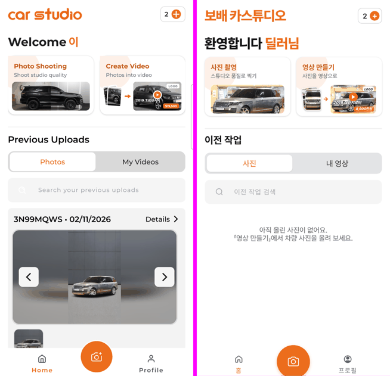
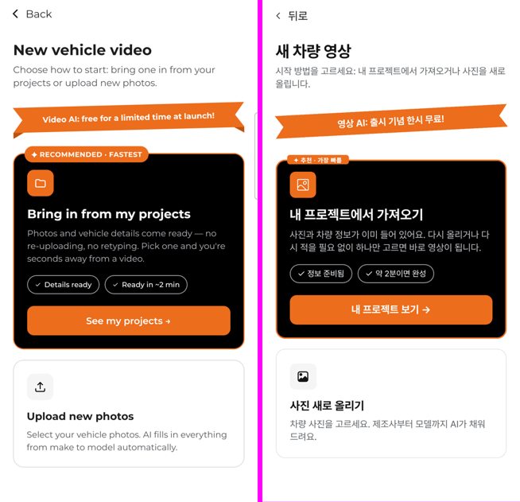
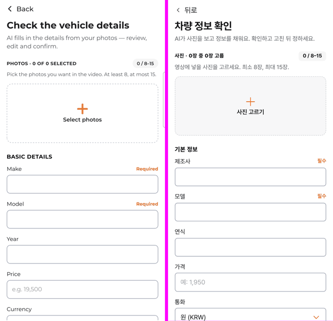
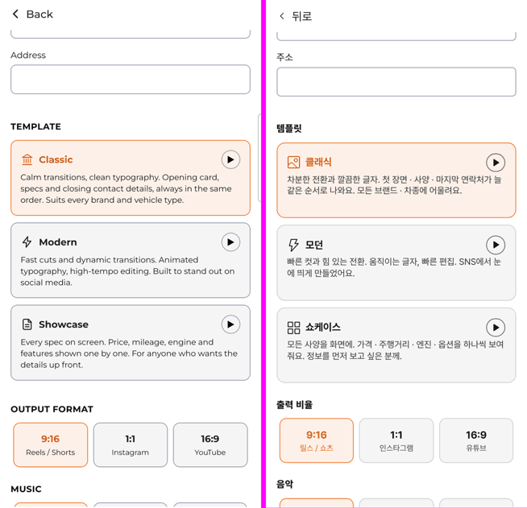
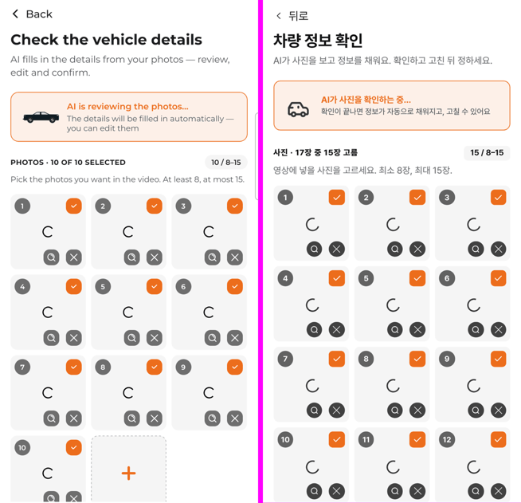
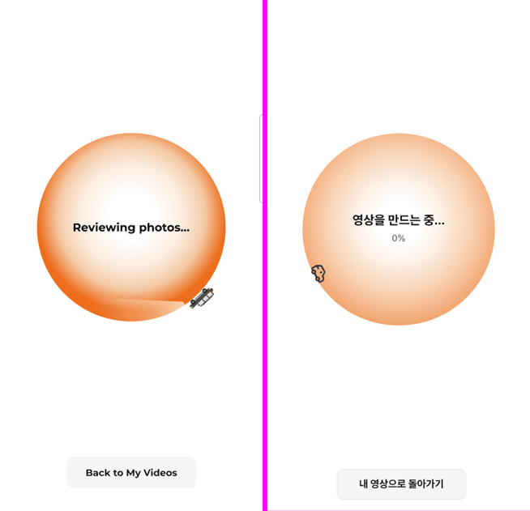
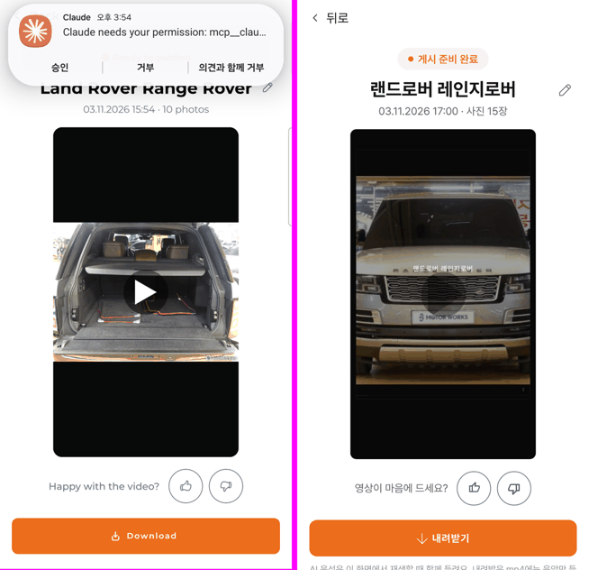
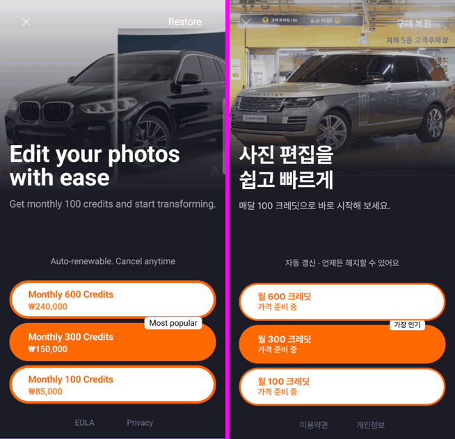

# PR #1148 보배 카스튜디오 원본 수치 대조

## ① 한 줄 요약
원본 Car Studio AI의 화면 구조 기록(폰에서 뽑은 요소 위치·크기)과 우리 화면을 같은 좌표로 재서, 모바일 전 화면의 크기·간격·색·동작을 원본에 맞췄습니다.

## ② 과제 · 브랜치 · 커밋 · 상태
- 과제 ID: 없음(사용자 지시 「10배 강화된 검수로 UI·UX·기능·인터랙션 100% 동일하게」)
- 브랜치: `carstudio-parity`
- 커밋: `a2d88c28` 외 보고서 커밋
- PR: https://github.com/bobaekimboae/bobaedream/pull/1148
- 상태: 푸시 완료 · 병합 전 · 배포 전
- 이번 병합으로 main에 함께 들어가는 과제: 없음

## ③ 한 일
1. 폰의 원본 화면 25장과 화면 구조 기록 20개(요소마다 위치·크기가 들어 있는 파일)를 받아, 우리 화면도 같은 기준(가로 384, 상태표시줄 아래부터)으로 재서 비교했습니다.
2. 머리(높이 47 · 뒤로 17px), 제목(24/28), 홈(머리 63 · 카드 171×117 · 탭 41.6 · 검색 48 · 아래 막대와 가운데 버튼 66.8)을 원본 값으로 바꿨습니다.
3. 차량 정보 확인 화면: 칸 이름 14px, 입력칸 43.4, 칸 사이 15.7, 구역 제목 위 23.4·아래 11.7, 사진 칸 112×112·간격 7.9, 템플릿·출력 비율·음악·로고·언어 칸 크기를 원본에 맞췄고, 여백이 겹쳐 줄어들던 문제를 막았습니다.
4. 원본처럼 사진을 고르면 「AI가 사진을 확인하는 중…」 띠가 뜨고 칸마다 도는 표시가 나온 뒤 정보가 채워집니다. 확인 중에는 「영상 만들기」가 눌리지 않습니다.
5. 만드는 중(원 276 · 가장자리를 도는 차 · 아래 버튼), 결과(알약 · 영상 244×434 · 누르면 재생/멈춤 · 의견 버튼 45), 결제(위 차 사진 · 알약 3개 · 가운데 「가장 인기」 채움), 저장 완료 시트(초록 체크 · 주황 닫기)를 원본 구성으로 바꿨습니다.
6. 아이콘의 크기가 다른 규칙에 덮여 커지던 문제(시작 화면 체크, 사진 고르기 +), 결과 화면에서 이름을 바꾸면 영상이 처음으로 돌아가던 문제, PC 홈 카드에서 글자와 사진이 겹치던 문제를 고쳤습니다.

## ④ 원본과 비교

원본 위치(y)와 우리 위치의 차이입니다(단위 CSS px, 상태표시줄 포함 좌표).

| 화면 · 요소 | 원본 | 작업 전 | 작업 후 |
|---|---|---|---|
| 홈 · 환영 글자 | 104.9 | 131.1 (+26.2) | 104.9 (0) |
| 홈 · 기능 카드 | 148.3 | 179.1 (+30.8) | 148.2 (−0.1) |
| 홈 · 이전 작업 제목 | 302.6 | 338.1 (+35.5) | 302.6 (0) |
| 홈 · 탭 | 338.5 | 379.1 (+40.6) | 338.4 (−0.1) |
| 홈 · 검색칸 | 391.8 | 435.6 (+43.8) | 391.6 (−0.2) |
| 홈 · 크레딧 | 50.1 | 64.1 (+14) | 50.1 (0) |
| 시작 · 제목 | 97.1 | 110.1 (+13) | 96.8 (−0.3) |
| 시작 · 추천 카드 제목 | 343.8 | 350.1 (+6.3) | 343.4 (−0.4) |
| 프로젝트 · 제목 | 81.4 | 110.1 (+28.7) | 81.1 (−0.3) |
| 정보 확인 · 제목 | 81.4 | 110.1 (+28.7) | 81.1 (−0.3) |
| 정보 확인 · 사진 고르기 칸 | 232.5 | 250.1 (+17.6) | 212.4 (−20.1, 한국어 설명이 1줄 짧음) |
| 만드는 중 · 원 위 | 232.2 | 없음(원 250, 머리 있음) | 232.1 |
| 만드는 중 · 버튼 | 706.5 | 원 바로 아래 | 706.6 |

차이가 남은 곳(시작 화면 아래 카드 −19.4, 정보 확인 −20.1)은 영어 설명이 3줄·2줄인데 한국어는 한 줄 짧아서 생긴 차이입니다. 간격 값은 원본과 같습니다.

동작 점검 42개(모두 통과): 홈 탭 전환, 결제창 열기·알약 선택·닫기·Esc, 시작 → 프로젝트 → 정보 확인, 검토 띠·확인 중 만들기 막힘·정보 채움, 사진 고름 풀기·크게 보기·빼기, 고르기 시트, km/mi, 구매자 질문 고르기·다시 눌러 풀기, 템플릿·미리보기, 비율, 음악, AI 음성 스위치, 언어, 영상 만들기 → 만드는 중 → 결과, 재생·누르면 멈춤, 좋아요, 이름 바꾸기, 내려받기(영문 파일 이름)·저장 시트, 홈 영상 카드 재생, 사진 넘기기, 프로필.

| 원본 · 우리 | |
|---|---|
| 홈 |  |
| 새 영상 시작 |  |
| 정보 확인 위 |  |
| 템플릿 · 출력 비율 |  |
| 사진 검토 중 |  |
| 만드는 중 |  |
| 결과 |  |
| 결제 |  |

## ⑤ 검증
- `nuxt typecheck` 통과, `nuxt generate` 통과
- 콘솔 오류: 모바일 384 · PC 1440 모두 0 (화면을 떠날 때 지운 사진 주소의 불러오기 취소만 기록됨)
- 가로 넘침: PC 1440 홈·시작·정보·만드는 중·결제 모두 없음
- `verify:qf` · `measure:qf`: 이번 작업은 `nuxt-carstudio`만 바꿔 퀵필터 화면은 바뀌지 않아 돌리지 않았습니다.

## ⑥ 원본과 다르게 남긴 것과 이유
- 글은 한국어, 로고 글자는 「보배 카스튜디오」, 언어 목록에 「한국어」를 더했습니다.
- 원본은 결제 알약을 누르면 바로 스토어 결제로 넘어가지만, 우리는 결제가 아직 없어 「준비 중」 안내만 띄웁니다. 가격 자리에는 「가격 준비 중」을 씁니다.
- 원본 홈의 「이」는 계정 이름이라 「딜러님」으로 씁니다.
- 사진 자동 인식은 서버 연결 전이라, 새로 올린 사진은 확인 표시 뒤 「직접 적어 주세요」 안내가 나옵니다(프로젝트에서 가져오면 정보가 채워짐).
- 아이콘은 원본 그림 대신 저장소의 초톳·레딧·오토스카우트·에어비앤비 원본 아이콘으로 바꿨습니다(뒤로·꺾쇠·좋아요/별로·차 윤곽).
- 결과 화면 아래 「AI 음성은 이 화면에서만 들려요」 안내 한 줄은 원본에 없지만, mp4에 음성이 없다는 사실을 알려야 해서 남겼습니다.

## ⑦ 못 한 것 · 다음에 할 것
- 원본의 드롭다운(변속기 등) 목록 모양, 결제 후 화면, 내 영상 카드의 공유 시트는 폰에서 재지 못해 기존 모양 그대로입니다.
- 원본 만드는 중 화면의 차 그림이 움직이는지는 녹화가 없어 확인하지 못했고, 천천히 도는 것으로 두었습니다.
- PC 판은 원본이 없어 모바일 값을 넓힌 그대로입니다.

## ⑧ 확인 링크(배포 뒤)
- 모바일: https://bobaekimboae.github.io/bobaedream/nuxt-carstudio/?m=1
- PC: https://bobaekimboae.github.io/bobaedream/nuxt-carstudio/?pc=1
