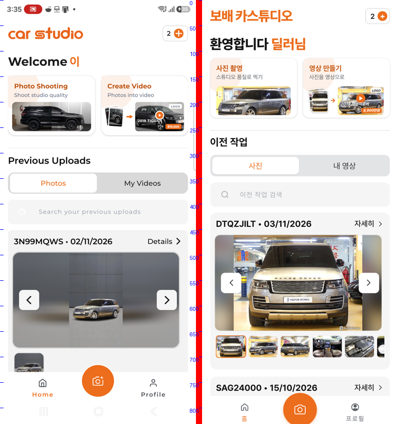
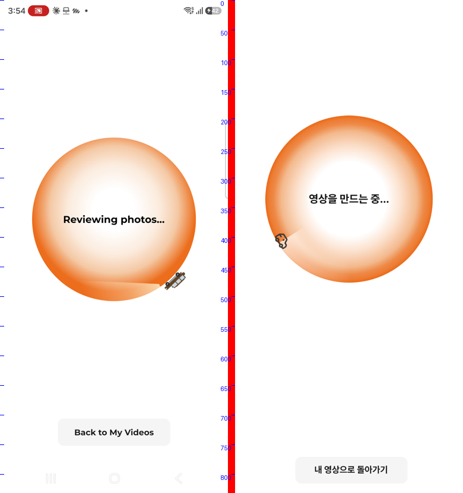
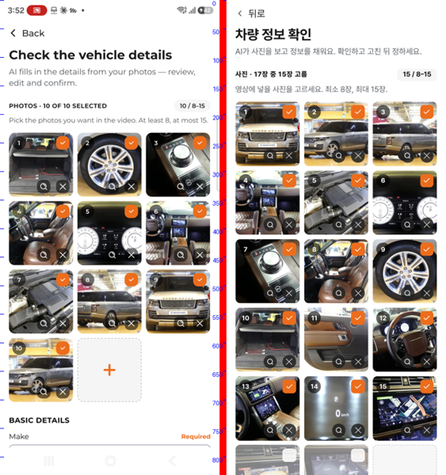
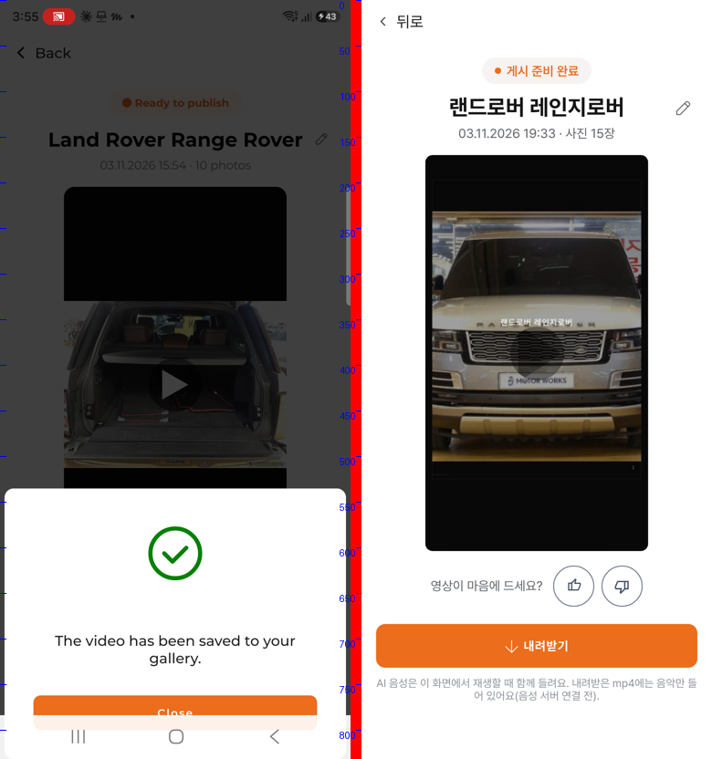
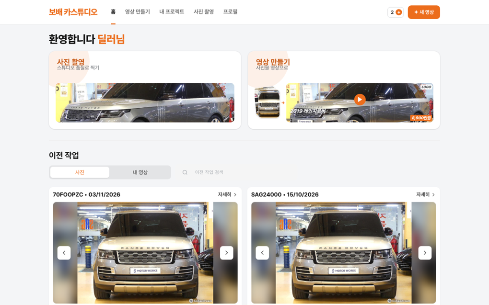

# 보배 카스튜디오: 원본과 다른 부분 수정(1차, PC웹 · 모바일)

① **한 줄 요약**: 원본 Car Studio AI 캡처 25장과 우리 화면을 같은 크기(가로 384)로 나란히 놓고 대조했습니다. 화면 · 기능이 다른 6곳을 고쳤고, PC웹과 모바일의 기능을 똑같이 맞췄습니다.

② 과제 ID 없음 · 브랜치 `carstudio-30x` · 커밋 `94ae58c3` · PR https://github.com/bobaekimboae/bobaedream/pull/1156 · 상태: 푸시, 병합 · 배포 전 · 함께 들어간 과제 없음

## ③ 한 일

- 홈 「사진」 탭에 이전 작업(사진 묶음)이 보이게 했습니다. 원본에서는 「내 프로젝트」에 있는 매물이 홈 사진 탭에도 나옵니다. 우리는 홈 사진 탭이 비어 있었습니다.
- 사진 탭 카드를 원본 크기로 맞췄습니다.
  - 큰 사진: 327×188, 가운데에 원본 비율로 보이고, 남는 칸은 같은 사진을 흐리게 깔아 채웁니다.
  - 아래 작은 사진 줄과 카드 아래 여백 23.5도 원본 값입니다.
  - 지금 보고 있는 작은 사진에는 주황 테두리를 둡니다.
- 「내 프로젝트에서 가져오기」를 누르면 원본처럼 사진과 정보가 바로 채워집니다. 이전에는 새 사진을 올릴 때만 나와야 할 「AI가 사진을 확인하는 중…」이 2.4초 동안 떴습니다.
- 「만드는 중」 화면을 원본에 맞췄습니다.
  - 주황 원: 가장자리가 진한 주황입니다. 이전에는 그라데이션 계산 범위가 원 밖까지 잡혀 가장자리가 연했습니다.
  - 차 아이콘 뒤를 따라가는 밝은 띠를 넣었습니다.
  - 원본에 없는 % 숫자와 버튼 테두리를 뺐습니다.
- 결과 화면의 「공유」 버튼을 PC에서도 뺐습니다. 원본 결과 화면에는 공유가 없고, 모바일은 이미 숨겨져 있었습니다. 「내 영상」 카드의 공유 · 내려받기는 원본에 있어서 그대로 둡니다.
- 영상이 다 만들어진 바로 그 순간 앱을 닫으면, 다시 열었을 때 「멈췄어요」로 보이던 문제를 고쳤습니다. 이제 기기에 먼저 저장한 뒤 화면을 바꿉니다.
- PC 홈에서 고친 것 두 가지
  - 사진 탭 2열 칸이 작은 사진 줄 길이만큼 늘어나 화면 밖으로 나가던 문제
  - 「사진 촬영」 · 「영상 만들기」 카드에서 제목과 설명이 겹치던 문제

## ④ 원본과 비교

| 화면 · 항목 | 원본 | 작업 전 | 작업 후 |
|---|---|---|---|
| 홈 사진 탭 | 올린 사진 묶음 카드 | 비어 있음 | 프로젝트 2개 + 만든 영상의 사진 묶음 |
| 사진 카드 큰 사진 | x 24.5 · 327.1×188.4 | x 23.5 · 337×190.6 | x 24.5 · 327×188.4 |
| 작은 사진 줄 시작 | x 27.4(사진 28.4) | x 31.3 | x 28.4 |
| 카드 아래 여백 | 23.5 | 13.7 | 23.5 |
| 프로젝트 가져오기 | 정보 바로 채움 | 「확인하는 중」 2.4초 | 바로 채움 |
| 만드는 중 원 가장자리 색 | RGB 237·124·50 | 연한 주황 | 진한 주황(같은 계열) |
| 만드는 중 % | 없음 | 있음 | 없음 |
| 결과 공유 버튼(PC) | 없음 | 있음 | 없음 |

| 원본 · 우리 홈 사진 탭 | 만드는 중 |
|---|---|
|  |  |

| 프로젝트에서 가져온 정보 화면 | 결과 · 저장 |
|---|---|
|  |  |

**동작 점검표**(모바일 384 · PC 1440, 각 13개 항목, 모두 통과)

사진 탭 카드 2개 · 가로 넘침 없음 · 검색 · 다음 사진 · 작은 사진 누르기 · 자세히 → 정보 화면 · 가져오기 즉시 · 제조사 채워짐 · 만드는 중 % 없음 · 결과 공유 없음 · 완성 뒤 사진 탭 3개 · 내 영상 1개 · 콘솔 오류 0

## ⑤ 검증

- `nuxt typecheck` 통과, `nuxt generate` 통과
- 콘솔 오류: PC 0, 모바일 0
- 퀵필터 화면은 건드리지 않아 verify:qf · measure:qf 대상이 아닙니다.

## ⑥ 원본과 다르게 남긴 것과 이유

- 화면 글은 한국어이고, 로고 · 음원 · 글꼴은 보배드림 것입니다(전과 같음).
- 사진 탭 카드 이름은 원본처럼 「코드 • 날짜」입니다. 예시 프로젝트는 매물 번호로 코드를 만들었습니다(예: SAG24000).
- AI 음성 안내 한 줄은 그대로 둡니다. mp4에 음성이 아직 들어가지 않는다는 사실을 알려야 해서입니다.

## ⑦ 못 한 것 · 다음에 할 것

- 원본 앱이 휴대폰에서 지워져 있어, 이번에는 11-03에 받아 둔 캡처 25장과 결과 영상으로만 대조했습니다. 휴대폰에 원본 앱을 연결해 주시면 아래를 이어서 대조합니다.
  - 드롭다운 목록 모양
  - 결제 뒤 화면
  - 「내 영상」 공유 시트
  - 프로필 화면
  - 만드는 중 차의 움직임 속도
  - 템플릿 미리보기 영상
- PC웹 원본(있다면)도 함께 대조해야 합니다.

## ⑧ 확인 링크(배포 뒤)

- 모바일: https://bobaekimboae.github.io/bobaedream/nuxt-carstudio/?m=1
- PC: https://bobaekimboae.github.io/bobaedream/nuxt-carstudio/?pc=1
