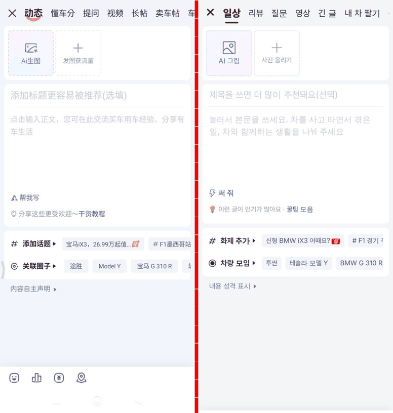
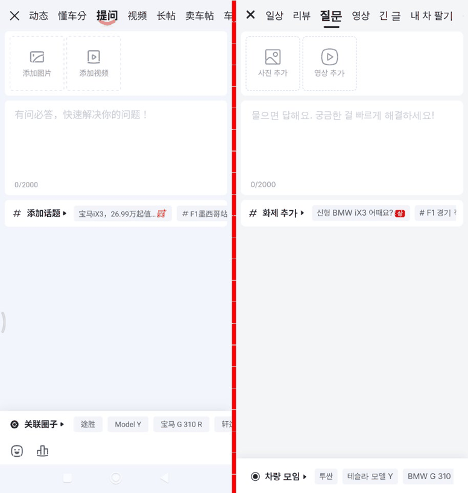
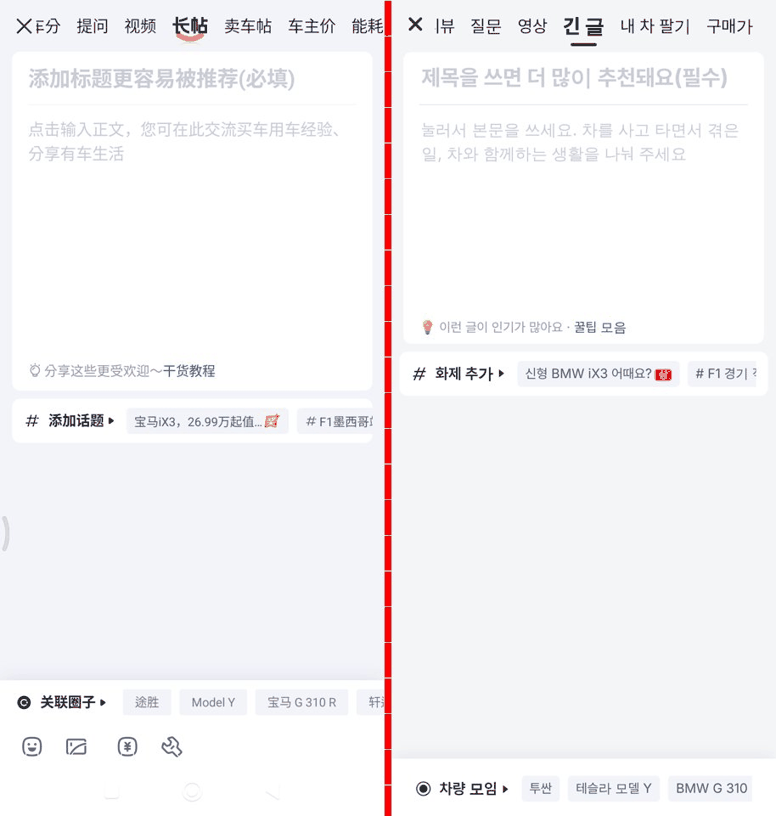
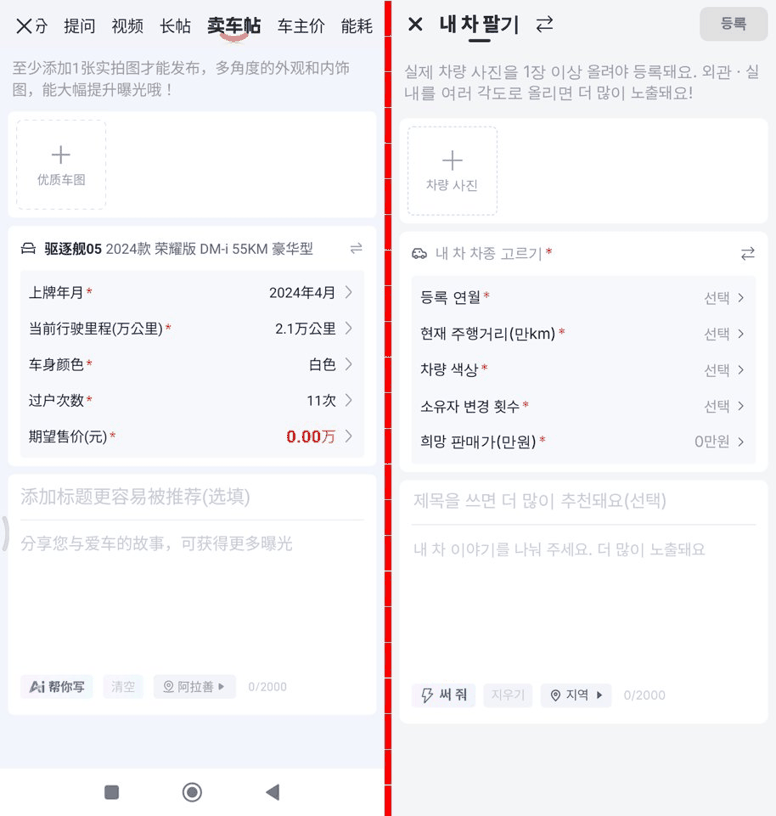
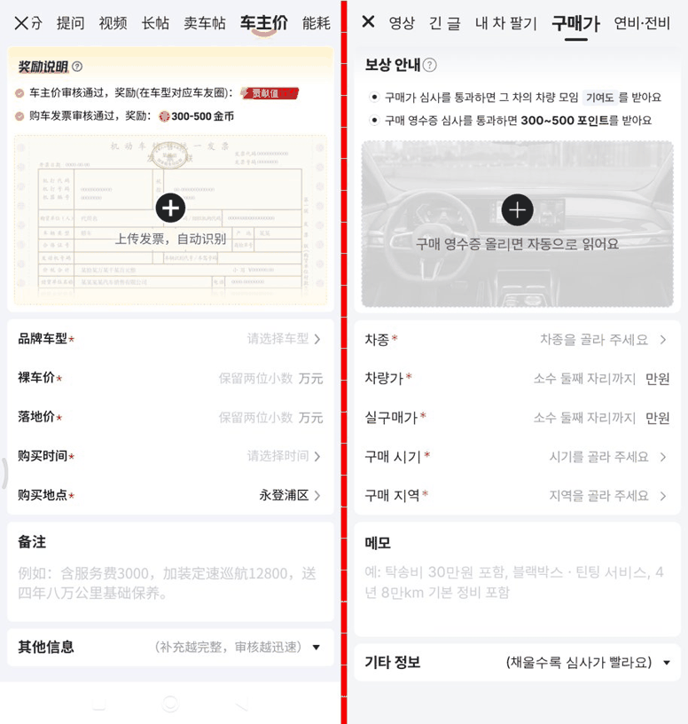
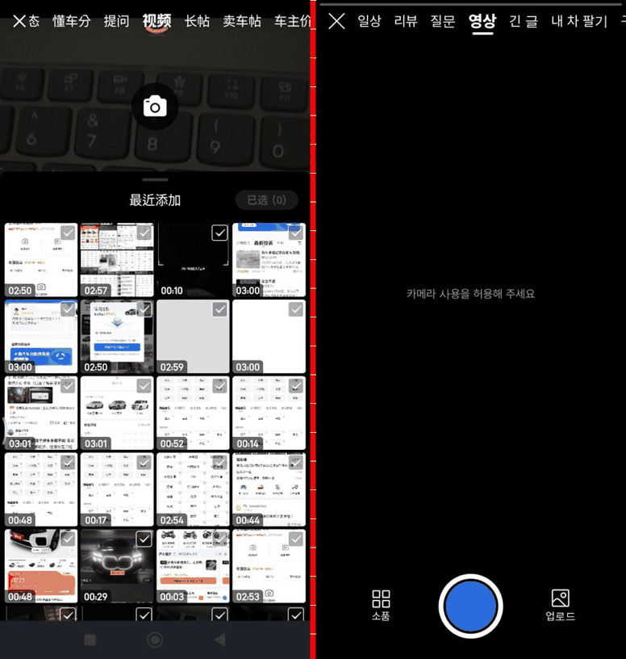
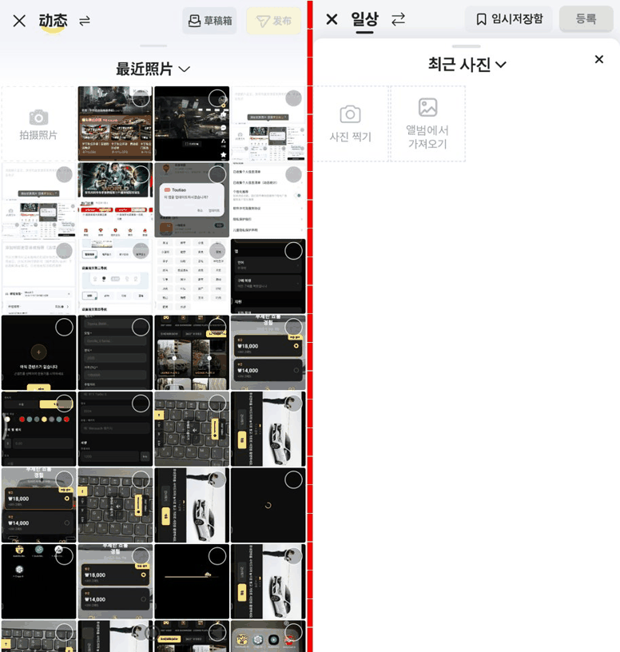
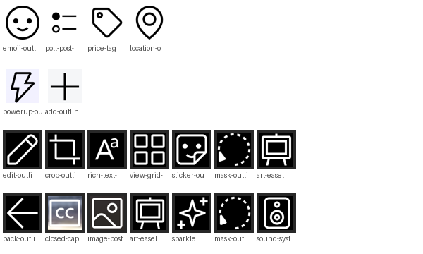

# PR #1157 동처띠 글쓰기 키트 8종 + 사진·영상 편집

## ① 한 줄 요약
동처띠 발행 화면의 글 종류 8개를 nuxt-review에 모두 만들었다. 사진 편집기와 영상 편집 흐름도 함께 넣었다. 커뮤니티 기본 글쓰기(치지직 방식)는 그대로다.

## ② 과제 · 브랜치 · 커밋 · 상태
- 과제 ID: 없음(사용자 지시 「동처띠 글쓰기 유형별 모두 만들어라」)
- 브랜치: `dcd-publisher` · 커밋 `a9d99332` · 아이콘 `03f42c87` · 2차 대조(이번 커밋)
- PR: https://github.com/bobaekimboae/bobaedream/pull/1157
- 상태: 푸시 완료 · 병합 · 배포 전(승인 대기)

## ③ 한 일
- 머리 줄에 종류 탭 8개를 두었다: 일상 · 리뷰 · 질문 · 영상 · 긴 글 · 내 차 팔기 · 구매가 · 연비·전비. 쓰기 시작하면 「제목 · ⇄ · 미리보기/임시저장함 · 등록」으로 바뀐다.
- 새로 만든 쓰기 화면은 6개다: 일상, 질문, 영상, 긴 글, 내 차 팔기, 구매가. 각 화면은 원본 캡처에 있던 칸과 동작을 따랐다.
- 공통 부품:
  - 사진 칸: 대표 표시, 길게 눌러 순서 바꾸기
  - 사진 고르기 시트
  - 사진 편집: 펜, 자르기, 텍스트, 템플릿, 스티커, 모자이크, 필터
  - 영상 흐름: 구간, 속도, 필터, 효과, 번호판 가리기, 음량, 자막, 표지
  - 글 정보: 화제, 차량 모임, 내용 성격 표시
  - 첨부: 투표, 실제 구매가, 부품, 위치
  - AI 본문 쓰기와 AI 그림
- 내 차 팔기는 등록 연월, 주행거리, 소유자 변경 횟수를 돌려서 고른다. 희망 판매가는 숫자판으로 넣으며, 원본처럼 예상 시세 안내가 함께 나온다.
- 임시저장은 종류마다 1건씩 자동으로 저장된다. 다시 들어오면 불러올지 묻고, 닫을 때는 그만 쓸지 한 번 더 묻는다.
- 등록한 글은 이 브라우저에 저장되고 상세 화면과 내 글 목록으로 볼 수 있다.

## ④ 원본과 비교
아래 캡처는 모두 왼쪽이 동처띠 원본, 오른쪽이 우리 화면이다.

| 화면 | 캡처 | 차이 |
|---|---|---|
| 일상 |  | 2차 대조 뒤. 노랑 대신 검정 |
| 질문 |  | 「질문 틀 넣기」 단추 뺌(원본에 없음) |
| 긴 글 |  | 빈 화면 비교 |
| 내 차 팔기 |  | 원본은 내 차 정보가 미리 채워져 있음, 우리는 「선택」 |
| 구매가 |  | 영수증 칸은 원본 중국 영수증 견본 대신 흐린 차 실내 사진 |
| 영상 촬영 |  | 원본은 들어오자마자 아래 영상 앨범이 반쯤 열림(웹은 휴대폰 영상 목록을 못 읽어 뺌) |
| 사진 고르기 |  | 웹은 휴대폰 사진 목록을 못 읽어 「사진 찍기 · 앨범에서 가져오기」 두 칸 |

### 아이콘 두께 통일(추가 커밋)
대신 쓰던 아이콘 5개(투표 = 격자, 음량 = 손가락, 효과 = 경고 마름모, 필터 = 스티커, 구매가 = ₩ 글자)를 원본으로 바꿨다. 사진 편집에서 직접 그린 아이콘 4개(텍스트 · 템플릿 · 모자이크 · 필터)도 원본으로 바꿨다.

- 에어비앤비 원본(노션 DB 파일 그대로): 가격표 · 음향시스템 · 반짝임 · 미술(이젤)
- 레딧 원본(에어비앤비에 맞는 아이콘이 없을 때): 표정 · 투표 · 위치 · 사진 · 부품 · 자막 · 타이머 · 텍스트 · 템플릿 · 모자이크

상자는 모두 24px, 획은 1.5px로 맞췄다. 영상 편집은 26~30px 상자를 24px로 줄였다. 원본이 굵은 투표(2.0px)와 텍스트(2.06px)는 그림만 75% · 73%로 줄여 같은 두께로 보이게 했다.

| 영역 | 작업 전 획 | 작업 후 획 |
|---|---|---|
| 아래 도구 줄 | 1.5 · 2.0 · ₩ 글자 혼재 | 1.50 |
| 사진 편집 도구 7개 | 직접 그림 1.9 · 원본 1.5 혼재 | 1.50~1.58 |
| 영상 편집 도구 | 1.8~2.0(상자 28~30px) | 1.50(자막 CC 안의 글자만 조금 굵음) |
| 사진 칸 추가 버튼 | 1.63(상자 26px) | 1.50 |

### 동처띠 2차 대조(추가 커밋)
폰(동처띠 9.2.9, 1080×2400)을 다시 열어 8개 화면을 같은 배율(384 CSS)로 찍고 우리 화면과 픽셀로 쟀다. 고친 것:

- **머리 줄**(리뷰 · 연비 포함 공통): 높이 44 → 48, X 잉크 10 → 14, 탭 글자 16 회색 → 17 검정, 탭 사이 20 → 15.6.
- **카드**: 좌우 여백 12 → 8(긴 글만 12), 모서리 10 → 8, 카드 사이 8.
- **사진 칸**: 108 → 89.6 정사각, 회색 채움 → 흰 바탕 점선, 사이 4.4. AI 칸은 연보라 점선, 질문은 사진 · 영상 아이콘.
- **일상**: 사진 칸 아래 안내 줄 뺌. 「써 줘」는 바탕 없는 글자 단추. 제목 18px, 본문 16/24, 본문 칸 154.
- **화제 · 차량 모임**: 원본 아이콘(# · ◎), 줄 사이 선 뺌, 칩은 높이 26 · 모서리 4 · 글자 #4B5A75, 「내용 성격 표시」는 카드 없이 회색 글자.
- **도구 줄**: 높이 48 → 44, 첫 아이콘 x16 · 간격 44, 위 선 대신 옅은 그림자.
- **질문**: 「질문 틀 넣기」 단추 뺌(원본 빈 화면 · 입력 중 모두 없음). 글자 수는 왼쪽 아래.
- **내 차 팔기**: 안내를 파란 상자 → 바탕 위 회색 글자 16/22. 항목은 회색 상자 안 35.9 줄(구분선 없음). AI · 지우기 · 지역 칩 24.
- **구매가**: 보상 안내 줄 한 줄로, 영수증 올리기 칸 72 → 188(원본처럼 큰 칸), 항목 줄 43.9 구분선 없음, 메모는 회색 상자 없이.
- **영상 촬영**: 머리에 글 종류 탭 줄 → 「영상 ⇄」로 바꿀 수 있게 함(이전엔 「동영상」 제목만 있어 다른 종류로 못 감). 탭 줄이 열려 있을 땐 오른쪽 도구를 숨김(원본과 같음). 오른쪽 도구 간격 56 → 66.
- **사진 고르기**: 머리(글 종류 · 등록)를 가리지 않고 그 아래에서 올라오는 판, 어둡게 하지 않음, 4칸 격자, 「최근 사진 ⌄」 20px. 고른 뒤 아래 줄은 검은 띠 위 「편집 · 완료」 반반.
- **사진 편집**: 「생성」 단추 바탕과 고른 사진 테두리가 안 보이던 오류 수정(`.pe button` 초기화가 단추 규칙을 덮어씀 → `:where(.pe) button`).
- 아이콘 추가(레딧 원본 그대로): `hashtag-outline` · `radio-button-fill` · `video-post-outline`.

| 영역(384 CSS) | 원본 | 작업 전 | 작업 후 |
|---|---|---|---|
| 머리 높이 · X 잉크 | 47.6 · 15.6 | 44 · 10.3 | 48 · 13.7 |
| 사진 칸 | 89.6 | 108 | 89.6 |
| 일상 사진 카드 높이 | 106 | 160 | 106 |
| 화제 카드(2줄) | 96 | 96(줄 사이 선) | 96(선 없음) |
| 내 차 팔기 항목 줄 | 35.9 | 57 | 35.9 |
| 구매가 보상 카드 | 298 | 210 | 약 300 |
| 도구 줄 | 44 | 48 | 44 |

## ⑤ 검증
- `pnpm typecheck` 통과, `pnpm build` 통과.
- 폭 384에서 자동 조작으로 확인한 흐름:
  - 일상: 사진 3장, AI 본문, 등록, 상세 확인
  - 내 차 팔기: 사진, 차종, 돌림 칸 4개, 숫자판, 등록
  - 구매가: 영수증, 차종, 금액, 시기, 지역, 등록
  - 긴 글: 사진 블록 넣고 등록
  - 질문: webm 영상, 구간, 효과, 내보내기, 등록
  - 투표 · 표정 · 화제 · 내용 성격 시트
  - 임시저장: 닫기 물음, 다시 열 때 불러오기
- 콘솔 오류 0(모바일 384). PC 폭은 앱이 최대 480으로 가운데 정렬되며 따로 재지 않았다.
- 아이콘 반영 뒤 같은 자동 조작 8개 흐름을 다시 돌렸다. 모두 통과, 콘솔 오류 0.
- 퀵필터 규격 점검(`verify:qf`, `measure:qf`)은 이번 작업과 상관없는 화면이라 돌리지 않았다.

## ⑥ 원본과 다르게 남긴 것과 이유
- 색: 노랑 버튼 대신 보배드림 검정 `#222`, 링크는 파랑 `#306BD9`(기존 리뷰 · 연비 규칙과 같음).
- 단위와 이름: 금액은 만원 · 원, 원본의 「金币」는 「포인트」로 바꿨다.
- AI 본문 · AI 그림 · 영수증 인식은 서버 연결 전이라 흉내 동작이다. AI 그림에는 실제 차량 사진이 아니라는 안내를 붙였다.
- 영상 내보내기는 브라우저 녹화 방식이라 영상 길이만큼 걸린다. 브라우저가 소리를 풀지 못하면 소리 없는 영상이 된다.
- 영상 편집의 「소품」은 아직 「준비 중」 알림만 뜬다.

## ⑦ 못 한 것 · 다음에 할 것
- 서버 저장(Laravel API), 실제 AI · 영수증 인식 연결.
- 실제 폰 카메라 녹화 시험. 자동 시험은 카메라가 없는 환경이라 앨범 영상으로만 확인했다.
- 사진 편집의 「좌우 반전」 「필터 없음」 아이콘은 맞는 원본이 없어 직접 그린 그림으로 남겼다(선 두께만 1.5로 맞춤).
- 화면 머리(닫기 · 뒤로)의 초톳 아이콘은 2.0px이다. 리뷰 · 연비와 같이 쓰는 공용이라 이번에는 바꾸지 않았다.

## ⑧ 확인 링크(배포 뒤)
- 일상: `https://bobaekimboae.github.io/bobaedream/nuxt-review/?board=dynamic&view=write`
- 그 밖: board 값을 `ask` · `video` · `long` · `sell` · `price`로 바꾼다.
