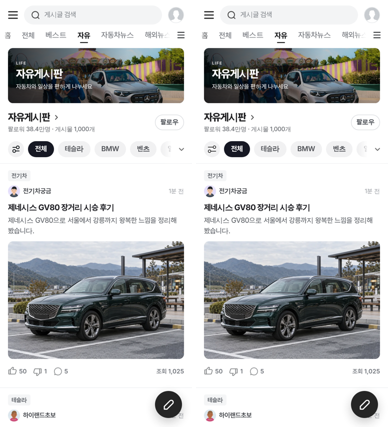
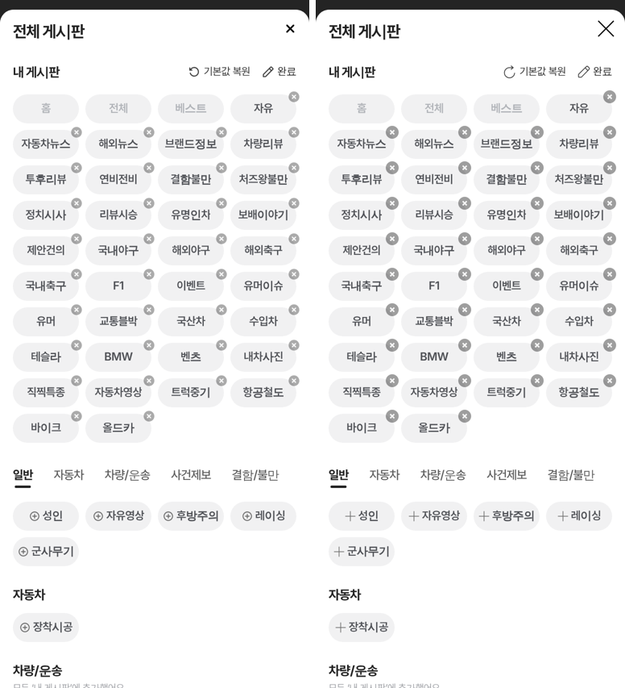
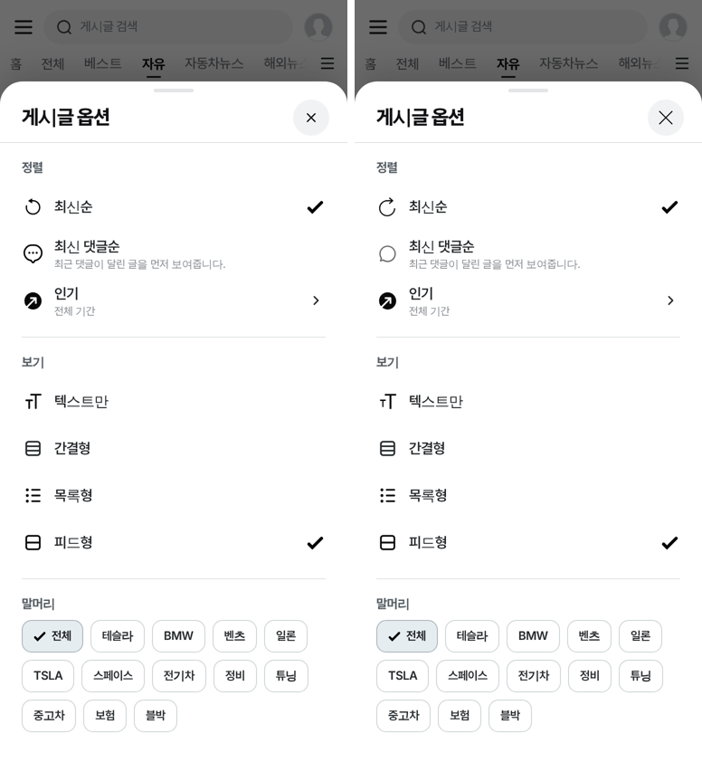
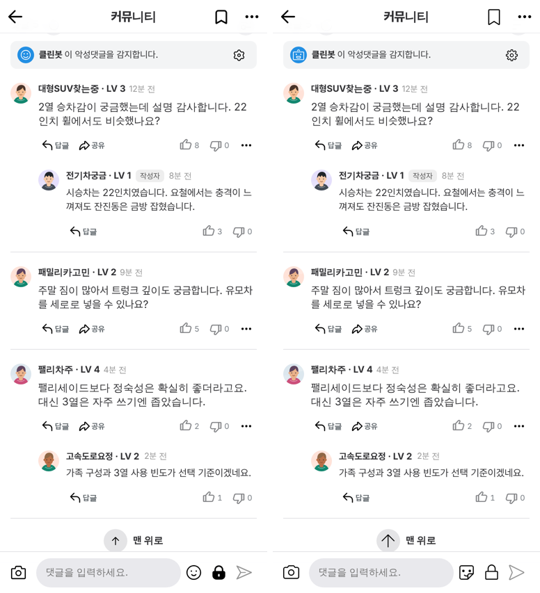
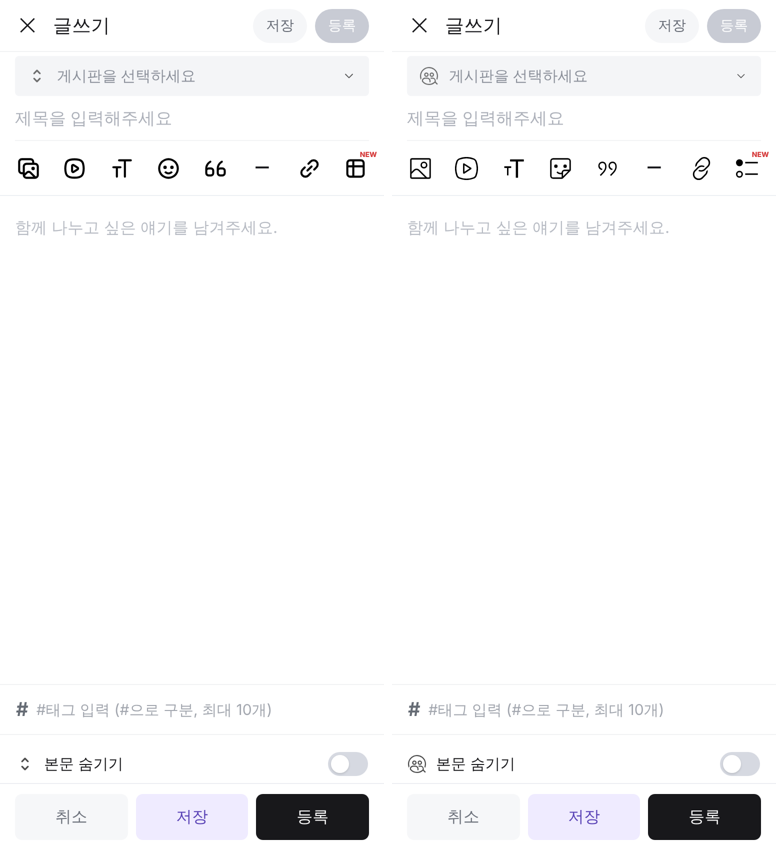

# PR #1158 커뮤니티 아이콘 레딧 원본으로 교체 (댓글·추천·비추천은 네이버)

## ① 한 줄 요약
커뮤니티 화면의 치지직·초톳·오토스카우트 아이콘을 레딧 원본으로 바꾸고, 댓글·추천·비추천만 네이버 증권 토론 원본으로 통일했다.

## ② 과제 · 브랜치 · 상태
- 과제 ID: 없음(사용자 지시 「커뮤니티는 레딧으로 교체하자, 단 댓글 추천 비추천은 네이버로」)
- 브랜치 `community-reddit-icons` · 커밋 `6999106` · PR https://github.com/bobaekimboae/bobaedream/pull/1158
- 상태: 푸시만(병합·배포 전, 승인 대기)

## ③ 한 일
1. 레딧 공식 아이콘(reddit/devvit-docs 원본, 수정 없음) 29개를 `public/community/assets/reddit-ui/icon-*.svg`로 넣었다.
2. 목록 · 상세 · 글쓰기 · 전체 게시판 창 · 피드 두 종류의 아이콘 경로를 레딧으로 바꿨다(짝 표는 `docs/quick-filter-spec.md` 끝).
3. 추천·비추천·댓글은 원래 쓰던 네이버 증권 토론 원본(`reactions/`, 노션 「네이버 커뮤니티」 DB와 그림이 같은 것을 확인)으로 맞췄다. 초톳 피드에 남아 있던 레딧 투표 화살표와 초톳 좋아요도 네이버로 바꿨다.
4. 피드 사진 넘김 화살표는 레딧 화살표(20)로, 영상 재생은 레딧 재생(반투명 검정 원 48)으로 바꿨다.
5. 바뀐 파일의 캐시 번호(`?v=20261103redditicons`)를 올려 배포 뒤 옛 파일이 남지 않게 했다.

## ④ 원본과 비교 (작업 전 왼쪽 → 후 오른쪽)

## ⑤ 검증
- `npm run check:runtime` 통과(보호 파일 28개)
- 바뀐 JS 6개 문법 검사 통과
- 폭 384 목록 · 패널 편집 · 게시글 옵션 · 상세 · 글쓰기 캡처: 콘솔 오류 0, 아이콘 404 0
- 퀵필터 화면은 건드리지 않아 verify:qf · measure:qf 대상 아님

## ⑥ 원본과 다르게 남긴 것
- 평점 별(리뷰 게시판): 레딧 별은 한 가지 색이라 점수가 안 보여 초톳 노랑 별을 그대로 둠
- 썸네일 위치(왼쪽/오른쪽) 아이콘: 레딧에 같은 뜻 아이콘이 없음
- 글자 서식 도구 막대(굵게·기울임 등) 안 아이콘: 이번 범위 밖
- 답글 아이콘은 레딧 그대로(지시가 댓글·추천·비추천만이라서)

## ⑦ 다음에 할 것
- 배포 뒤 폰에서 확인
- 리뷰·연비·결함 게시판 등 나머지 커뮤니티 화면 아이콘 점검

## ⑧ 확인 링크
- 목록: `community/naver-cafe-list.html?board=free`
- 상세: `community/chzzk-detail.html?id=1`
- 글쓰기: `community/chzzk-write.html`
