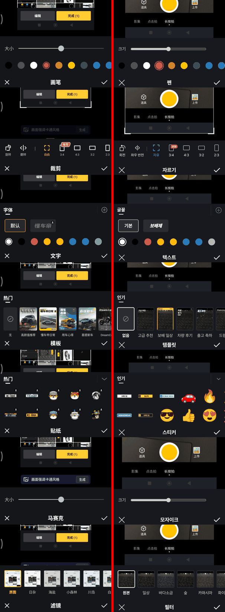
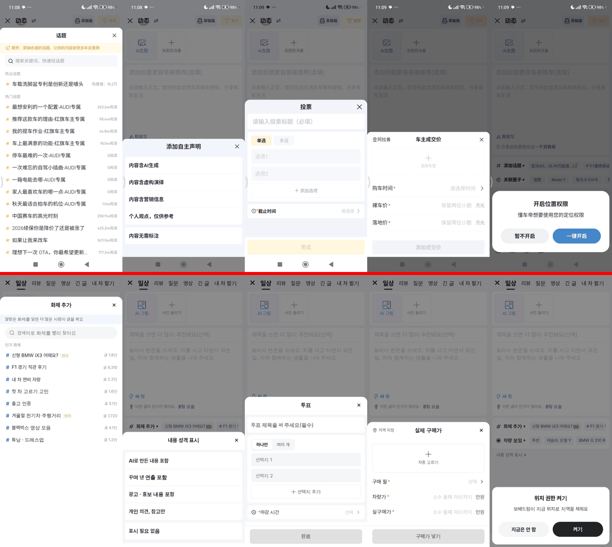
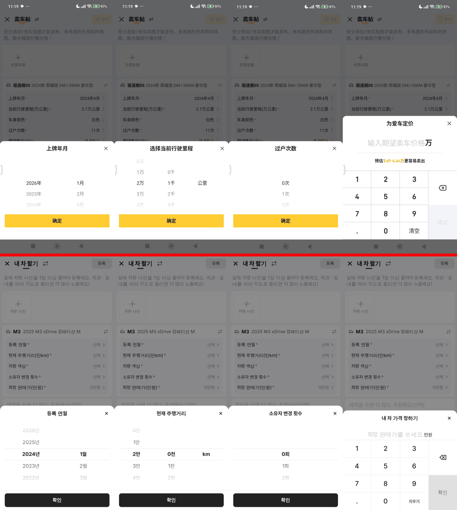
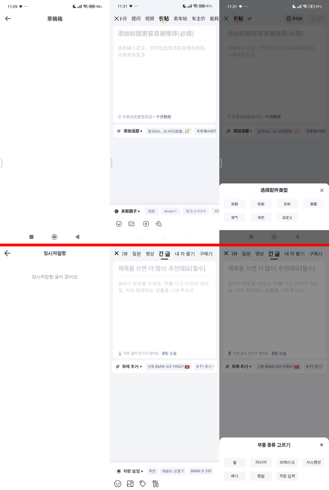

# PR #1159 동처띠 글쓰기 키트 3차 전수 대조

## ① 한 줄 요약
폰(동처띠 9.2.9)을 다시 열어 PR #1157에서 대조하지 못한 부속 화면(사진 편집 도구 7개 · 발행 시트 6개 · 임시저장함 · 내 차 팔기 입력 시트 6개 · 긴 글 · 부품)을 모두 찍고 우리 화면과 맞췄다.

## ② 과제 · 브랜치 · 커밋 · 상태
- 과제 ID: 없음(사용자 지시 「동처띠 전수조사해서 크로스체크해라」)
- 브랜치: `dcd-publisher-3`(기준 `dcd-publisher`) · 커밋 `95ce6dd8`
- PR: https://github.com/bobaekimboae/bobaedream/pull/1159 (기준 브랜치 `dcd-publisher`, PR #1157 위에 쌓음)
- 상태: 푸시 완료 · 병합 · 배포 전
- 같은 날 배포: PR #1158(커뮤니티 아이콘 레딧 통일) main 병합 `ffe9063` · Pages 배포 성공 · 번들 `assets/main-Cwq2fjBO.js`

## ③ 한 일
- **사진 편집 도구 판**: 원본 「아래 제목 줄 위에서 얼마나 떨어졌나」를 도구마다 재서 맞췄다. 펜 크기 줄 +14 · 색 줄 +5, 모자이크 안내 문구 뺌(원본 없음), 자르기 아이콘 높이가 달라도 글자 줄이 한 선에 오게, 템플릿 · 필터 카드 위치, 스티커는 원본처럼 2줄 가로 넘김(칸 73.6×66 · 그림 50).
- **사진 편집 동작**: 되돌리기는 그린 것이 있을 때만 보이고, 자르기 3등분 선은 틀을 끄는 동안만 보인다. 사진이 1장이면 위 `1/1`을 숨긴다(원본 같음).
- **발행 시트**(화제 · 내용 성격 · 투표 · 구매가 · 부품): 닫기 X를 오른쪽으로(원본 같음), 머리 아래 선 없앰. 화제는 안내 띠 · `인기 화제` 제목 · 줄 38 · # 16. 내용 성격은 회색 바탕 위 흰 카드에 왼쪽 굵은 글자. 투표는 회색 바탕 흰 카드 3개 · 가운데 점선 `＋ 선택지 추가` · 마감 시간 시계 아이콘. 구매가는 지역을 머리 왼쪽에, 차종 칸을 점선 세로 가운데로. 부품 칩 76×32 · 사이 16.
- **위치 권한**: 가운데 확인창 → 원본처럼 아래 카드(제목 · 설명 · 알약 버튼 47).
- **임시저장함**: 바텀시트 → 원본처럼 새 화면(`← 임시저장함`).
- **내 차 팔기**: 가격 숫자판을 원본처럼 4칸 같은 폭 · 줄 58 · 1px 선 평면으로(⌫ 1~2줄, 확인 3~4줄). 돌려 고르는 칸은 회색 띠 대신 위아래 선.
- **긴 글**: 본문 칸 8줄 → 10줄(원본 카드 높이 338에 맞춤).

## ④ 원본과 비교
모두 위(또는 왼쪽)가 동처띠 원본, 아래(또는 오른쪽)가 우리 화면이다.

| 화면 | 캡처 |
|---|---|
| 사진 편집 도구 7개(펜 · 자르기 · 텍스트 · 템플릿 · 스티커 · 모자이크 · 필터) |  |
| 발행 시트(화제 · 내용 성격 · 투표 · 구매가 · 위치 권한) |  |
| 내 차 팔기 입력(등록 연월 · 주행거리 · 소유자 · 가격) |  |
| 임시저장함 · 긴 글 · 부품 종류 |  |

| 영역(아래 제목 줄 위에서, CSS px) | 원본 | 작업 전 | 작업 후 |
|---|---|---|---|
| 펜 크기 줄 / 색 줄 | 91.9 / 34.8 | 78 / 30 | 92 / 35 |
| 모자이크 크기 줄 | 43.9 | 65 | 44 |
| 자르기 비율 글자 줄 | 27.7(같은 선) | 18~25(들쭉날쭉) | 28(같은 선) |
| 템플릿 제목 / 카드 이름 | 135.6 / 8.5 | 152 / 21 | 138 / 9 |
| 스티커 제목 / 1줄 / 2줄 | 157.7 / 100.8 / 34.7 | 218 / 160·94·28(3줄) | 160 / 101 / 35 |
| 필터 이름 | 26 | 21 | 26 |
| 텍스트 제목 · 글꼴 · 색 | 137.8 · 83.7 · 29.9 | 135 · 81.5 · 26 | 139 · 83.5 · 30 |

## ⑤ 검증
- nuxt-review `pnpm build` · `typecheck` 통과
- 자동 조작(384 · 2.8125배): 사진 편집 7개 도구, 발행 시트 5개, 임시저장함, 긴 글 · 부품, 내 차 팔기 6개 시트 열기 — 화면 오류 0
- 퀵필터 화면은 바꾸지 않음(verify:qf · measure:qf 대상 아님)

## ⑥ 원본과 다르게 남긴 것과 이유
- 색: 원본 노랑(버튼 · 선택 테두리) 대신 검정 · 보배드림 파랑. 위치 권한 「켜기」는 검정.
- 글 종류 바꾸기(⇄): 원본은 「就差一步，是否放弃？」로 버리고 나가지만, 우리는 종류마다 임시저장이 자동으로 남아 묻지 않고 바꾼다.
- 차량 소재지 고르기: 원본은 전체 화면 지역 목록(현재 위치 · 시 → 구), 우리는 시·도 시트 그대로.
- 스티커: 원본 캐릭터 스티커(저작물) 대신 번호판 가리개 + 표정 그림.
- 차량 모임 시트: 원본이 불러오는 중이라 대조 못 함.

## ⑦ 못 한 것 · 다음에 할 것
- 영상 · 구매가 글 종류의 부속 화면, 리뷰 · 연비 쓰기 부속 시트는 이번에 다시 찍지 못했다.
- 원본 내 차 팔기는 내 차 정보가 미리 채워져 있다(우리는 차종부터 고름).

## ⑧ 확인 링크
- 로컬 미리보기: `nuxt-review` 빌드 후 `?board=dynamic&view=write`, `?board=sell&view=write`, `?board=long&view=write`
- 병합·배포 전이라 배포본 링크 없음
