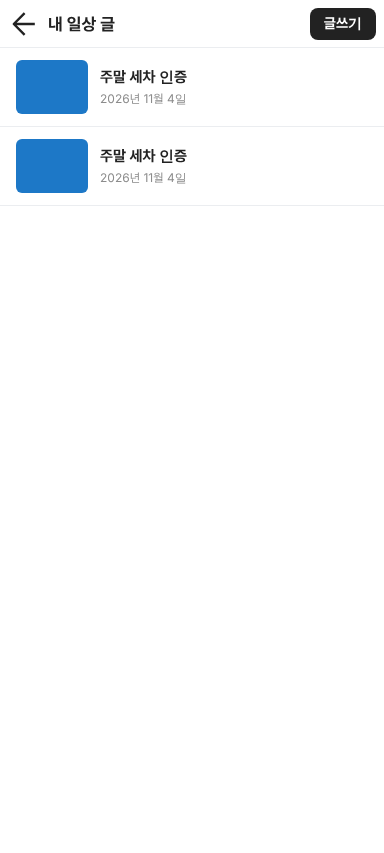
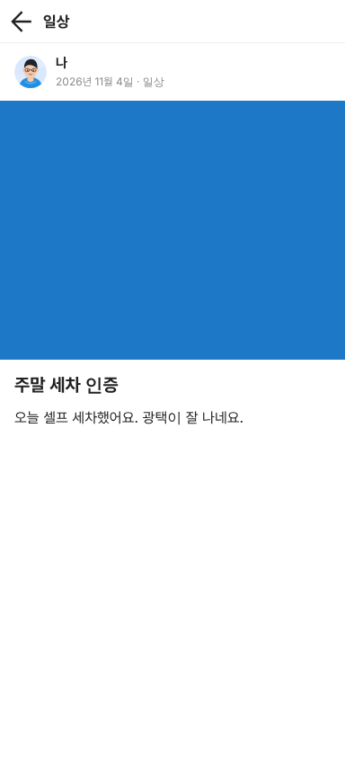

# PR #1160 동처띠 글쓰기 키트 6종 — 넉스트 + 라라벨 연결

## ① 한 줄 요약
일상 · 질문 · 영상 · 긴 글 · 내 차 팔기 · 구매가 글이 이제 이 브라우저가 아니라 **Laravel 서버(community-api)에 실제로 올라가고 저장**됩니다(화면은 Nuxt 4.6.2 그대로).

## ② 과제 · 브랜치 · 커밋 · 상태
- 과제 ID: 없음(사용자 지시 「우리 넉스트와 라라벨로 만들어라」)
- 브랜치: `dcd-publisher-api` (← #1159 `dcd-publisher-3` ← #1157 `dcd-publisher` 위에 쌓음)
- 커밋: `eb7b7faa`(서버) · `ed63d3d6`(화면) · `3c5373c9`(시험 파일 정리)
- PR: https://github.com/bobaekimboae/bobaedream/pull/1160
- 상태: 푸시 완료 · 병합 · 배포 전(#1157 · #1159 먼저 병합 필요)

## ③ 한 일
1. **서버(Laravel 12 · PHP 8.4 · PostgreSQL 15)**: 리뷰 · 연비와 같은 서버에 6개 게시판을 더했습니다. 사진 · 영상 올리기(`POST /uploads`), 종류별 등록 검사, 글 한 건 보기, 투표, 임시저장함(`GET /drafts`), 글에 안 붙은 파일 정리 명령.
2. **사진 개인정보**: 서버가 사진을 다시 저장해 촬영 위치(GPS) 같은 촬영 정보를 지웁니다. 회전 방향만 반영하고 긴 변 2560px로 줄입니다.
3. **구매가 영수증**: 공개 주소 없는 비공개 저장소에 두고, 글에는 「제출함(심사용, 공개 안 됨)」만 보입니다. 임시저장에도 넣지 않습니다.
4. **화면(Nuxt)**: 저장 · 불러오기를 `lib/api/publish-client.ts` 한 곳으로 모았습니다. 기본은 지금처럼 이 브라우저, 주소에 `?api=`를 붙이면 서버입니다. 등록하면 「사진 · 영상을 올리는 중이에요 2/5」가 보이고, 끝나면 서버에서 다시 읽은 상세로 갑니다.
5. **임시저장도 서버로**: 자동 임시저장할 때 사진은 먼저 올리고 주소만 저장합니다(같은 사진은 한 번만 올림).
6. **함께 고친 오류**: 서버가 「임시저장 없음」(`{"data":null}`)을 줘도 화면이 있다고 읽어 「불러올까요?」가 늘 뜨던 문제(리뷰 · 연비도 같은 문제)를 고쳤습니다.

## ④ 원본과 비교
화면 모양은 바꾸지 않았습니다(#1159 대조 결과 그대로). 등록 결과 화면만 글쓴이 이름이 서버 값으로 보입니다.

| 항목 | 작업 전 | 작업 후 |
|---|---|---|
| 글 저장 위치 | 이 브라우저(localStorage, 큰 사진이면 오래된 글이 지워짐) | 서버(PostgreSQL) · 기본 모드는 그대로 |
| 사진 | data: 주소째 저장 | 서버 업로드, GPS 정보 제거 |
| 종류별 조건 | 화면만 검사 | 화면 + 서버 두 번 검사 |
| 투표 | 보이기만 | 한 사람 한 표 집계(서버) |

| 서버 모드 내 글 목록 | 이 브라우저 모드 상세 |
|---|---|
|  |  |

## ⑤ 검증
- `community-api/tests/publish-smoke.sh` **69개 통과** — SQLite, PostgreSQL 16 둘 다. 기존 `tests/smoke.sh` 36개 통과(리뷰 · 연비 영향 없음).
- 브라우저 실제 조작(384px) **18개 통과**: 사진 고르기 → 자동 임시저장(서버, 사진은 올린 주소) → 등록 → 상세 · 새로고침 · 내 글 목록 · 등록 뒤 임시저장 지움 · 로그인 없이 등록하면 「로그인한 뒤 다시 등록해 주세요」 · 토큰이 주소에서 지워짐 · 콘솔 오류 0(두 모드 모두).
- 화면 → 서버 연결 시험 **10개 통과**: 내 차 팔기(`4.5만km` · `2,350만원`) · 구매가(영수증 비공개) · 긴 글 부품 카드 · 영상 표지 · 길이 · 투표 집계 · 실구매가 50% 미만 막힘.
- `pnpm typecheck` · `pnpm build` 통과.
- 퀵필터 · verify:qf · measure:qf: 이번 작업은 퀵필터 · 프로토타입 화면을 건드리지 않아 해당 없음.

## ⑥ 원본과 다르게 남긴 것과 이유
- 로그인: 보배드림 회원 로그인 연동 전이라, 시험할 때는 주소 끝 `#token=…`(Sanctum 토큰)을 한 번 붙입니다. 그 탭에만 두고 주소에서 바로 지웁니다(`#` 뒤 값은 서버로 가지 않음).
- heic 사진은 서버가 못 열어 그대로 저장합니다(촬영 정보가 남을 수 있음) → 변환은 다음 과제.
- 영상 속 번호판은 가리지 않습니다(촬영 키트와 같은 방침).

## ⑦ 못 한 것 · 다음에 할 것
- 상세 화면에서 투표 누르기 · 집계 막대 보이기(서버는 준비됨)
- 다른 사람 글 목록(피드) 화면, 신고
- 보배드림 회원 로그인 연동, heic → jpg 변환, 업로드 용량을 nginx · PHP 설정과 맞추기(300MB)
- 배포 서버에서 `php artisan storage:link` · `schedule:work` 실행

## ⑧ 확인 링크
- 배포 전입니다. 로컬 확인: `community-api` 에서 `php artisan serve` → `nuxt-review` 에서 `node scripts/serve.mjs 5195` → `http://localhost:5195/bobaedream/nuxt-review/?board=dynamic&view=write&api=http://127.0.0.1:8000#token=<토큰>`
- 배포 뒤(이 브라우저 모드): `https://bobaekimboae.github.io/bobaedream/nuxt-review/?board=dynamic&view=write&v=<커밋>`
