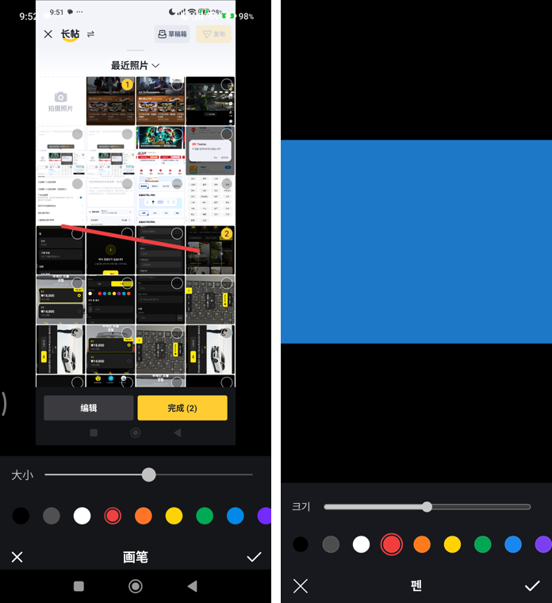
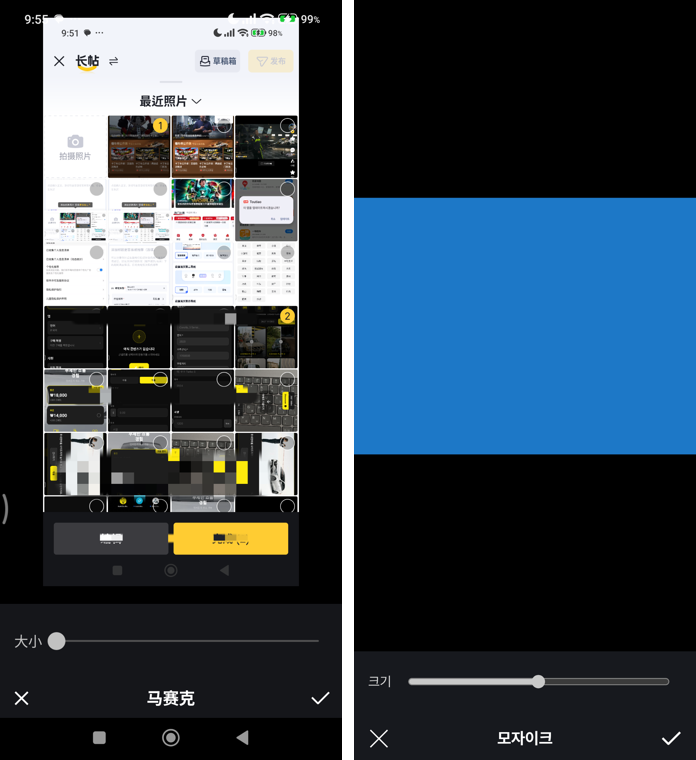
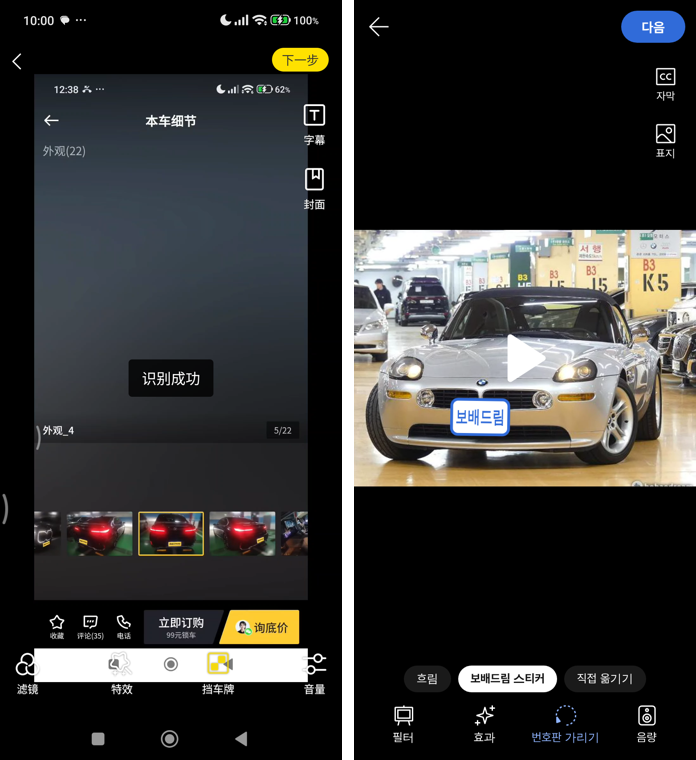
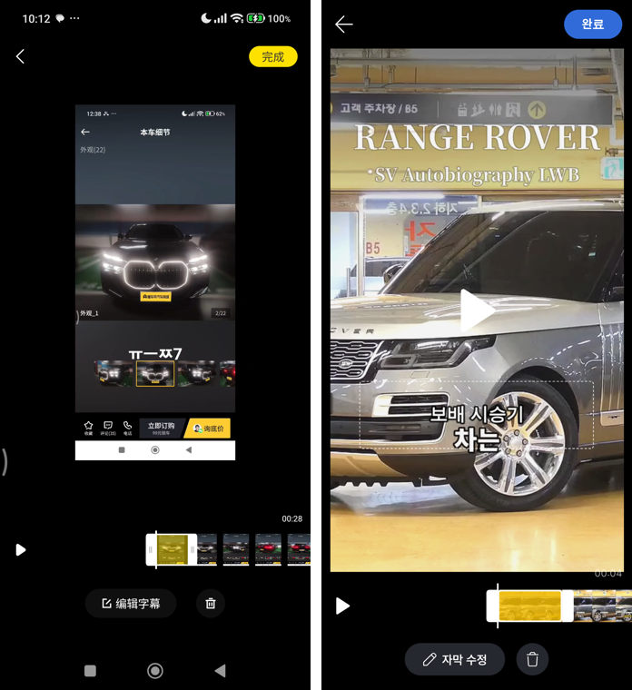
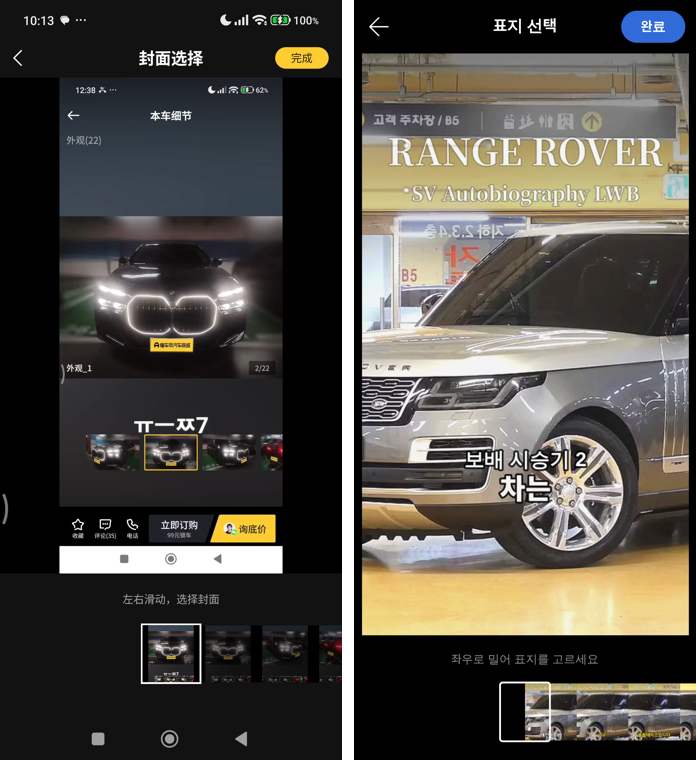
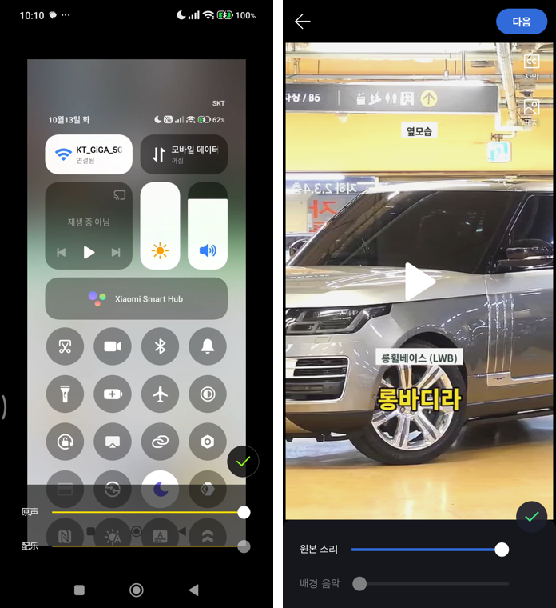

# PR #1161 — 동처띠 사진·영상 편집 전수 대조

## ① 한 줄 요약
동처띠 9.2.9 사진·영상 편집을 폰에서 직접 눌러 보고 차이를 고쳤습니다. 영상 번호판을 자동으로 찾아 가리고, 자막·표지 화면을 동처띠 구성으로 바꿨습니다. 그 과정에서 사진이 빠지던 오류 2건도 찾아 고쳤습니다.

## ② 과제 정보
- 과제 ID: 미지정
- 브랜치: `dcd-editor-4` (`dcd-publisher-api`, #1160 위에 쌓음)
- 커밋: `58c4fd51`
- PR: https://github.com/bobaekimboae/bobaedream/pull/1161
- 상태: 병합 완료(main 5c0fd4d) · 배포 완료 v=5c0fd4d · 번들 assets/main-CmUuUDDm.js
- 이번 병합으로 main에 함께 들어간 과제: #1157 · #1159 · #1160 (#1161에 쌓여 한 번에 병합)

## ③ 한 일
1. 폰(동처띠 9.2.9)에서 펜·모자이크를 가장 작게/가운데/가장 크게 놓고 직접 그려서 화소 단위로 굵기를 쟀습니다. 우리 펜은 가운데 굵기가 동처띠의 3배(16px 대 5.3px)여서 실측 곡선으로 맞췄습니다. 모자이크는 칸 크기가 붓 크기와 상관없이 12.8px로 고정이었습니다.
2. 동처띠 펜·모자이크에는 되돌리기 단추가 없어서(✕ 취소만 있음) 우리 것도 뺐습니다. 크기 막대는 오른쪽 끝 27px까지 늘였습니다.
3. 오류를 고쳤습니다. 편집기 안 「+」로 더한 사진이 글에 들어가지 않았습니다(일상·질문·긴 글). 내 차 팔기에서 사진이 10장 이상이면 편집 뒤 10장째부터 사라졌습니다.
4. 동처띠 「挡车牌(번호판 가리기)」는 누르면 번호판을 자동으로 인식합니다(「识别成功」). 우리도 같은 흐름으로 바꿨습니다. 「번호판을 찾는 중 N%」 → 「번호판을 찾아 가렸어요」 순서로 진행되고, 차가 움직이면 가림이 따라갑니다. 못 찾으면 예전처럼 직접 옮기는 상자를 띄웁니다. 영상은 기기 밖으로 보내지 않습니다.
5. 자막은 동처띠처럼 전체 화면으로 바꿨습니다. 가운데 재생선이 있는 필름 줄과 「자동 인식 · + 직접 추가」 단추를 두고, 직접 추가는 흐린 바탕 가운데 입력칸과 ✕ ✓로 합니다. 노란 구간의 양 끝 손잡이로 길이를 바꾸고, 「자막 수정 · 지우기」를 쓸 수 있습니다.
6. 표지는 「표지 선택」 화면에서 필름 줄을 좌우로 밀어 고릅니다. 동처띠에 없는 표지 제목 칸은 뺐습니다. 음량은 원본 소리와 배경 음악 두 줄에 ✓ 단추로 바꿨습니다. 필터·음량 판이 열리면 아래 도구 줄이 숨습니다.

## ④ 원본과 비교

| 항목 | 동처띠 실측 | 작업 전 | 작업 후 |
|---|---|---|---|
| 펜 굵기 (작게 · 가운데 · 크게) | 1.4 · 5.3 · 27px | 2 · 16 · 30px | 1.4 · 5.3 · 27px |
| 모자이크 칸 | 12.8px 고정 | 사진 폭의 1/56 (약 7px) | 12.8px 고정 |
| 모자이크 붓 (작게 · 가운데 · 크게) | 약 12 · 25 · 51px | 12 · 32 · 52px | 12 · 26.8 · 51px |
| 펜·모자이크 되돌리기 | 없음 | 있음 | 없음 |
| 번호판 가리기 | 자동 인식 | 직접 옮기는 상자 | 자동 인식 + 못 찾으면 상자 |
| 자막 | 전체 화면 · 필름 줄 · 직접 추가 | 아래 판 · 입력칸 목록 | 동처띠 구성 |
| 표지 | 필름 줄 · 제목 없음 | 막대 + 제목 칸 | 필름 줄 · 제목 없음 |
| 음량 | 원본 + 배경 음악 · ✓ | 원본 한 줄 | 두 줄 · ✓ |

나란히 캡처(왼쪽 동처띠, 오른쪽 우리):

## ⑤ 검증
- 사진 편집 자동 시험 22개 통과. 펜, 취소, 모자이크, 필터, 템플릿, 텍스트 입력, 스티커 이동·크기·회전, 자르기 3:4, 회전, AI 보정, 편집기 「+」 사진 추가, 완료 뒤 사진 2장과 크기(720×540)를 확인했습니다.
- 영상 편집 자동 시험 18개 통과. 고르기, 구간 줄이기, 속도, 필터, 효과 누르기, 번호판 자동 찾기, 음량, 자막 추가·길이·수정, 표지 고르기, 만들기(4.4초 540×960), 등록 뒤 상세를 확인했습니다.
- 번호판 시험 4개 통과. 움직이는 한국 번호판 영상에서 찾아 흐림/보배드림 스티커로 가렸습니다(헤드리스 15초).
- 같은 모델로 한국 번호판 사진 60장을 시험해 40장에서 찾았습니다.
- 콘솔 오류: 모바일(384) 0
- `pnpm typecheck` · `pnpm build` 통과
- 퀵필터 규격 측정(measure:qf)과 verify:qf: 이번 PR은 퀵필터·리액트 시안을 고치지 않아 돌리지 않았습니다.

## ⑥ 원본과 다르게 남긴 것과 이유
- 노란 강조는 보배드림 파랑과 검정으로 바꿨습니다(브랜드 규칙).
- 동처띠는 「다음」을 누를 때 미리 처리합니다(「奋力处理中」). 우리는 번호판 단추를 누를 때만 훑습니다. 쓰지 않는 사람이 기다리지 않게 하려는 것입니다.
- 번호판 가림은 동처띠 노란 스티커 대신 흐림 또는 보배드림 스티커입니다. 자동으로 찾은 뒤에도 「직접 옮기기」를 남겼습니다.
- 「자동 인식」(음성을 자막으로 바꾸기)은 음성 인식 서버를 연결하기 전이라 안내 문구만 띄웁니다.

## ⑦ 못 한 것 · 다음에 할 것
- 자막 자동 인식: 음성 인식 서버(또는 기기 안 Whisper) 연결
- 번호판 모델은 중국 번호판으로 학습해서 한국 번호판을 놓칠 수 있습니다. 한국 번호판으로 다시 학습하거나 더 큰 모델로 바꾸는 것을 검토해야 합니다.
- 실제 휴대폰에서 번호판 찾는 속도 측정(wasm 파일 14MB는 처음 한 번만 받음)
- 동처띠 자막 기본 길이를 정확히 재지 못해 2초로 두었습니다.

## ⑧ 확인 링크
- 로컬 미리보기(배포 전): `/bobaedream/nuxt-review/?board=ask&view=write` → 영상 추가, `?board=dynamic&view=write` → 사진 → 편집
- 배포본: https://bobaekimboae.github.io/bobaedream/nuxt-review/?board=ask&view=write&v=5c0fd4d (배포 후 8종 글쓰기 화면 콘솔 오류 0)
