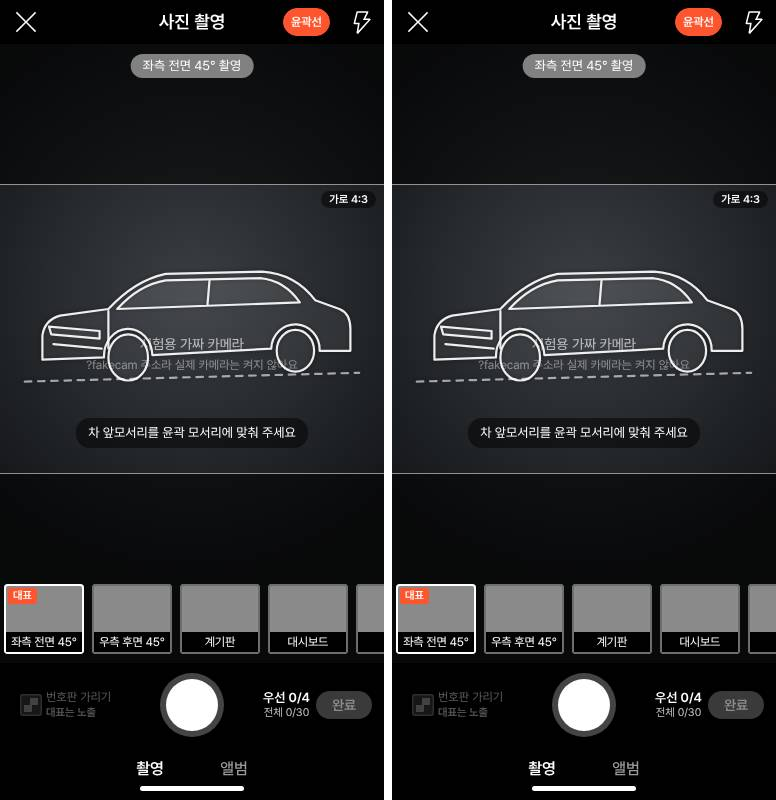
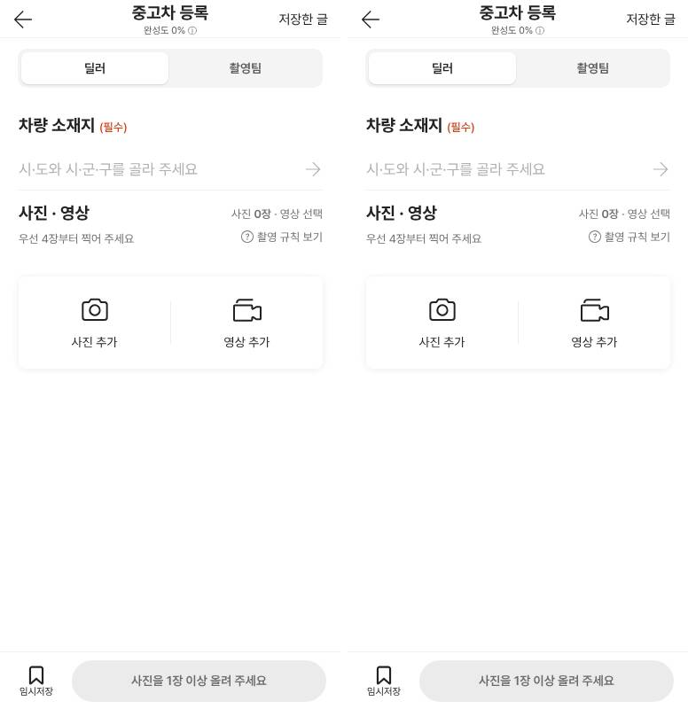
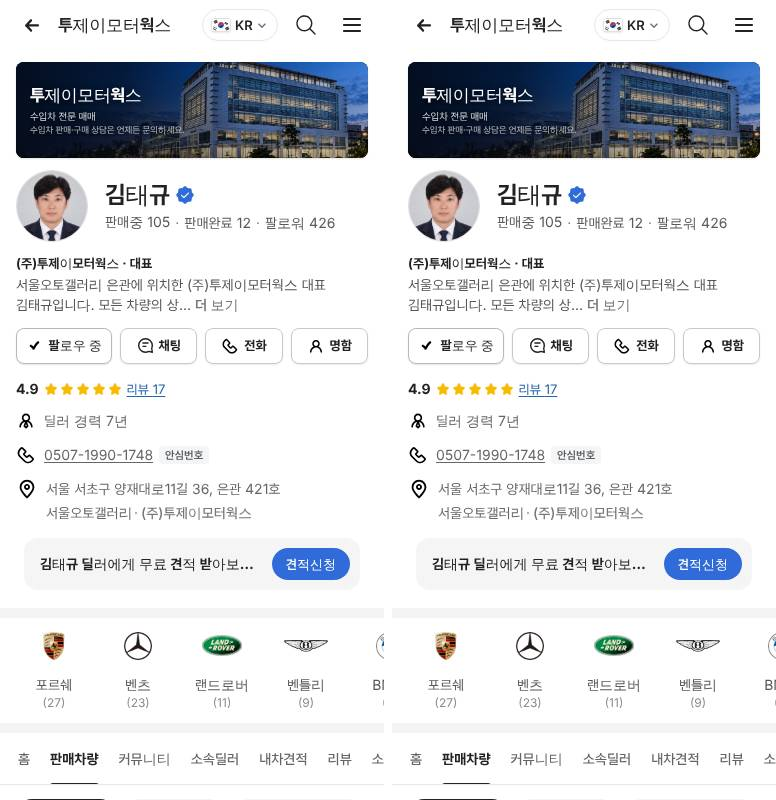
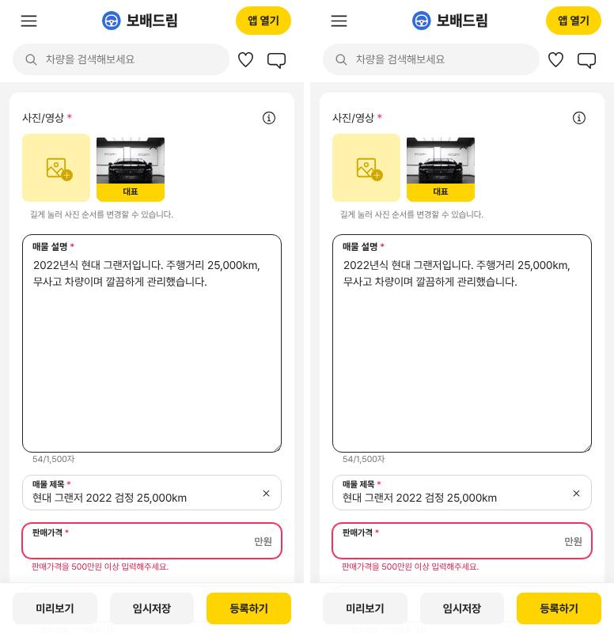

# PR #1164 — 넉스트 앱 전부 최신 스택으로 올림

## ① 한 줄 요약
넉스트 앱 10개의 버전을 Nuxt 4.6.2 · Vue 3.5.33 · TS 6.0.3 · pnpm 10.33.0 · Node 24.22.1로 맞췄습니다. API 2개는 PHP 8.4로 올렸습니다. 올리기 전후로 화면이 그대로인 것도 확인했습니다.

## ② 과제 · 브랜치 · 커밋 · 상태
- 과제 ID: 없음 (지시: 「최신으로 모두 올려라」)
- 브랜치: `stack-upgrade-1104`
- 커밋: `099cce9f` 작은 손질 · `c58fdcc9` 촬영키트 · `d5a2f7d2` 중고차 사이트 · 보고서 커밋
- PR: https://github.com/bobaekimboae/bobaedream/pull/1164
- 상태: 병합 · 배포 완료 (2026-11-04 17:15, 병합 커밋 `82d1e72`, 배포 실행 https://github.com/bobaekimboae/bobaedream/actions/runs/41797818158 성공)
- 배포 v값: `82d1e72` · 번들: `assets/main-BEGV_Ns-.js` · 촬영키트 `_nuxt/CoEOdLIs.js` · 넉스트 사이트 `_nuxt/BfwFyvdX.js`
- 이번 병합으로 main에 함께 들어간 과제: 없음

## ③ 한 일
- 넉스트 앱 8개가 Vue를 두 벌(3.5.33과 3.5.44) 받고 있었습니다. `pnpm overrides`(버전을 강제로 하나로 묶는 설정)로 vue와 @vue/* 부품을 모두 3.5.33 하나로 묶었습니다.
- 모든 넉스트 앱에 `engines`(이 앱이 요구하는 Node 버전 표시)를 넣었습니다: Node 24.22.1 이상, pnpm 10.33.0.
- 촬영키트(`nuxt-shootkit`)와 중고차 사이트(`nuxt-site`)를 Nuxt 3.21에서 4.6.2로 올렸습니다. TS는 5.9에서 6.0.3으로, 패키지 관리는 npm에서 pnpm으로 바꿨습니다.
  - 폴더는 옮기지 않았습니다(`srcDir: "."`). 다른 앱들이 촬영키트의 `lib/` 폴더를 함께 쓰고 있고, 파일 안 상대 경로도 300개가 넘기 때문입니다.
- Nuxt 4에서 새로 기본으로 켜지는 「배열에서 꺼낸 값이 비어 있을 수 있다」 검사는 Nuxt 3 때처럼 꺼 두었습니다.
  - 이 검사를 켜면 촬영키트에서만 173곳이 걸립니다. 코드 동작이 틀린 것이 아니라 검사 규칙이 더 엄해진 것입니다.
- 두 앱의 배포본(`public/nuxt-shootkit`, `public/nuxt`)을 다시 빌드해 넣었습니다.
- API 2개(`shorts-api`, `shootkit-api`)의 PHP 요구 버전을 8.3에서 8.4로 올렸습니다.

## ④ 원본과 비교 (올리기 전 빌드와 올린 뒤 빌드)
| 화면 | 올리기 전 → 후 차이 |
|---|---|
| 촬영키트 등록 화면 (384 · 1280) | 0.00% |
| 촬영키트 사진 촬영 화면 | 0.00% |
| 촬영키트 쇼츠 보기 · 비디오 투어 | 0.00% (쇼츠 384는 0.11%, 영상 재생 시점 차이) |
| 중고차 사이트 홈 · PC 목록 · 피드 · 등록 · 바이크 등록 · 촬영 · 딜러 페이지 | 0.00% |
| 중고차 사이트 모바일 목록 | 0.00% (다시 찍어 확인. 처음 찍었을 때 4.55%는 사진이 아직 덜 불러와진 시점 차이) |
| 중고차 사이트 차량 리뷰 | 0.84% (탭 줄 스크롤 위치가 찍을 때마다 319~339로 달라짐. 옛 빌드끼리도 똑같이 달라짐) |

## ⑤ 검증
- `npm run verify:qf`: 통과
- 넉스트 앱 10개 typecheck(형식 검사)와 build(빌드): 모두 통과
  - 대상: 3d-options, carstudio, community, register, review, shootkit, shootkit-lab, shortform, shorts, site
- 중고차 사이트 자기 파일의 형식 오류: 올리기 전 0 → 올린 뒤 0
  - 함께 쓰는 리액트 파일의 오류는 원래부터 있던 것입니다(87 → 73).
- 콘솔 오류: 촬영키트 16곳 0, 중고차 사이트 9곳 0
- 촬영키트 `lib/`를 함께 쓰는 앱 5개(register, carstudio, review, shortform, shorts)도 형식 검사를 다시 통과했습니다.
- 퀵필터 규격(`measure:qf`)과 시안형 필터 선택지 수: 이번 작업은 리액트 시안을 고치지 않아 다시 재지 않았습니다.

## ⑥ 원본과 다르게 남긴 것과 이유
- 폴더 배치는 Nuxt 4의 새 구조(`app/` 폴더)로 옮기지 않았습니다. 공유 경로(`@kit`)와 상대 경로가 깨지지 않게 하려고 Nuxt 3 배치를 그대로 두었습니다.
- 「배열에서 꺼낸 값이 비어 있을 수 있다」 검사(`noUncheckedIndexedAccess`)는 꺼 두었습니다. 켜려면 173곳을 하나씩 고쳐야 합니다.

## ⑦ 못 한 것 · 다음에 할 것
- 관리자 앱 2개(`admin-server`, `apps/variable-category-admin`)는 손대지 않았습니다. 판단(2026-11-04): 지금은 다시 만들지 않고 별도 계획으로 둡니다.
  - 지금은 Node 스크립트이고, 리뉴얼 스택(Laravel 12 + Nuxt 4.5.2 · Vuetify 3.10.8)으로 옮기려면 새로 만들어야 합니다.
  - AGENTS.md에서 퀵필터 작업 범위 밖으로 정한 경로이기도 합니다. 진행 여부를 정해 주셔야 합니다.
- 이 작업 환경의 PHP가 8.3이라, API를 PHP 8.4로 실제 실행하는 시험은 하지 못했습니다. 잠금 파일(composer.lock)의 확인값만 바꿨습니다.

## ⑧ 확인 링크 (배포본)
- 배포 확인: 모바일·PC `&debug=1` 배지 `main @ 82d1e72 · 2026-11-04 17:15 KST`, 다섯 화면 콘솔 오류 0
- 촬영키트: https://bobaekimboae.github.io/bobaedream/nuxt-shootkit/
- 중고차 사이트(넉스트 판): https://bobaekimboae.github.io/bobaedream/nuxt/?qf=guazi
- 모바일: https://bobaekimboae.github.io/bobaedream/?qf=guazi&v=82d1e72
- PC: https://bobaekimboae.github.io/bobaedream/?qf=guazi&v=82d1e72&pc=1
