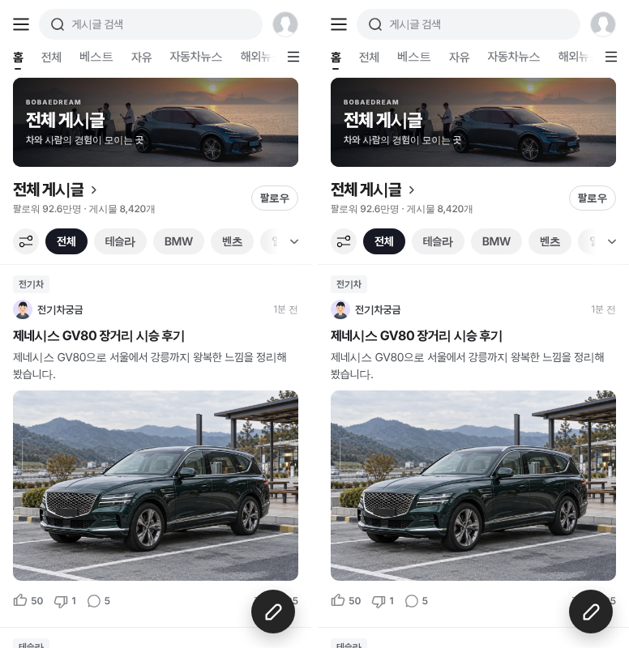
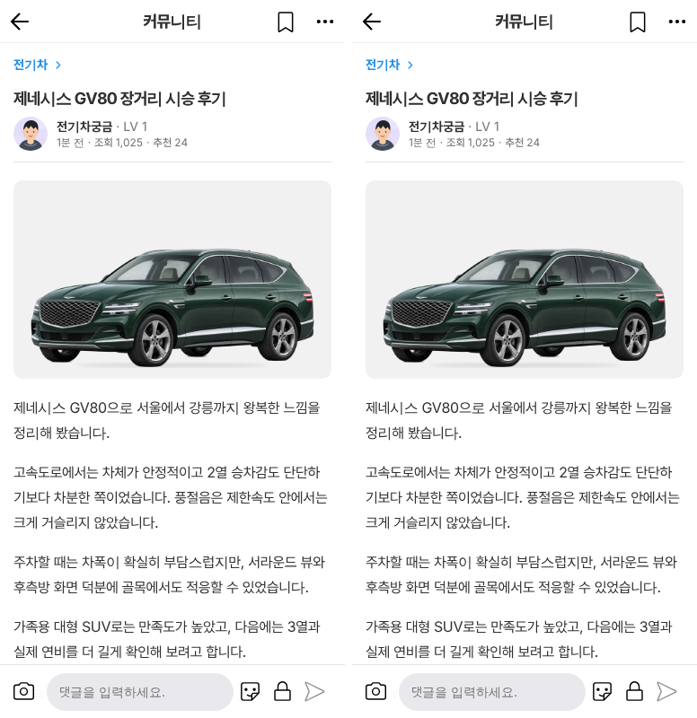
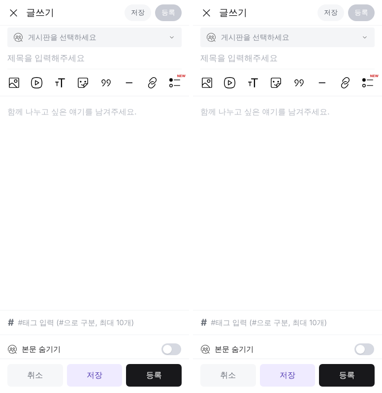
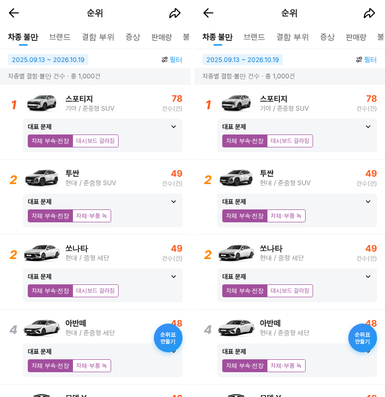
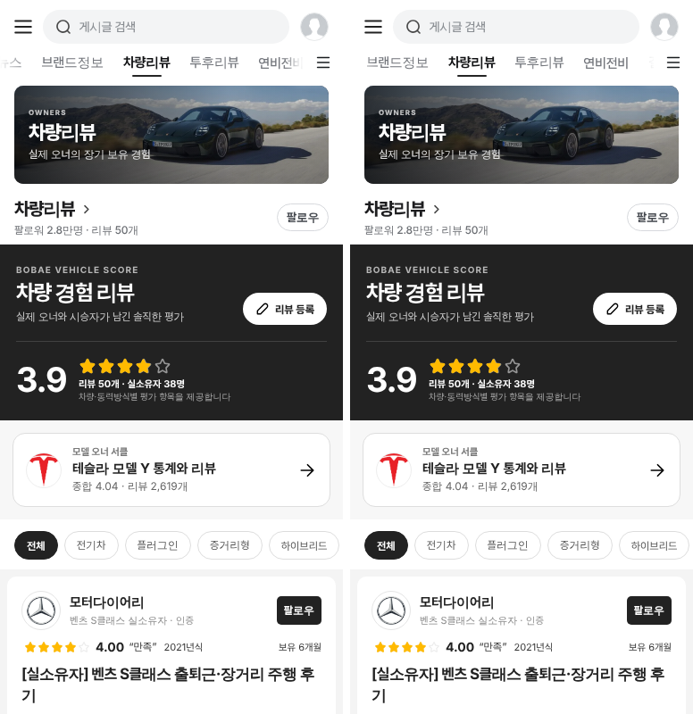
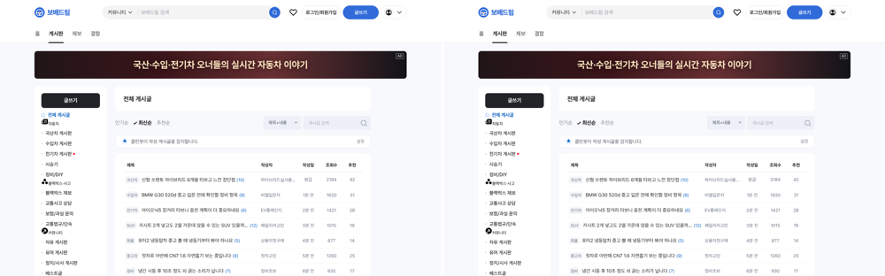
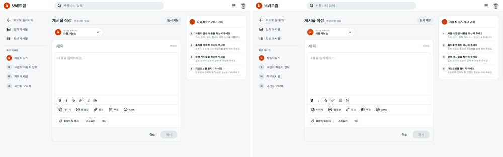

# PR #1166 — 커뮤니티 전체를 넉스트(Nuxt 4)로 교체

## ① 한 줄 요약
지금 쓰던 정적 커뮤니티(HTML · JS 약 1.4MB)를 리뉴얼 스택 넉스트 판으로 옮겼습니다. 옛 주소로 들어오면 넉스트의 같은 화면으로 넘어갑니다. 화면과 동작은 정적 판과 같습니다.

## ② 과제 · 브랜치 · 커밋 · 상태
- 과제 ID: 없음 (지시: 「우리 커뮤니티도 최신 스택으로 교체해라」 → 범위: 전부 옮기고 옛 주소를 넉스트로 연결)
- 브랜치: `community-nuxt-1` (화면별 브랜치 `community-nuxt-list` · `-detail` · `-write` · `-boards` · `-pc`를 합침)
- PR: https://github.com/bobaekimboae/bobaedream/pull/1166
- 상태: 푸시 완료. 병합 · 배포는 승인을 기다립니다.

## ③ 한 일
- **스택:** `nuxt-community`(Nuxt 4.6.2 · Vue 3.5.33 · TypeScript 6.0.3 · pnpm 10.33.0 · 글쓰기 편집기 Tiptap 3.27.3)입니다. 화면 로직은 Vue 3 + TypeScript로 다시 썼습니다.
- **모바일 목록(`/`)**
  - 게시판 탑메뉴, 전체 게시판 창(편집 · 끌기 · 더하기 · 빼기)
  - 좌우 넘기기, 게시판 배너, F1 머리
  - 보기 방식 17종, 옵션 · 게시판 시트
- **모바일 상세(`/posts/:id`)**
  - 본문 · 임베드 · 투표 · 댓글과 답글 · 추천 · 저장
  - 공지 · 문의 · 시나리오 글 · 직접 쓴 글(`?local=1`)
- **모바일 글쓰기(`/write`)**
  - Tiptap 편집기, 사진 · 영상, 링크 · 임베드, 스티커, 투표, 태그, 임시저장
- **특수 게시판:** 차량리뷰(모델 Y 오너 서클), 연비 · 전비, 결함 · 불만(오토홈), 처즈왕 결함 · 불만(1,000건 · 순위 6탭 · 필터 · 등록), 투후 리뷰
- **PC(`/pc` · `/pc/posts/:id` · `/pc/write`):** 목록 모든 모드(홈 · 피드 · 관심 · 섹션 · 정렬 · 검색 · 레딧형), 상세, 레딧형 글쓰기
- **옛 주소 넘기기:** 아래 7개 주소는 넉스트의 같은 화면으로 넘어갑니다(쿼리 유지). 옛 원본은 `*.static.html`로 이름만 바꿔 비교용으로 남겼습니다.
  - `naver-cafe-list.html` · `chzzk-detail.html` · `chzzk-write.html`
  - `bobaedream-pc-board-list.html` · `bobaedream-pc-board-detail.html`
  - `reddit-write.html` · `index.html`
- **CSS · 그림 · 데이터:** 원본을 그대로 씁니다.
  - CSS는 그 화면에 있는 동안만 붙이고 나갈 때 떼므로 다른 화면에 섞이지 않습니다.
  - 데이터는 `public/community/data`를 그대로 읽습니다(뉴스 봇 갱신이 그대로 반영됩니다).
  - 저장값(localStorage 키)도 정적 판과 같아서 사용자 설정이 이어집니다.

## ④ 원본과 비교

### 화면 차이 (정적 판 ↔ 넉스트, 채널 차 16 초과 픽셀 비율)
| 영역 | 비교한 상태 | 결과 |
|---|---|---|
| 모바일 목록 | 홈 · 게시판 · 보기 방식 17종 · 시트 · 전체 게시판 창 등 약 30개 | 0.00~0.71% |
| 모바일 상세 | 글 종류 12가지 · 댓글 메뉴 · 답글 · PC 폭 | 0.00~0.05% |
| 모바일 글쓰기 | 빈 화면 · 채운 화면 · 시트 · 편집 기능 35개 | 0.00% |
| 특수 게시판 | 5개 게시판 62개 상태 | 0.00~0.85% |
| PC | 목록 14 · 상세 6 · 글쓰기 2 (1280 · 1440) | 0.000% |

- 1%에 가까운 차이는 모두 화면 맨 위 게시판 탭 줄의 가로 넘김 위치(y 59~91)입니다. 정적 판끼리 두 번 찍어도 0.5%쯤 달라지는 부분입니다(글꼴을 다 받기 전에 위치를 잡음).
- 합친 뒤 최종 대조(14개 화면) 결과는 아래와 같습니다.

| 화면 | 차이 |
|---|---|
| 모바일 홈 · 상세 · 글쓰기 | 0.00% |
| 처즈왕 · 처즈왕 순위 · 투후 · 결함 | 0.00% |
| PC 목록 · 레딧형 · 글쓰기 | 0.00% |
| 자유 · F1 · 차량리뷰 · 연비 | 0.67~0.91% (탭 줄) |

### 동작 점검 (같은 조작을 두 판에 하고 결과 비교)
| 영역 | 점검 수 | 결과 |
|---|---|---|
| 모바일 목록 | 14 묶음 (넘기기 5가지 포함) | 같음 |
| 모바일 상세 | 70 단계 | 66 같음, 4 의도한 차이(⑥) |
| 모바일 글쓰기 | 50 항목 | 같음, 의도한 차이 2(⑥) |
| 특수 게시판 | 11 묶음 | 같음 |
| PC | 37 가지 | 같음 |
| 옛 주소 넘기기 | 10 주소 | 모두 맞는 화면 |
| 화면 사이 이동 | 목록 → 상세 → 뒤로 → 글쓰기 → 뒤로 | 다른 화면 CSS 남음 없음 |

## ⑤ 검증
- `nuxt-community`: `pnpm typecheck` · `pnpm test`(47개) · `pnpm generate` 통과
- `npm run verify:qf` 통과, `npm run verify`(전체) 통과
- 콘솔 오류: 넉스트 판 0입니다. 남은 것은 정적 판도 똑같이 내는 그림 404(시나리오 1번 글 사진 등)뿐입니다.
- 퀵필터 규격(`measure:qf`)은 리액트 시안을 건드리지 않아 다시 재지 않았습니다.

## ⑥ 원본과 다르게 남긴 것과 이유
- **주소 모양:** 넉스트 판은 해시 주소(`/nuxt-community/#/posts/1`)를 씁니다. 그래서 댓글 공유 주소는 `#앵커` 대신 `?comment=앵커`입니다.
- **글쓰기 등록 뒤:** 정적 판처럼 목록으로 돌아갑니다. 나가기 확인 창도 정적 판처럼 없고, 쓰던 내용은 조용히 임시저장됩니다.
- **정적 판 버그:** 화면을 똑같이 맞추려고 일부러 그대로 둔 것이 있습니다.
  - `?view=reddit-feed`로 바로 열면 목록형으로 보입니다.
  - F1 · 넘기기 알림이 뜨지 않습니다.
  - 일부 게시판은 댓글을 달아도 댓글 수가 그대로입니다.
- **포커스:** 상세에서 댓글 추천을 누른 뒤 포커스가 버튼에 남습니다. 정적 판은 목록을 다시 그려 포커스가 사라집니다. 키보드로 쓰기에는 넉스트 쪽이 낫습니다.
- **공용 CSS 처리:** 공용 CSS(`main.css`)의 전역 규칙(`a` · `button` · `input` · `:root` · `.brand` 등)이 옮긴 화면에 섞여 들어옵니다. 화면마다 우선순위 0인 되돌림 규칙으로 막았습니다. `main.css`를 고치지 않은 것은 계정 · 저장 화면을 건드리지 않기 위해서입니다.

## ⑦ 못 한 것 · 다음에 할 것
- **`main.css` 정리:** 전역 규칙을 모바일 껍데기(계정 · 저장 화면) 아래로 좁히면 화면마다 있는 되돌림 규칙을 지울 수 있습니다.
- **옮기지 않은 페이지:** 비교용 옛 변형 `naver-cafe-detail.html` · `notion-write.html` · `naver-write-parity.html`과 `reddit-profile*.html`은 옮기지 않았습니다. 지금 화면에서 연결되는 곳이 없거나 프로필 화면이라 범위 밖입니다.
- **예전 PR #1152:** 넉스트 판 좌우 넘기기 · 전체 게시판 창 PR은 이번 이식에 들어갔으므로 닫아도 됩니다.
- **운영 연결:** Laravel API(글 · 댓글 · 투표 저장) 연결은 다음 단계입니다. 지금은 정적 판처럼 브라우저에만 저장합니다.

## ⑧ 확인 링크 (병합 · 배포 뒤)
- 모바일 커뮤니티: https://bobaekimboae.github.io/bobaedream/nuxt-community/#/
- PC 커뮤니티: https://bobaekimboae.github.io/bobaedream/nuxt-community/#/pc
- 옛 주소: https://bobaekimboae.github.io/bobaedream/community/naver-cafe-list.html → 넉스트로 넘어감
- 처즈왕 결함 · 불만: https://bobaekimboae.github.io/bobaedream/nuxt-community/#/?board=chezhiwang-complaint
