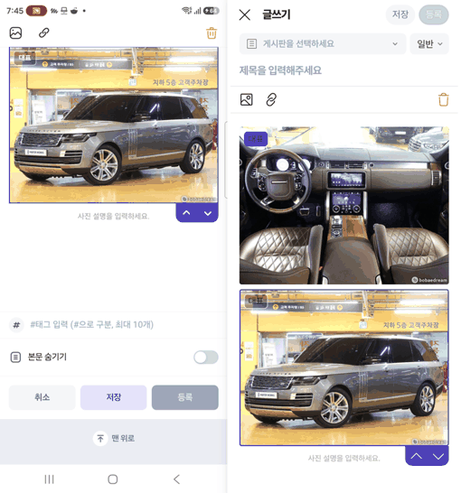
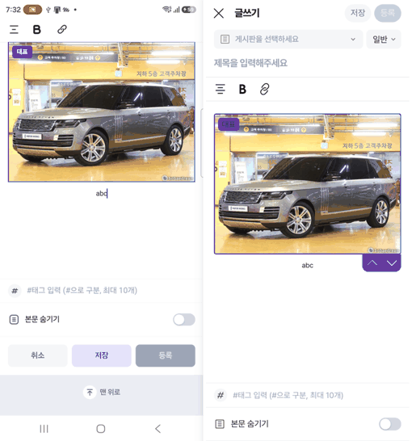
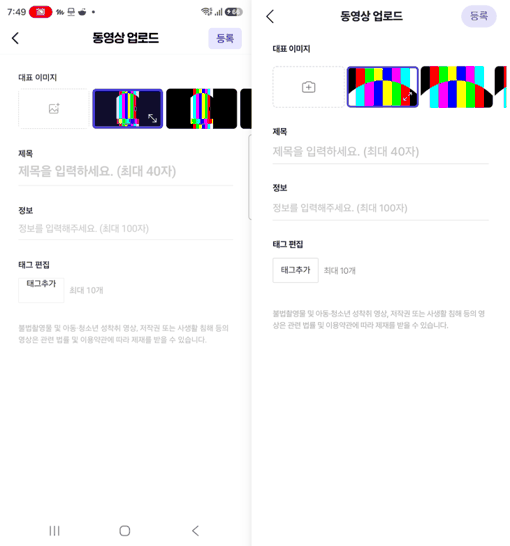
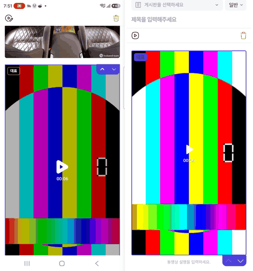

# PR #1168 — 커뮤니티 글쓰기 치지직형: 사진·동영상 첨부 폰 대조

## ① 한 줄 요약
치지직 앱 글쓰기의 사진·동영상 첨부를 폰에서 직접 눌러 보고, 대표 사진·사진 설명·교체·링크와 「동영상 업로드」 화면까지 같게 만들었습니다.

## ② 과제 · 브랜치 · 커밋 · PR · 상태
- 과제 ID: 없음(사용자 지시 「치지직 글쓰기 기능 백프로 똑같게, 크로스체크」)
- 브랜치: `community-write-media`
- 커밋: `a0824df7`
- PR: https://github.com/bobaekimboae/bobaedream/pull/1168
- 상태: 병합 · 배포(아래 v값)
- 함께 들어간 과제: 없음

## ③ 한 일
- 폰에서 사진·동영상 버튼을 눌러 보니 치지직도 앱 전용 사진 화면이 아니라 안드로이드 기본 고르기 창(카메라 · 캠코더 · 파일)을 씁니다. 우리 웹도 같은 창이 뜹니다.
- **사진:**
  - 한 번에 1장만 고릅니다.
  - 첫 사진에 보라 「대표」가 붙고, 다른 사진은 고르면 반투명 「대표」 단추가 나와 누르면 대표가 바뀝니다. 대표 사진을 지우면 다음 사진이 대표가 됩니다.
  - 사진을 고르면 도구 줄이 「교체 · 링크 · 삭제」로 바뀌고, 아래에 「사진 설명을 입력하세요.」 칸이 생깁니다.
  - 설명 칸을 누르면 도구 줄이 「정렬 · 굵게 · 링크」로 바뀝니다.
  - 교체는 같은 자리·같은 설명을 두고 그림만 바꿉니다. 링크는 흰 상자(주소 칸 + 연보라 「취소 · 확인」)에 넣습니다.
- **동영상:**
  - 고르면 「동영상 업로드」 화면이 열립니다.
    - 대표 이미지 추출 막대(초록)와 사용자 지정 섬네일 추가 칸이 있고, 동영상에서 뽑은 추천 섬네일 5장 중 고른 것은 보라 3px 테두리와 확대 단추가 붙습니다.
    - 제목(최대 40자), 정보(최대 100자), 태그(최대 10개, 입력 칸 초록 테두리), 안내 문구가 있습니다.
  - 「등록」을 누르면 본문에 대표 이미지 + 가운데 ▶ + 길이(00:06)로 들어갑니다.
  - 본문 동영상을 고르면 도구 줄이 「동영상 정보 고치기 · 삭제」가 되고, 고치기는 「동영상 정보」 화면(제목 · 정보 · 태그)을 엽니다.
- **긴 블록:** 사진·동영상이 길어 아래가 화면 밖이면 「위로 · 아래로」 탭이 상자 오른쪽 위 안쪽에 붙습니다.
- **맨 끝 블록:** 투표 · 사진을 넣으면 뒤에 빈 줄이 하나 붙어 맨 끝 블록의 「아래로」가 켜져 있던 것을 고쳤습니다. 이제 치지직처럼 흐려집니다.
- **아이콘:** 레딧 원본 아이콘 3개를 추가했습니다(사용자 지정 섬네일 `add-media-outline`, 확대 `expand-right-outline`, 재생 `play-fill`).

## ④ 원본과 비교
| 항목 | 치지직(폰) | 우리 |
|---|---|---|
| 사진 고르기 | 안드로이드 기본 창, 1장 | 같음(웹 파일 고르기), 1장 |
| 본문 사진 폭 · 사진 사이 | 356 · 8 | 356 · 8 |
| 대표 표시 | 40×25, 보라 채움 / 반투명 + 흰 테 | 40×25, 같음 |
| 사진 고른 뒤 도구 줄 | 교체 · 링크 · 삭제 | 같음 |
| 설명 칸 | 그림 아래 12 · 13px 가운데 | 같음 |
| 설명 도구 줄 | 정렬 · 굵게 · 링크 | 같음 |
| 링크 창 | 296 상자 · 아래 연보라 단추 51 | 같음 |
| 동영상 업로드 화면 | 대표 이미지 · 제목 · 정보 · 태그 · 안내 | 같음 |
| 섬네일 칸 | 110×63 · 간격 3 · 고른 것 보라 3px | 같음 |
| 본문 동영상 | 대표 이미지 + ▶ + 길이 | 같음 |
| 동영상 고른 뒤 도구 줄 | 정보 고치기 · 삭제 | 같음 |

## ⑤ 검증
- `pnpm typecheck` 통과, 시험 52개 통과, `pnpm build` 통과
- 동작 점검(384 화면):
  - 사진 2장 넣기 → 두 번째의 「대표」 누르기 → 대표가 바뀜
  - 대표 사진 삭제 → 남은 사진이 대표가 됨
  - 교체 → 설명은 그대로 두고 그림만 바뀜
  - 동영상 넣기 → 길이 00:06 표시
  - 동영상 정보 고치기 → 제목 · 태그가 남아 있음
- 콘솔 오류 없음
- 퀵필터 관련 측정(`measure:qf`)은 이번 변경 범위가 아니라 돌리지 않았습니다.

## ⑥ 원본과 다르게 남긴 것과 이유
- 치지직은 사진 버튼을 처음 누를 때 「사진을 올리기 위해 카메라 권한을 요청합니다」 창을 먼저 띄웁니다. 앱 전용 창이라 웹에는 넣지 않았습니다. 웹은 브라우저가 권한을 묻습니다.
- 「대표 이미지 추출중」 막대는 치지직에선 실제 업로드 진행인데, 우리는 서버 연결 전이라 섬네일을 뽑는 진행을 보여 줍니다.
- 동영상 정보 고치기 · 확대 아이콘은 레딧 원본 중 가장 가까운 것을 썼습니다. 치지직 아이콘은 레딧에 없습니다.

## ⑦ 못 한 것 · 다음에 할 것
- 실제 업로드 서버(Laravel)와 대표 사진 · 동영상 정보 저장 연결
- 사진 「교체」에서 카메라로 바로 찍기는 휴대폰 웹에서 기본 창이 처리합니다(별도 구현 없음).

## ⑧ 확인 링크
- 병합 · 배포 후: https://bobaekimboae.github.io/bobaedream/nuxt-community/#/write
