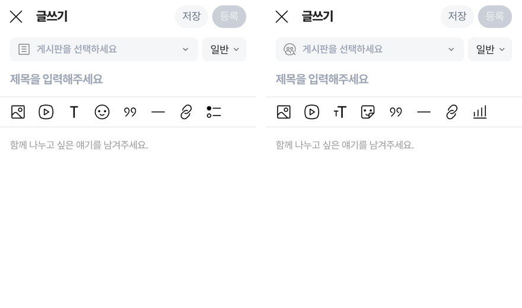

# PR #1169 — 커뮤니티 글쓰기 아이콘 레딧 원본으로 뜻 맞춤

## ① 한 줄 요약
글쓰기 도구 줄·게시판·본문 숨기기 아이콘 중 뜻이 어긋나 어설프던 5곳을 레딧 원본 중 뜻이 맞는 아이콘으로 바꿨습니다.

## ② 과제 · 브랜치 · 커밋 · PR · 상태
- 과제 ID: 없음(사용자 지시 「글쓰기 항목별 아이콘이 어설프다, 레딧 아이콘으로 통일, 투표 등」)
- 브랜치: `community-write-icons`
- 커밋: `0fdba418`
- PR: https://github.com/bobaekimboae/bobaedream/pull/1169
- 상태: 병합 · 배포 완료(v=faf3249, 번들 `_nuxt/BlAuE843.js`)
- 함께 들어간 과제: 없음

## ③ 한 일
- 텍스트 서식: 굵은 T(text) → tT(text-size). 글자 크기·서식 도구라는 뜻이 보이고 다른 아이콘과 굵기가 맞습니다.
- 스티커: 웃는 얼굴(emoji) → 스티커(sticker). 치지직도 스티커 버튼입니다.
- 투표: 목록처럼 보이던 poll-post → 막대 그래프(statistics).
- 게시판 선택 줄 · 게시판 목록: 문서 아이콘(text-post) → 사람 모임(communities).
- 본문 숨기기: 문서 아이콘(text-post) → 눈 가림(hide). 예전 간결형(`?style=legacy`)도 같게 맞췄습니다.
- 아이콘은 레딧 공식 저장소(devvit-docs e2fe9c1) 파일을 한 글자도 고치지 않고 복사했고, 목록 파일(icon-manifest.json)에 적었습니다.

## ④ 원본과 비교
| 자리 | 전 | 후 |
|---|---|---|
| 텍스트 서식 | text | text-size |
| 스티커 | emoji | sticker |
| 투표 | poll-post | statistics |
| 게시판 | text-post | communities |
| 본문 숨기기 | text-post | hide |

## ⑤ 검증
- `pnpm typecheck` 통과, 시험 52개 통과, `pnpm build` 통과
- 384 화면에서 도구 줄 아이콘 22×22, 게시판·본문 숨기기 18×18로 표시, 새 아이콘 파일 모두 200 응답
- 퀵필터 측정(`measure:qf`)은 이번 변경 범위가 아니라 돌리지 않았습니다.

## ⑥ 원본과 다르게 남긴 것과 이유
- 구분선은 레딧에 더 맞는 선 아이콘이 없어 subtract(가로선)를 그대로 둡니다.
- 네이버 카페형 도구는 네이버 원본 아이콘이라 바꾸지 않았습니다.

## ⑦ 못 한 것 · 다음에 할 것
- 레딧에 없는 아이콘은 네이버 원본으로 쓰기로 함(2026-11-05). 남은 대상 「밑줄(U)」은 노션 네이버 아이콘 DB(N_글쓰기)에도 밑줄·구분선 원본이 없어 글자 U를 유지. 원본 추가 시 교체.

## ⑧ 확인 링크
- 배포본: https://bobaekimboae.github.io/bobaedream/nuxt-community/?v=faf3249#/write (확인 `&debug=1`)
