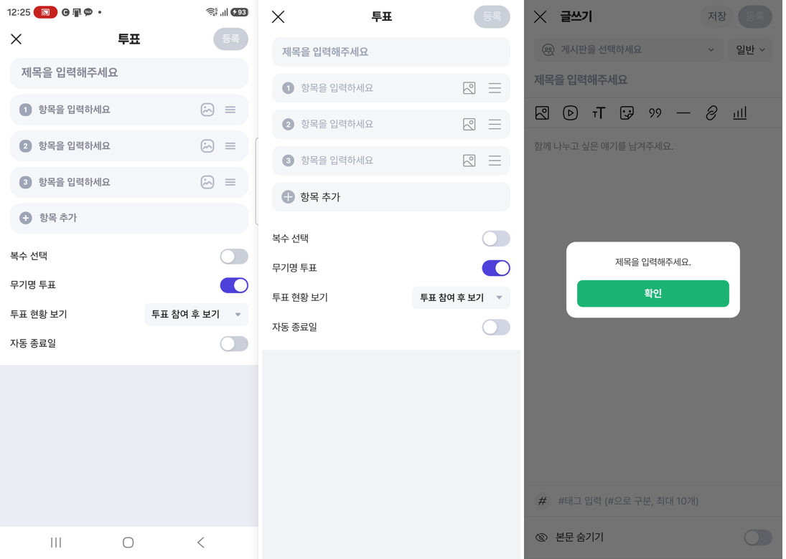

# PR #1170 — 커뮤니티 글쓰기 최종 기능 시험과 보정

## ① 한 줄 요약
치지직형 글쓰기의 모든 기능을 처음부터 끝까지 51항목으로 시험하고, 어긋난 3가지(조사 · 포커스 테두리 · 투표 안내 글자색)를 고쳤습니다.

## ② 과제 · 브랜치 · 커밋 · PR · 상태
- 과제 ID: 없음(사용자 지시 「배포하고 최종 기능 테스트, UI UX 완벽하게 동일하게」)
- 브랜치: `community-write-final`
- 커밋: `8c034386`
- PR: https://github.com/bobaekimboae/bobaedream/pull/1170
- 상태: 푸시 · PR 열림
- 함께 들어간 과제: PR #1168 · #1169 배포 보고서

## ③ 한 일
- 시험 스크립트(`nuxt-community/scripts/write-final-check.cjs`)로 실제 화면을 눌러 51항목을 확인했습니다: 제목 없이 저장 안내, 게시판 선택, 제목 입력 뒤 등록 켜짐, 굵게 · 기울임 · 밑줄 · 취소선 · 글자색 · 글자 크기 · 목록, 인용구와 모양 6가지, 구분선과 모양 8가지 · 위로/아래로, 스티커, 링크(불러오기 실패 안내), 투표(항목 추가 · 자동 종료일 · 등록), 사진 2장 · 대표 바꾸기 · 설명 · 링크, 동영상 업로드(섬네일 5장 · 태그) · 정보 고치기, 블록 이동 · 삭제, 태그, 본문 숨기기, 글 종류(질문), 저장 · 이어 쓰기, 등록 완료.
- 조사: 「분류을(를) 입력해 주세요」 → 「분류를 입력해 주세요」처럼 받침에 맞게 고쳤습니다(이어 쓰기 묻기도 「…」을/를).
- 투표 · 스티커 · 링크 · 글 종류 화면을 열면 닫기 버튼에 주황 포커스 테두리가 보이던 것을, 화면 자체에 포커스를 주는 방식으로 바꿔 치지직처럼 테두리가 없게 했습니다(Esc 닫기는 그대로).
- 투표 제목 · 항목 안내 글자색을 치지직 화면 실측값 #858894로 맞췄습니다(이전 #9DA5B6).

## ④ 원본과 비교
| 항목 | 치지직(폰) | 전 | 후 |
|---|---|---|---|
| 투표 안내 글자색 | #858894 | #9DA5B6 | #858894 |
| 도구 화면 열 때 테두리 | 없음 | 닫기 버튼에 주황 테두리 | 없음 |
| 글쓰기 제목 안내 글자색 | #9DA5B6 | #9DA5B6 | 같음 |
| 본문 안내 글자색 | #999999 | #999999 | 같음 |

## ⑤ 검증
- 기능 시험 51/51 통과, 콘솔 오류 · 깨진 파일 0
- `pnpm test` 53개 통과, `pnpm typecheck` · `pnpm build` 통과
- 퀵필터 측정(`measure:qf`)은 이번 변경 범위가 아니라 돌리지 않았습니다.

## ⑥ 원본과 다르게 남긴 것과 이유
- 아이콘은 레딧 원본(밑줄만 글자 U, 레딧 · 네이버 DB에 원본 없음)이라 치지직 그림과 모양이 다릅니다.
- 「일반」 글 종류 단추는 우리가 더한 기능이라 치지직에 없습니다.

## ⑦ 못 한 것 · 다음에 할 것
- 실제 업로드 서버(Laravel) 연결

## ⑧ 확인 링크
- 배포 후: https://bobaekimboae.github.io/bobaedream/nuxt-community/?v=<커밋>#/write
