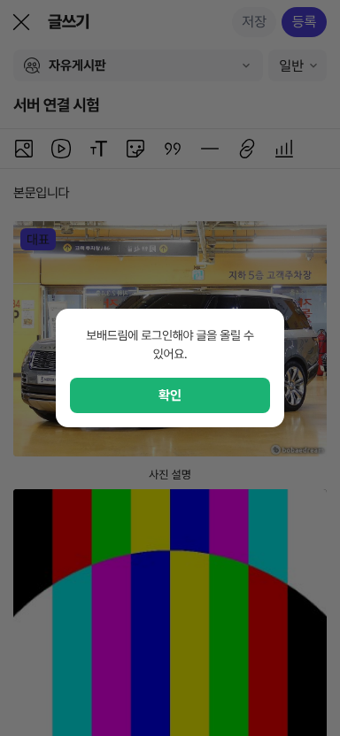
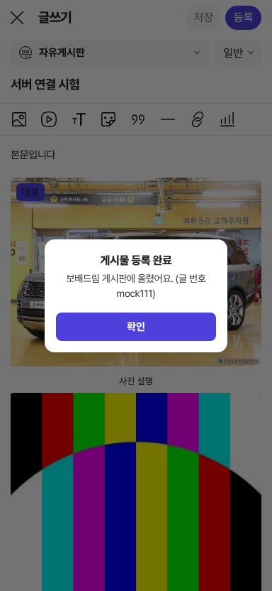

# PR #1171 — 커뮤니티 글쓰기 보배드림 백엔드 연결

## ① 한 줄 요약
글쓰기 화면을 보배드림 리뉴얼 서버(staging.bbmuseum.co.kr /v1)의 실제 게시판 · 사진 올리기 · 글 등록 · 임시저장 형식에 맞춰 연결했습니다.

## ② 과제 · 브랜치 · 커밋 · PR · 상태
- 과제 ID: 없음(사용자 지시 「니가 직접 보배드림 백엔드와 조인해라」)
- 브랜치: `community-write-bbm-backend`
- 커밋: `e09a5f32`
- PR: https://github.com/bobaekimboae/bobaedream/pull/1171
- 상태: 푸시 · PR 열림(병합 승인 대기)
- 함께 들어간 과제: 없음

## ③ 한 일
- dev.bbmuseum.co.kr의 실제 글쓰기 화면(`/community/write`) 배포 파일을 읽어, 보배드림 서버가 받는 등록 형식을 그대로 확인했습니다.
- 주소에 `?bbm=proxy`를 붙이면 게시판 목록을 보배드림 서버에서 받아 오고(지금 24개), 「등록」을 누르면 사진 · 동영상 · 대표 이미지 · 투표 사진을 먼저 올린 뒤 글을 등록합니다. 「저장」은 보배드림 서버 임시저장으로 보냅니다.
- 로그인은 보배드림 로그인 토큰을 주소 `?bbmtoken=`으로 한 번 넘기는 방식입니다. 그 탭에만 두고 주소에서 바로 지웁니다. 비밀번호는 받지 않습니다.
- 보배드림 서버는 dev.bbmuseum.co.kr 주소에서 온 요청만 받도록 막혀 있어(CORS), 같은 서버에 둔 중계(`/api/bbm`)를 거쳐 보냅니다.
- 시험용 가짜 서버(같은 형식으로 답함)로 처음부터 등록 완료까지 확인했습니다.
- 사진 · 동영상 블록을 고른 채 새 사진 · 동영상을 넣으면 고른 블록을 덮어쓰던 문제를 고쳤습니다.

## ④ 원본과 비교(보배드림 서버 등록 형식)
| 항목 | dev.bbmuseum 글쓰기 | 우리 글쓰기 |
|---|---|---|
| 게시판 | `GET /v1/board-groups` | 같음(일반 게시판만) |
| 사진 · 동영상 올리기 | `POST /v1/articles/media-uploads` files[] · alt[] | 같음(대표 이미지 · 투표 사진 포함 한 번에) |
| 글 등록 | `POST /v1/articles` board_code · title · content · type · media · poll | 같음 |
| 동영상 본문 | `<video data-type="community-video" poster>` | 같음 |
| 투표 | single/multiple · 1~7일 · voters_only | 같음(자동 종료일을 1~7일로 바꿈) |
| 임시저장 | `POST/PATCH /v1/article-drafts` | 같음(저장 버튼을 누를 때만) |

## ⑤ 검증
- `pnpm test` 58개(등록 형식 시험 5개 추가) · `typecheck` · `build` 통과
- 글쓰기 기능 시험 51/51(서버 연결을 끈 기본 상태)
- 가짜 서버: 게시판 → 제목 → 본문 → 사진(설명) → 동영상(대표 이미지) → 투표 → 등록 완료, 보낸 값이 위 형식과 같음
- 실서버(중계): 게시판 24개 받아 옴, 토큰 없이 등록하면 「보배드림에 로그인해야 글을 올릴 수 있어요.」, 토큰 없는 등록 요청은 서버가 「인증이 필요합니다」로 거절
- 실서버에는 글을 올리지 않았습니다.

## ⑥ 원본과 다르게 남긴 것과 이유
- 태그 · 본문 숨기기: 보배드림 서버 등록 형식에 칸이 없어 보내지 않습니다.
- 글 종류(질문 · 리뷰 등): 서버에 칸이 없어 본문 첫 줄에 요약(「질문 · 분류 정비」)으로 넣습니다.
- 말머리(category_id): 아직 고르는 칸이 없어 비워 보냅니다. 말머리가 있는 게시판은 다음에 추가합니다.

## ⑦ 못 한 것 · 다음에 할 것
- GitHub Pages(정적)에는 중계가 없어 연결되지 않습니다. 보배드림 서버 CORS에 시안 주소를 더하거나, 글쓰기를 dev.bbmuseum 서버에 올리면 바로 됩니다.
- 실제 로그인 토큰으로 실서버 등록 시험(사용자 확인 뒤)
- 말머리 고르기, 차량 리뷰 게시판(review) 형식

## ⑧ 확인 링크
- 로컬: `BBM_MOCK=1 node scripts/serve.mjs` → `/bobaedream/nuxt-community/?bbm=proxy&bbmtoken=test#/write`
- 배포본(정적, 연결 꺼짐): https://bobaekimboae.github.io/bobaedream/nuxt-community/#/write
