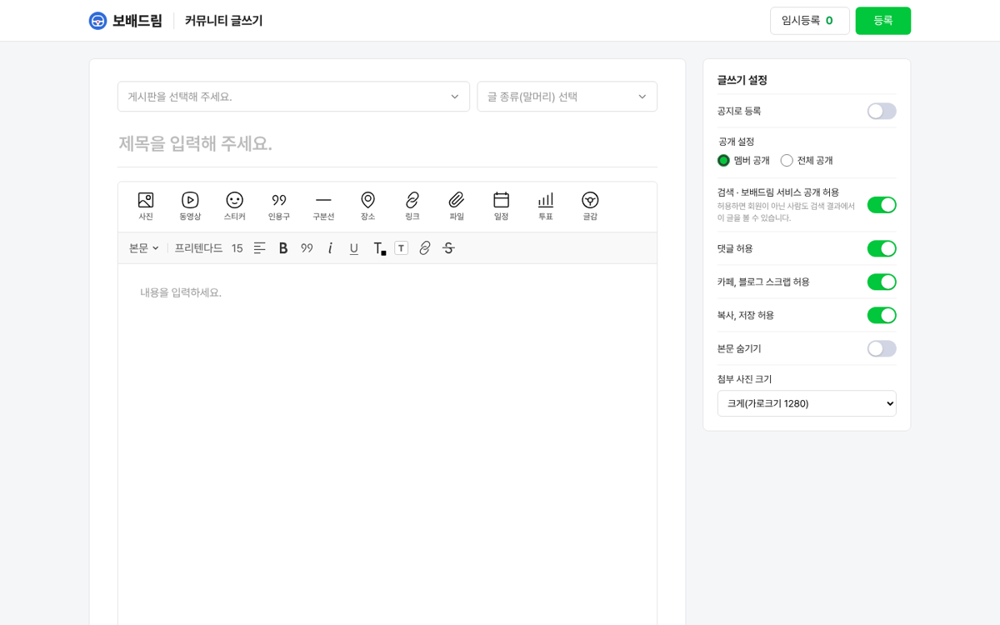
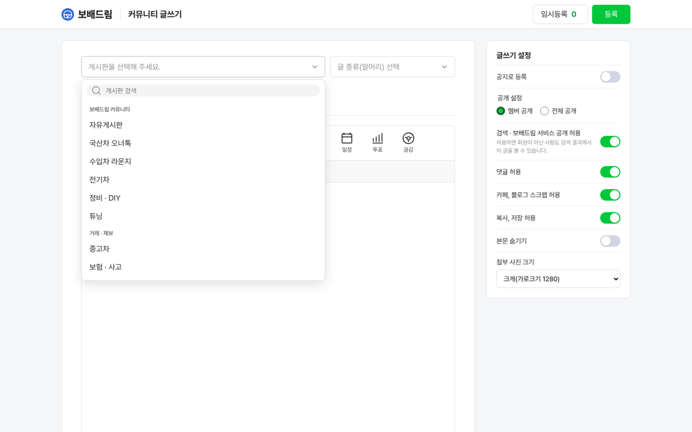
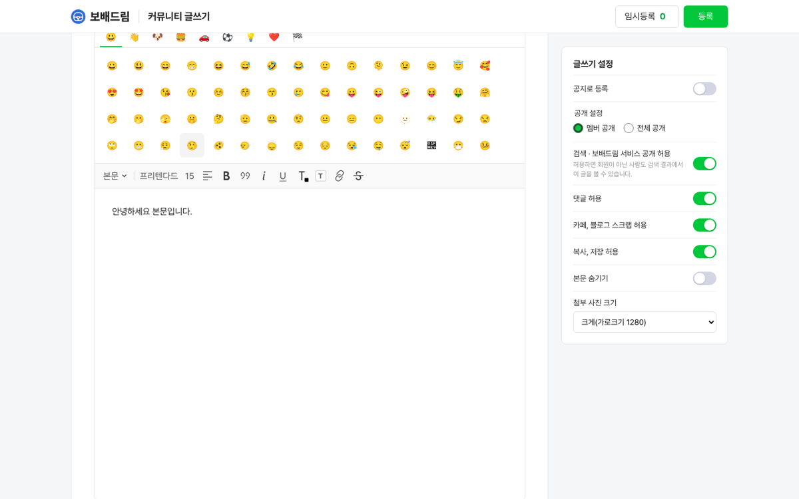
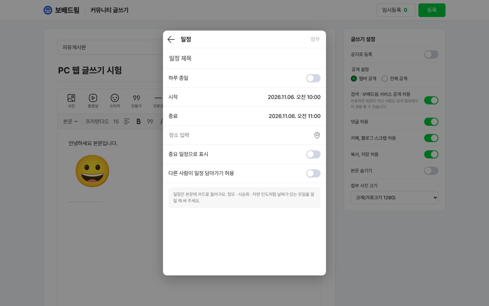
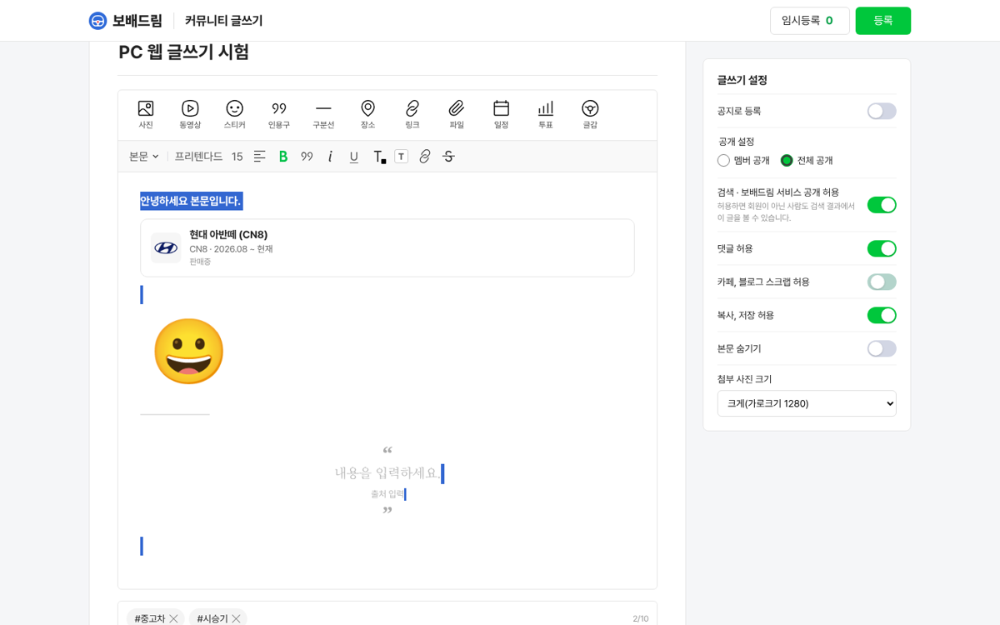
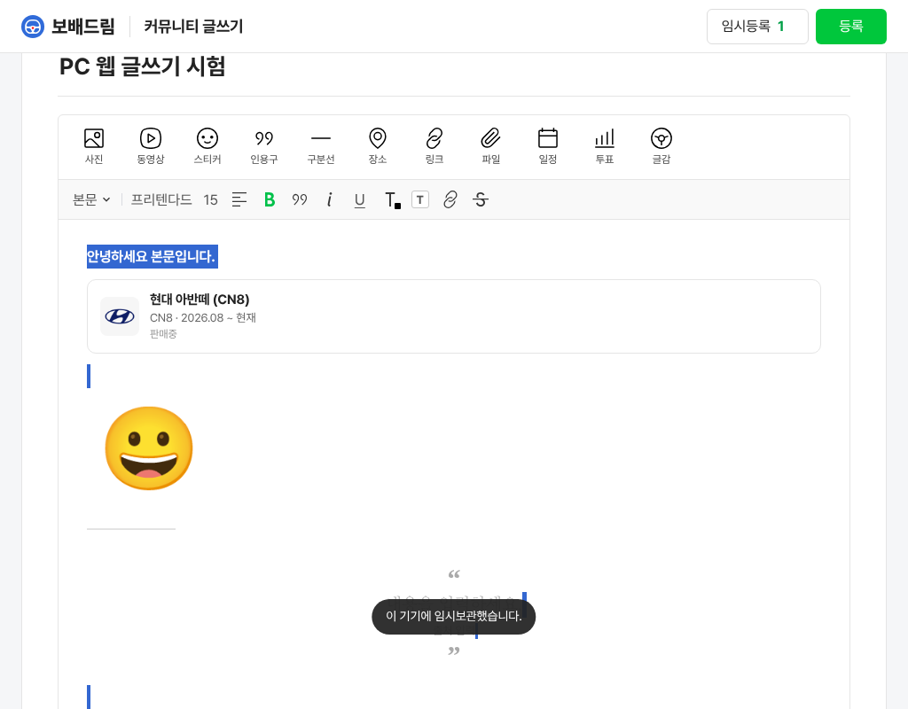

# 커뮤니티 글쓰기 · 네이버 카페 PC 웹형

① 한 줄 요약: 네이버 카페 PC 글쓰기 배치(머리 띠 · 가운데 본문 칸 · 오른쪽 설정 칸)를 넉스트로 새로 만들었고, 기본 글꼴 이름을 「프리텐다드」로 바꿨다.

② 과제 ID 없음 · 브랜치 `community-write-naver-pc` · 커밋 e51b13c5 · PR https://github.com/bobaekimboae/bobaedream/pull/1174 · 상태 푸시(병합 · 배포 대기)

③ 한 일
- `components/write/naver/NaverPcWrite.vue` · `assets/css/write/naver-pc.css`를 새로 만들었다.
- 주소: `?style=naver-pc`. `?style=naver`도 화면 폭이 1024 이상이면 PC 웹형으로 열린다. `&m=1`을 붙이면 앱형, `&pc=1`을 붙이면 PC 웹형으로 고정된다.
- 머리 띠 60: 로고 · 「커뮤니티 글쓰기」 · 임시등록 N · 초록 등록.
- 본문 칸 860: 게시판 펼침 목록(검색 포함) · 글 종류 · 제목 · 편집기 · 태그 알약.
  - 콘텐츠 도구 11개: 사진 · 동영상 · 스티커 · 인용구 · 구분선 · 장소 · 링크 · 파일 · 일정 · 투표 · 글감.
  - 서식 줄은 앱형과 같은 12항목이고, 스크롤해도 머리 띠 아래에 붙어 있다.
- 설정 칸 300: 공지 · 공개 설정(라디오) · 검색 허용 · 댓글 · 스크랩 · 복사 · 본문 숨기기 · 사진 크기. 화면 폭 1100 이하에서는 본문 아래로 내려간다.
- 장소 · 일정 · 글감 · 투표 · 글 종류는 앱형 화면을 가운데 창(폭 480)으로 띄운다. 기능은 앱형과 같은 상태 · 등록 로직을 쓴다.
- 서식 줄의 기본 글꼴 이름을 「기본서체」에서 「프리텐다드」로 바꿨다. 모든 글쓰기 모양에 같이 적용된다.

④ 원본과 비교: PC 원본 화면은 오늘 열지 못했다(브라우저 도구가 cafe.naver.com을 막음). 그래서 나란히 대조하지 않고 우리 화면만 찍었다.
     

| 비교 | 이전 PC(`naver-web` 넉스트) | 이번 PC 웹형 |
|---|---|---|
| 기능 점수(10-15 기준 30항목, 글꼴은 프리텐다드로 정해 제외) | 68점 | 85점 |
| 0점 항목 | 글감 · 파일 · 장소 · 배경색 · 공개 범위 · 스크랩 · 복사 | 없음 |

⑤ 검증
- `pnpm typecheck` 통과, `pnpm test` 58/58, `pnpm generate` 성공.
- PC 웹형 동작 시험 25/25 통과(1440·1024). 시험한 동작:
  - 게시판 검색 · 고르기, 스티커, 구분선, 인용구
  - 일정 · 장소 · 글감 · 투표 창 열고 닫기, 글감 카드, 링크 창
  - 태그 2개, 공개 범위, 스크랩 끄기, 서식 12개 · 굵게
  - 임시보관 건수 1, 가로 넘침 없음
  - 폭 384 · `&m=1`은 앱형으로 열림
- 치지직형 회귀 51/51, 네이버 앱형 9/9, 콘솔 오류 0.

⑥ 원본과 다르게 남긴 것
- 말머리 대신 글 종류.
- 스티커는 이모지.
- 글감은 차량, 장소는 매매단지.
- 하단 취소 버튼은 없다. 로고를 누르면 나가기 창이 뜬다.
- 상세설정을 접지 않고 다 보인다.

⑦ 못 한 것 · 다음
- PC 원본 재실측(사용자가 Chrome에서 cafe.naver.com 접근을 허용해야 한다).
- 사진 편집(회전 · 비율 · 필터)과 양쪽 정렬은 아직 앱형 수준이다.

⑧ 확인 링크(배포 후): PC `nuxt-community/#/write?style=naver` (넓은 화면) 또는 `#/write?style=naver-pc`, 모바일 `#/write?style=naver&m=1`.
