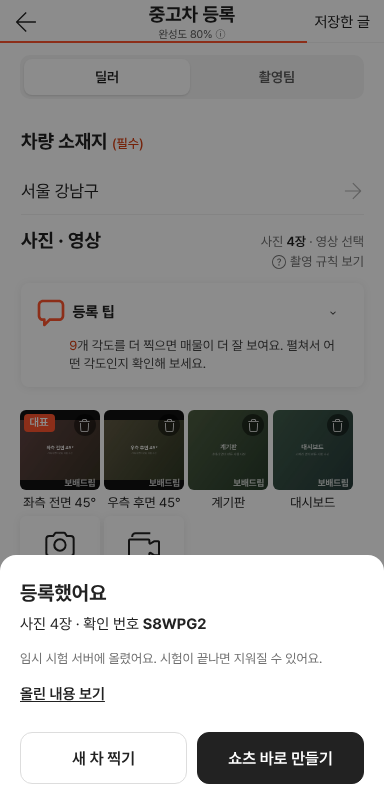
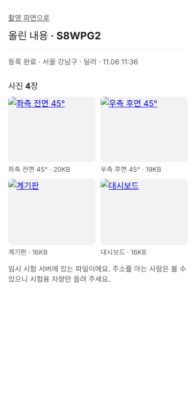

# 촬영 키트 → 보배드림 시험 서버 연결

① 한 줄 요약: 촬영 키트가 찍은 사진·영상을 보배드림 시험 서버(121.78.125.73, Laravel 12 · PostgreSQL 15)에 올려 확인할 수 있게 서버 직접 업로드 모드와 설치 스크립트를 만들었다. 서버 설치는 개발자가 명령 한 줄로 한다.

② 과제 ID 없음 · 브랜치 `shootkit-server-direct` · 커밋 7166ce22 · PR https://github.com/bobaekimboae/bobaedream/pull/1176 · 상태 병합 · 배포 완료(main 7141d52, v=7141d52). 배포본 촬영 키트(PR #1177로 배포본 갱신)에서 실제 서버로 사진 2장 올리기 → 「등록했어요 · 확인 번호 2DAA2M」 → 보기 화면에서 서버 사진 2장 표시 확인. 서버 health: store db · upload direct · storage true(개발자가 설치 완료)

③ 한 일
- 서버(`shootkit-api`): 파일을 서버 디스크에 받는 `SHOOT_UPLOAD=direct` 모드. `PUT /api/shoots/{id}/files/{photo|video}/{이름}`으로 본체를 받아 `storage/app/public/shoots/…`에 두고 `/storage/…`로 공개한다. 경로·형식·크기·개수 검사는 예전 Blob 허가표와 같다. DB 모드에 빠져 있던 파일 기록(`addFile`)을 넣었고, `artisan`이 없어 추가했다. CORS에 PUT 허용.
- 설치: `deploy/server-setup.sh`(저장소 받기 → composer → DB `shoot_api` 만들기 → `.env` → migrate · storage:link → PHP 업로드 한도 320MB → nginx → sslip.io 도메인에 Let's Encrypt https). 다시 실행해도 안전하고 `update`로 갱신.
- 화면(`nuxt-shootkit/lib/upload.ts`): 서버가 `upload: direct`를 돌려주면 XHR PUT으로 올리며 진행률을 보인다. 기본 서버 주소 `https://121-78-125-73.sslip.io`(카메라·깃허브 페이지가 https라 서버도 https여야 함).

④ 원본과 비교: 해당 없음(서버 연결 작업). 로컬 확인 캡처:  

⑤ 검증
- 로컬 PostgreSQL + PHP 8.3 서버로 전 과정: 촬영 만들기 → 사진·3MB 영상 PUT → 잘못된 형식 거절 → 등록 확인 → 보기 → 등록 뒤 추가 업로드 거절 → OPTIONS에 PUT 허용. 모두 기대대로.
- 폰 화면(가짜 카메라)으로 사진 4장 → 소재지 → 등록하기 → 「등록했어요 · 확인 번호」, 보기 화면에 4장 표시. 콘솔 오류 0.
- `nuxt typecheck` 통과. 실제 서버(121.78.125.73)는 이 작업 환경에서 접속이 막혀 있고 비밀번호 로그인은 하지 않아 직접 설치하지 못했다.

⑥ 원본과 다르게 남긴 것: Vercel Blob 판(`SHOOT_UPLOAD=blob`)은 그대로 두고 모드로 나눴다.

⑦ 못 한 것 · 다음: 서버 설치 실행(개발자) → 깃허브 페이지 배포 후 폰으로 실촬영 확인. 로그인 없이 누구나 올릴 수 있는 시험용이므로 시험 차량만 올린다. 접속 정보가 채팅에 올라왔으니 root 비밀번호는 바꾸는 것이 좋다.

⑧ 확인 링크(배포 후): 촬영 `https://bobaekimboae.github.io/bobaedream/nuxt-shootkit/`, 서버 상태 `https://121-78-125-73.sslip.io/api/health`, 올린 내용 `…/nuxt-shootkit/?shoot=<번호>`
