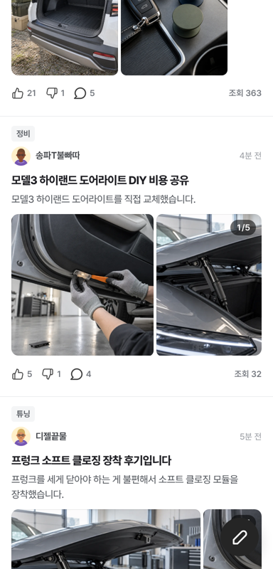
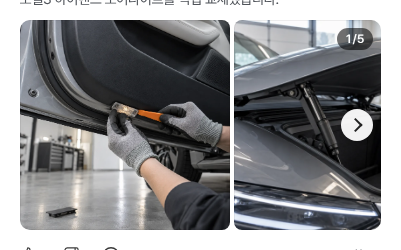
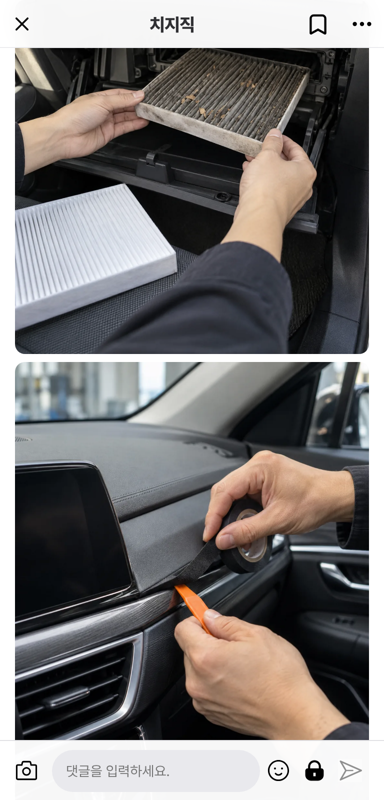

# PR #639 네이버 토론 피드 사진 개선

① 한 줄 요약: 토론 피드 사진을 원본 비율로 보여 주고, 1/N·PC 화살표·휠을 넣고, 상세에서 피드와 같은 사진이 나오게 했다.

② 과제 ID 없음 · 브랜치 `claude-consult/naver-discussion-media-1016` · PR https://github.com/bobaekimboae/bobaedream/pull/639 · 상태: 푸시 완료, 병합·배포 전(승인 대기)

③ 한 일
- 사진 칸 높이(184~210)는 그대로, 폭 = 높이 × 실제 사진 비율(9:16~16:9 안). 예전 임의 비율 표(`mediaLayouts`)는 삭제.
- 여러 장이면 오른쪽 위 `1/N`(다 보이면 숨김). 사진 사이 간격 8 → 4, 칸 뒤 회색 바탕 제거.
- PC(마우스): 올리면 좌우 32px 화살표, 트랙패드 가로 밀기로 한 장씩. 세로 휠은 페이지 스크롤.
- 상세: `from=discussion`으로 열면 피드와 같은 사진 전부를 원본 비율로 세로로 쌓고, 누른 사진(`&photo=N`)으로 이동.
- 공용 자료 `public/community/discussion-media.js`(관련 사진 표·비율·영상).

④ 원본과 비교: 네이버 원본 대조 캡처 없음(사진 비율·동작 기능 수정).

⑤ 검증(로컬 정적 서버): 모바일 384 터치 스와이프 이동·상세 안 열림, 탭 시 상세 `photo=3`, PC 1280 화살표·가로 휠·세로 휠 정상, 콘솔 오류·404 0. `npm run verify:qf`는 프로토타입 소스(`src/`)를 바꾸지 않아 돌리지 않음.

⑥ 원본과 다르게 남긴 것: Embla 관성 넘기기(`dragFree`)는 최근 결정이라 유지(한 장씩 멈춤 아님).

⑦ 다음에 할 것: 한 장씩 멈춤(snap) 여부 결정, 글쓰기에서 올린 사진(로컬)은 불러온 뒤 비율을 재서 맞춤 — 실제 업로드로는 아직 확인 못 함.

⑧ 확인 링크(배포 후): `community/naver-cafe-list.html?view=naver-discussion`

  
