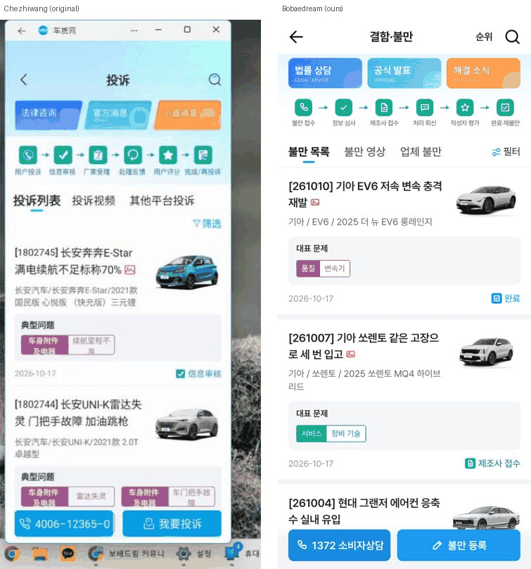
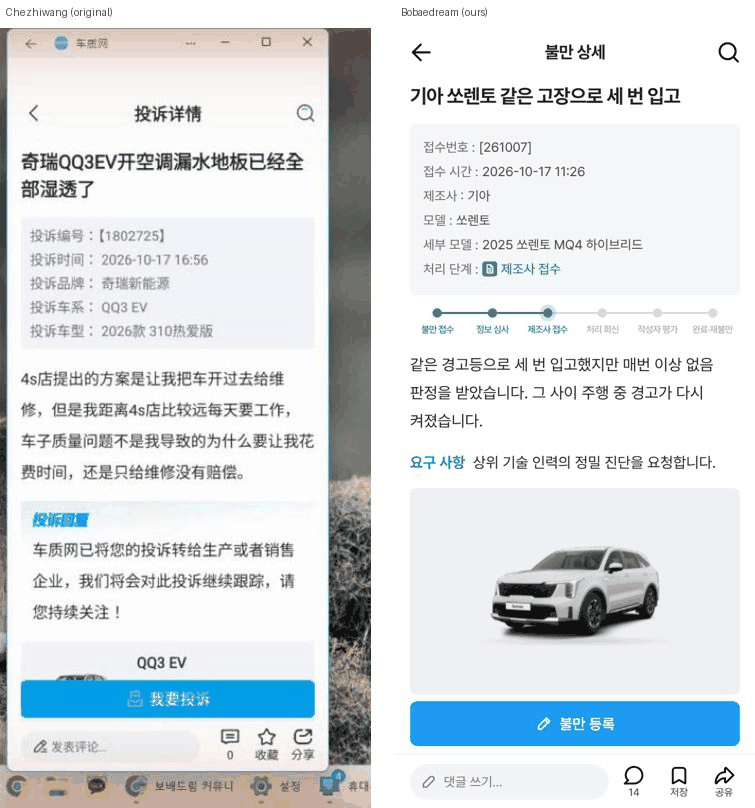
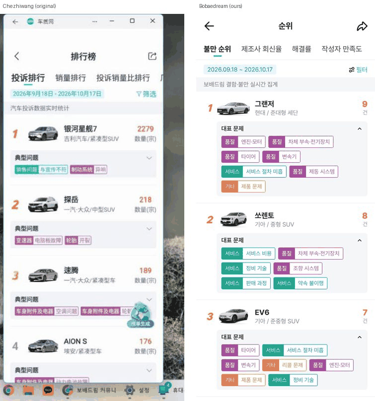
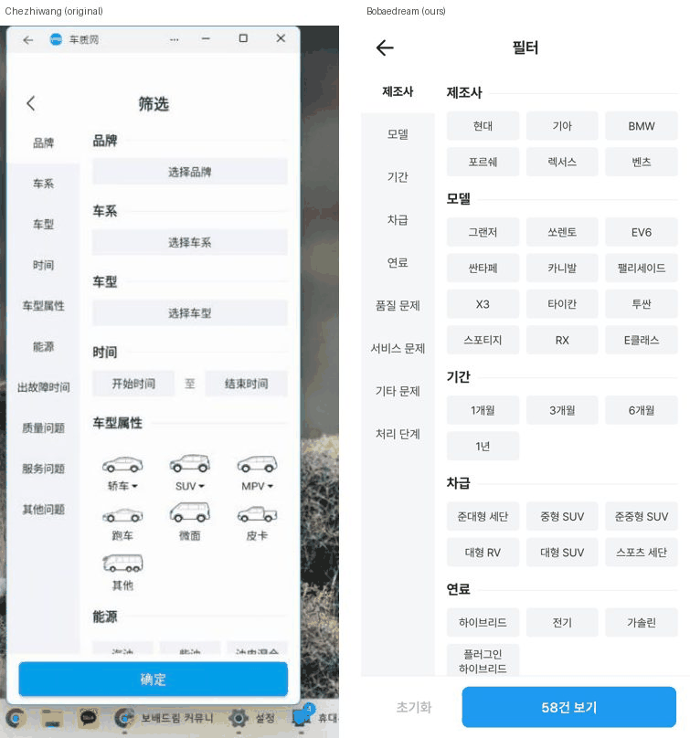
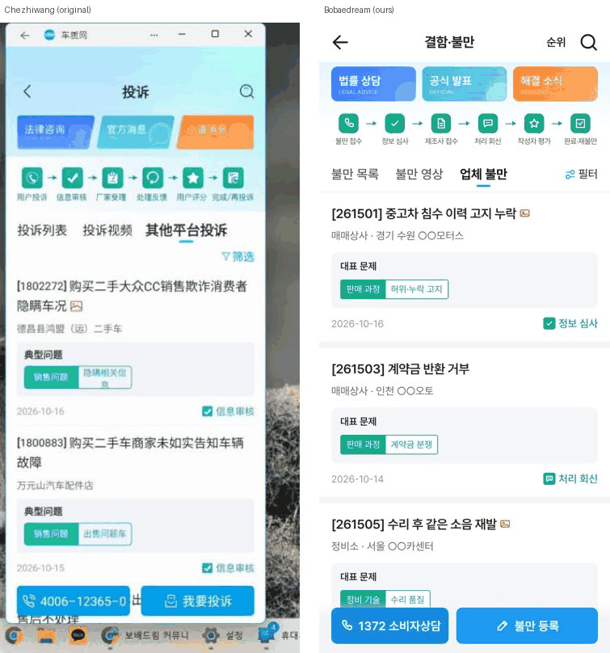
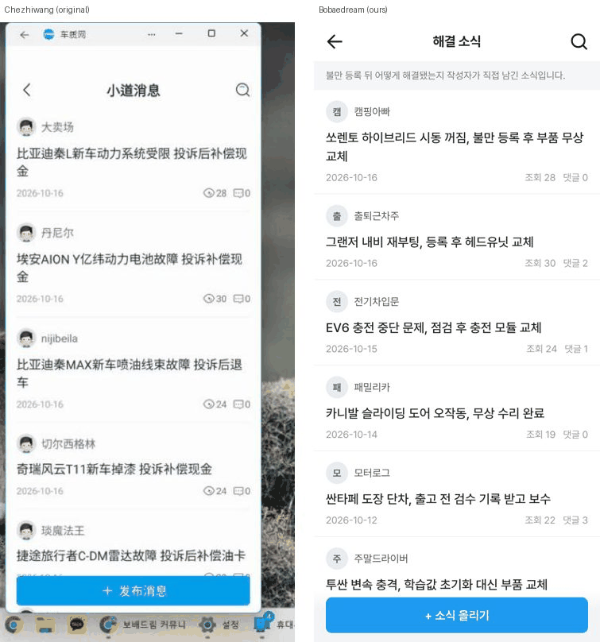

# PR #729 처즈왕 결함·불만 게시판 보강 (앱 전수 캡처 기준)

## ① 한 줄 요약
휴대폰 미러로 처즈왕(车质网) 앱 29개 화면을 직접 캡처해, 결함·불만 게시판에 빠져 있던 처리 단계·순위·필터·검색·해결 소식 화면을 한국형으로 추가했다.

## ② 과제 정보
- 과제 ID: 없음(사용자 직접 지시, 2026-10-17)
- 브랜치: `claude-consult/chezhiwang-1017`
- PR: https://github.com/bobaekimboae/bobaedream/pull/729
- 상태: 병합·배포(배포 v값은 채팅 보고 참고)
- 함께 들어간 과제: 없음

## ③ 한 일
- 목록: 상단에 법률 상담·공식 발표·해결 소식 진입 카드와 6단계 처리 흐름(불만 접수 → 정보 심사 → 제조사 접수 → 처리 회신 → 작성자 평가 → 완료·재불만)을 넣었다. 탭은 불만 목록·불만 영상·업체 불만이고, 필터 버튼과 적용된 조건 칩을 붙였다.
- 카드: [접수번호] 제목, 사진·영상 첨부 아이콘, 차량 이미지(오른쪽), 제조사/모델/세부 모델 줄, 대표 문제 칩(품질 보라·서비스 초록·기타 주황), 날짜와 처리 단계 배지를 표시한다.
- 상세: 접수 정보 상자, 처리 단계 추적 바, 본문과 요구 사항, 불만 회신(작성자 평가 별점 포함), 차량 카드, 해결 소식, 관련 불만, 최신 댓글(빈 상태 포함)을 넣었다. 하단에는 불만 등록 버튼과 댓글·저장·공유 줄을 고정했다.
- 순위: 불만 순위(모델별 건수·대표 문제 펼침), 제조사 회신율, 해결률, 작성자 만족도(별점) 4개 탭을 만들었다. 같은 값은 같은 순위로 표시한다.
- 필터: 왼쪽 메뉴(제조사·모델·기간·차급·연료·품질/서비스/기타 문제·처리 단계)와 오른쪽 칩 영역, 초기화(선택 없으면 회색)와 `N건 보기` 버튼을 만들었다.
- 검색(기록·많이 찾는 검색어), 해결 소식 목록·상세, 공식 발표, 법률 상담(제휴 준비 중 안내, 1372 소비자상담센터·자동차리콜센터), 내 불만(빈 상태)을 추가했다.
- 불만 등록(작성) 화면은 기존 흐름을 그대로 쓴다.

## ④ 원본과 비교
| 화면 | 원본(처즈왕) | 우리 |
|---|---|---|
| 목록 | 진입 카드 3개·6단계 흐름·탭 3개·필터·카드 | 같은 구조로 반영 |
| 상세 | 접수 정보·회신·차량 카드·小道消息·관련 불만·댓글 | 같은 구조 + 처리 단계 추적 바·차량·발생 정보 |
| 순위 | 투소/판매량/비율/회신율/철회율/만족도 | 불만 순위·회신율·해결률·만족도(판매량 자료가 없어 비율·철회율 제외) |
| 필터 | 왼쪽 메뉴 + 칩 | 같은 구조, 처리 단계 추가 |

## ⑤ 검증
- Playwright 384px로 17개 화면(목록·상세·순위 3탭·필터·검색·해결 소식·영상·업체 불만·법률·공식·내 불만·작성·업체 상세·필터 적용)을 열어 봤다. 콘솔 오류 0건, 깨진 이미지 0건, 가로 넘침 없음.
- 동작 확인: 필터에서 기아 → 24건, 완료 추가 → 7건, 적용 후 목록 7건과 조건 칩 2개. 댓글 등록, 검색(EV6 7건)과 검색 기록 저장도 확인했다.
- 이번 작업은 정적 커뮤니티 페이지(`public/community`)라 `verify:qf`·`measure:qf` 대상이 아니다.

## ⑥ 원본과 다르게 남긴 것과 이유
- 핫라인: 원본 `4006-12365`는 한국 상황에 맞게 `1372 소비자상담`으로 바꿨다.
- 판매량 기반 순위(불만/판매 비율)와 철회율: 판매량·철회 자료가 없어 넣지 않았다.
- 법률 상담: 실제 변호사 정보를 넣지 않고 "제휴 준비 중"으로 두었다.
- 업체 불만의 업체명은 `○○모터스`처럼 가린 가상 이름이다. 모든 글·회신·작성자는 UI 검증용 가상 데이터다.

## ⑦ 못 한 것·다음에 할 것
- 해결 소식 작성 화면(지금은 안내 문구만 표시).
- 불만 영상의 실제 영상 재생(지금은 포스터와 재생 표시).
- 차량 가격대(원본 厂商指导价)는 근거 자료가 없어 넣지 않았다.

## ⑧ 확인 링크
- 목록: https://bobaekimboae.github.io/bobaedream/community/naver-cafe-list.html?board=chezhiwang-complaint
- 순위: `&czw=rank` / 필터: `&czw=filter` / 검색: `&czw=search` / 해결 소식: `&czw=news`
